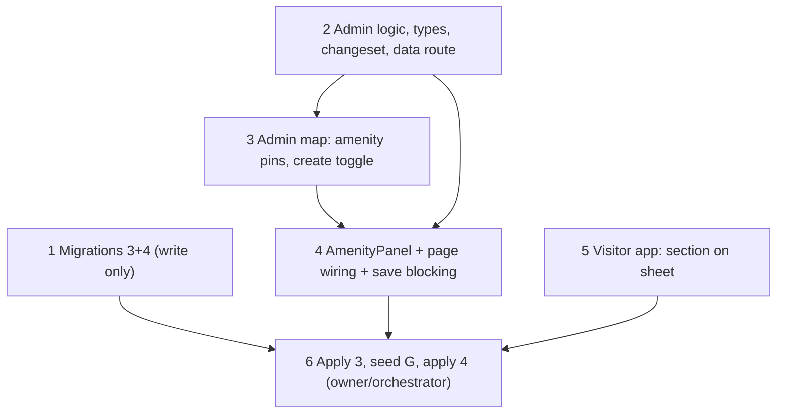

# Amenity management in the dev-only `/admin` tool (+ amenity section)

**Milestone**: n/a (personal project, no Jira)
**Status**: IMPLEMENTED (2026-11-10)
**Extends**: `docs/specs/exhibit-admin-tool.md` (read it first; same architecture: staged edits, one transactional Save via `admin_apply_changes`, dev-only guard, client-generated UUIDs, partial updates).

---

## Context

`amenities` (washroom | ticketing | food | gate | leisure) can only be edited via the Supabase dashboard. This adds amenity CRUD to `/admin` and gives every amenity a **section** so it can be referred to as "Washroom A". Visitors see the section letter on the amenity sheet.

Live data today: 2 amenities (Living Canopy Walk, Main Washroom), both inside section **G**, no photos.

---

## Decisions (resolved with owner)

1. **Scope: full CRUD, minimal.** Draggable amenity pins on the same admin map, click-to-create, edit name/type/description, delete. Everything staged, written on the existing Save.
2. **Photos out of scope.** `amenities.photos` (TEXT[]) is never touched by the admin; the RPC's partial-update semantics preserve it. Visitor UI ignores the URLs today.
3. **Same RPC, one transaction.** New migration `CREATE OR REPLACE`s `admin_apply_changes` adding a top-level `amenities` block. One Save stays atomic across sections / exhibits / audio / photos / amenities.
4. **Amenity belongs to a section (like exhibits).** `amenities.section` FK → `sections.id` `ON UPDATE CASCADE`. **Section letter only — no number** (no per-type numbering, no unique constraint; two washrooms in one section are told apart by name). Pins must sit inside a section: dropping outside every section snaps back (same `sectionAt` rule; first polygon wins). Section changes only by dragging. A section with amenities cannot be deleted; reshaping must not strand an amenity.
5. **Rollout mirrors exhibits.** Migration 3: nullable `amenities.section` + RPC v2. Seed: assign the 2 existing amenities to **G** (point-in-polygon). Migration 4: `section SET NOT NULL`. Admin refuses to save an unplaced amenity (like exhibits). Visitor app change must not deploy before migration 4 is applied.
6. **Visitor: sheet only.** `AmenitySheet` shows the letter next to the type ("Washroom · Section A"). Map chips and search unchanged. `CachedAmenity.section: string`; precache selects `section`; bump the persist version in `lib/store.ts`.
7. **Admin UI.** Amenity pins are a different shape/colour from exhibit pins (square, visitor amenity colour), separate layer, labelled `WC · G`-style (short type tag + section). Selecting one opens the same side panel with a single Details view: name, type select, description, section (read-only), **Delete** button (no Audio/Photos tabs). The click-to-create form gets an **Exhibit | Amenity** toggle (amenity needs name + type). Delete is staged: pin shown faded/struck until Save; Discard restores. No confirm dialog. No separate "amenities mode".

---

## `admin_apply_changes` amenities block (contract)

```
"amenities": {
  "upsert": [ { "id": "<uuid>",           -- REQUIRED, client-generated; not in table => insert
                "name": "...",             -- required on insert
                "type": "washroom|ticketing|food|gate|leisure",   -- required on insert
                "description": "..."|null,
                "gps_lat": 17.38, "gps_lng": 78.19,               -- required on insert
                "section": "G" } ],        -- existing row: PARTIAL update, only keys present are written
  "delete": [ "<uuid>" ]
}
```
Order inside the function: after exhibits (step 3) and before section deletes (step 6). `photos` is never written. Existing keys/behaviour unchanged; `amenities` optional (omitted = nothing). Returns the existing `{ exhibits_created }` shape unchanged.

---

## Implementation Plan

1. **Migrations (write only, do not apply)** — `supabase/migrations/<ts>_amenity_section.sql` (nullable `amenities.section` FK + `CREATE OR REPLACE FUNCTION admin_apply_changes` = the current body from `20261110000100_sections.sql` **plus** the amenities block; keep grants: service_role only) and `<ts>_amenity_section_not_null.sql` (`SET NOT NULL`). Timestamps after `20261110000200`. Dry-run the SQL on a throwaway local postgres if available (step 1 of the exhibit tool did this).
2. **Admin logic + data route** — `lib/admin/types.ts`: `AdminAmenity { id, name, type, description, gps_lat, gps_lng, section: string | null }`, `AdminState.amenities`, `WorkingState` accordingly, `Changeset.amenities { upsert, delete }`. `changeset.ts`: diff + summary ("1 amenity moved, 1 amenity added, 1 deleted"); new rows = full row, existing = `{id}` + changed keys (section sent whenever gps/section changes); rename-only amenities omitted (ON UPDATE CASCADE). `lib/admin/pins.ts`: `moveAmenityPin` (sectionAt → patch | snap-back), `newAmenity`. `lib/admin/validation.ts`: unplaced-amenity blocker message. `lib/admin/working.ts`: replace/delete/add helpers. `GET /api/admin/data` returns `amenities`. TDD; no React.
3. **Admin map** — `AdminMap` amenity pin layer (distinct style, draggable, selectable via a combined selection `{kind:'exhibit'|'amenity', id}` or an added `selectedAmenityId`/`onSelectAmenity` prop — pick the smallest change that keeps the exhibit API working), delete-section block and reshape-strand check extended to amenities, create form gains Exhibit | Amenity toggle, staged-delete visual.
4. **Panel + page wiring** — `components/admin/AmenityPanel.tsx` (controlled; Details only; Delete), wire into `app/admin/page.tsx` (working state, selection, save blocked while any amenity unplaced or panel invalid, unplaced message lists names).
5. **Visitor app** — `lib/types.ts` `CachedAmenity.section`, `lib/precache.ts` select + map, `lib/store.ts` persist version bump + migration clearing cached datasets, `components/amenity/AmenitySheet.tsx` shows "· Section X", unit tests + e2e fixtures (amenity rows carry `section`).
6. **Orchestrator (not an agent)** — after merge: owner applies migration 3; seed 2 amenities → G; owner applies migration 4; then visitor change may deploy.

---

## Task Graph



1, 2 and 5 run in parallel (disjoint files).

---

## Acceptance Criteria

- [ ] Amenity pins draggable on `/admin`; drop into another section changes `section`; drop outside every section snaps back; position and section staged until Save.
- [ ] Click inside a section → form with Exhibit | Amenity toggle; creating an amenity yields a staged row with client UUID, section from `sectionAt`.
- [ ] Panel edits name/type/description; type limited to the 5 allowed; delete is staged and Discard restores it.
- [ ] Section delete blocked if it holds an amenity; reshape rejected if it would strand an amenity.
- [ ] Save sends `amenities` through `admin_apply_changes` atomically with everything else; any failure leaves the DB unchanged; `photos` untouched.
- [ ] After migration 4 `amenities.section` is NOT NULL and the tool refuses to save an unplaced amenity.
- [ ] Visitor `AmenitySheet` shows the section letter; map chips/search unchanged; persisted cache cleared via version bump.

## Testing

Unit (vitest) for changeset, pins, validation, working helpers, store migration, precache mapping. Update Supabase-mocked e2e fixtures. Admin UI verified manually in a browser; DB writes only via the orchestrator. Known baseline: 8 mobile-chrome e2e failures on main; don't remove WebKit `test.skip`s.

## Open Questions

- [ ] None blocking. Docs update (`docs/tech-architecture.md`, `docs/decisions.md`) batched with the exhibit-tool docs update.
