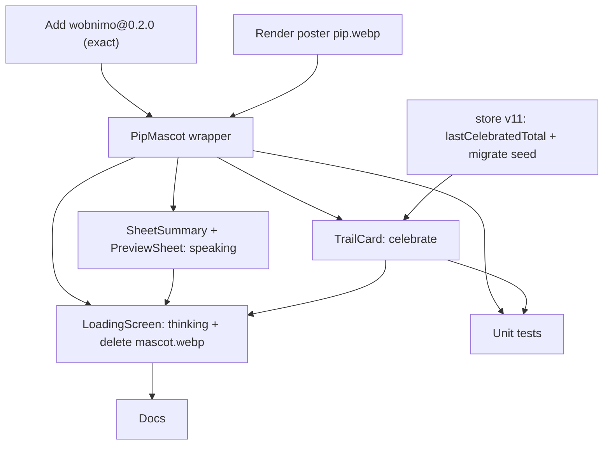

# Animated Pip mascot (wobnimo)

**GitHub**: TBD (issue not created yet — see Open Questions)
**Milestone**: TBD
**Status**: IMPLEMENTED (2026-11-20, app `main` @ `3a9a43d`); extended by [pip-mascot-bigger.md](pip-mascot-bigger.md)

---

## Context

The park mascot is a static squirrel image, `public/mascot.webp`, used as a decorative corner image in two places: `SheetSummary` (62×72, `components/common/SheetSummary.tsx:89`) and `TrailCard` (48×56, `components/exhibit/TrailCard.tsx:208`). `LoadingScreen` has no mascot, only a leaf logo tile.

This story replaces the squirrel with **Pip**, the built-in songbird chick from [wobnimo](https://github.com/Pouryaak/wobnimo) (MIT, ~25 KB, WebGL2, 10 expressive states), and drives its state from app events:

| Spot | State |
|---|---|
| `SheetSummary` in `PreviewSheet` | `speaking` while audio plays, else `idle` |
| `SheetSummary` in `AmenitySheet` | `idle` (no audio) |
| `TrailCard` | `idle`; `celebrating` ~3s when the discovered total rose since the card last celebrated |
| `LoadingScreen` | `thinking`; Pip replaces the leaf logo tile |

Before: static squirrel in two corners, leaf tile on loading.
After: live Pip in all three, reacting to audio / discovery / loading.

Out of scope: a custom squirrel wobnimo character (rejected — Pip chosen for now), `CardReveal` / milestone celebration (`MilestoneCelebration` untouched), any new mascot placements, recoloring (`setPalette`).

---

## Architecture Decisions

### Use built-in `pip`, default palette

**Decision**: Import `pip` from `wobnimo/characters/pip`; no `setPalette`.

**Why**: wobnimo's skill can build a custom squirrel, but the result would be a stylized primitive squirrel, not the current illustration, and costs more effort. Pip's default orange accent (`#e8892a`) already sits near `ex-orange`. Recoloring would force the poster to be rendered with the same palette (a second thing to keep in sync).

**Consequences**: The squirrel identity is retired. Revisit palette if Pip clashes with the cream background in the visual check.

### One `<PipMascot state size />` wrapper with a poster fallback

**Decision**: New `components/common/PipMascot.tsx`. Dynamically imports wobnimo with `next/dynamic` (`ssr: false`). Renders a static poster `` until the canvas fires `ready`, and keeps the poster when WebGL2 is unavailable or `prefers-reduced-motion` is set. Always `aria-hidden` (decorative, same as today).

**Why**: wobnimo needs the client and WebGL2, and WebGL2 is off on some locked-down devices (wobnimo's architecture doc says so). The poster covers SSR first paint, no-WebGL2, reduced-motion, and the chunk-load gap on the loading screen. A single wrapper means all three call sites share the fallback logic and nothing wobnimo-specific leaks into them.

**Alternatives considered**: Keep the squirrel `mascot.webp` as fallback — rejected: flashes the wrong character on swap. No poster, render nothing until ready — rejected: pop-in and layout shift unless the box is reserved.

**Consequences**: `mascot.webp` is deleted. Wrapper reserves its `size` box so there is no layout shift.

### Shared WebGL context — no per-spot cost concern

**Decision**: No special pooling. Mount a `PipMascot` per call site.

**Why**: wobnimo shares one WebGL2 context across all mascots on a page and drives them from one `requestAnimationFrame`, so `TrailCard` + `SheetSummary` on the same screen is fine.

### Offline: no service-worker change

**Decision**: None needed.

**Why**: Serwist precaches the `_next/static` chunks (including the dynamic wobnimo chunk) via `__SW_MANIFEST`, and `next.config.ts` precaches every file in `public/` (`additionalPrecacheEntries`), so the poster is included automatically. Meets "Offline after initial load" with no `app/sw.ts` edit.

### `speaking` driven by `PreviewSheet.isPlaying` via a prop

**Decision**: `SheetSummary` gets an optional `mascotState?: 'idle' | 'speaking'` prop (default `idle`). `PreviewSheet` passes `isPlaying ? 'speaking' : 'idle'`. `AmenitySheet` passes nothing.

**Why**: `isPlaying` is local state in `PreviewSheet.tsx:73` and `SheetSummary` is its direct child (line 383), so a prop is the least plumbing. No store field needed.

### `TrailCard` celebrate trigger: persisted `lastCelebratedTotal`

**Decision**: Add `lastCelebratedTotal: number` (+ setter) to the persisted store in `lib/store.ts`. On `TrailCard` mount, if `selectTotalDiscovered` > `lastCelebratedTotal`, set Pip to `celebrating`, then after ~3s back to `idle`, and set `lastCelebratedTotal` to the current total.

**Why**: Discovery usually happens on the map/exhibit page, then the visitor navigates home and `TrailCard` mounts fresh — so an in-session ref comparison would miss the common case. Any increase celebrates (a small reward per new exhibit); milestones already have their own overlay (`CardReveal`), so `getCrossedMilestone` is not used here.

**Alternatives considered**: Celebrate only on milestone crossing — rejected: rarer, and needs the same stored previous total anyway. In-session-only — rejected: misses the common navigation path.

**Consequences**: Store version bump 10 → 11 with a migrate entry. **The migration must seed `lastCelebratedTotal` to the visitor's current total** — otherwise every existing visitor with discoveries celebrates once on first load after deploy. The seed must run before the existing early returns in `migrate` (`if (version === 9) return state`, etc.), or those branches will skip it.

### `LoadingScreen`: Pip replaces the leaf tile

**Decision**: Replace the 112px leaf logo tile (`w-28 h-28 rounded-3xl` gradient) with `<PipMascot state="thinking" size={112} />` on the bare matcha background. Remove the now-unused `LeafIcon` import.

**Why**: Makes Pip the face of the app on first load. Trade-off accepted: the leaf logo no longer appears on this screen.

**Consequences**: Visual check needed that Pip reads on the matcha gradient without a tile, at 375×667 as well.

---

## Implementation Plan

1. **Dependency** — `npm install wobnimo@0.2.0 --save-exact` in `experium-ai-tour-app/` (pre-1.0, pin exact). Peer dep `react >=18` is satisfied (React 19.1).

2. **Poster** — render a still of Pip (idle) to `public/pip.webp` using wobnimo's still-frame renderer or its `scripts/posters` approach (decide at implementation). Match the aspect ratio of the largest box used (112×112 square). Delete `public/mascot.webp` in step 7, once nothing references it.

3. **`components/common/PipMascot.tsx`** — new `'use client'` component:
   - Props: `state: 'idle' | 'speaking' | 'thinking' | 'celebrating'`, `size: number | { width: number; height: number }`.
   - Dynamic import of the wobnimo React `Mascot` (`wobnimo/react`) + `pip` (`wobnimo/characters/pip`), `ssr: false`.
   - Poster `` at the given size; swap/overlay to the canvas on `ready`. Keep poster if WebGL2 unavailable or `matchMedia('(prefers-reduced-motion: reduce)')` matches.
   - Wrapper `div` reserves `size` so no layout shift.
   - Follow the repo's existing `eslint-disable-next-line @next/next/no-img-element` pattern for the poster ``.

4. **`components/common/SheetSummary.tsx`** — add `mascotState?: 'idle' | 'speaking'` prop; replace the `` (line ~89) with `<PipMascot state={mascotState ?? 'idle'} size={{ width: 62, height: 72 }} />`, keeping the same absolute-position classes. **`components/exhibit/PreviewSheet.tsx`** (~line 383) passes `mascotState={isPlaying ? 'speaking' : 'idle'}`. `AmenitySheet` unchanged.

5. **`lib/store.ts`** — add `lastCelebratedTotal: number` (default `0`) and `setLastCelebratedTotal`; bump `version` to 11; add a migrate step (`if (version < 11)`) that seeds `lastCelebratedTotal` from the existing total (`discoveredByCampaign` default-campaign total, i.e. what `selectTotalDiscovered` returns), placed **before** the early returns. Check how the store partializes/persists so the new field is included.

6. **`components/exhibit/TrailCard.tsx`** — read `selectTotalDiscovered`, `lastCelebratedTotal`, `setLastCelebratedTotal`. Extract the decision as a small pure helper (e.g. `shouldCelebrate(total, lastCelebratedTotal)` in `lib/trail.ts`) so it is unit-testable. On mount: if true, `celebrating` state + `setTimeout(~3s)` back to `idle` + `setLastCelebratedTotal(total)`; clear the timer on unmount. Replace the `` (line ~208) with `<PipMascot state={state} size={{ width: 48, height: 56 }} />`.

7. **`components/onboarding/LoadingScreen.tsx`** — replace the leaf tile `div` with `<PipMascot state="thinking" size={112} />`; keep the `mt-16` spacing; remove the `LeafIcon` import. Delete `public/mascot.webp` (no remaining references — verify with grep).

8. **Docs** — add a Pip mascot decision to `docs/decisions.md` and a short note in `docs/design.md` (mascot = Pip, states and spots). Update the Documentation Index in `CLAUDE.md` with this spec.

9. **Tests** (see Testing) and manual phone check.

---

## Task Graph

---

## Code References

- `components/common/SheetSummary.tsx:89` — current static mascot (62×72), add `mascotState` prop
- `components/exhibit/PreviewSheet.tsx:73,383` — `isPlaying` state and `SheetSummary` mount
- `components/amenity/AmenitySheet.tsx:39` — `SheetSummary` usage with no audio (stays `idle`)
- `components/exhibit/TrailCard.tsx:208` — current static mascot (48×56); mounted from `app/page.tsx:58` and `components/exhibit/SearchOverlay.tsx:155`
- `components/onboarding/LoadingScreen.tsx` — leaf logo tile to replace; `LeafIcon` import to remove
- `lib/store.ts` — persisted store (`name: 'experium-store'`, `version: 10`, `migrate`); `selectTotalDiscovered`
- `lib/trail.ts` — home for the pure `shouldCelebrate` helper
- `app/sw.ts`, `next.config.ts` (`additionalPrecacheEntries`) — why no SW change is needed
- wobnimo docs: `docs/architecture.md` (shared WebGL2 context, reduced-motion, poster/still-frame, WebGL2 absence), `packages/characters/src/pip.ts`

---

## Acceptance Criteria (Technical)

- [ ] `public/mascot.webp` is deleted; nothing references it; `public/pip.webp` exists
- [ ] `PipMascot` shows the poster on first paint, swaps to the live canvas on `ready`, and keeps the poster when WebGL2 is unavailable or `prefers-reduced-motion` is set
- [ ] `PipMascot` stays `aria-hidden` and reserves its box (no layout shift on swap)
- [ ] In `PreviewSheet`, Pip is `speaking` while audio plays and `idle` when paused/ended; in `AmenitySheet` Pip is `idle`
- [ ] `TrailCard` celebrates ~3s when the discovered total exceeds `lastCelebratedTotal`, then returns to `idle` and stores the new value; no celebration on subsequent mounts at the same total
- [ ] Existing visitors do not celebrate on first load after deploy (migrate seeds `lastCelebratedTotal` to their current total)
- [ ] `LoadingScreen` shows Pip in `thinking` in place of the leaf tile; `LeafIcon` import removed
- [ ] Pip works offline after first load (verify in DevTools offline mode: poster and animation both render)
- [ ] `wobnimo` pinned to exact `0.2.0` in `package.json`
- [ ] Existing e2e suite (Chromium + WebKit) stays green

---

## Testing

- **What to test**:
  - `PipMascot`: renders the poster when WebGL2 is unavailable; renders the poster under `prefers-reduced-motion`; forwards the `state` prop to wobnimo's `setState` (wobnimo import mocked).
  - `shouldCelebrate(total, lastCelebratedTotal)` and the `TrailCard` effect: total above stored value requests `celebrating` and updates the stored value; equal total does nothing.
  - Store migration: v10 → v11 seeds `lastCelebratedTotal` from the existing total.
- **Test type**: unit (vitest, `__tests__/`, component tests via the existing `*.test.tsx` setup).
- **Prior art**: `__tests__/trail.test.ts` (pure helpers), `__tests__/amenity-sheet.test.tsx` (component tests).
- **What NOT to test**: the WebGL canvas, animation quality, wobnimo internals. No new Playwright canvas assertions — headless Chromium/WebKit WebGL2 behavior differs and `CLAUDE.md` warns about WebKit flakes; the poster fallback is what CI will most likely exercise, and the existing e2e suite is the regression check.
- **Manual**: real phone — animation quality, Pip on cream (`SheetSummary`/`TrailCard`) and on matcha without a tile (`LoadingScreen`), including 375×667.

---

## Delivery

One PR, commits in order: dependency → wrapper + poster → `PreviewSheet` speaking → `TrailCard` celebrate (+ store migration) → `LoadingScreen` → docs. Each commit leaves the app working.

---

## Open Questions

1. Create a GitHub issue on the project board (`makaravind` account switch) and fill in the **GitHub**/**Milestone** fields above?
2. Poster render method: wobnimo's `scripts/posters` or a still-frame call? Decide at implementation.
3. Does Pip read well on the bare matcha background on `LoadingScreen` without the tile? Verify visually; fall back to a rounded tile behind Pip if not.
