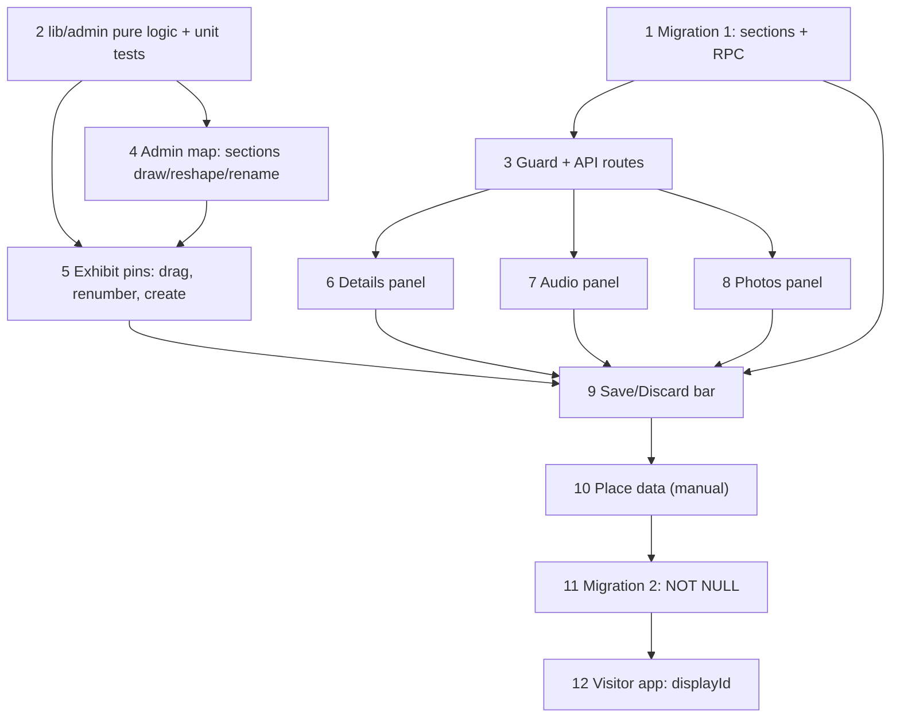

# Exhibit data management tool (dev-only `/admin`) + section-based display IDs

**Milestone**: n/a (personal project, no Jira)
**Status**: IMPLEMENTED (2026-11-10)

---

## Context

Exhibit data lives in Supabase and is edited today through the Supabase dashboard and ad-hoc scripts (`tools/upload-audio.js`, `tools/generate-audio.py`). Park positions were placed with the throwaway `sample-map/marker-placer.html`, and the printed-PDF numbers (1–83) are arbitrary: adding an exhibit shuffles everything.

This work adds:

1. **Sections** — named-by-letter polygons over the park (A, B, C…). Every exhibit belongs to exactly one section and has a per-section `number`. Display ID = `A3`. Numbers fill the lowest free gap in the section.
2. **An admin tool** at `/admin` in `experium-ai-tour-app`, usable only under `next dev`. A MapLibre map (same `park.pmtiles` basemap as the visitor app) where you draw/reshape/rename sections, drag exhibit pins (moving across a section re-numbers it), and edit exhibit fields, audio scripts/files and photos. Edits are staged and written in one batch on **Save**.
3. **Visitor app shows the display ID** (`A3`) on map pins, the preview sheet and in search.

Identity model: `exhibits.code` (SMALLINT, existing) stays the **permanent internal code** used in `/s/{code}` URLs and QR scans — it never changes. `section` + `number` is the **display ID** and may change when an exhibit is physically moved. No QR codes are printed yet (development phase), so no backward-compat is needed.

Out of scope: QR code management (`exhibit_qr_codes`), TTS generation (stays in `tools/generate-audio.py`), deleting exhibits (set `status = coming_soon` instead), auth/production deployment of the tool.

---

## Architecture Decisions

### Dev-only route, service-role server API

**Decision**: `app/admin/**` and `app/api/admin/**` are only served when `process.env.NODE_ENV !== 'production'`; otherwise `notFound()` / 404. All DB and Storage writes go through the existing `getSupabaseAdmin()` (service-role) server-side; the browser never sees the key.
**Why**: Solo dev, one Supabase project (no staging); building auth for a tool used from one laptop is waste. `NODE_ENV` is always `production` on Vercel.
**Alternatives considered**: Magic-link-protected deployed admin (auth flow + RLS allowlist + ships in prod bundle); standalone HTML like the marker-placer (can't share types/client).
**Consequences**: You can only edit from the machine running `npm run dev`. Edits hit the real database, hence the staged Save below.

### Permanent `code` + display `section`/`number`

**Decision**: Migration 1 adds table `sections (id TEXT PK letters-only, polygon JSONB [[lng,lat]…])` and nullable `exhibits.section` (FK → `sections.id`, `ON UPDATE CASCADE`) and `exhibits.number SMALLINT`, with `UNIQUE (section, number) DEFERRABLE INITIALLY DEFERRED`. Migration 2 (after data is placed) sets both `NOT NULL`. `exhibits.code` is untouched.
**Why**: Exhibits move physically between sections; the QR URL must survive that. `ON UPDATE CASCADE` makes renaming a section letter a single-row update. The deferred unique constraint lets one transaction swap/shift numbers without transient conflicts.
**Alternatives considered**: Replace `code` with section+number (breaks QR URLs on every move); keep a single global display number (the shuffling problem we're leaving).
**Consequences**: Two IDs per exhibit, by design. Renaming a section letter changes what visitors see (not URLs) — the tool shows a note before saving it.

### Number assignment: lowest free gap

**Decision**: A new exhibit, or one dragged into another section, gets the lowest positive integer not used in the target section (ignoring itself). The number is also editable by hand; the tool blocks a duplicate within a section.
**Why**: Keeps numbers dense per owner's choice.
**Alternatives considered**: max+1 never reusing gaps (safer for stale references; rejected by owner).
**Consequences**: A freed `A3` can later be a different exhibit — acceptable pre-launch.

### Every exhibit must sit inside a section

**Decision**: Same rule as the marker-placer: section is derived from the polygon the pin lies in (first polygon in list wins on overlap). Dropping a pin outside all sections snaps it back. Reshaping a polygon is rejected if it would leave any of its exhibits outside.
**Why**: The polygon is the single source of truth; section can't drift from position.
**Consequences**: Exhibits already in the DB with `section IS NULL` show as "unplaced" (grey) in the tool, and are auto-assigned (number in `code` order) when a polygon is drawn around them.

### Staged edits, one transactional Save

**Decision**: All edits live in client state; a bar shows a diff ("2 moved, 1 tier changed, 1 section added") with **Save** / **Discard**. Save calls `POST /api/admin/save` with a changeset, which invokes one Postgres function `admin_apply_changes(changes jsonb)` (sections, exhibit rows incl. section/number/gps, `exhibit_audio` script+status+url, `exhibit_photos` rows) in a single transaction.
**Why**: One database, no staging — a stray drag must never go live. A single transaction also makes number swaps safe with the deferred constraint.
**Alternatives considered**: Write-on-every-edit (simple, but a mis-drag is instantly live); many PostgREST calls (not atomic, transient unique violations).
**Consequences**: Needs a SQL function (migration 1). Create-new-exhibit generates `code = max(code)+1` inside that function.

### File uploads are immediate but non-destructive

**Decision**: Audio and photo uploads go to Storage right away under a **new unique object path** (`audio/{code}/{lang}-{timestamp}.mp3`, `images/exhibits/{code}/{uuid}.webp`); the DB row only points at them after Save. Audio: WAV/MP3 → 64 kbps mono MP3 via the local `ffmpeg` (as in `tools/upload-audio.js`). Photos: resized to max 1600 px WebP with `sharp`.
**Why**: Keeps the staged model (nothing visible to visitors before Save) without holding big files in browser memory; unique paths also bust CDN and service-worker caches.
**Consequences**: Discarded uploads leave orphan files in Storage (accepted pre-launch). `sharp` must be added as a devDependency.

### Visitor app: `displayNumber: number` → `displayId: string`

**Decision**: Replace the existing `displayNumber` (currently `exhibits.code`) with `displayId` = `${section}${number}` (e.g. `A3`) from the precache/map queries; lookups and URLs keep using `code`. No fallback for unplaced exhibits — the visitor change ships only after Migration 2.
**Why**: The plumbing already exists (types, store, search, map pin, sheets); only the type and source change. No fallback because the data is fully placed before release.
**Consequences**: Persisted store shape changes → bump the persist version so `cachedExhibits` is cleared and re-fetched (see the v2 migration at `lib/store.ts:167`).

---

## Implementation Plan

1. **Migration 1** (`supabase/migrations/<ts>_sections.sql`): create `sections` (anon `SELECT` RLS like other tables; writes via service role), add nullable `exhibits.section`/`number` + deferred unique, create `admin_apply_changes(jsonb)` (SECURITY DEFINER, `search_path = public`; applies sections upsert/rename/delete, exhibit upserts with `code` generation for new rows, audio and photo rows; raises on any violation so the whole thing rolls back). Apply the way the repo applies migrations (`tools/run-migrations.js`).
2. **Pure logic** in `lib/admin/`: `geometry.ts` (`pointInPolygon`, `sectionAt` — port from `sample-map/marker-placer.html`), `numbering.ts` (`lowestFreeNumber(section, exhibits, excludeId)`), `changeset.ts` (diff of original vs working state → changeset + human summary). Unit-test all three first.
3. **Guard + API** (`lib/admin/guard.ts` returning 404 unless `NODE_ENV !== 'production'`; used by `app/admin/layout.tsx` and every route): `GET /api/admin/data` (sections, exhibits, audio, photos), `POST /api/admin/save`, `POST /api/admin/upload-audio` (multipart → ffmpeg → Storage → returns URL), `POST /api/admin/upload-photo` (multipart → sharp → Storage → returns URL).
4. **Admin map** (`components/admin/AdminMap.tsx`): MapLibre + `pmtiles` protocol using `/park.pmtiles`, mirroring `components/map/ParkMap.tsx` setup but without its GPS/store coupling. Sections as GeoJSON fill/line layers with letter labels; draw mode, reshape mode (vertex handles, reject if an exhibit would be stranded), letter rename, delete (blocked if it has exhibits) — port behaviour from the marker-placer.
5. **Exhibit pins**: draggable markers labelled with display ID (grey if unplaced). Drag → `sectionAt` → new section + `lowestFreeNumber`; outside all sections → snap back. Click inside a section → "new exhibit" form (name, type, tier); `code` shown as "assigned on save".
6. **Details panel**: edit `name`, `type`, `tier`, `status`, `description`, `facts` (JSON list editor with validation), `number`; `code` read-only; `section` read-only (changes only by dragging).
7. **Audio panel** (per language en/hi/te): script textarea, status select (`draft`/`ready`/`published`), `<audio>` preview of current URL, upload/replace button.
8. **Photos panel**: upload, caption, mark hero (exactly one per exhibit), drag to reorder (`sort_order`), delete row.
9. **Save/Discard bar** wired to `changeset.ts`; Save posts the changeset, then reloads data; show the DB error verbatim on failure (nothing is applied).
10. **Place the data (manual, by you)**: draw the sections, assign every existing exhibit, fix numbers, Save.
11. **Migration 2**: `section`/`number` `SET NOT NULL`; admin tool refuses to save an unplaced exhibit from now on.
12. **Visitor app switch** (after 11 is applied): `lib/types.ts` (`displayNumber` → `displayId: string | null`… non-null once typed), `lib/precache.ts` (select `section, number`, build `displayId`), `lib/store.ts` (bump persist version/migration), `lib/map-exhibits.ts`, `lib/search.ts` (case-insensitive prefix match on `a3`), `components/map/ParkMap.tsx` pin label, `components/common/SheetSummary.tsx`, `components/exhibit/PreviewSheet.tsx`, `components/ExhibitPageClient.tsx`, `components/home/DidYouKnow.tsx`, `app/(map)/layout.tsx`. `/s/[code]` and `app/api/scan` stay on `code`.

---

## Task Graph

Steps 1 and 2 run in parallel; 6, 7, 8 run in parallel after 3. Step 12 can be coded earlier on a branch but must not be deployed before 11.

---

## Code References

- `sample-map/marker-placer.html` — working reference for polygon draw, vertex reshape, letter rename, point-in-polygon, legacy import and the "stay inside a section" rules. Port the logic, not the single-file structure.
- `experium-ai-tour-app/components/map/ParkMap.tsx` — MapLibre + `pmtiles` setup against `/park.pmtiles` (line ~436 builds map pins from `displayNumber`).
- `experium-ai-tour-app/lib/supabase-admin.ts` — lazy service-role client; use for every admin route.
- `experium-ai-tour-app/supabase/migrations/20260809000000_initial_schema.sql` — `exhibits`, `exhibit_audio` (`UNIQUE (exhibit_id, language)`), `exhibit_photos`, RLS patterns, `set_updated_at` trigger.
- `experium-ai-tour-app/supabase/migrations/20260926000000_add_exhibit_status.sql`, `20261020120000_exhibits_code_to_number.sql` — latest `exhibits` column changes (`status`, SMALLINT `code`).
- `experium-ai-tour-app/supabase/migrations/20260812052738_storage_audio_rls_policies.sql` — Storage buckets `audio` and `images`.
- `tools/upload-audio.js`, `tools/generate-audio.py` — current ffmpeg conversion (64 kbps mono MP3) and upload convention.
- `experium-ai-tour-app/lib/precache.ts` (~line 80–110) — exhibits query + `displayNumber` mapping; `lib/store.ts:167` persist migration; `lib/search.ts:19` display-number match.
- `experium-ai-tour-app/__tests__/precache.test.ts`, `search.test.ts`, `map-exhibits.test.ts` — prior art for the visitor-side changes.
- `docs/tech-architecture.md` (Admin UI row says "Supabase dashboard, no custom admin in v1") — update after this lands.

---

## Acceptance Criteria (Technical)

- [ ] `/admin` and `/api/admin/*` return 404 when `NODE_ENV === 'production'`; work under `next dev`.
- [ ] Draw a section, reshape it by dragging vertices (rejected if it strands an exhibit), rename its letter, delete it (blocked while it has exhibits); all staged until Save.
- [ ] Dragging an exhibit pin into another section re-assigns `section` and the lowest free `number` there; dropping outside every section snaps it back; `code` never changes.
- [ ] Editing name/type/tier/status/description/facts/number is staged; duplicate `(section, number)` is blocked in the UI and by the DB.
- [ ] Audio: edit script and status per language, preview, upload WAV/MP3 → stored as 64 kbps mono MP3 at a new unique path; visitor-visible URL changes only after Save.
- [ ] Photos: upload (≤1600 px WebP), caption, one hero, reorder, delete; persisted on Save.
- [ ] Save applies everything atomically via `admin_apply_changes`; any failure leaves the DB unchanged and shows the error; Discard restores the loaded state.
- [ ] After Migration 2, `section`/`number` are NOT NULL and the tool cannot save an unplaced exhibit.
- [ ] Visitor app shows `A3`-style IDs on map pins, preview sheet and search (case-insensitive); `/s/{code}` URLs and scan flow are unchanged; stale persisted caches are cleared via the store version bump.

---

## Testing

- **What to test**: Pure logic in `lib/admin/` (point-in-polygon, overlap precedence, `lowestFreeNumber` incl. gap fill and self-exclusion, changeset diff/summary); the guard returns 404 in production and passes in dev; visitor-side `displayId` mapping, search matching and store migration.
- **Test type**: Unit (vitest) for the above. Update existing e2e fixtures (Supabase mocked via `page.route`) to return `section`/`number` so the visitor flows still pass. The admin UI itself is verified manually in the browser (dev-only tool, not run in CI).
- **Prior art**: `__tests__/precache.test.ts`, `__tests__/search.test.ts`, `__tests__/map-exhibits.test.ts`; CI e2e per `.github/workflows/e2e.yml`.
- **What NOT to test**: MapLibre rendering internals, ffmpeg/sharp output bytes, Supabase itself. Don't remove the existing WebKit `test.skip`s. Note the 8 known baseline mobile-chrome e2e failures when comparing results.

---

## Open Questions

- [ ] New exhibit `code` = `max(code) + 1`, generated inside `admin_apply_changes` — assumed; confirm. — owner
- [ ] Add `sharp` as a devDependency (not currently in `package.json`) vs. using `ffmpeg` for image resize. Assumed `sharp`. — owner
- [ ] Deleting exhibits is out of scope (use `status = coming_soon` or the dashboard). OK? — owner
- [ ] Update `docs/tech-architecture.md` (Admin UI row, schema section) and `docs/decisions.md` when this ships. — owner
