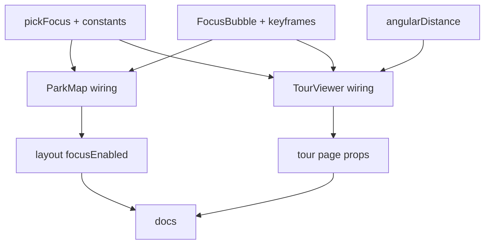

# Exhibit focus bubble (peek while panning) — map + virtual tour

**GitHub**: TBD (create under the current milestone before starting)
**Status**: IMPLEMENTED (2026-11-18, app `main` @ `5c9e299`); device checks open — iOS Safari bubble tap keeps the sheet open, tour entry bubble (PSV `position-updated` on load / node change), pick radii feel
**Design**: Open Design project `71dad1fb-67b1-46ef-8286-29bd197b9d61`, file `map-focus-bubble.html` (anatomy, 3 map frames, 2 tour frames)
**Builds on**: `docs/specs/gh-57-off-screen-peek-chips.md` (`moveend` hook, off-screen chips — unchanged), `docs/specs/gh-58-3d-metal-markers.md` / `docs/specs/marker-drift-zoom-ux.md` (pin visuals + drift), `docs/user-flows/flow-8-virtual-tour.md` (tour pins)

---

## Context

Today a new visitor sees numbered pins on the map and has to *guess* they are tappable. Nothing tells them what an exhibit is until they tap. Off-screen peek chips (gh-57) hint that more exhibits exist, but carry no detail.

This feature auto-expands the pin nearest the view center into a small bubble — thumbnail, name, number, state tag — while the visitor pans. Tapping the bubble opens the exhibit sheet, same as tapping the pin. The same bubble works in the 360° virtual tour, anchored to the pano pin.

**Before**: pan the map / rotate the pano → pins only; detail only after a tap.
**After**: pan → settle → the nearest pin shows a bubble ("Banyan Tree · Not visited") that invites a tap.

**Goal**: more exhibit opens per visit from new visitors. Measured with `peek_tap` + `pin_tap` (below).

No DB changes. None of the critical tables are touched.

---

## Behaviour

| Event | Result |
|---|---|
| Pan / rotate starts | Bubble fades out, 100 ms, immediately non-interactive |
| Camera idle for ~250 ms | Nearest pin to the view center (inside the pick radius) gets the bubble. Scale-in 0.92 → 1, 150 ms, origin = tail. Reduced-motion: plain 150 ms fade |
| Nothing inside the radius | No bubble |
| Next pan | Bubble fades out again. No auto-dismiss otherwise |
| Tap bubble | Opens the exhibit sheet exactly as a pin tap does; fires `peek_tap` |
| A suppressing mode becomes active | Bubble hides. When browsing mode returns, re-pick immediately (the camera did not move, so no settle event will fire) |

**Candidates**: every exhibit with coordinates (map) / every pin at the current node (tour): visited, unvisited and coming-soon alike. Nearest wins; no priority for unvisited.

**Pick radius**: map ~90 px from the screen center; tour ~20° angular distance from the view center. Starting values — tune on a device.

**Suppressed (browsing mode only)**: exhibit sheet open, amenity sheet open, navigation route active, search overlay open. On the tour: `PreviewSheet` open.
(The did-you-know stack lives on the home screen, `app/page.tsx`, not on the map — nothing to suppress.)

### Bubble content

164 px wide card, image on top (100 px tall, full card width), then name (one line, truncates) and a state tag, chevron bottom-right, tail pointing to the pin.

| Pin state | Ring / tag colour | Tag text |
|---|---|---|
| unvisited | `ex-orange` | Not visited |
| visited | `ex-forest` | ✓ Visited |
| coming soon (map only) | `ex-coming-soon` | Coming soon |

Number badge sits on the image's top-left corner (white disc, ring in the state colour). Same colours as the pin (`TINTS` in `components/map/marker-layer.ts`; tour pin colours in `components/tour/TourViewer.tsx`).

**Thumbnail**: `thumbUrl()` (`lib/exhibit-photos.ts`): hero photo → 360° preview → first photo → null. Network-only, not precached. `null` or a load error → forest gradient (`linear-gradient(135deg, ex-forest-light, ex-forest-deep)`), `onError` hides the ``; same pattern as the exhibit sheet header in `components/exhibit/PreviewSheet.tsx`. Only the focused exhibit's image is requested.

---

## Architecture Decisions

### One shared selection function, two distance measures

**Decision**: `pickFocus(candidates, maxDistance)` in a new `lib/focus-pick.ts` takes `{ id, distance }[]` and returns the id of the nearest one within `maxDistance`, or `null`. The map computes pixel distance; the tour computes angular distance.
**Why**: The rule is identical on both surfaces; only the distance differs. A pure function is trivially unit-testable.
**Alternatives considered**: separate pick logic per surface — duplicated rule, two test sets.

### One shared presentational component

**Decision**: `components/map/FocusBubble.tsx` renders the card (props: `displayId`, `name`, `thumb`, `state: 'unvisited' | 'visited' | 'coming_soon'`, `onTap`, `popKey`). Used by both `ParkMap` and `TourViewer`.
**Why**: Two callers, one visual. This clears the "no abstraction for single-use code" bar.

### Map: persistent MapLibre DOM marker + portal, not a canvas layer

**Decision**: One `maplibregl.Marker` (anchor `bottom`) holding an element; React content is portalled into it, same as the amenity chips and the 360° pin in `ParkMap.tsx`. On settle, `setLngLat` + `setOffset([0, -(pinPx/2 + 8)])` where `pinPx = pinPixelHeight(zoom, lat)` (`lib/nearby.ts`).
**Why**: The marker follows the map for free; no per-frame projection math. Pins are 3D disc meshes in a custom layer, so the bubble cannot live in the same scene, and a DOM marker above the canvas needs no Three.js changes.
**Drift**: while dragging, pins drift opposite to the pan (`panDrift`, `marker-layer.ts`). The bubble is hidden during the drag and the drift decays (`DRIFT_DECAY` 0.82) in ~170 ms, before the 250 ms settle, so at show time the pin sits on its coordinate. Active-pin "rise" (`riseOffsetPx`) only applies to the selected pin, which is suppressed anyway.

### Settle = `movestart` / `moveend` + 250 ms timer (map); `position-updated` debounce (tour)

**Decision**: Map: `movestart` hides and cancels the timer; `moveend` starts a 250 ms timer; the timer runs the pick. Tour: every PSV `position-updated` hides and restarts a 250 ms timer; the timer runs the pick.
**Why**: `moveend` already fires after inertia / `flyTo`; the extra 250 ms avoids a flash when a visitor pauses between swipes. `position-updated` fires continuously for drag, inertia and animation in Photo Sphere Viewer, so a debounce is the settle signal.
**Alternatives considered**: live re-pick every frame — a `map.project()` over every pin per frame, flicker while the finger is down.

### Tour: bubble is a PSV marker, tap via `select-marker`

**Decision**: Add one marker (`id: '__focus__'`, `anchor: 'bottom center'`, element = portal host) at the focused pin's position; remove / hide it on pan start. Taps arrive through the existing `select-marker` listener; if `marker.id === '__focus__'`, call `onPeekTap(focusedExhibitId)` instead of `onPinSelect`.
**Why**: PSV already hit-tests marker elements and keeps them out of the pano `click` (which closes the sheet). Reusing `select-marker` avoids a second click path.
**Consequences**: the marker element needs a fixed `size` (164 × ~152). Markers are cleared on every node change (`TourViewer.tsx` `node-changed`), so focus state resets there.

### Bubble tap reuses the pin-tap path; analytics are split

**Decision**: Bubble tap calls the same `onPinTap` / `onPinSelect` handler (`handlePinTap` in `app/(map)/layout.tsx`; `onPinSelect` on the tour page). Events:

- `peek_tap` — bubble tapped
- `pin_tap` — pin tapped directly (new; map **and** tour)
- both carry `{ exhibitId, surface: 'map' | 'tour', visited: boolean }`

`pin_tap` fires from the pin-click handlers (`map.on('click', 'exhibit-pins')`, tour `select-marker` for real pin ids), **not** from `handlePinTap`, otherwise bubble taps would also count as pin taps.
**Existing `map_marker_click`** (`ParkMap.tsx` ~line 675) is left unchanged. On the map a pin tap fires both `map_marker_click` and `pin_tap` — intentional duplicate, flagged in Open Questions.
**No `peek_shown`**: decided out of v1. Conversion therefore can't be computed as taps / shown; compare `peek_tap` to `pin_tap` instead.

### Browsing flag computed in the layout

**Decision**: `app/(map)/layout.tsx` derives `focusEnabled = !mapSelectedExhibit && !isExhibitPage && !activeAmenityId && !searchOpen && !navigationPathCoords` and passes it to `ParkMap`. The tour page passes `focusEnabled={!selectedExhibit}` to `TourViewer`.
**Why**: Every one of those states already lives in the layout (or `useMapStore` for `activeAmenityId`); one boolean prop keeps the components ignorant of modes.

### No flag, no precache change, no new dependencies

**Decision**: Ships on for everyone; no DebugPanel toggle or remote flag. Thumbnails are not added to the precache (images stay network-only).
**Why**: v1, single park. A bad bubble is fixed or reverted by a normal deploy. Revisit thumbnail precache only if on-site testing shows the bubble is often image-less.

---

## Implementation Plan

1. **`lib/focus-pick.ts`** — `pickFocus` (pure). Export `FOCUS_RADIUS_PX = 90`, `FOCUS_RADIUS_DEG = 20`, `FOCUS_SETTLE_MS = 250`.
2. **`lib/tour.ts`** — add `angularDistance(a, b)` (great-circle distance in radians between `{ yaw, pitch }` points: `acos(sin p1 sin p2 + cos p1 cos p2 cos Δyaw)`, clamped to [-1, 1]).
3. **`components/map/FocusBubble.tsx`** — card + tail + tag + thumb fallback, `data-testid="focus-bubble"`. Keyframes (`focus-bubble-pop`, `focus-bubble-fade`, reduced-motion variant) in `app/globals.css`. Hidden state = `opacity: 0; pointer-events: none` with a 100 ms transition.
4. **`ParkMap.tsx`**
   - New prop `focusEnabled: boolean`.
   - `calcFocusCandidates(map, exhibits)` (exported, pure like `calcPeekChips`): for each exhibit with coords, `map.project([lng, lat])`, distance to `(container.clientWidth / 2, container.clientHeight / 2)` — use the container's CSS px, not `getCanvas().width` (device px).
   - State `{ exhibitId: string | null, visible: boolean, popKey: number }`; a persistent `Marker` + portal host like `spotEl` / amenity chips.
   - `map.on('movestart')` → hide, clear timer. In the existing `moveend` handler (beside `setPeekChips`) → start the 250 ms timer → `pickFocus` → show.
   - Effect on `focusEnabled`: false → hide; true → run the pick immediately.
   - Click on the bubble: `stopPropagation` so the map's own `click` handler (which calls `onMapTap` → closes sheet / clears route) does not fire; then `track('peek_tap', …)` and `onPinTapRef.current(exhibit)`.
   - Add `track('pin_tap', …)` next to `map_marker_click` in the `exhibit-pins` click handler.
   - Visited / thumb: read `visitedExhibits` and the matching `CachedExhibit` (for `thumbUrl`) from `useStore` — `MapExhibit` has no `photos`.
5. **`app/(map)/layout.tsx`** — compute `focusEnabled`, pass to `ParkMap`.
6. **`components/tour/TourViewer.tsx`**
   - New props `focusEnabled`, `onPeekTap(exhibitId)`.
   - On `position-updated`: hide, restart timer. On timer: view position `viewer.getPosition()`, candidates = current node pins from `nodeMarkers(...)`, distance = `angularDistance`, `pickFocus(…, degToRad(FOCUS_RADIUS_DEG))`; show via `markers.addMarker` / `updateMarker`.
   - `select-marker`: `__focus__` → `track('peek_tap')` + `onPeekTap`; real pin → `track('pin_tap')` + `onPinSelect`.
   - `node-changed`: reset focus.
   - Effect on `focusEnabled`: same as the map.
7. **`app/tour/page.tsx`** — pass `focusEnabled={!selectedExhibit}` (the sheet-open state it already owns) and `onPeekTap` = the existing pin-select handler.
8. **Docs** — add to the Documentation Index in `CLAUDE.md`; add a short "Focus bubble" note to `docs/interactive-map.md` and `docs/user-flows/flow-8-virtual-tour.md`.

---

## Task Graph

Steps 1–3 are independent and can run in parallel; 4 and 6 are independent of each other.

---

## Code References

- `components/map/ParkMap.tsx` — `calcPeekChips` (~l.98, the pattern for `calcFocusCandidates`); `moveend` handler (~l.726); `exhibit-pins` click + `map_marker_click` (~l.668–677); amenity chip / `spotEl` portals (~l.769+, l.897+)
- `components/map/marker-layer.ts` — `TINTS` (state colours), `DRIFT_DECAY`, `panDrift` handling
- `lib/nearby.ts` — `pinPixelHeight(zoom, lat)` for the bubble offset
- `lib/exhibit-photos.ts` — `thumbUrl()`
- `components/exhibit/PreviewSheet.tsx` (~l.395–410) — thumbnail gradient + `onError` fallback to copy
- `components/tour/TourViewer.tsx` — `pinMarker`, `PIN_COLORS`, `node-changed`, `select-marker` (~l.143–160)
- `lib/tour.ts` — `TourPin`, `nodeMarkers`, `degToRad`
- `app/(map)/layout.tsx` — `mapSelectedExhibit`, `searchOpen`, `navigationPathCoords`, `handlePinTap` (~l.223), `handleMapTap`
- `lib/map-store.ts` — `activeAmenityId`
- `lib/types.ts` — `MapExhibit` (no photos), `CachedExhibit` (`photos`, `tour_preview_url`)

---

## Acceptance Criteria (Technical)

**Map**
- [ ] After a pan ends and ~250 ms pass, the pin nearest the screen center (inside 90 px) shows a bubble anchored above it, with its tail on the pin
- [ ] Bubble fades out within ~100 ms of the next pan start and is not tappable while hidden
- [ ] No bubble when no pin is within 90 px of the center
- [ ] Unvisited / visited / coming-soon pins show the orange / green / grey ring and the matching tag
- [ ] Tapping the bubble opens the exhibit sheet for that exhibit and does **not** trigger the map `click` handler (sheet stays open, route not cleared)
- [ ] Bubble is hidden while the exhibit sheet, amenity sheet, search overlay or a navigation route is active; after the mode ends it reappears without a pan
- [ ] Missing / failed thumbnail shows the forest gradient, no broken-image icon; offline does not break the bubble
- [ ] Existing off-screen peek chips and nearby-pin pulses are unchanged

**Tour**
- [ ] After the pano settles ~250 ms, the pin nearest the view center (inside ~20°) shows the bubble
- [ ] Bubble hides on rotate; tapping it opens `PreviewSheet` for that exhibit; the pano `click` handler (close sheet) does not fire
- [ ] Switching node resets the bubble; no bubble for a node with no pins
- [ ] Bubble hidden while `PreviewSheet` is open; reappears after the sheet closes

**Both**
- [ ] `prefers-reduced-motion`: no scale; plain fade
- [ ] `peek_tap` fires on bubble tap only; `pin_tap` fires on direct pin tap only; both carry `exhibitId`, `surface`, `visited`
- [ ] Map pan stays smooth (no per-frame work added; pick runs once per settle)

---

## Testing

- **Unit** (`__tests__/focus-pick.test.ts`): `pickFocus` — nearest wins, outside radius → null, empty → null, tie → first, radius boundary inclusive. `angularDistance` — 0 for equal points, π/2 for 90° apart on the equator, wraps across yaw 0 / 2π, clamps float error.
- **Unit** (`__tests__/focus-candidates.test.ts`): `calcFocusCandidates` with a stubbed `map.project` / container size, as `calcPeekChips` is tested.
- **E2E** (`e2e/focus-bubble.spec.ts`, Chromium + WebKit, Supabase mocked via `page.route`): load `/map`, drag the map so a known pin is centered, expect `[data-testid="focus-bubble"]` visible with the exhibit name; start another drag → hidden; tap bubble → sheet open; with the sheet open → no bubble; close sheet → bubble back. Skip-with-comment on WebKit only for a verified flake, per the CI note in `CLAUDE.md`.
- **Manual (device)**: iOS Safari tap on the bubble does not close the sheet; pop-in feels right; radius feel at the landing zoom; tour settle behaviour on entry and after a node change; thumbnails on the park network.
- **Not tested**: CSS appearance, MapLibre / Photo Sphere Viewer internals, Three.js drift.

---

## Open Questions

- Pick radii (90 px / 20°) and whether a map zoom floor is needed — tune on a device.
- Tag copy for unvisited ("Not visited" vs something warmer like "Discover") — design currently says "Not visited".
- Migrate `map_marker_click` to `pin_tap`, or keep both?
- Does PSV fire `position-updated` on load / node change? If not, the entry exhibit gets no bubble until the first rotate (acceptable for v1; verify while building).
- Does the taller bubble (~152 px + tail) cover neighbouring pins too much at the landing zoom? If so, drop the image to ~84 px or the card to ~148 px wide.
- Bubble tap on the map: confirm `stopPropagation` is enough to keep a DOM marker click from reaching MapLibre's `click` on iOS Safari.
