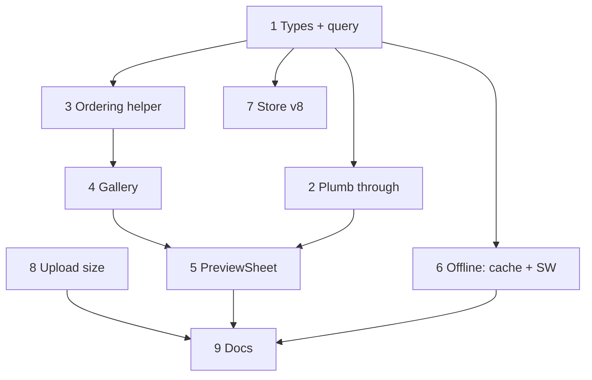

# Exhibit Photos in the Visitor App

**GitHub**: _none yet_
**Milestone**: _unassigned_
**Status**: IMPLEMENTED (on branch `impl/exhibit-photos-visitor`, not yet merged to `main`)

---

## Context

The dev-only `/admin` tool already uploads exhibit photos (`exhibit_photos` rows, `images` bucket; see `exhibit-admin-tool.md`). The visitor app never reads them: `PreviewSheet` shows a hardcoded gradient thumbnail, and `Gallery` draws 4 identical gradient placeholder slides. Only the 360° tour preview (`tour_nodes.preview_url`) is a real image.

This feature shows uploaded photos in the preview sheet (collapsed thumbnail + expanded gallery) and makes the sheet look intentional while an exhibit has no photos yet.

**Already shipped (uncommitted, this session):** exhibits with a tour node use the 360° preview as the thumbnail and as the only gallery slide (`count={0}`); `Gallery` hides the `n / total` counter and thumbnail strip when there is a single slide. This spec builds on that.

---

## Architecture Decisions

### Precache the hero photo only; other photos cache at runtime

**Decision**: The upfront precache downloads one image per exhibit — the hero. Remaining photos are fetched when the gallery is opened and cached by a service-worker route (`CacheFirst`).

**Why**: Project rule is "offline after initial load", but N photos × ~60 exhibits would bloat the first-visit download on mobile data. The hero is what appears in the collapsed thumbnail and slide 1, so the sheet always looks right offline; extra photos are a bonus once seen.

**Alternatives considered**: Precache all photos (too heavy); precache none (thumbnail breaks offline).

**Consequences**: Non-hero photos are unavailable offline until viewed once online. Slides for uncached photos fail to load offline — render them with the neutral blank background (the `Gallery` `blank` palette) rather than a broken-image icon.

---

### Slide order and thumbnail fallback chain

**Decision**:

- **Gallery order**: hero photo → 360° slide → remaining photos by `sort_order`. If no photo is `is_hero`, the 360° slide goes first, then all photos by `sort_order`.
- **Thumbnail**: hero photo → 360° preview → first photo by `sort_order` → gradient.
- The `360°` badge on the thumbnail shows whenever the exhibit has a tour node.

**Why**: A flat photo is recognisable at 56 px; a cropped equirectangular panorama is not. Leading with a real photo avoids a distorted first impression, while the 360° stays near the front.

**Consequences**: One pure helper owns this ordering so thumbnail and gallery can't disagree (see step 3).

---

### Empty state: one branded placeholder, not four

**Decision**: With no photos and no tour, `Gallery` renders a single slide showing the branded "No image available" artwork (`public/exhibit-placeholder.webp`, 720×1290, ~9 KB, already committed on the impl branch; `object-fit: cover`); no counter, no thumbnail strip. The collapsed thumbnail stays the gradient plus the display-ID badge. The image is in `public/`, so it is precached with the app shell and works offline.

**Why**: 4 identical placeholders with `1 / 4` look unfinished. Most exhibits will be in this state for a while.

**Consequences**: The `count` default of 4 is removed for the exhibit path. `AmenitySheet` still passes its own `count` and `palette`, so it is untouched. Keep `count`/`palette` props working for it.

---

### Photos ride in the bulk exhibits query

**Decision**: Embed `exhibit_photos(url, caption, is_hero, sort_order)` in the `fetchCachedExhibits` select (as `tour_nodes(preview_url)` already is). `CachedExhibit` and `PreviewExhibit` gain `photos: ExhibitPhoto[]`, sorted by `sort_order`.

**Why**: URLs are tiny text; they persist in the Zustand store, so the gallery works from the cached dataset offline and needs no per-sheet fetch or loading state.

**Consequences**: Persisted `cachedExhibits` from v7 lack `photos` → bump store persist `version` to 8 with a migration that clears `cachedExhibits`/`cachedAmenities` (same pattern as v5→v6) so `AppGate` re-runs the precache.

---

### Smaller uploads: 1000 px, quality ~75

**Decision**: `app/api/admin/upload-photo/route.ts` resizes to max 1000×1000 (was 1600) at WebP quality 75 (was sharp default 80).

**Why**: Enlarged view is capped at 480 CSS px (~960 px on 2× screens), so 1600 px is wasted bytes. ~60–100 KB per photo cuts hero-only precache to roughly 4–6 MB total.

**Consequences**: Photos uploaded before this change stay 1600 px until re-uploaded. Update the size mention in `exhibit-admin-tool.md`.

---

## Implementation Plan

1. **Types + data** (`lib/types.ts`, `lib/precache.ts`)

   Add `ExhibitPhoto { url: string; caption: string | null; is_hero: boolean }` (order = array order). Add `photos: ExhibitPhoto[]` to `CachedExhibit`; `photos?: ExhibitPhoto[]` to `PreviewExhibit`. Extend the select with `exhibit_photos(url, caption, is_hero, sort_order)`; map rows sorted by `sort_order` ascending, dropping `sort_order` from the stored shape.

2. **Plumb through** (`lib/map-exhibits.ts`, `components/home/DidYouKnow.tsx`, `components/ExhibitPageClient.tsx`, `app/(map)/layout.tsx`, `app/tour/page.tsx`)

   Pass `photos` wherever `tour_preview_url` is passed today (grep `tour_preview_url`). Fixtures in `__tests__` and `e2e` need `photos: []`.

3. **Ordering helper** (`lib/exhibit-photos.ts`, new)

   `galleryPhotos(exhibit)` → ordered slides (`{ kind: 'photo', url, caption } | { kind: 'tour', url }`) per the order decision; `thumbUrl(exhibit)` → string | null per the fallback chain. Pure, no React.

4. **Gallery** (`components/exhibit/Gallery.tsx`)

   Accept `slides` (from helper) instead of computing `hasTour`/`offset` internally; keep `count`/`palette` path for `AmenitySheet`. Photo slides render `` (`loading="lazy"` except slide 0, `alt` = caption or exhibit name, `object-fit: cover`); tap opens the fullscreen modal with the real image (`object-fit: contain`). Tour slide behaves as today. Empty state per the decision. Counter/strip only when `slides.length > 1`.

5. **PreviewSheet** (`components/exhibit/PreviewSheet.tsx`)

   Thumbnail uses `thumbUrl(exhibit)`; keep the gradient fallback, display-ID badge and `360°` badge. Pass `slides` to `SheetSummary` → `Gallery`.

6. **Offline** (`lib/cache-names.ts`, `lib/precache.ts`, `app/sw.ts`)

   Add `EXHIBIT_PHOTO_CACHE = 'exhibit-photo-cache'`. `getAssetGroups` gets a 4th group with the hero URL per exhibit (hero only; no hero → no entry). Add the cache to `CONTENT_CACHE_NAMES`. In `sw.ts` add a `CacheFirst` route (cache `EXHIBIT_PHOTO_CACHE`, `CacheableResponsePlugin` 0/200) matching `/storage/v1/object/public/images/exhibits/` so lazily viewed photos are cached too.

7. **Store migration** (`lib/store.ts`)

   Bump `version` to 8; add `if (version < 8) return { ...state, cachedExhibits: [], cachedAmenities: [] }` before the v6→v7 branch is reached (keep `tourSpot` default for v6).

8. **Upload size** (`app/api/admin/upload-photo/route.ts`)

   `resize({ width: 1000, height: 1000, ... }).webp({ quality: 75 })`. Update the route's doc comment.

9. **Docs** — update `docs/design.md` / `docs/user-flows/flow-1-qr-scan-to-exhibit.md` (gallery behaviour), `docs/tech-architecture.md` (new cache + query), `docs/specs/exhibit-admin-tool.md` (1000 px), `docs/decisions.md`.

---

## Task Graph

---

## Code References

- `components/exhibit/PreviewSheet.tsx` — thumbnail (`thumb` prop) and `tourPreviewUrl`/`count` wiring added this session
- `components/exhibit/Gallery.tsx` — placeholder slides, tour slide, thumbnail strip, `FullscreenModal` (FLIP animation; currently renders gradient only)
- `components/common/SheetSummary.tsx` — passes `count`/`palette`/`tourPreviewUrl` to `Gallery`
- `components/amenity/AmenitySheet.tsx` — other `Gallery` consumer; must keep working
- `lib/precache.ts` — `fetchCachedExhibits` select, `getAssetGroups`, `CONTENT_CACHE_NAMES`
- `lib/store.ts:176` — persist `version: 7` + `migrate` chain
- `app/sw.ts:70` — existing `CacheFirst` route for panorama previews (pattern to copy)
- `lib/map-exhibits.ts` — `toMapExhibits` / `toPreviewExhibit`
- `app/api/admin/upload-photo/route.ts` — current 1600 px upload
- `supabase/migrations/20260809000000_initial_schema.sql:69` — `exhibit_photos` table
- `supabase/migrations/20260812052738_storage_audio_rls_policies.sql` — `images` bucket public read

---

## Acceptance Criteria (Technical)

- [ ] Exhibit with a hero photo: thumbnail is the hero; gallery order is hero → 360° (if tour) → rest by `sort_order`
- [ ] No hero set: 360° is slide 0 and the thumbnail; photos follow by `sort_order`
- [ ] Photos but no hero and no tour: thumbnail is the first photo by `sort_order`
- [ ] Tour only / photos only: counter and strip appear only when more than one slide
- [ ] No photos and no tour: one slide rendering `/exhibit-placeholder.webp`, no counter, no strip; thumbnail is the gradient
- [ ] `360°` badge on the thumbnail whenever `tour_node_id` is set
- [ ] Tapping a photo opens the fullscreen modal with the real image; tapping the 360° slide still enters the tour
- [ ] Hero photo URLs are in `getAssetGroups` output; non-hero URLs are not
- [ ] With the hero precached, going offline keeps the thumbnail and slide 1 rendering
- [ ] A photo viewed online once is served from `exhibit-photo-cache` offline; an uncached photo shows the blank slide background, no broken-image icon
- [ ] Store persist is v8; a v7 device re-runs precache once and then has `photos`
- [ ] `AmenitySheet` gallery renders as before
- [ ] New uploads are ≤1000 px WebP

---

## Testing

- **What to test**: `galleryPhotos` / `thumbUrl` (every branch of the order and fallback rules); `getAssetGroups` hero-only; `fetchCachedExhibits` maps and sorts photos; `Gallery` single-slide hides counter/strip, empty state renders one slide; store v7→v8 migration clears the dataset
- **Test type**: unit (Vitest + Testing Library)
- **Prior art**: `__tests__/precache.test.ts`, `__tests__/precache-dataset.test.ts`, `__tests__/map-exhibits.test.ts`, `__tests__/did-you-know.test.tsx`
- **E2E**: extend an existing visitor-flow spec fixture with `exhibit_photos` (Supabase is mocked via `page.route`); assert the hero renders in the sheet. WebKit skips stay as they are.
- **What NOT to test**: FLIP animation timing, scroll-snap, SW runtime caching internals (verify manually with DevTools offline on a prod build)

---

## Open Questions

| Question | Answer |
|---|---|
| Precache scope? | Hero only; rest cached at runtime |
| Order / thumbnail with both hero and 360°? | Hero first, 360° second; no hero → 360° first. Thumbnail: hero → 360° → first photo → gradient |
| Empty state? | One branded placeholder slide |
| Data path? | Embedded in the bulk exhibits query; store v8 |
| Image size? | 1000 px, quality 75 |
| Branch vs `main`? | Unresolved — owner |
| Backfill/re-upload of existing 1600 px photos? | Unresolved — owner (none uploaded yet?) |
| `images` bucket public-read confirmed in prod? | Unresolved — policy exists in migration; verify in Supabase |
