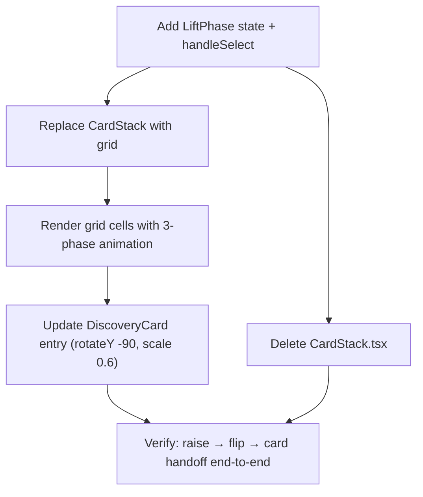

# Show collection as badge grid (earned + greyed-out)

**GitHub**: #113
**Milestone**: m4-gamification
**Status**: NOT STARTED

---

## Context

The `/collection` route currently shows earned cards as a fanned overlapping `CardStack`. This layout breaks down visually as the stack grows, and gives no sense of "how many are left to collect" — a key motivator for gamification.

This story replaces the stack with a 3×3 grid over all 9 milestones. Earned badges render in full color; unearned ones render greyed-out (grayscale + low opacity). The result is a Pokédex-style overview that communicates progress at a glance and motivates discovery.

The `DiscoveryCard` detail view remains — tapping an earned badge opens it in-screen (no route change) with a lift-off-and-expand animation connecting the grid cell to the card.

---

## Architecture Decisions

### Grid replaces CardStack entirely

**Decision**: Delete `CardStack.tsx` and replace its usage in `collection/page.tsx` with an inline grid over `TRAIL_MILESTONES`.

**Why**: `CardStack` is only used in one place. An inline grid is simpler and avoids a component that exists solely to render a list of buttons differently.

**Alternatives considered**: Keep the stack as a hero above the grid — rejected because it adds no new information once the grid exists.

**Consequences**: `CardStack.tsx` becomes dead code and should be deleted.

---

### Unearned badges are non-interactive

**Decision**: Unearned badge buttons have `disabled` and no `onClick`.

**Why**: No meaningful action exists for a locked badge. A "X more to unlock" tooltip adds complexity for marginal value at v1.

**Consequences**: Screen-reader users hear the badge as disabled. If a hint is needed later, it can be added without changing the architecture.

---

### Tap animation: raise → flip → DiscoveryCard seamless handoff

**Decision**: Tapping an earned badge runs three sequential phases driven by a `LiftPhase` state (`{ m, phase: 'raise' | 'flip' }`), chained via Framer Motion's `onAnimationComplete`:

1. **Raise** (200ms easeOut): `y: 0 → -24, scale: 1 → 1.1, rotateY: 0` — card lifts off the grid.
2. **Flip to edge** (200ms easeIn): `rotateY: 0 → 90` — card rotates to edge-on (visually disappears).
3. **Handoff**: `setSelected(m)` mounts `DiscoveryCard` with `initial: { rotateY: -90, scale: 0.6 }` → `animate: { rotateY: 0, scale: 1 }` over 350ms — card appears from the opposite edge and grows to fill the screen.

The grid card exits at `rotateY: 90` (right edge toward viewer); `DiscoveryCard` enters at `rotateY: -90` (left edge toward viewer, same visual edge-on state). Together they produce one continuous rightward flip with no visible seam.

```ts
type LiftPhase = { m: number; phase: 'raise' | 'flip' }
```

**Why**: The handoff-at-90° technique requires no shared-element machinery and works correctly with a canvas-based `DiscoveryCard` (where `layoutId` morph would break). Each phase is independently timed, making it easy to tune feel.

**Alternatives considered**: `layoutId` shared layout — rejected because `DiscoveryCard` renders via canvas. Single `setTimeout` lift — rejected because it can't guarantee the animation completes before handoff; `onAnimationComplete` is frame-accurate.

---

## Implementation Plan

1. **`app/collection/page.tsx`** — add `LiftPhase` type and `lifting: LiftPhase | null` state. Add `handleSelect(m)`: calls `setLifting({ m, phase: 'raise' })`. Remove `CardStack` import; add imports for `motion`, `TRAIL_MILESTONES`, `CARD_GRADIENT_CSS`, `getBadgeColor`.

2. **`app/collection/page.tsx`** — replace the `<div className="flex-1 …"><CardStack …/></div>` block with `<div className="grid grid-cols-3 gap-3 px-4 pt-2 pb-6" style={{ perspective: 600 }}>`. The `perspective: 600` parent makes `rotateY` on grid cells look 3D.

3. **`app/collection/page.tsx`** — for each milestone `m`, render a `motion.button` with:
   - `animate`: raise phase → `{ y: -24, scale: 1.1, rotateY: 0 }`; flip phase → `{ y: -24, scale: 1.1, rotateY: 90 }`; idle → `{ y: 0, scale: 1, rotateY: 0 }`
   - `transition`: raise → `{ duration: 0.2, ease: 'easeOut' }`; flip → `{ duration: 0.2, ease: 'easeIn' }`
   - `onAnimationComplete`: if phase `'raise'` → `setLifting({ m, phase: 'flip' })`; if phase `'flip'` → `setSelected(m); setLifting(null)`
   - `style`: `background: CARD_GRADIENT_CSS`, `filter/opacity` for locked state
   - Badge circle inside: `getBadgeColor(m)`, `55%` width/height, `clamp(14px, 4.5vw, 20px)` font

4. **`components/collection/DiscoveryCard.tsx`** — change `motion.div` entry:
   - `initial`: `{ rotateY: -90, scale: 0.6 }` (enters from opposite edge — seamless continuation of grid card's flip)
   - `animate`: `{ rotateY: 0, scale: 1 }`
   - `transition`: `{ duration: 0.35, ease: [0.4, 0.1, 0.2, 1] }` (reduced from 0.5s)
   - Remove `opacity` from initial/animate — card is edge-on at mount, no fade needed

5. **Delete `components/collection/CardStack.tsx`** — orphaned by step 1.

---

## Task Graph



---

## Code References

- `app/collection/page.tsx` — current collection shell; `selected` state pattern to follow
- `components/collection/CardStack.tsx` — to be deleted; shows existing card sizing logic
- `components/collection/DiscoveryCard.tsx:155–160` — existing `motion.div` entry animation to extend
- `lib/trail.ts` — `TRAIL_MILESTONES` array and `getCurrentSegment` (source of `achieved`)
- `lib/badge-placeholder.ts` — `CARD_GRADIENT_CSS`, `getBadgeColor(m)` for cell styling

---

## Acceptance Criteria (Technical)

- [ ] All 9 milestones render in a 3-column grid on `/collection`
- [ ] Earned badges (milestone ≤ `totalDiscovered`) render in full color and are tappable
- [ ] Unearned badges render with `grayscale(1)` filter and `opacity: 0.35`; tapping does nothing
- [ ] Tapping an earned badge plays raise (200ms) then flip-to-edge (200ms) before `DiscoveryCard` mounts
- [ ] `DiscoveryCard` enters from `rotateY: -90, scale: 0.6` — visually continues the grid card's flip with no seam
- [ ] No route change on badge tap — `DiscoveryCard` opens via `selected` state
- [ ] `CardStack.tsx` is deleted; no dead imports remain

---

## Testing

- **What to test**: grid renders correct count of enabled vs disabled buttons given different `totalDiscovered` values
- **Test type**: unit (render test on `CollectionView` with mocked store)
- **Prior art**: check existing component tests in `__tests__/` or `*.test.tsx` near `collection/`
- **What NOT to test**: animation timing, canvas rendering inside `DiscoveryCard`
