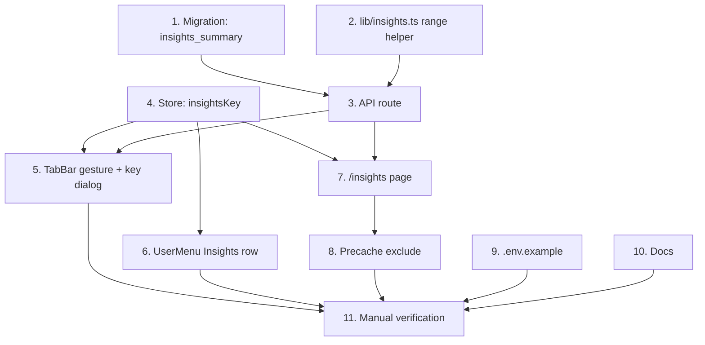

# Insights Page (hidden, key-gated, in the 3-dot menu)

**GitHub**: [#130](https://github.com/makaravind/experium-ai-tour-app/issues/130) — "Admin page in 3 dot menu with insights (scans today count, minutes listened etc)" (issue body is empty; scope comes from the grill session below)
**Milestone**: m7-launch-ready ([#13](https://github.com/makaravind/experium-ai-tour-app/milestone/13))
**Status**: IMPLEMENTED (2026-11-11). Guide: `docs/insights.md`
**Builds on**: `docs/specs/scans-playbacks-split.md` (tables the metrics read), `docs/specs/exhibit-admin-tool.md` (RPC + service-role pattern, precache exclude)

---

## Context

There is no way to see how the app is used. Scans and playbacks are logged (`scans`, `playbacks`, written by `/api/scan` via `upsert_scan` / `upsert_playback`) but reading them means opening the Supabase dashboard.

The existing `/admin` tool cannot be reused: it is dev-only and 404s in every production build (`adminGuard()` / `requireAdminPage()`), and the real data lives on the live site. Insights must work on a phone at the park.

**Before**: no in-app view of usage.
**After**: the owner (and park staff later) tap the More button 8 times, enter a shared key, and get an "Insights" row in the 3-dot menu. It opens `/insights`: stat tiles, top exhibits and language split, with a Today / 7d / All toggle. Other visitors never see the row or the page.

---

## Architecture Decisions

### Prod-capable key gate, separate from `/admin`

**Decision**: A shared secret in env `INSIGHTS_KEY`. `/api/insights` requires it in an `x-insights-key` header, compared in constant time. A missing or wrong key returns a bare 401. The key is saved on the device in the persisted zustand store (`insightsKey`) after a successful entry.
**Why**: Insights are only useful against live data, so the dev-only guard is out. Real user auth is out of scope for m7 (m8-user-auth). One shared key is enough for the owner now and park staff later; rotation is an env change.
**Alternatives considered**: (b) dev-only page — no use from a phone at the park; (c) public read-only aggregates — leaks usage data and has no place in the visitor menu.
**Consequences**: The key sits in `localStorage` on each unlocked device. Accepted for a v1 internal tool. A 401 from the API clears the stored key (handles rotation). Per-person keys wait for m8.

### Hidden unlock: 8 taps on the More button

**Decision**: In `TabBar.tsx` the More button counts taps in a ref. Taps less than 4 s apart count; a longer gap resets to 1. On the 8th tap the menu closes and a key-entry dialog opens. The menu still opens on every tap (no debounce). Once unlocked, the gesture is a no-op.
**Why**: No visible entry point for visitors, no extra UI in the visitor menu. A ref keeps the count independent of the menu opening and closing under the taps.
**Alternatives considered**: direct-URL entry — less discoverable for staff; delaying the menu open until a pause — changes normal menu behavior for every visitor.
**Consequences**: The menu flickers during the gesture. Acceptable.

### One Postgres function for all aggregates

**Decision**: `insights_summary(p_since timestamptz)` returns one jsonb with all metrics. `service_role` only (anon/authenticated revoked), like `admin_apply_changes`. The API computes `p_since` (null for All).
**Why**: One DB round trip, and aggregation stays server-side. Matches the repo's RPC pattern (`upsert_*`, `admin_apply_*`).
**Alternatives considered**: several `from().select()` calls aggregated in TypeScript — pulls raw rows, multiple round trips, slows as `playbacks` grows.
**Consequences**: A new migration is applied to the live project (no staging). Logic lives in SQL.

### Approximate numbers, labelled as such (no event log)

**Decision**: No schema or tracking changes. Use the current tables and say what the numbers mean.
**Why**: Two limits in the data:
- `scans` is one row per `(user_id, qr_code_id, scan_src)`. `scanned_at` is set at first insert only; a re-scan bumps `scanned_count` and `updated_at`. Repeat scans cannot be dated exactly.
- `playbacks` is one row per `(user_id, exhibit_id, language)`. `listen_duration_sec` keeps `GREATEST(...)`, the longest single listen, not a running total. `played_at` is the first play.
**Alternatives considered**: append-only `scan_events` / `playback_events` — exact and chartable by hour, but more work and only counts from deploy time onward.
**Consequences**: "Scans" counts new user/QR/source combinations. "Minutes listened" is a lower bound and the UI says "at least". A replay on a later day is not counted in "Today". Revisit with an event table if the numbers prove too coarse.

### Time ranges are IST

**Decision**: Today = since IST midnight (`Asia/Kolkata`, UTC+5:30). 7d = now minus 7 days. All = no lower bound (`p_since` null). Default Today; the range is component state, not persisted.
**Why**: The park is in Hyderabad. A UTC day would roll over mid-morning there.
**Consequences**: The `since` helper is the one place that knows about IST; the SQL function takes an absolute timestamp.

---

## Metrics

All filtered by `p_since` (when not null) on the column shown.

| Metric | Source | Definition |
|--------|--------|------------|
| Scans | `scans` | `count(*)` where `scanned_at >= since` |
| Unique visitors | `scans` + `playbacks` | `count(distinct user_id)` over the union of `scans.scanned_at >= since` and `playbacks.played_at >= since` |
| Minutes listened (at least) | `playbacks` | `sum(listen_duration_sec) / 60` where `played_at >= since` |
| Listen rate | `playbacks` | `count(*) filter (where listened) / count(*)` where `played_at >= since`; 0 when no rows |
| Top 5 exhibits | `playbacks` + `exhibits` | group by exhibit, order by plays desc, limit 5; return `section \|\| number` (display ID), name, plays |
| Plays by language | `playbacks` | group by `language` (en / hi / te), count |

Response shape (jsonb):

```json
{
  "scans": 0,
  "visitors": 0,
  "minutes": 0,
  "listen_rate": 0,
  "top_exhibits": [{ "display_id": "K1", "name": "…", "plays": 0 }],
  "languages": { "en": 0, "hi": 0, "te": 0 }
}
```

Out of scope: per-hour charts (needs events), ad CTR (m6 not built), reports, device and scan-source breakdowns.

---

## Implementation Plan

1. **Migration** — `experium-ai-tour-app/supabase/migrations/20261111000200_insights_summary.sql`. Create `insights_summary(p_since timestamptz) returns jsonb` per the metrics table. `REVOKE ALL ... FROM PUBLIC, anon, authenticated; GRANT EXECUTE ... TO service_role`. Missing languages return 0, not absent. Drop-then-create if the signature ever changes (PostgREST cannot pick between overloads, see `20261028000400_upsert_functions.sql`).

2. **Range helper** — `lib/insights.ts`: `sinceFor(range: 'today' | '7d' | 'all', now = new Date()): string | null`. Today = IST midnight as an ISO timestamp.

3. **API** — `app/api/insights/route.ts`. `GET ?range=today|7d|all`. Read `x-insights-key`; compare with `process.env.INSIGHTS_KEY` using `crypto.timingSafeEqual` (handle length mismatch and an unset env as 401). Bad `range` returns 400. Call the RPC with `getSupabaseAdmin()` and return the jsonb. No caching headers beyond `no-store`.

4. **Store** — `lib/store.ts`. Add `insightsKey: string | null` (default null) and `setInsightsKey`. Add it to `partialize`. No version bump: persist merges the new field with the default, and `cachedExhibits` must not be wiped.

5. **Unlock gesture + dialog** — `components/exhibit/TabBar.tsx` (More button, `:69`): add the tap counter ref (4 s window, 8 taps). On the 8th tap, if `insightsKey` is null, call `setMoreMenuOpen(false)` and open the key dialog. New component `components/more/InsightsKeyDialog.tsx`, styled like the refresh-confirm `alertdialog` in `UserMenu.tsx:342`: password-type input, "Unlock" and "Cancel". Unlock calls `GET /api/insights?range=today` with the key; 200 saves the key to the store and closes, 401 shows "Invalid key". Mount the dialog where `UserMenu` is mounted so the state is shared.

6. **Menu row** — `components/more/UserMenu.tsx`, App section (`:285`). When `insightsKey` is set, render an "Insights" row ("Usage stats for this tour") before "About us". It closes the menu and `router.push('/insights')`. Add a small chart/bars icon in the file's inline-SVG style.

7. **Page** — `app/insights/page.tsx` (outside the `(map)` layout), client component:
   - No `insightsKey` → `router.replace('/map')`.
   - Header: back arrow to `/map`, title "Insights", refresh button.
   - Segmented control Today / 7d / All, default Today.
   - 2×2 tiles: Scans, Visitors, Minutes ("at least" note), Listen rate. Then Top 5 exhibits (display ID, name, plays), then three language rows with counts. No chart library.
   - Fetch on mount and range change with the key header; skeleton tiles while loading. 401 → clear key, redirect to `/map`. Offline → "Connect to the internet to view insights", no fetch. Empty data → zeros and "No plays yet".
   - Existing design tokens (`ex-paper`, `ex-ink`, `ex-forest`, display font); reuse the card/row styling from `UserMenu`.

8. **Precache** — `next.config.ts:54`: add `insights` to the exclude regex (`/(^|\/)(admin|insights)\//`) so visitors never cache the page chunks. The API route is network-only.

9. **Env** — add `INSIGHTS_KEY=` to `.env.example`; set it in Vercel before launch.

10. **Docs** — `docs/tech-architecture.md`: add `GET /api/insights` under Public endpoints (key-gated) and a short "Insights" section (metrics, approximations). `docs/decisions.md`: log the gate choice and the no-event-log choice.

11. **Verify manually** (no automated tests, see Testing).

---

## Task Graph



Steps 1, 2 and 4 are independent and can run in parallel. 9 and 10 are independent of everything else.

---

## Code References

- `components/exhibit/TabBar.tsx:69` — More button (`setMoreMenuOpen(true)`)
- `components/more/UserMenu.tsx:285` — App section; `:342` refresh-confirm dialog to copy for the key dialog
- `lib/store.ts:86` — persisted store; `:164` `version: 7`; `:189` `partialize`; `:157` `setMoreMenuOpen`
- `lib/admin/guard.ts` — dev-only guard that this deliberately does not use
- `app/api/scan/route.ts` — service-role client usage via `getSupabaseAdmin()`
- `supabase/migrations/20261028000300_playbacks_table.sql` — `playbacks` columns
- `supabase/migrations/20261028000400_upsert_functions.sql` — what `scanned_at`, `listen_duration_sec`, `played_at` mean on upsert; overload note
- `supabase/migrations/20260919000000_scan_src_per_row_history.sql` — `scans` unique key `(user_id, qr_code_id, scan_src)`
- `next.config.ts:54` — precache exclude regex (admin chunks)
- `.claude/current-milestone.md` — m7 context

---

## Acceptance Criteria (Technical)

- [ ] Tapping More 8 times, each less than 4 s after the previous, closes the menu and opens the key dialog; a pause over 4 s resets the count
- [ ] Wrong key: dialog shows "Invalid key" and stores nothing. Correct key: stored in the persisted store; the menu then shows an "Insights" row. Without a key the row is absent
- [ ] `GET /api/insights` returns 401 for a missing, wrong, or unset-env key, 400 for a bad `range`, 200 with the jsonb shape otherwise
- [ ] `insights_summary` is not executable by `anon` / `authenticated`
- [ ] `/insights` with no stored key redirects to `/map`; a 401 clears the key and redirects
- [ ] Today / 7d / All change the data; Today uses IST midnight (checked just after IST midnight and just before UTC midnight)
- [ ] Minutes tile carries an "at least" note; zero data shows zeros and "No plays yet"
- [ ] Offline shows the offline message and makes no request
- [ ] `/insights` chunks are not in the service-worker precache manifest
- [ ] `cachedExhibits` survives the store change (no version bump, no wipe)

---

## Testing

Out of scope by decision (grill session): no unit or E2E tests for this feature. No new CI coverage.

**Manual verification instead:**
- After applying the migration, run `insights_summary(null)` and a dated call via Supabase `execute_sql`, and compare each number with a raw SQL query on `scans` / `playbacks`.
- In `npm run dev` / a production build: run the gesture, wrong and right key, range toggle, offline (devtools), 401 after changing `INSIGHTS_KEY`.
- Confirm `/insights` chunks are absent from the built precache manifest.

---

## Open Questions

- [ ] Should the key dialog validate against the API before saving (assumed, via `GET /api/insights?range=today`), or save and let `/insights` handle a 401? — Aravind
- [ ] Who sets `INSIGHTS_KEY` in Vercel, and before merge? — Aravind
- [ ] OK to apply the migration straight to the live Supabase project (no staging)? — Aravind
- [ ] Write the agreed scope into the empty issue body? — Aravind
