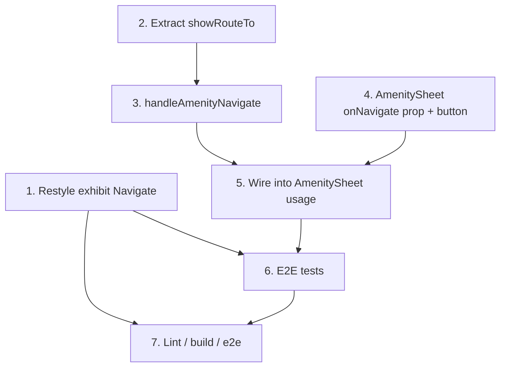

# Navigate Button: Fix Disabled Look + Add to Amenity Sheet

**GitHub**: [#131](https://github.com/makaravind/experium-ai-tour-app/issues/131) — "Navigate option enabled and also available for amenity" (issue body is empty; scope comes from the grill session below)
**Milestone**: m2b-ortho ([#8](https://github.com/makaravind/experium-ai-tour-app/milestone/8))
**Status**: DONE — merged to main `025cf50` 2026-11-09, issue closed
**Builds on**: `docs/specs/gh-38-path-navigation-overlay.md` (routing algorithm, failure behavior — unchanged here)

---

## Context

The exhibit `PreviewSheet` has a Navigate button next to Listen. Tapping it flies the map to the exhibit and, when there is a usable GPS fix and a route over `public/park-paths.json`, draws an animated dashed route line (gh-38).

Two problems:

1. **The button looks disabled.** It is `bg-ex-sage` (`#a3b18a`) with white text. That is a pale green with low contrast, so visitors read it as inactive. The button is actually enabled and works.
2. **Amenities have no Navigate.** `AmenitySheet` shows name, type, distance and description only. A visitor who finds a washroom on the map cannot get a route to it, although the routing code could route to any lat/lng.

**Before**: pale-green exhibit Navigate; no amenity Navigate.
**After**: Navigate is an outlined `ex-forest` button on both the exhibit sheet and the amenity sheet. On an amenity it draws the same route line and closes the sheet.

There is no separate "amenity page". Amenities only have the bottom sheet (`AmenitySheet`, opened by tapping a chip or by amenity search).

---

## Architecture Decisions

### Outlined `ex-forest` style, on both sheets

**Decision**: Navigate becomes white background, `border-2 border-ex-forest`, `text-ex-forest`. Same style on exhibit and amenity sheets (no `ex-amenity` blue accent).
**Why**: The green filled Listen button is the primary action. An outlined button is clearly active (high contrast, strong border) but reads as secondary. Same style in both sheets keeps one visual meaning for "Navigate".
**Alternatives considered**: (b) solid `ex-forest` fill — active but identical to Listen, so two competing primaries; (c) darker sage fill — still close to Listen's green, hard to tell apart.
**Consequences**: The class string is duplicated in two files. Deliberate: two callers, v1, no shared component (see "Prefers minimal abstractions"). If a third caller appears, extract then.

### Amenity Navigate = route + close sheet

**Decision**: Tapping Navigate on an amenity computes the route from the visitor's position to the amenity, then closes the sheet via `setActiveAmenityId(null)`. The route is cleared by the existing `handleMapTap`.
**Why**: Mirrors the exhibit flow, where Navigate closes the sheet (`setMapSelectedExhibit(null)`) so the route is visible and not hidden under the sheet.
**Alternatives considered**: keep the sheet open — the route line may sit under the sheet.
**Consequences**:
- No `flyTo` is needed. `ParkMap` already flies to the amenity when `activeAmenityId` is set (`ParkMap.tsx:715`). For exhibits `flyTo` stays, since an exhibit pin may not be centered.
- Failure behavior is the same as gh-38: no GPS fix (`userPosition` null or `accuracyM > 60`), missing `park-paths.json`, or unreachable target means no line. The sheet still closes. No toast (v1).

### Refactor `handleNavigate` to take a target lat/lng

**Decision**: Extract the route computation from `handleNavigate` (`app/(map)/layout.tsx:199`) into a small local function that takes `{ lat, lng }`, `showRouteTo(target)`. `handleNavigate` (exhibit) and the new `handleAmenityNavigate` both call it.
**Why**: The routing block (paths ref, accuracy check, `findRoute`, `setNavigationPathCoords`) is identical for both targets; only how the target is resolved and which sheet closes differs.
**Alternatives considered**: duplicating the block — two copies of the 60 m accuracy rule would drift.
**Consequences**: One function local to `layout.tsx`. Not exported, not a hook.

---

## Implementation Plan

1. **Restyle the exhibit button** — `components/exhibit/PreviewSheet.tsx` (~line 530). In the `onNavigate` button, replace `bg-ex-sage text-white` with `bg-white border-2 border-ex-forest text-ex-forest`, and drop `border: 'none'` from its inline `style` (it would override the border). Keep `flex-1 h-14 rounded-2xl font-semibold text-base` and the `CompassIcon`. Check `h-14` still lines up with the Listen button now that a border is added (border is inside the box with Tailwind's default `border-box`, so heights match).

2. **Extract `showRouteTo`** — `app/(map)/layout.tsx`. Move the `if (paths && userPosition && userPosition.accuracyM <= 60) { findRoute(...); setNavigationPathCoords(route) }` block out of `handleNavigate` into `showRouteTo(target: { lat: number; lng: number })`. In `handleNavigate`, resolve the exhibit's coordinates from `mapExhibits` as today (skip if `gps_lat`/`gps_lng` null) and call `showRouteTo`. Behavior of the exhibit path must not change.

3. **Add `handleAmenityNavigate`** — `app/(map)/layout.tsx`. Look up the amenity in `useStore.getState().cachedAmenities` by `activeAmenityId`, call `showRouteTo({ lat: amenity.gps_lat, lng: amenity.gps_lng })`, then `useMapStore.getState().setActiveAmenityId(null)`.

4. **Add `onNavigate` to `AmenitySheet`** — `components/amenity/AmenitySheet.tsx`. New optional prop `onNavigate?: () => void`. Below the description `
`, render the outlined button (same classes as step 1 plus `w-full mt-3`) with `CompassIcon` and "Navigate", when `onNavigate` is set and `amenity` exists. It sits inside the `px-4` wrapper so it shows in both collapsed and expanded states. Import `CompassIcon` from `@/components/icons`.

5. **Wire it** — `app/(map)/layout.tsx` (~line 406). Pass `onNavigate={handleAmenityNavigate}` to `AmenitySheet`.

6. **E2E** — `e2e/amenities.spec.ts`. Add tests (see Testing).

7. **Verify** — lint, build, e2e (`npm run lint`, `npm run build`, `npm run e2e`). Compare e2e failures against the baseline list (8 known mobile-chrome failures on main), not as regressions.

---

## Task Graph

Steps 1, 2 and 4 are independent and can run in parallel.

---

## Code References

- `components/exhibit/PreviewSheet.tsx:530` — current Navigate button (sage fill, `border: 'none'`); `onNavigate` prop at :42/:56
- `components/amenity/AmenitySheet.tsx` — sheet to extend; reuses `BottomSheet`/`SheetSummary`
- `app/(map)/layout.tsx:199` — `handleNavigate` to refactor; :183 `handleAmenityTap`; :188 `handleMapTap` (clears route); :399 exhibit `onNavigate` wiring; :406 `AmenitySheet` usage
- `components/map/ParkMap.tsx:715` — flies to the active amenity (why no explicit flyTo is needed)
- `lib/park-paths.ts` — `findRoute`, `loadParkPaths`
- `lib/map-store.ts` — `activeAmenityId`, `setActiveAmenityId`, `userPosition`
- `app/globals.css:59-60` — `--color-ex-sage`, `--color-ex-amenity`; `--color-ex-forest` at :51
- `e2e/amenities.spec.ts` — fixtures (`seedVisitor`, `WASHROOM`, `chip`) and the "with a GPS fix" describe block to copy
- `docs/specs/gh-38-path-navigation-overlay.md` — routing and failure behavior this reuses

---

## Acceptance Criteria (Technical)

- [ ] Exhibit Navigate renders white background, `ex-forest` 2 px border and text; visibly active next to Listen; same height as Listen
- [ ] Exhibit Navigate behavior unchanged: flyTo, sheet closes, route drawn when GPS fix ≤ 60 m and a path exists
- [ ] `AmenitySheet` shows an outlined Navigate button in both peek and expanded states
- [ ] Tapping amenity Navigate computes the route to the amenity's coordinates, closes the sheet (`activeAmenityId` becomes null) and leaves the route up until a map tap
- [ ] With no GPS fix, no `park-paths.json`, or no route: no line is drawn, the sheet still closes, no error
- [ ] No Navigate on the QR-scan exhibit page (`/s/…`) — unchanged (`navigateEnabled` stays false there)
- [ ] `showRouteTo` is the single place that applies the 60 m accuracy rule

---

## Testing

- **What to test**: external behavior only — Navigate is visible and styled as active on the amenity sheet; tapping it closes the sheet; exhibit Navigate still present on pin tap.
- **Test type**: e2e (Playwright). Route-line drawing is on the MapLibre canvas, so asserting pixels is out of scope; the route math is covered by gh-38 / `findRoute`.
- **Cases** (`e2e/amenities.spec.ts`):
  1. Chip tap shows a "Navigate" button in the peek sheet; expanding keeps it visible.
  2. Tapping Navigate closes the sheet (`[data-selected="true"]` hidden, description hidden). Run in the "with a GPS fix at Baobab Forest" block so the route path is exercised without errors.
  3. Without a GPS fix, tapping Navigate still closes the sheet and the page shows no error.
- **Prior art**: `e2e/amenities.spec.ts` — `chip(page)`, `amenityHandle(page)`, `DESCRIPTION` assertions, and the geolocation `test.use` block.
- **What NOT to test**: the exact Tailwind classes or computed colors; `findRoute` internals; MapLibre layer contents.
- **WebKit**: if a WebKit-only flake appears, `test.skip` with an explanation as the project does — do not remove existing skips.

---

## Open Questions

- [ ] Button placement: below the description (assumed) vs. in the collapsed header row next to the badge — Aravind
- [ ] Should a no-GPS / no-route tap show a toast instead of silently closing? (Deferred; v1 matches exhibit behavior) — Aravind
