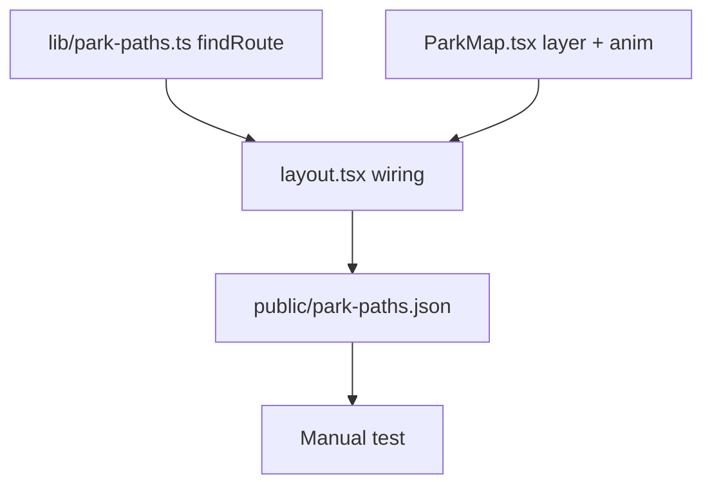

# In-App Path Navigation Overlay

**GitHub**: gh-38
**Milestone**: m2b-ortho
**Status**: IN PROGRESS — an uncommitted nearest-path version exists (`lib/park-paths.ts`, `layout.tsx`, `ParkMap.tsx`); this spec replaces it with visitor-to-exhibit routing.

---

## Context

The map currently supports "Navigate" on an exhibit pin — tapping it just calls `flyTo(exhibit)`, centering the map on the target. There is no visual path guidance.

The park has designated walking roads. This story adds a `park-paths.json` file (in `public/`, authored via `sample-map/road-editor.html`) that stores polylines tracing those roads. When a visitor taps Navigate, the app routes from the visitor's GPS position to the exhibit across those polylines and renders the route as an animated dashed line on the MapLibre map. Routing is a shortest-path search over a small graph built from the polylines — no external routing service. The line is dismissed when the visitor taps empty map space (same handler that already dismisses the exhibit sheet).

---

## Architecture Decisions

### Route across paths, not a single nearest path

**Decision**: Paths are independent polylines (`{ slug: { name, coords } }`). At navigate time, snap the visitor and the exhibit onto the path network, join paths where they meet, and take the shortest chain between the two snap points.

**Why**: The park's roads branch. The exhibit's nearest path alone (the earlier design) doesn't reach the visitor, so the line would start somewhere unrelated to where they are standing.

**Alternatives considered**: (a) nearest path to the exhibit only — doesn't connect to the visitor; (b) explicit `{ exhibitId: pathSlug }` mapping — maintenance burden; (c) one hand-drawn continuous path per exhibit — too much data duplication.

**Consequences**: Paths must actually meet. Two paths are joined where a waypoint of one lies within `JOIN_GAP_M` (3 m) of the other's line, so a path can branch off mid-segment of another. If the author leaves a gap larger than that, the route is not found (see failure behavior). The editor snaps clicks within 10 px of an existing waypoint or path line onto it (Alt bypasses), so junctions drawn in the editor connect exactly; `JOIN_GAP_M` only covers hand-edited or imported data. `road-editor.html` "Test Navigate" shows the result before shipping the JSON.

### Routing algorithm (reference: `computeRoute` in `sample-map/road-editor.html`)

Port to TypeScript as-is. Distances in local metres (equirectangular projection around the exhibit; fine at park scale).

1. Nodes = every waypoint of every path with ≥2 points. Paths with <2 points are ignored.
2. Snap the visitor and the exhibit each to the closest point on any segment; insert that point as a node on the segment.
3. For every waypoint, if another path's segment is within `JOIN_GAP_M`, insert the projection point as a node on that segment and link it to the waypoint.
4. Link consecutive nodes along each segment (including inserted ones, ordered by position along the segment); edge weight = Euclidean metres.
5. Dijkstra from visitor snap node to exhibit snap node. The graph has at most a few hundred nodes, so an O(n²) scan is fine.
6. Return the node coordinates as `[lat, lng][]`, or `null` if unreachable.

The line follows the paths only: the off-path legs from the visitor and the exhibit to their snap points are not drawn.

### Failure behavior

**Decision**: Draw nothing if there is no usable GPS fix or no route. Navigate still does `flyTo`.

**No fix** means `userPosition` is null, or `accuracyM` is above 60 m (the same threshold `nearestWithin` uses in `lib/nearby.ts`).

**Why**: A line that doesn't start at the visitor would suggest a route that isn't one. This matches the other acceptance criteria (empty or missing `park-paths.json` also means flyTo only).

### Route is a snapshot

**Decision**: Computed once at tap time. It does not re-route as the visitor moves.

**Why**: v1 simplicity. Live re-routing is listed under Open Questions.

### Static file in `public/`, not database

**Decision**: `public/park-paths.json` — static JSON bundled with the app.

**Why**: Path data is park infrastructure, not user data. It changes only when a surveyor re-traces roads. Serwist auto-precaches all `public/` files, so no SW changes needed.

**Alternatives considered**: Supabase table — unnecessary for a static dataset.

### Animated dashed line, dismissed via existing `handleMapTap`

**Decision**: Render as MapLibre `line` layer with animated dasharray (MapLibre's 14-frame marching sequence), inserted below `exhibit-pins` layer. Dismissed by the existing `handleMapTap` which already clears exhibit selection.

**Why**: No new UI needed. Consistent with how the exhibit sheet dismisses. Path renders under pins so pins stay tappable.

---

## Implementation Plan

1. **`lib/park-paths.ts`** — types, loader, router. Replaces `findNearestPath`.
   - `ParkPath = { name: string; coords: [number, number][] }` — coords are `[lat, lng]` pairs.
   - `ParkPaths = Record<string, ParkPath>`
   - `loadParkPaths()` — `fetch('/park-paths.json')`, return `{}` on any failure (404, parse error, network). (Already implemented.)
   - `JOIN_GAP_M = 3` — module constant, same default as the editor's "Join gap" input.
   - `findRoute(from, to, paths)` — `from`/`to` are `{ lat, lng }`; implements the algorithm above; returns `[number, number][] | null`. Remove `findNearestPath` and its helpers.

2. **`components/map/ParkMap.tsx`** — add nav path layer and animation. No change from the earlier design.
   - Add `navigationPath?: [number, number][] | null` to `ParkMapProps`.
   - Add module-level `NAV_DASH_SEQ` constant (14-frame MapLibre dasharray sequence, see Code References).
   - Add refs: `navPathRafRef`, `navDashStepRef`, `navDashLastRef`.
   - In `onLoad`, after `exhibit-pins` circle layer is added:
     ```ts
     map.addSource('nav-path', { type: 'geojson', data: { type: 'Feature', geometry: { type: 'LineString', coordinates: [] }, properties: {} } })
     map.addLayer({
       id: 'nav-path-line', type: 'line', source: 'nav-path',
       layout: { 'line-join': 'round', 'line-cap': 'round', visibility: 'none' },
       paint: { 'line-color': '#5a7fa0', 'line-width': 3, 'line-opacity': 0.85, 'line-dasharray': [0, 4, 3] }
     }, 'exhibit-pins')  // insert BELOW exhibit-pins
     ```
   - Add `useEffect([navigationPath, mapReady])`:
     - Cancel any running RAF from `navPathRafRef`.
     - If `navigationPath` has < 2 points: clear source coords, set layer visibility `'none'`, return.
     - Else: flip coords to `[lng, lat]` for GeoJSON, call `source.setData(...)`, set visibility `'visible'`, start RAF loop that cycles `NAV_DASH_SEQ` at ~80ms/step via timestamp comparison.
     - Return cleanup that cancels the RAF.

3. **`app/(map)/layout.tsx`** — load paths, wire navigate, clear on dismiss.
   - Import `loadParkPaths`, `findRoute`, `ParkPaths` from `@/lib/park-paths`.
   - `parkPathsRef`, `navigationPathCoords` state, mount `useEffect` loading paths — already present.
   - `userPosition` is already read from `useMapStore` (`layout.tsx:80`).
   - In `handleNavigate`: after existing `setFlyToTarget` logic, if `userPosition` is non-null with `accuracyM <= 60` and the exhibit has `gps_lat`/`gps_lng`, call `findRoute(userPosition, { lat: exhibit.gps_lat, lng: exhibit.gps_lng }, paths)` and set the result as `navigationPathCoords` (null clears). Replace the current `findNearestPath` call.
   - In `handleMapTap`, the `!isExhibitPage` branch of the `isExhibitPage` effect, and `onClose`: `setNavigationPathCoords(null)` — as before.
   - Pass `navigationPath={navigationPathCoords}` to `<ParkMap>`.

4. **Add `public/park-paths.json`** — empty initial file (`{}`) until the park is traced with the road editor. Export from the editor as `park-paths.json`; paths are named "Path 1", "Path 2", …, keys `path-1`, `path-2`, ….

5. **Test manually**: authored paths loaded, GPS spoofed (DevTools Sensors) near one end; tap a pin at the other end, tap Navigate — confirm the animated dashed line runs from near the visitor to the exhibit, across path joins. Tap empty map — confirm the line disappears. With `park-paths.json` empty, confirm Navigate still works (flyTo only).

---

## Task Graph



---

## Code References

- `sample-map/road-editor.html` — authoring tool; `computeRoute` is the reference implementation of the algorithm, and "Test Navigate" (Place You / Place Exhibit / Navigate / Join gap) previews routes on the real ortho before the JSON ships.
- `components/map/ParkMap.tsx` — map init, `onLoad` pattern, how sources/layers are added, existing `useEffect` structure.
- `app/(map)/layout.tsx` — `handleNavigate`, `handleMapTap`, `isExhibitPage` effect, `userPosition` from the map store.
- `lib/map-store.ts` — `userPosition: { lat, lng, accuracyM } | null`.
- `lib/nearby.ts` — example of distance math over GPS coords; `nearestWithin` uses the same 60 m accuracy cutoff.
- `app/sw.ts` lines 39-44 — confirms `public/` files are auto-precached via `__SW_MANIFEST`; no changes needed.
- MapLibre animated dasharray sequence: `[[0,4,3],[0.5,4,2.5],[1,4,2],[1.5,4,1.5],[2,4,1],[2.5,4,0.5],[3,4,0],[0,0.5,3,3.5],[0,1,3,3],[0,1.5,3,2.5],[0,2,3,2],[0,2.5,3,1.5],[0,3,3,1],[0,3.5,3,0.5]]`

---

## Acceptance Criteria (Technical)

- [ ] Visitor with a good GPS fix taps Navigate on an exhibit reachable via the paths → animated dashed line appears from near the visitor to the exhibit, following the paths and crossing joins between them
- [ ] Line color is `#5a7fa0` (amenity blue), width 3, rendered below exhibit pins
- [ ] Tapping empty map dismisses both the exhibit sheet and the path line
- [ ] No GPS fix (null position, or accuracy > 60 m) → flyTo works, no line, no error
- [ ] Visitor or exhibit not connected to each other through the paths → flyTo works, no line, no error
- [ ] Tapping Navigate with empty `park-paths.json` → flyTo works, no line, no error
- [ ] `park-paths.json` missing entirely (404) → same graceful fallback, no crash
- [ ] Navigating to a different exhibit replaces the previous route

---

## Testing

- **What to test**: `findRoute`:
  - two paths joined at a waypoint-to-waypoint meeting → route spans both
  - second path starting mid-segment of the first (within `JOIN_GAP_M`) → joined
  - gap larger than `JOIN_GAP_M` → `null`
  - visitor and exhibit snapping to the same path → route along that path only
  - paths with <2 points ignored; empty paths → `null`
- **Test type**: unit
- **Prior art**: `__tests__/nearby.test.ts` — same pattern (distance math, pure function, no DOM).
- **What NOT to test**: MapLibre layer setup, RAF animation, React rendering — too coupled to the map instance.

---

## Open Questions

- [ ] No GPS fix: show no line (current decision), or fall back to the path nearest the exhibit?
- [ ] Re-route live as the visitor moves, and auto-dismiss within N metres of the exhibit? — deferred to v2.
- [ ] Draw the short off-path legs from the visitor and exhibit to their snap points? — not in v1.
