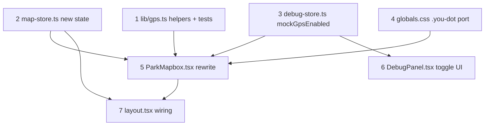

# GPS "you are here" dot

**GitHub**: [#49](https://github.com/makaravind/experium-ai-tour-app/issues/49)
**Milestone**: m2b-mechanics — Map Mechanics
**Status**: DONE
**Touches**: [#50](https://github.com/makaravind/experium-ai-tour-app/issues/50) Nearby pulse (rewires its position feed, no behavior change) — closed by [#58](https://github.com/makaravind/experium-ai-tour-app/issues/58)'s `mapboxgl.GeolocateControl` approach, which this spec replaces

---

## Context

#58 shipped a first pass at this issue using Mapbox's built-in `mapboxgl.GeolocateControl` (`components/map/ParkMapbox.tsx:322-349`): its own button hidden, wired to fire on tap of the app's compass button (`app/(map)/layout.tsx:117`), with its DOM dot/pulse/accuracy-circle retinted blue via `app/globals.css:223-237` to match `sample-map/drony-ortho.html`'s `.you-dot` look. The `geolocate` event from that control also feeds the nearby-exhibit calculation (`nearestWithin`, `lib/nearby.ts`) that drives #50's sparkle animation.

That approach has two gaps against the issue's acceptance criteria and a hard blocker for local development:

1. **Not actually live** — the control only starts watching position after the compass button is tapped. A visitor who never taps it never sees a dot, which doesn't match "Live GPS position dot ... tracks live position via `watchPosition()`."
2. **No permission-denied/unsupported UX** — the control fails silently (clears nearby state) with nothing shown to the visitor.
3. **Not mockable** — `GeolocateControl` drives its dot from the real `navigator.geolocation.watchPosition()` internally; there is no API to feed it a fake position, which makes it untestable without physically walking around Experium Park.

This spec replaces `GeolocateControl` with a custom watcher built directly on `navigator.geolocation.watchPosition()`, rendering the dot as a `mapboxgl.Marker` using the `.you-dot` element — literally the pattern `sample-map/drony-ortho.html:451-456` already uses. This both satisfies the issue's acceptance criteria as written and opens a clean seam for a debug-only mock position source.

**Before**: dot only appears after a compass tap, driven by Mapbox's internal control; no error UX; untestable without real GPS.
**After**: dot appears automatically as soon as a fix resolves, map auto-follows it, follow releases on manual pan and resumes on compass tap, a persistent banner explains permission-denied/unsupported with a retry path, and a debug toggle lets a developer simulate walking around by tapping the map.

---

## Architecture Decisions

### Custom watcher + `mapboxgl.Marker`, not `GeolocateControl`

**Decision**: Remove the `GeolocateControl` block in `ParkMapbox.tsx`. Call `navigator.geolocation.watchPosition()` directly, and render the dot as a `mapboxgl.Marker({ element, anchor: 'center' })` where `element` is a plain `div.you-dot` (ported verbatim from `sample-map/drony-ortho.html:27-43`).

**Why**: `GeolocateControl` is a black box over `watchPosition()` — it owns the browser API call and exposes no way to inject a position, so it cannot be driven by a debug mock. Building the watcher ourselves means the real path and the mock path can call the exact same `onPosition(coords)` function, so debug mode exercises the real update/follow/nearby-calc logic instead of a parallel look-alike.

**Alternatives considered**: Keep `GeolocateControl` for the real path and layer a second, separate marker for debug visualization. Rejected — it only verifies CSS, not the actual tracking/follow/nearby logic, and leaves two parallel code paths to keep in sync.

**Consequences**: We lose `GeolocateControl`'s built-in meter-accurate `showAccuracyCircle` sizing and its internal ACTIVE_LOCK/BACKGROUND state machine — both get reimplemented (deliberately simplified) below. The CSS retint block at `globals.css:223-237` becomes dead code and is deleted in favor of the ported `.you-dot` rules.

### Fixed decorative pulse, not a meter-scaled accuracy circle

**Decision**: The halo is the literal `.you-dot::after` treatment — a fixed 36px ring that pulses via `@keyframes` — not a circle sized by `position.coords.accuracy` in meters.

**Why**: The issue's own wording asks to "reuse the visual pattern from `sample-map/drony-ortho.html`'s `.you-dot` CSS (pulse animation, ring style)," and that pattern is decorative/fixed-size, not accuracy-scaled. `position.coords.accuracy` is still read and used — just for `nearestWithin`'s `maxAccuracyM` gate (`lib/nearby.ts:33`), not for sizing anything on screen.

**Alternatives considered**: Keep `GeolocateControl`'s real accuracy circle (radius ∝ accuracy in meters, reprojected every frame). More "correct," but it's extra reprojection math the issue never asked for, and the fixed pulse is the only version anyone has actually signed off on visually.

**Consequences**: The halo's visual size never reflects how good or bad the GPS fix actually is. Acceptable — the issue scoped the halo as decorative.

### Follow mode: auto-starts with the dot, releases on manual drag, resumes on compass tap

**Decision**: `lib/map-store.ts` gains a `followMode: 'idle' | 'following'` field. The very first successful position fix sets `followMode = 'following'` and `map.flyTo`s to it. Every subsequent fix while `following` re-centers with `map.panTo` (no zoom change). A `dragstart` listener on the map sets `followMode = 'idle'` — `dragstart` fires only for user-gesture pans, never for our own `flyTo`/`panTo`/`easeTo` calls, so this cleanly distinguishes "visitor is looking around" from "we just moved the camera." The compass button now calls a `recenterTrigger` (replacing today's `geolocateTrigger`) that `flyTo`s to the last known position and sets `followMode` back to `'following'`.

**Why**: this was explicitly chosen over two simpler alternatives (no auto-pan at all; or a permanent follow that fights manual panning) — see the issue thread. It mirrors `GeolocateControl`'s own ACTIVE_LOCK → BACKGROUND transition, which the compass-button UX was already designed around.

**Alternatives considered**: (a) dot updates in place, no auto-pan ever — simpler, but overridden by request; (b) follow is permanent — fights a visitor trying to look at another part of the park while GPS is live.

**Consequences**: the restored last-viewed viewport (`useStore.getState().mapViewport`, `ParkMapbox.tsx:193,197`, from #51) is only visible until the first GPS fix arrives, which can be near-instant on a device with a recent fix cached. This is accepted as a known, deliberate trade-off, not a bug.

### Debug mock: same `onPosition` function, fake source, map-tap sets a walk destination

**Decision**: `lib/debug-store.ts` gains `mockGpsEnabled: boolean`. When true, `ParkMapbox` does not call `navigator.geolocation.watchPosition()` at all; instead, tapping an empty area of the map (the existing "no pin hit" branch of the click handler) sets a mock destination, and a `requestAnimationFrame` loop linearly interpolates from the current mock position toward it over ~5 seconds, calling the same `onPosition(coords)` used by the real path on every tick.

**Why**: this is the one function every downstream consumer (marker placement, follow logic, nearby calc) already depends on — routing the mock through it, instead of writing a parallel "fake nearby calc" or "fake marker mover," guarantees the mock actually exercises the real logic, not a reimplementation of it that can drift.

**Alternatives considered**: plain lat/lng/accuracy number inputs in `DebugPanel` with a "Set" button. Simpler, but doesn't exercise the nearby-pulse animation (#50) the way walking toward an exhibit does, and was explicitly traded for the richer version.

**Consequences**: tapping directly on a pin still opens the Preview sheet (unchanged, existing `exhibit-pins` click handler) rather than setting a destination — to "walk" to a specific exhibit in debug mode, tap just next to its pin rather than on it. Acceptable for a developer-only tool.

### Permission-denied/unsupported: persistent yellow banner, not silent, not a toast

**Decision**: `lib/map-store.ts` gains `geoError: 'denied' | 'unavailable' | null`, set by the watcher's error callback and cleared on the next successful fix. `app/(map)/layout.tsx` renders a persistent (non-auto-dismissing) yellow banner pinned to the top whenever `geoError` is non-null. Copy depends on reason: `'denied'` → "Location access denied — tap to enable" with a retry button that calls `retryGpsTrigger` (re-invokes the watcher start); `'unavailable'` → "Location isn't available on this device" with no retry button (nothing to retry — covers missing `navigator.geolocation`, `POSITION_UNAVAILABLE`, and `TIMEOUT`).

**Why**: explicitly requested over the simpler "fully silent" default — the visitor should know why they can't see themselves and get a path to fix it where one exists.

**Alternatives considered**: fully silent (matches the issue's literal "no dot, no crash" wording, but was overridden); a one-time auto-dismissing toast matching `app/scan/page.tsx`'s existing `toast` pattern (rejected — a permission problem is persistent state, not a one-off event, so it shouldn't disappear on a timer).

**Consequences**: "retry" cannot force the browser to re-show its native permission prompt once denied — no web API does that. The button just re-attempts the watcher; if the OS/browser-level permission is still denied, the same error (and banner) comes right back. This is standard, expected behavior for this kind of control, not a bug to work around.

---

## Implementation Plan

1. **`lib/gps.ts` (new file)** — pure helpers, no DOM/browser APIs:
   - `classifyGeoError(code: number): 'denied' | 'unavailable'` — maps `GeolocationPositionError.PERMISSION_DENIED` (1) to `'denied'`, anything else (`POSITION_UNAVAILABLE`, `TIMEOUT`) to `'unavailable'`.
   - `lerpPosition(from, to, t)` — linear interpolation between two `{ lat, lng }` points, used by the debug walk simulation.

2. **`lib/map-store.ts`** — replace `geolocateTrigger`/`setGeolocateTrigger` with:
   - `userPosition: { lat: number; lng: number; accuracyM: number } | null` + setter
   - `followMode: 'idle' | 'following'` + setter
   - `geoError: 'denied' | 'unavailable' | null` + setter
   - `recenterTrigger: (() => void) | null` + setter (compass tap → recenter + resume follow)
   - `retryGpsTrigger: (() => void) | null` + setter (banner retry button → restart the watcher)

3. **`lib/debug-store.ts`** — add `mockGpsEnabled: boolean` + `setMockGpsEnabled`.

4. **`app/globals.css`** — delete the dead block at `globals.css:223-237` (the `GeolocateControl` retint + hidden button rules). Port `sample-map/drony-ortho.html:27-43`'s `.you-dot`, `.you-dot::after`, and the pulse `@keyframes` in as-is (rename the keyframe if `pulse` collides with anything already in this file — check first).

5. **`components/map/ParkMapbox.tsx`** — the main rewrite, inside the existing `map.on('load', ...)` block, replacing the current `GeolocateControl` section (lines 322-349):
   - Create the `.you-dot` element once; wrap in a `mapboxgl.Marker`, but don't call `.addTo(map)` until the first position arrives.
   - Write a single `handlePosition(lat, lng, accuracyM)` function that: moves the marker (adding it on first call), calls `setUserPosition`, clears `geoError`, runs the existing `nearestWithin(...)` → `setNearbyExhibitIds(...)` logic (same as today, just no longer inside a `geolocate` event handler), and — if `followMode === 'following'` — `panTo`s the map; the very first call instead `flyTo`s and sets `followMode = 'following'`.
   - Write `handleGeoError(code)` that calls `classifyGeoError`, sets `geoError`, sets `followMode = 'idle'`, clears `nearbyExhibitIds` (same as today's control `error` handler), and removes the marker if it was already added.
   - Write `startWatcher()`: if `useDebugStore.getState().mockGpsEnabled`, do nothing (the mock path below drives `handlePosition` instead); else if `!('geolocation' in navigator)`, call `handleGeoError` with an `'unavailable'`-mapping code immediately; else call `navigator.geolocation.watchPosition(handlePosition, handleGeoError, { enableHighAccuracy: true })` and keep the returned id for cleanup.
   - Call `startWatcher()` once on load. Register `setRecenterTrigger` (flyTo last `userPosition`, set `followMode = 'following'`) and `setRetryGpsTrigger` (re-run `startWatcher()`) on the store.
   - Add a `map.on('dragstart', ...)` listener that sets `followMode = 'idle'`.
   - In the existing empty-map-tap branch of the click handler (`ParkMapbox.tsx:358-361`), add: if `mockGpsEnabled`, set a mock destination (local ref) and kick off a `requestAnimationFrame` loop that calls `lerpPosition` toward it over ~5s, calling `handlePosition` each tick with a hardcoded plausible accuracy (e.g. 15m).
   - Clean up: on unmount, clear the real watcher (`navigator.geolocation.clearWatch`) if one is running, cancel any in-flight mock animation frame, and reset the three new store triggers to `null` (same pattern as today's `setGeolocateTrigger(null)` cleanup).

6. **`components/DebugPanel.tsx`** — add a "Mock GPS: ON/OFF" toggle button wired to `mockGpsEnabled`/`setMockGpsEnabled`, next to the existing debug controls (e.g. near `forcedMarkerState`'s buttons).

7. **`app/(map)/layout.tsx`**:
   - Change the compass button's `onClick` from `geolocateTrigger?.()` to `recenterTrigger?.()`.
   - Style the compass button to look "active" (e.g. filled `bg-ex-forest text-white` instead of the current outline look) when `followMode === 'following'`.
   - Render the yellow banner when `geoError` is non-null, with copy and retry button per the Architecture Decisions section above.

---

## Task Graph

---

## Code References

- `components/map/ParkMapbox.tsx:322-349` — the `GeolocateControl` block being replaced; also where the existing click handler (`:358-361`) and cleanup (`:403-408`) live.
- `sample-map/drony-ortho.html:27-43` — the `.you-dot` CSS to port verbatim.
- `sample-map/drony-ortho.html:451-456` — the `mapboxgl.Marker({ element, anchor: 'center' })` pattern this spec reuses for the live dot.
- `lib/nearby.ts` — `nearestWithin`, unchanged; just called from `handlePosition` instead of a `geolocate` event.
- `lib/map-store.ts:20-21,38-39` — current `geolocateTrigger` shape being replaced.
- `components/DebugPanel.tsx` + `lib/debug-store.ts` — existing debug-only state pattern (`forcedMarkerState`) to follow for `mockGpsEnabled`.
- `app/scan/page.tsx:22-23,56-57,151-155` — existing toast pattern; the banner is deliberately *not* this (persistent, not timer-dismissed), but it's the closest existing UI precedent for transient user-facing messages in this app.
- `app/(map)/layout.tsx:104-123` — search bar + compass button, where the banner and button styling land.

---

## Acceptance Criteria (Technical)

- [ ] On map load, with geolocation permitted, a `.you-dot` marker appears without any tap, within one `watchPosition` fix, and its position updates as new fixes arrive.
- [ ] The halo pulses using the ported `.you-dot::after` animation (fixed-size, not accuracy-scaled).
- [ ] The map auto-centers on the first fix and continues to re-center on each subsequent fix while `followMode === 'following'`.
- [ ] A user-initiated drag (`dragstart`) sets `followMode = 'idle'` and stops auto-centering; the dot itself keeps updating.
- [ ] Tapping the compass button re-centers on the last known position and sets `followMode` back to `'following'`.
- [ ] On `PERMISSION_DENIED`, no dot is shown (or an existing one is removed), nearby-exhibit state clears, and a yellow banner reading "Location access denied — tap to enable" appears with a working retry button.
- [ ] On missing `navigator.geolocation`, `POSITION_UNAVAILABLE`, or `TIMEOUT`, the same no-dot/cleared-nearby behavior occurs, with a yellow banner reading "Location isn't available on this device" and no retry button.
- [ ] No uncaught exception in any of the above error paths.
- [ ] With `mockGpsEnabled` true (debug mode only), the real `watchPosition` is never called; tapping an empty area of the map animates the mock dot toward the tapped point over ~5s, and nearby-exhibit pulsing fires if the path comes within 50m of an exhibit.
- [ ] Toggling `mockGpsEnabled` off and back on correctly stops/restarts the appropriate watcher without leaking a running `watchPosition` or animation frame loop.

---

## Testing

- **What to test**: `classifyGeoError` and `lerpPosition` in `lib/gps.ts` — pure functions, straightforward input/output assertions.
- **Test type**: unit (Vitest).
- **Prior art**: `__tests__/nearby.test.ts` — same shape (pure geo-math helpers, no DOM), same file to add alongside.
- **What NOT to test**: the `mapboxgl.Marker`/`watchPosition`/map-follow wiring in `ParkMapbox.tsx` itself — there's no existing precedent for unit-testing this component's Mapbox glue (`marker-layer.ts`'s Three.js rendering and the original `GeolocateControl` wiring were never unit tested either). Verify this manually via the dev server using `mockGpsEnabled`, which is the whole point of building it.

---

## Open Questions

None — all resolved during the issue grill (see GitHub #49 discussion): auto-start + auto-follow together on load, drag releases follow, mock mode replaces the watcher entirely and drives the real update path, banner is persistent/yellow/not silent with a denied-only retry button, compass button gets an active-follow visual state.
