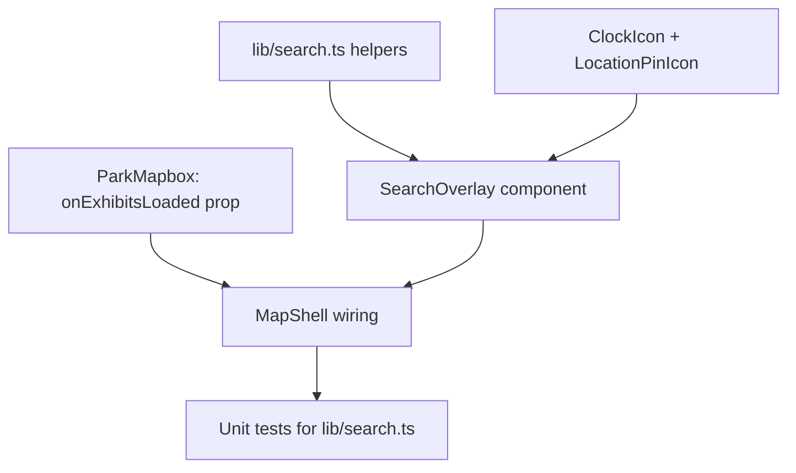

# Map: search feature

**GitHub**: [#56](https://github.com/makaravind/experium-ai-tour-app/issues/56)
**Milestone**: m2b-mechanics
**Status**: NOT STARTED

---

## Context

The map tab already has a "Search" pill rendered at the top of the screen (`app/(map)/layout.tsx`), but it's a static, non-functional div — tapping it does nothing. This story wires it up: tapping the pill opens a full-screen search overlay that lets a visitor find an exhibit by name, see their trail progress, see which results are physically nearby, and jump straight to a result.

Before: a decorative "Search" pill that does nothing.
After: tapping it opens a full-screen list of exhibits (filterable by name), shows the visitor's milestone trail progress, flags nearby exhibits with a distance, and tapping a result flies the map to it (or deep-links to the exhibit page if the map failed to load).

There is no "trail" or "point of interest" entity in the schema — the GitHub issue's wording ("exhibits, trails, or points of interest") is loose; `trail` in this codebase means the gamification milestone progress bar (`lib/trail.ts`), not a location. The only searchable entity is `exhibits`.

A clickable prototype of every state below (idle pill, empty-query list, filtered list, no-results, map-failed fallback) exists at `map-search.html` in the Open Design project `71dad1fb-67b1-46ef-8286-29bd197b9d61` — open it to see the exact visual target before implementing.

---

## Architecture Decisions

### Scope: exhibits only, matched by name

**Decision**: Search matches only against `MapExhibit.name`, case-insensitive substring, anywhere in the string (not prefix-only, not fuzzy).
**Why**: `exhibits` is the only queryable location entity in the schema. `type` is usually `null` in seed data, so it isn't a reliable second field. Substring-anywhere is the simplest matching rule that still finds results if a visitor only remembers part of a name.
**Alternatives considered**: prefix-of-word matching (rejected — "urban" wouldn't match "ban", feels less forgiving for a casual park visitor); fuzzy/typo-tolerant matching (rejected — unnecessary complexity for a ~40–90 row dataset).
**Consequences**: no relevance ranking. Results are always sorted alphabetically, whether the query is empty or not.

### Exhibit list ownership: lift via callback, fallback fetch only when needed

**Decision**: `ParkMapbox` fetches and owns the exhibit list today (`exhibitsRef`, populated inside the Mapbox `load` handler). It gains an `onExhibitsLoaded(exhibits)` prop, called once right after `exhibitsRef.current` is populated. `MapShell` (`app/(map)/layout.tsx`) stores this in new state and passes it to the search overlay. If `ParkMapbox` never mounts (`mapFailed === true`), `MapShell` runs its own one-time fallback Supabase fetch, using the same `.eq`/`.not` filters as `ParkMapbox`'s query (`exhibit_qr_codes.status = active`, `gps_lat`/`gps_lng` not null) but select only `id, name, type, tier, status, gps_lng, gps_lat, exhibit_qr_codes(code)` — **not** `exhibit_audio(language, status)`.
**Why**: avoids a duplicate network request in the common case (reuses data already being fetched for pins), but still makes search usable in the one state where `ParkMapbox` doesn't exist on the page at all. The fallback deliberately skips the `exhibit_audio` join — `SearchOverlay` never reads `MapExhibit.languages`, so there's no reason to pull or join that table for this path.
**Alternatives considered**: always fetch independently in `MapShell` (rejected — duplicates the query every page load, and risks silently drifting from the pin-filtering logic over time); selecting `exhibit_audio` too for byte-for-byte parity with `ParkMapbox`'s query (rejected — an unused join adds query cost for a field nothing in this feature displays).
**Consequences**: fallback-built `MapExhibit` objects always have `languages: []` — this is intentional, not a bug, and must not be "fixed" to match `ParkMapbox`'s query later without checking whether anything started relying on it. Two code paths populate the same state variable; guard the fallback fetch so it only fires once (e.g. only if the list is still empty) — otherwise a flaky Mapbox token could cause rapid repeat Supabase queries.

### Coming-soon exhibits: included, badged, tappable

**Decision**: `status: 'coming_soon'` exhibits appear in results with a "Soon" badge. In normal mode they're tappable like any other result (fly + open sheet) — same as how a coming-soon pin on the map is already tappable today. In map-failed mode, a coming-soon result is only tappable (routes to `/s/[qr_code]`) if it has an active `qr_code`; otherwise it renders disabled (no chevron, muted).
**Why**: hiding them from search while they're visibly plotted as pins on the map would be a confusing gap. The qr_code guard in fail-mode exists because that's the only way to open an exhibit without a working map, and some coming-soon exhibits genuinely have no active code yet.
**Consequences**: the search row component needs to know both `status` and whether `qr_code` is null, and needs a different `disabled` rule depending on `mapFailed`.

### UI pattern: full-screen overlay, not a dropdown

**Decision**: tapping the pill expands to a `fixed inset-0` full-screen view (header + input + scrollable list), matching the solid-background full-screen pattern already used by `InfoModal.tsx`. It is not an inline dropdown under the pill.
**Why**: the result list (up to ~90 rows) and the trail card both need real vertical space on a phone screen; a dropdown under a pill positioned at `top: 60` would clip badly and complicate dismiss-on-outside-tap logic.
**Consequences**: needs its own back/close affordance (there's no backdrop to tap away).

### Opening search closes any open preview first

**Decision**: the search pill's `onClick` runs the exact same close logic as the existing `handleMapTap` — clear `mapSelectedExhibit`, and if currently on an exhibit sub-page (`/s/[code]`), `router.push('/map')` — *before* calling `setSearchOpen(true)`.
**Why**: requested explicitly — if a preview sheet (or full exhibit page) is open and the visitor taps search, the preview must close first, not just get visually covered by the overlay.
**Consequences**: `handleMapTap`'s close logic needs to be reusable from two call sites — just call `handleMapTap()` directly (its body already does exactly this), then `setSearchOpen(true)`, in the pill's handler. This narrows — but, importantly, does **not eliminate** — the race condition described in the next decision, because `setSearchOpen(true)` renders the overlay synchronously while `router.push('/map')` is an async navigation; the overlay (and its first result) can be interactive before `pathname` actually updates to `/map`.

### Result tap behavior differs by map state — and must survive an in-flight navigation

**Decision**: selecting a result:
- **Normal mode** (map loaded): closes the overlay, flies the camera to the exhibit (`setFlyToTarget`), and opens `PreviewSheet` for it — i.e. pin-tap + the sheet's "Navigate" button, combined into one tap, since a search result is often off-screen.
- **Map-failed mode**: closes the overlay and routes straight to `/s/[qr_code]` (no camera to fly, no map to show a pin on).

**Why**: a plain pin-tap only opens the sheet without moving the camera, which would leave the visitor looking at an unrelated part of the map for an off-screen result.

**The race condition**: `MapShell` has an existing effect that clears map-page state whenever `isExhibitPage` transitions to `false`:
```ts
useEffect(() => {
  if (!isExhibitPage) {
    setMapSelectedExhibit(null)
    setFlyToTarget(null)
    setNavigateEnabled(false)
  }
}, [isExhibitPage])
```
Opening search from an exhibit sub-page triggers `router.push('/map')` (previous decision), but that navigation is async — `isExhibitPage` doesn't flip to `false` until it resolves. The overlay is visible and tappable immediately (e.g. the empty-query list, or a one-character match) well before that happens on a slow device/network. If a visitor taps a result in that window, setting `mapSelectedExhibit`/`flyToTarget` directly would get wiped moments later when the effect finally fires on the `isExhibitPage` true→false transition. This is a real, if narrow, window — not eliminated by closing the preview before opening search, only shortened.

**Resolution**: keep a ref for a selection made before the navigation has settled, and have the existing effect apply it instead of unconditionally clearing:
```ts
const pendingSearchSelectRef = useRef<MapExhibit | null>(null)

useEffect(() => {
  if (!isExhibitPage) {
    const pending = pendingSearchSelectRef.current
    pendingSearchSelectRef.current = null
    if (pending) {
      setMapSelectedExhibit(toPreviewExhibit(pending))
      setFlyToTarget(pending.id)
      setNavigateEnabled(true)
    } else {
      setMapSelectedExhibit(null)
      setFlyToTarget(null)
      setNavigateEnabled(false)
    }
  }
}, [isExhibitPage])
```
`handleSearchSelect` checks the *current* `isExhibitPage` value at tap time:
- still `true` (navigation from `handleOpenSearch` hasn't resolved yet) → `pendingSearchSelectRef.current = exhibit`; the effect above applies it once `isExhibitPage` catches up to `false`.
- already `false` (the overwhelmingly common case — any navigation has long since settled by the time a visitor finishes typing/scrolling/tapping) → set `mapSelectedExhibit` / `flyToTarget` / `navigateEnabled` directly; the effect won't re-fire since `isExhibitPage` isn't changing.

**Consequences**: the existing clear-on-leave effect gains one `if (pending)` branch — a small, surgical change, not a rewrite. `handleSearchSelect` has three branches: `mapFailed`, `isExhibitPage` (defer via ref), and the direct-set fast path.

### Matching: no debounce, re-filter every keystroke

**Decision**: filter the in-memory list on every keystroke. No debounce, no server round-trip.
**Why**: dataset is small (~40–90 rows) and already resident in memory — a debounce would only add perceived latency for no performance benefit.

### Empty query shows the full list, A–Z

**Decision**: with no query typed, show every exhibit sorted alphabetically. The list narrows as the visitor types.
**Why**: many visitors won't know exact exhibit names; being able to browse is more useful than a blank "type to search" screen.

### Thumbnails are placeholder gradients, sharing `Gallery.tsx`'s constant

**Decision**: each row gets a 46×46 rounded-square thumbnail using a flat gradient — green for live, tan for coming-soon — not a real photo. `Gallery.tsx`'s existing `PLACEHOLDER` object (currently a local, non-exported `const`) gets an `export` added so `SearchOverlay.tsx` can import `{ PLACEHOLDER }` and reuse `PLACEHOLDER.hero` (live) / `PLACEHOLDER.blank` (coming-soon) as the actual background values, instead of re-typing the gradient strings.
**Why**: `Gallery.tsx` (the exhibit page's photo carousel) already renders these hardcoded placeholder gradients regardless of the `exhibit_photos.url` column — the app has no real photo pipeline wired up anywhere yet. Inventing new-but-similar gradient strings here would drift from `Gallery.tsx` over time; a shared constant doesn't.
**Note**: this reuses the *values*, not the *selection rule* — `Gallery.tsx` picks hero-vs-blank by photo index (first slide vs the rest), while `SearchOverlay` picks it by `exhibit.status` (`live` vs `coming_soon`). These are two different axes that happen to want the same two colors; that's a coincidence worth stating explicitly so a future reader doesn't assume one rule derives from the other.
**Consequences**: `export const PLACEHOLDER = {...}` is the only change required in `Gallery.tsx` for this story. If/when real exhibit photos are wired up app-wide, this and `Gallery.tsx` should be revisited together.

### Trail progress: reuse `TrailCard` unchanged

**Decision**: render the existing `<TrailCard />` component (currently only used on the home screen) directly inside the search overlay, between the input and the results list. No new progress component, no props threading — `TrailCard` already reads `totalDiscovered` from `useStore` itself.
**Why**: the ask was literally to show "the same one" progress indicator used on the home screen. `TrailCard` is self-contained (no required props), so dropping it in elsewhere is a one-line change, not a rebuild.
**Consequences**: `TrailCard` also owns its own `MilestoneModal` — tapping a milestone node inside the search overlay will open that modal on top of the search overlay, which is already how it behaves on the home screen. No special-casing needed.

### Nearby badge: reuse the existing 50m radius, don't touch `nearestWithin`

**Decision**: a result row gets a green "Nearby" badge + a rounded distance ("38m away") if its id is in `useMapStore`'s `nearbyExhibitIds` (the same list that drives the map's pulse/sparkle marker animation — live, unvisited exhibits within 50m of the last GPS fix, gated on GPS accuracy ≤60m). The distance itself is computed in the search overlay via the existing `haversineMetres(userPosition, exhibit)` from `lib/nearby.ts` — `nearestWithin` is not modified to return distances.
**Why**: reuses the exact proximity rule already defined and tested in `lib/nearby.ts` instead of inventing a second "nearby" concept. Not touching `nearestWithin`'s return shape avoids a ripple change into `ParkMapbox`'s existing call site.
**Alternatives considered**: have `nearestWithin` return `{id, distance}[]` instead of `string[]` (rejected — touches a tested, working function and its one existing call site for a need only the search overlay has).
**Consequences**: this badge is naturally absent in map-failed mode, since `nearbyExhibitIds`/`userPosition` are only ever populated by `ParkMapbox`'s GPS handler, which never runs if `ParkMapbox` never mounts. No extra guard needed beyond passing `mapFailed` through for clarity.

---

## Implementation Plan

1. **`lib/search.ts`** (new file) — pure, testable helpers, no React:
   - `matchesQuery(name: string, query: string): boolean` — `name.toLowerCase().includes(query.trim().toLowerCase())`; empty query always matches.
   - `filterExhibits(exhibits: MapExhibit[], query: string): MapExhibit[]` — filters by `matchesQuery` then sorts by `name.localeCompare(...)`. Called with an empty query, it just returns the full sorted list.
   - `matchRange(name: string, query: string): { start: number; end: number } | null` — returns the index range of the first match for highlighting, or `null` if the query is empty or doesn't match.

2. **`components/icons/index.tsx`** — add two small stroke icons following the existing `Stroke` helper pattern used by `CloseIcon`/`ChevronDownIcon`: `ClockIcon` (coming-soon badge) and `LocationPinIcon` (nearby badge, small filled dot — distinct from the large map `PinIcon`).

   **`components/exhibit/Gallery.tsx`** — add `export` to the existing `PLACEHOLDER` const (no other change). This is the only edit needed in that file.

3. **`components/map/ParkMapbox.tsx`** — add `onExhibitsLoaded?: (exhibits: MapExhibit[]) => void` to `ParkMapboxProps`. Call it once immediately after the `exhibitsRef.current = (data ?? []).map(...)` assignment closes (the closing `}))` of that `.map`), passing `exhibitsRef.current` — the same point the existing peek-chip code already reads `exhibitsRef.current` from.

4. **`components/exhibit/SearchOverlay.tsx`** (new file) — the overlay itself:
   ```ts
   interface SearchOverlayProps {
     exhibits: MapExhibit[]
     nearbyExhibitIds: string[]
     userPosition: { lat: number; lng: number } | null
     mapFailed: boolean
     onClose: () => void
     onSelect: (exhibit: MapExhibit) => void
   }
   ```
   **Mounting**: `MapShell` conditionally renders it — `{searchOpen && <SearchOverlay ... />}` — the same pattern `InfoModal`/`MilestoneModal` already use elsewhere in this app, rather than always mounting it and toggling visibility with CSS. There is therefore no `open` prop and no need to reset `query` in an effect: a fresh `useState('')` starts empty every time the component mounts, which is every time it opens.
   - Autofocus the `<input>` on mount (ref + effect, or the `autoFocus` prop — confirm it fires reliably inside a `fixed` overlay on iOS Safari).
   - `const results = filterExhibits(exhibits, query)` from `lib/search.ts`.
   - Section header: `"All exhibits · A–Z"` when `query === ''`, else `"${results.length} matches"`.
   - Empty state (centered icon + text) when `query !== '' && results.length === 0`. The text must interpolate the live `query` value (e.g. `Nothing matches "${query}"`) — this is required by the Acceptance Criteria below, not optional polish.
   - Render `<TrailCard />` unchanged, directly under the input row, above the results list/empty state.
   - Per row: thumbnail div using `PLACEHOLDER.hero`/`PLACEHOLDER.blank` imported from `Gallery.tsx` (class/style driven by `status`), name with `matchRange` highlight wrapped in `<mark>`, "Soon" badge for `coming_soon`, "Nearby" badge + `Math.round(haversineMetres(userPosition, {lat: exhibit.gps_lat, lng: exhibit.gps_lng}))` + `m away` when `userPosition && nearbyExhibitIds.includes(exhibit.id)`, chevron unless disabled.
   - `disabled = mapFailed && !exhibit.qr_code`. Disabled rows get no `onClick`, no chevron, reduced opacity.
   - Tappable rows call `onSelect(exhibit)`.

5. **`app/(map)/layout.tsx` (`MapShell`)**:
   - New state: `searchOpen` (bool), `exhibitsForSearch` (`MapExhibit[]`).
   - New ref: `pendingSearchSelectRef = useRef<MapExhibit | null>(null)`.
   - Pass `onExhibitsLoaded={setExhibitsForSearch}` to `<ParkMapbox>`.
   - New `useEffect`: when `mapFailed` becomes `true` and `exhibitsForSearch.length === 0`, run the fallback Supabase query (see "Exhibit list ownership" decision for the exact select/filters — no `exhibit_audio` join), map to `MapExhibit[]`, call `setExhibitsForSearch`.
   - Extend the existing clear-on-leave effect (`layout.tsx:33-39`) with the `pendingSearchSelectRef` branch described in "Result tap behavior differs by map state" above. This is the one existing effect this story modifies — everything else below is additive.
   - Add `handleOpenSearch()`: calls `handleMapTap()` (closes any open preview / routes off an exhibit sub-page — reuse as-is, no changes needed), then `setSearchOpen(true)`. Wire the static search pill div (currently just markup, around the `SearchIcon` + "Search" text) with `onClick={handleOpenSearch}`.
   - Add `handleSearchSelect(exhibit: MapExhibit)`:
     - `setSearchOpen(false)`
     - if `mapFailed`: `if (exhibit.qr_code) router.push(`/s/${exhibit.qr_code}`)`; return.
     - if `isExhibitPage`: `pendingSearchSelectRef.current = exhibit`; return (the pending navigation from `handleOpenSearch` hasn't resolved yet — the clear-on-leave effect will apply this once it does).
     - else: `setMapSelectedExhibit({...}); setFlyToTarget(exhibit.id); setNavigateEnabled(true)` directly (mirrors the net *effect* of a pin tap followed by tapping "Navigate" on the sheet — but as three direct setter calls, not by literally calling `handlePinTap`/`handleNavigate`; `handleNavigate`'s real body has an `if (!isExhibitPage) setMapSelectedExhibit(null)` line that would immediately undo a literal call once `isExhibitPage` is false).
   - Render `{searchOpen && <SearchOverlay exhibits={exhibitsForSearch} nearbyExhibitIds={...} userPosition={...} mapFailed={mapFailed} onClose={() => setSearchOpen(false)} onSelect={handleSearchSelect} />}`, reading `nearbyExhibitIds` / `userPosition` from `useMapStore`.

6. **`__tests__/search.test.ts`** (new file) — unit tests for `matchesQuery`, `filterExhibits`, `matchRange` from `lib/search.ts`.

---

## Task Graph



---

## Code References

- `lib/types.ts:31` — `MapExhibit` shape; no changes needed, already has every field the overlay needs (`id`, `name`, `type`, `tier`, `gps_lat`, `gps_lng`, `qr_code`, `languages`, `status`)
- `lib/map-store.ts` — `nearbyExhibitIds`, `userPosition` already live here; read, don't add to, this store
- `lib/nearby.ts` — `haversineMetres`, `nearestWithin`; reuse `haversineMetres` for display distance, do not change `nearestWithin`'s signature
- `lib/trail.ts` + `components/exhibit/TrailCard.tsx` — drop `<TrailCard />` into the overlay unchanged
- `components/map/ParkMapbox.tsx:229-251` — exhibit fetch + `exhibitsRef` assignment (the `.map(...)` closes at line 251); add the `onExhibitsLoaded` call right after this
- `components/map/ParkMapbox.tsx` (`PeekChip` type + `calcPeekChips`, roughly lines 59-124) — prior art for extracting a pure, independently-testable function out of this file. Lines after that (`EDGE_ROTATION`/`MARGIN` constants and the `PeekChipEl` JSX renderer) are not part of this prior art and aren't covered by `calcPeekChips.test.ts` — don't follow those as a pattern.
- `app/(map)/layout.tsx:33-39` (clear-on-leave effect) — gains the `pendingSearchSelectRef` branch; see "Result tap behavior differs by map state"
- `app/(map)/layout.tsx:76-83` (`handleMapTap`) — reuse directly, unchanged, from `handleOpenSearch`
- `app/(map)/layout.tsx:64-74` (`handlePinTap`) and `:85-90` (`handleNavigate`) — the behavior `handleSearchSelect`'s direct-set branch mirrors the *effect* of, without literally calling either (see Implementation Plan step 5 for why not)
- `app/(map)/layout.tsx:131-142` — the static search pill markup to wire up
- `components/exhibit/InfoModal.tsx`, `components/exhibit/MilestoneModal.tsx` — precedent for both the `fixed inset-0` full-screen overlay pattern and the conditional-mount-rather-than-css-hide pattern `SearchOverlay` should follow
- `components/exhibit/Gallery.tsx` — `PLACEHOLDER` const; add `export` and import `PLACEHOLDER.hero`/`PLACEHOLDER.blank` directly into `SearchOverlay.tsx` rather than re-typing the gradient strings
- `components/icons/index.tsx` — `Stroke` helper + existing icon components; follow this pattern for `ClockIcon`/`LocationPinIcon`
- `supabase/migrations/20260926000000_add_exhibit_status.sql` — `ExhibitStatus` (`live`/`coming_soon`) origin

---

## Acceptance Criteria (Technical)

- [ ] Tapping the search pill opens a full-screen overlay with an autofocused input
- [ ] With an empty query, all exhibits render alphabetically by name
- [ ] Typing filters the list to case-insensitive substring matches on `name`, re-filtering on every keystroke
- [ ] The matched substring is visually highlighted in each result name
- [ ] A query with zero matches shows a centered empty state that echoes the query text
- [ ] `coming_soon` exhibits appear with a "Soon" badge and remain tappable in normal mode
- [ ] If a preview sheet (or exhibit sub-page) is open, tapping the search pill closes it first (same effect as tapping the map) and only then opens the overlay
- [ ] Selecting a result while the map is loaded: overlay closes, map flies to the exhibit, `PreviewSheet` opens for it
- [ ] On a throttled/slow network, opening search from an exhibit sub-page and immediately tapping a result (before the `/map` route finishes resolving) still flies to and opens the sheet for the selected exhibit — it is not silently dropped by the clear-on-leave effect
- [ ] Selecting a result while `mapFailed` is true routes to `/s/[qr_code]`; a `coming_soon` result with no active `qr_code` renders disabled (no chevron) in this mode only
- [ ] A result whose id is in `nearbyExhibitIds` shows a "Nearby" badge and a rounded metre distance computed via `haversineMetres`
- [ ] The search overlay never fires its own Supabase query when `ParkMapbox` already supplied the list via `onExhibitsLoaded`
- [ ] `TrailCard` renders inside the overlay with no prop changes and no duplicated logic

---

## Testing

- **What to test**: `matchesQuery`, `filterExhibits`, `matchRange` in `lib/search.ts` — pure functions, no DOM/React involved
- **Test type**: unit (Vitest)
- **Prior art**: `__tests__/trail.test.ts` — same style of pure-function table testing against `lib/trail.ts`; `__tests__/calcPeekChips.test.ts` — same pattern of testing logic extracted out of `ParkMapbox.tsx`
- **What NOT to test**: `SearchOverlay`'s React rendering, Mapbox fly-to behavior, or `TrailCard`'s internals (already covered by its own prior art)
- **Manual/e2e only**: the `pendingSearchSelectRef` race path (slow-network tap-before-navigation-settles) depends on real Next.js router timing and isn't practically unit-testable — verify it by hand with throttled network in devtools, per the "throttled/slow network" Acceptance Criterion above

---

## Open Questions

None — all design decisions were resolved via a grilling session plus a reviewed Open Design prototype (`map-search.html`, project `71dad1fb-67b1-46ef-8286-29bd197b9d61`) before this spec was written.
