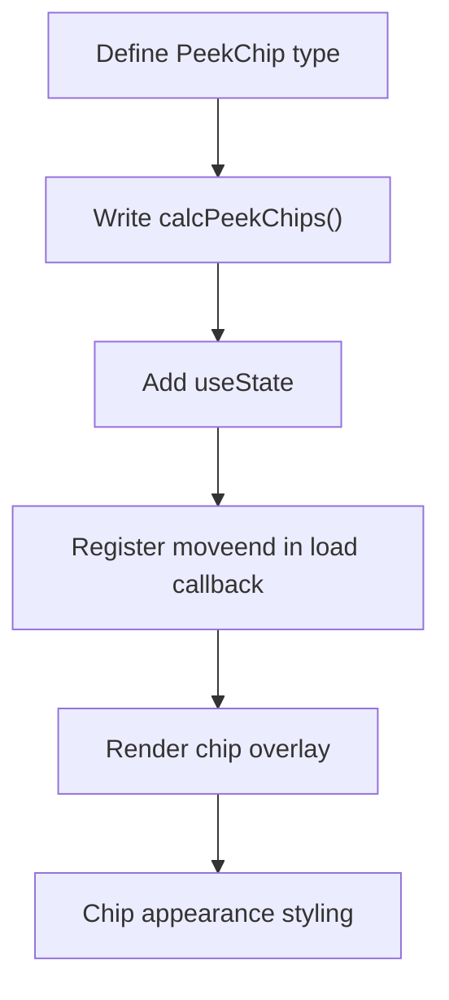

# Map: off-screen marker peek chips

**GitHub**: [#57](https://github.com/makaravind/experium-ai-tour-app/issues/57)
**Milestone**: m2b-mechanics
**Status**: NOT STARTED

---

## Context

The map currently shows exhibit pins only when they're inside the visible viewport. When a visitor pans, pins silently disappear off-screen — there's no hint that more exhibits are nearby. This feature adds small pill-shaped chips that peek in from the viewport edge whenever a nearby exhibit is just off-screen. Chips are passive and informational; tapping them does nothing.

Before: pan the map → off-screen pins vanish with no indication.
After: pan the map → nearby off-screen exhibits show a small colored chip on the nearest viewport edge, passively communicating "there's something this way."

---

## Architecture Decisions

### Zone filter: extended-rectangle, not circular radius

**Decision**: Qualify off-screen exhibits using a rectangle that extends the current viewport bounds by 50% in each dimension (W × 1.5, H × 1.5, centered on the same center point).

**Why**: The issue spec said "1.5× viewport radius" but the viewport is a rectangle. An extended rectangle is simpler — one `getBounds()` call, no distance math — and produces consistent results with the bounded park area.

**Alternatives considered**: Half-diagonal circular zone. Rejected: adds a `map.project()`-based distance calc and has no meaningful behavioral difference at park scale.

**Consequences**: Corner exhibits qualify more liberally than strictly equidistant edge exhibits. Acceptable for a passive hint feature.

### Corner markers: dominant axis wins

**Decision**: A marker outside both a horizontal and vertical edge gets one chip on the edge it most overshot. Compare `|dx|` (pixel overflow past left/right edge) vs `|dy|` (pixel overflow past top/bottom edge); the larger one determines the edge.

**Why**: Two chips for one marker clutters corners. One chip is unambiguous.

**Alternatives considered**: Show chip at nearest corner. Rejected: a chip pinned to a corner gives no directional information about where along the edge the exhibit actually is.

### Visited state: snapshot on `moveend`, not reactive

**Decision**: Read `useStore.getState().visitedExhibits` once per `moveend` event to color chips. No Zustand subscription.

**Why**: Chips recalculate on every `moveend`. If a visitor scans an exhibit and pans the map, the chip color updates on the next pan — close enough. A subscription adds a `useEffect` dependency and a re-render path for a minor edge case.

### Chips inline in `ParkMapbox`, not extracted

**Decision**: Add `useState<PeekChip[]>` and chip rendering directly inside `ParkMapbox.tsx`.

**Why**: `ParkMapbox` already owns `mapRef` and `exhibitsRef`. Extracting requires threading both refs into a child component for ~60 lines of new code.

### `moveend` registered inside `load` callback

**Decision**: Register `map.on('moveend', ...)` inside the existing `map.on('load', ...)` handler, after exhibits are fetched.

**Why**: Consistent with how all other event handlers are registered (`click`, `mouseenter`). Guarantees `exhibitsRef.current` is populated before the first `moveend` fires.

### `pointer-events-none` on chip overlay

**Decision**: The chip container div has `pointer-events-none`. Individual chip elements also have no click handlers.

**Why**: Chips are purely informational (spec: "no tap interaction"). Without this, chip divs would intercept touch events at the viewport edges and break map panning.

---

## Implementation Plan

1. **Define `PeekChip` type** in `ParkMapbox.tsx` (file-local, no need to export):
   ```ts
   type PeekChip = {
     id: string
     name: string
     visited: boolean
     edge: 'left' | 'right' | 'top' | 'bottom'
     offset: number  // px along the edge: y-coord for left/right, x-coord for top/bottom
   }
   ```

2. **Write `calcPeekChips(map, exhibits, visitedIds)`** — pure function, no side effects. Logic:
   - `bounds = map.getBounds()` → `sw`, `ne`
   - Compute extended bounds: expand each side by 50% of viewport width/height
   - For each exhibit: skip if inside viewport bounds; skip if outside extended bounds
   - For qualifying exhibits: `map.project([lng, lat])` → pixel `{x, y}`
   - `W = map.getCanvas().width`, `H = map.getCanvas().height`
   - Compute overflow: `dx = x < 0 ? x : x > W ? x - W : 0`, same for `dy`
   - Dominant axis: `Math.abs(dx) >= Math.abs(dy)` → horizontal edge; else vertical
   - Assign `edge`: left/right from sign of `dx`; top/bottom from sign of `dy`
   - `offset`: clamp `y` to `[16, H - 16]` for left/right edges; clamp `x` to `[16, W - 16]` for top/bottom
   - Return `PeekChip[]`

3. **Add `useState<PeekChip[]>([])` to `ParkMapbox`** near the other refs at the top of the component.

4. **Register `moveend` inside the `load` callback**, after the exhibits fetch and pin layer setup:
   ```ts
   map.on('moveend', () => {
     const visited = useStore.getState().visitedExhibits
     setPeekChips(calcPeekChips(map, exhibitsRef.current, visited))
   })
   ```

5. **Render chip overlay** — add a sibling div inside the existing `<div className="absolute inset-0">` wrapper, after the `containerRef` div:
   ```tsx
   <div className="absolute inset-0 overflow-hidden pointer-events-none">
     {peekChips.map((chip) => (
       <PeekChipEl key={chip.id} chip={chip} />
     ))}
   </div>
   ```
   Position each chip based on `chip.edge` and `chip.offset`. Use `transform: translateX(-40%)` (left), `translateX(40%)` (right), `translateY(-40%)` (top), `translateY(40%)` (bottom) so the chip visually peeks in from the edge. The container's `overflow-hidden` clips the protruding portion.

6. **Chip appearance**: small pill (`rounded-full px-2 py-1 text-xs`), white background, colored left-border dot (`bg-[#588157]` visited / `bg-[#dda15e]` unvisited), exhibit name truncated with `max-w-[80px] truncate`.

---

## Task Graph



---

## Code References

- `components/map/ParkMapbox.tsx` — the only file changed; all event handlers, refs, and render logic live here
- `lib/types.ts:29` — `MapExhibit` shape (`id`, `name`, `gps_lat`, `gps_lng`)
- `lib/store.ts:14` — `visitedExhibits: string[]`

---

## Acceptance Criteria (Technical)

- [ ] Panning so a nearby exhibit exits the viewport → chip appears on the correct edge within ~300ms of pan end (`moveend` fires on map idle, not continuously)
- [ ] Chip `top`/`left` value tracks the proportional position where the marker exited the edge (not always centered)
- [ ] Chip dot color: `#588157` if `visitedExhibits.includes(exhibit.id)`, `#dda15e` otherwise
- [ ] Exhibits outside the 1.5× extended viewport rectangle show no chip
- [ ] In-viewport exhibits show no chip
- [ ] Corner exhibits (off both edges) show exactly one chip on the dominant-overflow edge
- [ ] Chip overlay has `pointer-events-none` — map pan/zoom is not blocked near edges

---

## Testing

- **What to test**: `calcPeekChips()` pure function — input a mock `map` object with stubbed `getBounds()`, `project()`, `getCanvas()` and a list of `MapExhibit` fixtures; assert correct `edge`, `offset`, and `visited` values in output
- **Test type**: unit
- **What NOT to test**: React rendering of chips, CSS appearance, Mapbox internals

---

## Open Questions

None — all design decisions resolved.
