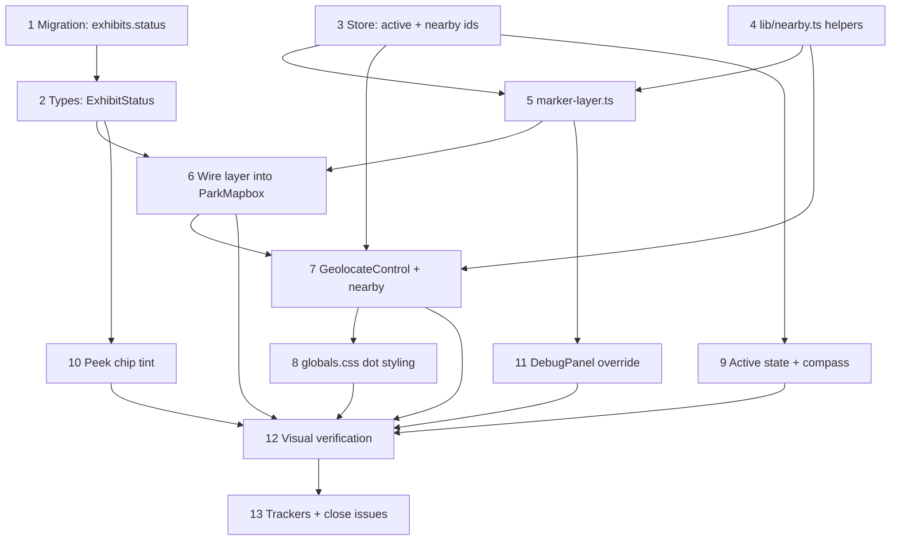

# 3D metal map markers (Three.js custom layer)

**GitHub**: [#58](https://github.com/makaravind/experium-ai-tour-app/issues/58)
**Milestone**: m2b-mechanics — Map Mechanics
**Status**: NOT STARTED
**Closes**: [#49](https://github.com/makaravind/experium-ai-tour-app/issues/49) GPS dot, [#50](https://github.com/makaravind/experium-ai-tour-app/issues/50) Nearby pulse

---

## Context

The park map is a Mapbox GL JS map with a drone orthophoto raster on top (`components/map/ParkMapbox.tsx`). Exhibits are currently drawn as an 8 px Mapbox `circle` layer — orange `#dda15e` if unvisited, green `#588157` if visited. Tapping a circle opens the Preview bottom sheet. That is all the visual vocabulary the map has today: two colours, one shape, no animation, and no sense of where the visitor is standing.

This story replaces those circles with the 3D metallic map pin that was designed and signed off in `sample-map/marker-3d.html` — an orange polished-metal teardrop with a hole through the head — and gives it the five states from the Open Design reference `map-marker-states.html`: unvisited, visited, coming-soon, nearby, and active/selected. Because "nearby" needs a live GPS fix, this story also delivers the GPS you-are-here dot (#49) and the nearby animation (#50).

**Before**: flat coloured dots, no animation, no GPS, `exhibits` has no lifecycle column.
**After**: metallic 3D pins drawn by Three.js into Mapbox's own WebGL context, tinted by visit/lifecycle state, with a sparkle on the nearest few exhibits and a rise-and-spin on the selected one; a tracked GPS dot; and a new `exhibits.status` column driving the coming-soon look.

> Two reference artefacts govern this work, and they disagree in one place. `sample-map/marker-3d.html` is the newer and authoritative source for **geometry and material**; `map-marker-states.html` is authoritative for **which states exist and how they animate**. Where they conflict (the head has a through-hole in 3D but is solid with a category icon in 2D), the decision below resolves it.

---

## Architecture Decisions

### Mapbox custom layer sharing the GL context

**Decision**: Render with `map.addLayer({ type: 'custom', onAdd, render })`, constructing the Three.js `WebGLRenderer` over Mapbox's existing canvas and GL context: `new THREE.WebGLRenderer({ canvas: map.getCanvas(), context: gl })`.

**Why**: One canvas, one GL context, and the markers are composited by Mapbox itself at a defined point in the layer order — so there is no second canvas to keep in sync and no chance of the markers lagging the basemap during `flyTo`.

**Alternatives considered**:
- *Pre-baked sprite atlases* on a Mapbox `symbol` layer. Cheapest and needs no runtime WebGL, but animation means swapping `icon-image` (a layout property, so not feature-state-drivable) every frame.
- *A separate transparent Three.js canvas above the map*, positions synced via `map.project()`. Simple, but a second canvas can visibly lag the basemap mid-animation.

**Consequences**: We are a guest in someone else's GL context, which imposes three hard rules the implementation must not break:

1. `renderer.resetState()` at the top of every `render()` call, and once after `onAdd` finishes, so neither renderer corrupts the other's state.
2. `renderer.autoClear = false`, and **never** call `renderer.setSize()` or touch the canvas dimensions — Mapbox owns them.
3. Our materials use `depthTest: false, depthWrite: false` so we never write to Mapbox's depth buffer.

It also means **`queryRenderedFeatures` cannot see our markers**, which breaks tap handling — see the hit-testing decision below.

### Placement via `map.project()` and a screen-space orthographic camera

**Decision**: Do not use the `matrix` argument passed to `render()`. Instead give the Three.js scene an `OrthographicCamera` spanning the canvas in CSS pixels, and position each marker at `map.project(lngLat)`.

**Why**: The agreed semantics are *size derived from the world, orientation locked to the viewport, on-screen height clamped to a pixel range*. Once orientation is viewport-locked and size is expressed in pixels, the only thing we need from Mapbox's projection is the anchor point — and `map.project()` gives exactly that, in CSS pixels, already correct for the current zoom, pitch and bearing. Going through the mercator matrix instead would mean converting a pixel-clamped size back into mercator units and cancelling out the view rotation by hand, for no gain.

**Alternatives considered**: Use the supplied `matrix` with `MercatorCoordinate.fromLngLat(...).meterInMercatorCoordinateUnits()` for scale and an inverse-view quaternion for orientation. Faithful to the "3D object in the map" mental model, but strictly more math to arrive at the same pixels, plus z-fighting risk between coplanar markers.

**Consequences**: The markers are geometrically a screen-space billboard system that happens to be drawn inside Mapbox's context. That is exactly the agreed behaviour, but it means if the map ever gains real 3D content (terrain, extrusions) the markers will not be occluded by it.

`map.project()` returns **CSS** pixels while the GL drawing buffer is CSS × `devicePixelRatio`. Mapbox sets the GL viewport to the full drawing buffer, so an orthographic camera defined over the CSS-pixel extent maps correctly without any manual dpr multiplication. Do not add one.

### World-anchored 12 m, clamped to 24–96 px on screen

**Decision**: Target height in metres is a constant 12 m. Convert to pixels per frame and clamp:

```
metresPerPixel(zoom, lat) = 78271.517 * cos(lat) / 2^zoom   // 512px tiles
pinPx = clamp(12 / metresPerPixel(zoom, lat), 24, 96)
```

**Why**: 12 m is the height at which the pin is ~42 px tall at `STARTING_ZOOM` 18 — i.e. it matches the approved 38×50 px design the moment the map opens. The clamp exists because a strictly world-anchored 12 m pin is 3 px at `minZoom` 14 (invisible and untappable) and 676 px at Mapbox's default `maxZoom` 22.

The `78271.517` constant, rather than the more familiar `156543.034`, is because Mapbox GL uses 512 px tiles: one Mapbox zoom level covers the ground span of a 256-tile zoom level one step finer.

**Consequences**: The marker is only *strictly* world-anchored between roughly z17 and z20. Outside that window it behaves as a fixed-pixel marker. This is a deliberate trade and should not be "fixed" later without re-deciding.

### Viewport-aligned orientation

**Decision**: The pin always faces the viewer. Its silhouette is identical at any map pitch or bearing. (With the screen-space camera above, this is the default and requires no per-frame rotation work.)

**Why**: Mapbox's default `pitch` is 0 — the camera looks straight down. A pin that stood upright in world space would be seen end-on from above, showing the top of the head rather than the pin. Viewport-alignment is also what Mapbox's own `pitch-alignment: 'viewport'` symbols do, and it is what makes the active state's Y-spin read the way `map-marker-states.html` draws it.

**Consequences**: Rotating or pitching the map does not rotate the pins. The ground shadow is the only element that should hint at the map plane.

### Keep the through-hole; no category icons

**Decision**: Port `marker-3d.html`'s geometry unchanged — the head keeps its hole — and render **no** category icon. Tint is the only differentiator between markers.

**Why**: The 3D artefact is the newer and explicitly approved one, and the donut silhouette is the signed-off look. Adding an icon means either a recessed plate inside a ~10 px aperture at z18 or abandoning the silhouette.

**Consequences**: `exhibits.type` (`plant` / `structure` / `water_body` / `landmark`) becomes irrelevant to the marker; category is communicated only in the Preview sheet. Coming-soon loses the clock icon from the 2D reference and is signalled by tint and finish alone.

Geometry constants to carry over verbatim, and the derived numbers the rest of the spec depends on:

```
R = 1.0           head radius          depth          = 0.34
TIP = 2.05        head centre → tip    bevelThickness = 0.15
HOLE = 0.63       hole radius          bevelSize      = 0.13
                                       bevelSegments  = 16
                                       curveSegments  = 128

after geo.center():
  bbox        = min [-1.13, -1.682, -0.32]  max [1.13, 1.682, 0.32]
  PIN_UNITS_H = 3.364     // full height in pin units
  TIP_OFFSET  = 1.682     // tip sits this far below the mesh origin
```

The tip is the anchor: after positioning the mesh at the projected point, raise it by `TIP_OFFSET * (pinPx / PIN_UNITS_H)` so the tip — not the centre — lands on the exhibit's coordinate.

> Beware `ExtrudeGeometry`'s bevel: it adds `bevelThickness` at **both** ends and expands the contour outward in XY, so the front face is at `boundingBox.max.z` (0.32), **not** at `depth / 2` (0.17). Read it off the geometry (`geo.computeBoundingBox()`), never compute it. Getting this wrong makes the sparkle render inside the metal and vanish.

### PMREM studio environment, generated once in `onAdd`

**Decision**: Port `buildStudioEnv()` from `marker-3d.html` verbatim and run `PMREMGenerator.fromScene(env, 0.02)` exactly once, in `onAdd`. Keep `MeshStandardMaterial` with `metalness: 0.96, roughness: 0.11, envMapIntensity: 1.4`.

**Why**: A polished metal is almost pure reflection, so its appearance is decided by the environment map, not by lights — `RoomEnvironment` and ordinary lighting both look nothing like the approved marker. The studio lightbox (an overhead softbox, side strips, a low kicker, bars *behind the camera*, and a gradient-ramp backdrop) is the approved look.

**Consequences**: A one-time cost of roughly 50–150 ms when the layer is added, and PMREM mutates a lot of GL state — hence the mandatory `renderer.resetState()` after it. Because it runs once after `map.on('load')`, it does not affect first paint.

Two non-obvious properties of that environment scene that must survive the port: emissive panel colours are pushed **above 1.0** so they read as HDR light sources, and the panels *behind the camera* are load-bearing — a mirror-like front face reflects whatever sits behind the viewer, so without them the large flat faces render almost black.

### Hit-testing via an invisible circle layer, which doubles as the fallback

**Decision**: Keep the existing `exhibit-pins` circle layer with the same id and source, but set `circle-opacity: 0` and `circle-stroke-opacity: 0`, and zoom-interpolate `circle-radius` and `circle-translate` so the invisible disc sits over the drawn pin.

**Why**: Our markers are invisible to `queryRenderedFeatures`. Reusing the circle layer as a pure hit target means **every existing handler keeps working unchanged** — the pin click at `ParkMapbox.tsx:258`, the empty-map fallback at `:266` that `onMapTap` depends on, and the hover cursor at `:270`. And the same layer is the graceful degradation path: if Three.js cannot initialise, set the two opacities back to 1 and the map is exactly what it is today.

**Alternatives considered**: A Three.js `Raycaster` (most accurate, but the ray must be rebuilt from Mapbox's matrix — overkill for a ~42 px target), or a hand-rolled projected-rect test (then the empty-map fallback and hover cursor must be hand-rolled too).

**Consequences**: The hit target is a translated circle approximating the pin's box, so it will not match the silhouette exactly — notably for the spinning active pin. Acceptable for a touch target.

### Draw order: depth test off, sorted by projected screen y

**Decision**: Sort markers back-to-front by `map.project(lngLat).y` each frame; draw the active marker last, always on top.

**Why**: This is exactly what Mapbox's own `symbol-z-order: 'viewport-y'` default does, so 3D pins overlap in the same order as any symbol layer and the peek chips. Unlike sorting by latitude, it stays correct when the visitor rotates the map.

### Repaint on demand; only the active pin spins

**Decision**: Idle, visited and coming-soon pins are static. The active pin rises then spins; nearby pins sparkle. `map.triggerRepaint()` is called at the end of `render()` **only** when something is animating.

**Why**: A Mapbox custom layer only redraws when the map redraws, so "what animates" and "what costs battery" are the same question. This is a PWA used outdoors on phone batteries: a settled map must cost zero GPU. It also matches `map-marker-states.html`, where only the active pin spins — note this deliberately diverges from `marker-3d.html`, where the prototype pin revolves continuously because it was a single-object showcase.

**Consequences**: While a marker is selected the layer repaints continuously (the ref's spin is an infinite 2.2 s loop). That is accepted: a selection only exists while the Preview sheet is open.

### Baked shadow sprite, not a shadow map

**Decision**: One shared radial-gradient texture on a small plane under each pin's tip, squashed to a ~1 : 0.32 ellipse. No lights, no shadow map.

**Why**: Reproduces the `.shadow` element from the states ref exactly, at essentially zero cost. A real shadow map would mean an extra depth pass with 20–30 casters every frame inside a shared GL context, on mid-range Android, plus a ground plane that would z-fight with the ortho raster.

**Consequences**: The shadow does not react to the active pin's rotation. It is a contact shadow whose only job is to stop the pin looking like it floats above the photograph. Because it is drawn in screen space with a fixed aspect ratio it is only strictly correct at `pitch: 0` — which is the map's only pitch today. Revisit if pitch is ever introduced.

### Tints are F0 values; coming-soon is muted physically, not with opacity

**Decision**:

| State | `color` (F0) | `metalness` | `roughness` | `envMapIntensity` |
|---|---|---|---|---|
| unvisited | `0xdda15e` | 0.96 | 0.11 | 1.4 |
| visited | `0x588157` | 0.96 | 0.11 | 1.4 |
| coming_soon | `0x9e7548` | 0.90 | 0.35 | 0.7 |
| active | *(base tint)* | — | — | 2.0 |

**Why**: For a metal, `color` is the F0 value — it tints the reflection itself rather than a diffuse base — which is what gives the approved marker its warm gold cast. The hexes are the existing design tokens, reused verbatim. Coming-soon is muted by making the metal rougher and less reflective — i.e. tarnished — rather than by dropping opacity, because a semi-transparent metal shows the orthophoto through it and destroys the solid-object illusion the states ref's `opacity: 0.68` was only approximating in 2D.

**Consequences**: `#588157` is materially darker than `#dda15e` (L\* ≈ 50 vs ≈ 70), so visited pins may read as duller metal rather than merely green. **Check this during verification.** If it reads muddy, the fix is to lighten the marker's green F0 only (~`#8fbf85`), leaving the `#588157` token untouched for the peek chips, sheet and all 2D UI — do not change the token.

### `exhibits.status` column for coming-soon

**Decision**: Add an explicit column following the convention already used by `exhibit_audio`, `exhibit_qr_codes` and `reports`:

```sql
ALTER TABLE exhibits
  ADD COLUMN status TEXT NOT NULL DEFAULT 'live'
  CHECK (status IN ('live','coming_soon'));
```

**Why**: Coming-soon is an editorial decision about an exhibit's lifecycle. Deriving it from "has no published audio" would couple the map's appearance to whether a file happens to be uploaded yet, and deriving it per-language would re-tint the whole map whenever the visitor switches language.

**Consequences**: A migration plus a curation step — somebody has to actually set `coming_soon` on the right rows. All existing rows default to `live`, so the migration is behaviour-preserving. No query filter changes: coming-soon markers still render, just muted.

### State precedence

**Decision**: `active` > `coming_soon` > `visited` > `nearby` > `unvisited`.

Concretely: a coming-soon marker never sparkles even if the visitor is standing next to it (there is nothing to hear), and an already-visited marker you walk past again stays green without sparkling. `active` composes with any tint — the rise-and-spin applies on top of whatever colour the marker already has, so a coming-soon pin can still be tapped and spun while the sheet explains why there is no audio.

### GPS via Mapbox `GeolocateControl`

**Decision**: Add a `GeolocateControl` with `trackUserLocation: true`, `showAccuracyCircle: true`, `enableHighAccuracy: true`. Hide its default button with CSS and wire the **existing but currently inert** compass button at `app/(map)/layout.tsx:110` to `control.trigger()`.

**Why**: It satisfies #49 with almost no code — it calls `watchPosition` internally, renders the blue dot with a pulsing ring (`.mapboxgl-user-location-dot`) and the translucent accuracy circle, handles permission denial, and emits a `geolocate` event we can feed the nearby calculation from. #49 asked for the `.you-dot` CSS from `sample-map/drony-ortho.html` to be reused; restyle the Mapbox dot to match rather than rebuilding the dot.

**Consequences**: One dependency on Mapbox's control styling, overridden in `app/globals.css`. The user-location dot is a DOM `Marker`, not a layer, so it always composites above our canvas — no ordering conflict.

### Nearby: nearest 5 within 50 m, sparkle effect

**Decision**: Honour #50's acceptance criteria as written — up to the **nearest 5** exhibits within **50 m** are flagged nearby, recomputed on every `geolocate` event. Fixes with `accuracy > 60` m are discarded as junk. The effect is the approved metallic glint from `marker-3d.html` on a 1 s loop, with each marker's phase staggered by `i * 0.2 s` so they do not flash in unison.

**Why**: The radius and count come straight from the issue. "Pulse" in #50 is read as "the nearby animation", not as a literal expanding ripple ring — a ripple was explicitly rejected during the marker design, and both approved reference artefacts specify a sparkle.

**Consequences**: With five markers able to animate at once, the stagger matters — without it the map flashes. Because 50 m is generous relative to phone GPS accuracy, the set will change as the visitor moves; that is the intended behaviour per the AC, and the accuracy gate is what stops it thrashing on junk fixes.

### Sparkle sizing: proportional with a pixel floor

**Decision**: `sparklePx = max(0.28 * pinPx, 16)`.

**Why**: At the z18 pin size the glint sits on the metal exactly as approved. Strictly proportional, it would be ~7 px on a clamped 24 px pin and effectively invisible — the nearby state would stop communicating at low zoom. The floor makes it overhang the silhouette when the pin is small, which reads like the stars-around-the-pin treatment in the states ref.

**Consequences**: The glint is not rigidly attached to the pin at small sizes. Accepted.

### Marker state read from the store, not passed as props

**Decision**: Add `activeExhibitId: string | null` and `nearbyExhibitIds: string[]` to the existing `lib/map-store.ts`. `MapShell` writes `activeExhibitId`; the `geolocate` handler writes `nearbyExhibitIds`. The layer reads both with `getState()` inside `render()` and subscribes only to know it is dirty. Visited ids come from `lib/store.ts` the same way.

**Why**: `ParkMapbox` already reads stores imperatively inside map handlers (`useStore.getState()` at `:174`, `:226`, `:301`) — this follows the file's existing idiom rather than adding two more manually-synced refs to a file that already carries three (`:157-166`). And `MapShell` already computes the active exhibit: `sheetExhibit` at `layout.tsx:46` is exactly the union of "tapped a pin" and "arrived on an exhibit page".

### `three` lazy-imported, with a circle-layer fallback

**Decision**: Add `three` as a dependency but `await import('./marker-layer')` inside the `map.on('load')` handler, after the ortho and source are set up. Wrap it in `try/catch`; on failure, restore the circle layer's opacities.

**Why**: Visitors reach `/map` directly from a QR scan, often on mobile data. Three.js is ~150–200 KB gzipped and must not land in that route's first paint. The fallback matters because a device with WebGL blocked would otherwise show a park map with no visible exhibits at all.

**Consequences**: A small async ordering concern — the markers appear a beat after the basemap. The existing `MapStub` path for total map failure is untouched.

---

## Implementation Plan

1. **Migration** — add `supabase/migrations/<timestamp>_add_exhibit_status.sql` with the `ALTER TABLE` from the decision above. Follow the existing filename convention (`YYYYMMDDHHMMSS_description.sql`) and the `TEXT NOT NULL DEFAULT … CHECK (… IN (…))` style used throughout `20260809000000_initial_schema.sql`.

2. **Types** — in `lib/types.ts`, add `export type ExhibitStatus = 'live' | 'coming_soon'` and a `status: ExhibitStatus` field to `MapExhibit`. Add `status` to the `PeekChip` type in `ParkMapbox.tsx`.

3. **Store fields** — in `lib/map-store.ts`, add `activeExhibitId: string | null`, `nearbyExhibitIds: string[]` and their setters, alongside the existing `exhibitPageData`.

4. **Pure helpers** — new `lib/nearby.ts`, deliberately free of Mapbox and React so it is unit-testable:
   - `haversineMetres(a, b)`
   - `nearestWithin(position, exhibits, { radiusM: 50, maxCount: 5, maxAccuracyM: 60 })` → `string[]`, returning `[]` when the fix is too inaccurate, sorted nearest-first and truncated to `maxCount`
   - `metresPerPixel(zoom, lat)` and `pinPixelHeight(zoom, lat)` implementing the 12 m target and the 24–96 px clamp

5. **The custom layer** — new `components/map/marker-layer.ts`, exporting a factory that returns a Mapbox `CustomLayerInterface`. This is the bulk of the work; build it in this order so each stage is visually checkable:
   1. `onAdd`: construct the renderer over `map.getCanvas()` and `gl`, `autoClear = false`; build the pin `ExtrudeGeometry` once; generate the PMREM environment; create the three tinted materials, the shared shadow texture and the glint texture; `renderer.resetState()`.
   2. `render`: `renderer.resetState()`, read state via `getState()`, compute `pinPx`, project and sort markers by screen y, draw shadow then pin then glint per marker, active last.
   3. Add the rise-then-spin on the active marker: rise `0.32 * pinPx` over 0.4 s ease-out, then an infinite 2.2 s linear Y-spin; the shadow shrinks from `0.44 * pinPx` @ 0.55 opacity to `0.26 * pinPx` @ 0.25 over the same 0.4 s.
   4. Add the staggered 1 s glint loop for nearby markers, positioned off the front face at `boundingBox.max.z`.
   5. Call `map.triggerRepaint()` only when `activeExhibitId` or `nearbyExhibitIds.length` is non-zero.
   6. `onRemove`: dispose geometry, materials, textures and the PMREM target.

6. **Wire the layer into `ParkMapbox`** — add `status` to the Supabase select and to the `exhibitsRef` mapping; set the existing `exhibit-pins` circle layer's opacities to 0 and give it the zoom-interpolated `circle-radius` / `circle-translate`; lazily import and add the marker layer in `try/catch`, restoring the opacities on failure. Leave the click, empty-map and cursor handlers alone.

7. **GPS** — in the same `load` handler, add the `GeolocateControl`, and on its `geolocate` event call `nearestWithin(...)` and write the result to `nearbyExhibitIds`. Handle `error` by leaving the ids empty (permission denial must not throw).

8. **Hide the default geolocate button** in `app/globals.css` and restyle `.mapboxgl-user-location-dot` to match the `.you-dot` treatment in `sample-map/drony-ortho.html`.

9. **Active state + compass** — in `app/(map)/layout.tsx`, add one effect writing `sheetExhibit?.id ?? null` to `activeExhibitId`, and give the existing compass `div` at `:110` an `onClick` that triggers the geolocate control. (The control instance needs to be reachable from the layout — expose it through the map store or an `onGeolocateReady` callback prop, whichever reads more naturally alongside the existing `onPinTap` / `onMapTap` props.)

10. **Peek chips** — add `status` to `calcPeekChips`'s output and make `PeekChipEl`'s `fill` a three-way: `coming_soon` → `#9e7548`, visited → `#588157`, else `#dda15e`. Chips stay flat 2D; nearby is not shown on chips.

11. **Debug affordance** — add a forced-marker-state override to `lib/debug-store.ts` and a control group in `components/DebugPanel.tsx` (already `?debug=1`-gated) so every state is reachable without a real GPS fix or a DB edit. The layer should prefer the override when one is set.

12. **Verify visually** — run the dev server and drive `/map` in Chrome. Screenshot every state across z14 / z17 / z18 / z19 / z20, plus mid-loop frames for the glint and mid-spin frames for the active pin. Check overlapping markers order correctly, the fallback path renders visible circles, and the console is clean. Specifically confirm the visited green does not read muddy (see the tints decision).

13. **Close out** — update `.claude/current-milestone.md` and `milestones-tracker/milestones.md`, and close #49 and #50 alongside #58.

---

## Task Graph



Steps 1–4 are independent of each other and can be done in any order. Step 5 is the critical path.

---

## Code References

- `sample-map/marker-3d.html` — **the** source for geometry, material and `buildStudioEnv()`. Port the numbers verbatim; read the comments, they record several hard-won gotchas (the bevel Z offset, why panels behind the camera are required, why the backdrop needs a gradient ramp).
- Open Design `map-marker-states.html` (project `71dad1fb-67b1-46ef-8286-29bd197b9d61`) — the five states, the exact animation timings (`twinkle` 1 s, `rise` 0.4 s, `spin-y` 2.2 s, `shadow-shrink` 0.4 s) and the colour tokens.
- `components/map/ParkMapbox.tsx` — the file most changed. Note the ref-mirroring pattern at `:157-166`, the single-run `useEffect` at `:170`, the handlers at `:258-275`, and `calcPeekChips` / `PeekChipEl` at `:53-146`.
- `app/(map)/layout.tsx:46` — `sheetExhibit`, already the union of tapped-pin and exhibit-page selection; `:110` is the inert compass button.
- `lib/map-store.ts` — small zustand store to extend.
- `lib/types.ts:29` — `MapExhibit`.
- `supabase/migrations/20260809000000_initial_schema.sql:36-49` — the `exhibits` table and the `status` column convention to copy.
- `__tests__/calcPeekChips.test.ts` — prior art for unit-testing a pure map helper by stubbing the `map` object. Model `lib/nearby.ts`'s tests on it.
- `components/DebugPanel.tsx` / `lib/debug-store.ts` — the `?debug=1` panel to extend.
- `sample-map/drony-ortho.html` — `.you-dot` CSS referenced by #49.

---

## Acceptance Criteria (Technical)

- [ ] Exhibit markers render as the 3D metallic pin; the `exhibit-pins` circle layer is present but fully transparent
- [ ] Pin height is `clamp(12 / metresPerPixel(zoom, lat), 24, 96)` px — ~42 px at z18, 24 px at z14, 96 px at z22
- [ ] The pin's **tip**, not its centre, sits on the exhibit's coordinate at every zoom
- [ ] Silhouette is unchanged when the map is rotated or pitched
- [ ] Visited → `#588157` F0; `status === 'coming_soon'` → `#9e7548` F0 with `roughness 0.35`, `envMapIntensity 0.7`, and never sparkles
- [ ] Selected marker rises `0.32 * pinPx` over 0.4 s, then spins about Y on a 2.2 s loop; its shadow shrinks to `0.26 * pinPx` at 0.25 opacity
- [ ] Up to 5 markers sparkle, being the nearest exhibits within 50 m, phases staggered by 0.2 s; the set recomputes on each `geolocate` event
- [ ] A fix with `accuracy > 60` m produces no sparkles rather than wrong ones
- [ ] Overlapping markers draw back-to-front by projected screen y; the active marker is always on top
- [ ] Tapping a marker opens the Preview sheet and tapping empty map dismisses it — no regression from today
- [ ] With nothing selected and nothing nearby, the layer issues no `triggerRepaint()`
- [ ] Blocking WebGL leaves a working map with visible circle markers and no console errors
- [ ] GPS dot with accuracy circle appears and tracks; denying permission leaves the map working with no dot
- [ ] The compass button triggers geolocation
- [ ] Off-screen coming-soon exhibits show a `#9e7548` peek chip
- [ ] `exhibits.status` defaults to `live`, so the migration changes no existing behaviour

---

## Testing

- **What to test**: `lib/nearby.ts` as pure functions — `haversineMetres` against known coordinate pairs; `nearestWithin` for the 50 m boundary, the 5-item cap with more than 5 in range, nearest-first ordering, and the empty result when `accuracy > 60`; `pinPixelHeight` for the ~42 px value at z18 and for both clamp bounds. Update `__tests__/calcPeekChips.test.ts` for the new `status` field on `PeekChip`.
- **Test type**: unit (vitest).
- **Prior art**: `__tests__/calcPeekChips.test.ts` — same shape of problem: a pure function over `MapExhibit` fixtures with a stubbed `map`, asserting on plain output objects.
- **What NOT to test**: the Three.js scene graph, material parameters, animation interpolation, Mapbox internals, or the custom layer's `render()`. These are verified by screenshot in step 12, not by assertions. Do not add a WebGL harness for them.

---

## Open Questions

- [ ] Pin `three` to `0.164.1` (the version the prototype was built and approved against) or take the latest? — Aravind
- [ ] Leave `maxZoom` at Mapbox's default 22 and rely on the 96 px clamp, or cap it on the map? — Aravind
- [ ] Which exhibits should actually be set to `status = 'coming_soon'`, and does the seed migration need updating, or is it migration-only for now? — Aravind
- [ ] Verify the `exhibit_qr_codes` embed at `ParkMapbox.tsx:208` is non-`!inner`, so a coming-soon exhibit with no QR code yet still returns (with `qr_code: null`) and the Preview sheet handles it. — dev, during implementation
- [ ] `PreviewSheet.tsx:306` tests `tier === 'a'` but the schema is `CHECK (tier IN ('gold','silver','bronze'))` — a dead branch, unrelated to this story. Fix here or file separately? — Aravind
- [ ] `milestones-tracker/milestones.md` describes the nearby effect as a "pulse"; the implementation is a sparkle (radius and count are unchanged at 50 m / 5). Reword the tracker? — Aravind
