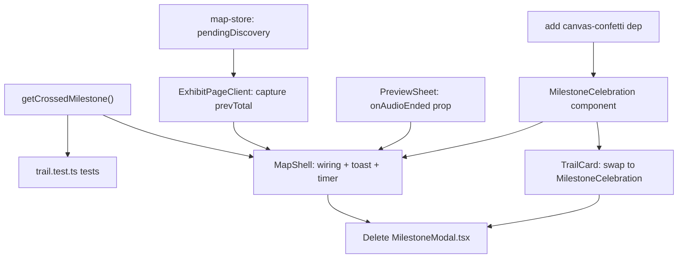

# Post-audio toast + auto milestone celebration (S4→S5)

**GitHub**: [#59](https://github.com/makaravind/experium-ai-tour-app/issues/59) (scope expanded to absorb [#60](https://github.com/makaravind/experium-ai-tour-app/issues/60) — see Architecture Decisions)
**Milestone**: m4-gamification — Gamification
**Status**: NOT STARTED

---

## Context

Right now, finishing an exhibit's audio just collapses the bottom sheet (`PreviewSheet`'s `onEnded` calls `collapse()`) — nothing tells the visitor they discovered something, and nothing celebrates milestone progress (1, 3, 5, 10, 15, 20, 30, 40, 50 exhibits discovered). This story adds that: a toast ("+1 🌿 · X/50 discovered") after every fresh discovery, and — when the new total lands on a milestone — a full-screen celebration overlay with confetti on top of it.

Today, milestone celebration already exists in a different form: `TrailCard` (home screen) lets a visitor tap a *completed* trail node to reopen `MilestoneModal`, a small centered card. Per `docs/user-flows/flow-6-gamification-trail.md`, that tap-to-revisit is supposed to open "the same full-screen overlay as Flow 1, S5" — i.e. the same component this story is building, not a separate one. A follow-up ticket (#60) was originally carved out to do that swap later. Since building the real overlay here makes keeping the old `MilestoneModal` around purely redundant work, **this story's scope now includes the #60 swap**: `TrailCard` switches to the new overlay immediately, `MilestoneModal.tsx` is deleted, and #60 is closed as superseded (same pattern as #20 → #59 in `.claude/current-milestone.md`).

Out of scope (separate tickets, already filed): real badge artwork (#62 — placeholder solid-color circle + `StarIcon` for now) and the actual Discovery Card screen (#61 — CTA is a no-op stub here).

Before: audio ends → sheet collapses → silence.
After: audio ends → sheet collapses → toast ("+1 🌿 · X/50 discovered") → full-screen confetti celebration if a milestone was crossed. Tapping a completed trail node on the Home screen opens the same celebration overlay directly (no toast, since nothing new was just discovered).

---

## Architecture Decisions

### Crossing detection: plain comparison, not a range scan

**Decision**: `getCrossedMilestone(prevTotal, newTotal)` in `lib/trail.ts` returns the milestone number if `newTotal > prevTotal && TRAIL_MILESTONES.includes(newTotal)`, else `null`.

**Why**: Discovery is idempotent server-side (`upsert_scan`'s `discovered = scans.discovered OR EXCLUDED.discovered`, gated to `scan_src === 'onsite'`), and each scan discovers exactly one exhibit, so `total_discovered` only ever moves by +1 per fresh discovery. A membership-only check (`TRAIL_MILESTONES.includes(newTotal)`) would be wrong: it would re-fire the celebration on every repeat listen while sitting at a milestone count, because the check can't tell "just arrived here" from "already here." Comparing against `prevTotal` fixes that.

**Alternatives considered**: Range-crossing check (`prevTotal < m <= newTotal` for any `m`), to handle a hypothetical jump of more than 1. Rejected — not reachable in this single-exhibit-per-scan flow; would be speculative generality.

### `prevTotal` capture is decoupled from "show the celebration" via a map-store field

**Decision**: Add `pendingDiscovery: { prevTotal: number; newTotal: number } | null` (+ setter/clearer) to `lib/map-store.ts`. `ExhibitPageClient.handleFirstPlay` captures `prevTotal` from `useStore.getState().totalDiscovered` *before* calling `postScan`, and on response calls `setPendingDiscovery({ prevTotal, newTotal: data.total_discovered })` (in addition to the existing `setTotalDiscovered(data.total_discovered)`). A new `onAudioEnded` prop on `PreviewSheet` fires from the `<audio onEnded>` handler, alongside the existing `collapse()`. `MapShell` reads `pendingDiscovery` only when `onAudioEnded` fires, not when the scan response arrives.

**Why**: `handleFirstPlay` fires at **play-start** (`listen()` calls `onFirstPlay?.()` right after `el.play()`), so by the time audio actually ends, `useStore`'s `totalDiscovered` has long since been overwritten with the new value — the "before" count is gone unless captured earlier and held separately from the moment it's revealed. This splits "when do we learn the result" (immediate, needed for pin-color/map state) from "when do we show it" (audio-end, per the S4 spec).

**Alternatives considered**: Thread a new `onAudioEnded(prevTotal, newTotal)` callback through `useMapStore().exhibitPageData` (the same path `onFirstPlay`/`onQuartile` already use). Rejected in favor of the store-field approach: it would require widening the `ExhibitPageData` interface and still needs `MapShell` to own the toast/celebration state — a plain store field is less plumbing for the same result, since `MapShell` already renders `PreviewSheet` directly and can read `pendingDiscovery` itself.

### Single `+500ms` timer, not the doc's staggered 0.5s/1s

**Decision**: One `setTimeout(500ms)` off `onAudioEnded` shows the toast and, if `getCrossedMilestone` returns non-null, the celebration overlay — both at the same instant.

**Why**: Simpler than two timers for a visually identical outcome: when a milestone is hit, the full-screen celebration covers the toast immediately, so staggering when the (now-invisible) toast appears underneath it has no observable effect. (`flow-1-qr-scan-to-exhibit.md`'s S4 table describes 0.5s/1s offsets from audio-end; collapsed here per product decision.)

**Consequences**: On a milestone hit, the toast is never independently visible — acceptable since the celebration's "Explorer — N Discovered!" already carries that information.

### One shared `MilestoneCelebration` component, two mount sites, no "mode" prop needed

**Decision**: Build `components/exhibit/MilestoneCelebration.tsx` (full-screen, confetti, badge, CTA) as the single celebration UI. `MapShell` mounts it for the auto-trigger path (post-audio). `TrailCard` mounts it for the tap-to-revisit path, replacing `MilestoneModal`. `MilestoneModal.tsx` is deleted once nothing imports it.

**Why**: `flow-6-gamification-trail.md` already specifies these as the same overlay. The component itself doesn't need to know which path triggered it — it only needs `milestone`, `totalDiscovered`, and `onClose`; the "no toast on revisit" distinction `#60`'s AC calls out is already satisfied for free, because the toast is owned entirely by `MapShell`'s timer logic, never by this component.

**Consequences**: `TrailCard`'s existing local-state pattern (`openMilestone` + conditional render) carries over unchanged — just swap the component name and props.

### Toast is a one-off `motion.div`, not a new generic component

**Decision**: Render the toast inline in `MapShell`, not as a reusable `components/common/Toast.tsx`.

**Why**: There is exactly one toast in this app. A generic toast system (queueing, stacking, variants) is speculative generality for a single caller.

### Confetti via `canvas-confetti`, dynamically imported

**Decision**: Add `canvas-confetti` as a dependency. `MilestoneCelebration` dynamically imports it client-side inside a `useEffect` on mount, fires one burst, and calls `.reset()` on unmount.

**Why**: Hand-rolling a particle burst with `framer-motion` (the codebase's existing animation tool) was the initial lean, but a dedicated ~3kb library is simpler and more reliable for a one-shot confetti effect than reimplementing physics/easing by hand. `canvas-confetti` needs no canvas markup — it creates and tears down its own canvas — so no new refs or DOM wiring beyond the import.

### Badge keeps the existing `StarIcon` placeholder

**Decision**: The badge's solid core renders the existing `StarIcon` (from `components/icons/index.tsx:180`), not a bare color circle.

**Why**: `flow-1-qr-scan-to-exhibit.md`'s S5 table specifies "solid core **with icon**"; the old `MilestoneModal` already used `StarIcon` for the same purpose. Real artwork replaces this placeholder in #62 — no rework needed here beyond swapping the badge's `background`/icon when that lands.

### Discovery Card CTA is a true no-op

**Decision**: At milestones 10 and 50, render the "📸 Your Discovery Card is ready!" button with a no-op `onClick`.

**Why**: The Card screen is #61, not built yet. The issue AC explicitly allows "stub action acceptable" — a disabled/greyed-out treatment or a "coming soon" micro-interaction would be scope the ticket doesn't ask for.

### Z-index: toast above the sheet, celebration above the toast

**Decision**: Toast `zIndex: 55`, `MilestoneCelebration` `zIndex: 60`.

**Why**: Must sit above `PreviewSheet` (`zIndex: 50`) and `SearchOverlay` (`zIndex: 45`) so the toast is visible when it slides in over a collapsed sheet. Celebration above toast so it fully covers it per the "single timer" decision above.

---

## Implementation Plan

1. **`lib/trail.ts`** — add and export:
   ```ts
   export function getCrossedMilestone(prevTotal: number, newTotal: number): number | null {
     if (newTotal <= prevTotal) return null
     return TRAIL_MILESTONES.find((m) => m === newTotal) ?? null
   }
   ```

2. **`__tests__/trail.test.ts`** — add a `describe('getCrossedMilestone', ...)` block alongside the existing `getCurrentSegment` tests: `0→1` crosses `1`; `9→10` crosses `10`; `10→10` (repeat listen) is `null`; `9→11` (not a milestone number) is `null`; `49→51` is `null`.

3. **`lib/map-store.ts`** — add `pendingDiscovery: { prevTotal: number; newTotal: number } | null`, `setPendingDiscovery`, `clearPendingDiscovery` to `MapStoreState`, following the existing field pattern (e.g. `geoError`).

4. **`components/ExhibitPageClient.tsx`** — in `handleFirstPlay` (around line 106), read `prevTotal` from `useStore.getState().totalDiscovered` before the `postScan` call. After the response, call `useMapStore.getState().setPendingDiscovery({ prevTotal, newTotal: data.total_discovered ?? 0 })` right next to the existing `setTotalDiscovered(...)` call.

5. **`components/exhibit/PreviewSheet.tsx`** — add an `onAudioEnded?: () => void` prop. In the `<audio>` element's `onEnded` handler (currently `onEnded={() => collapse()}`, around line 235), change to call both `collapse()` and `onAudioEnded?.()`.

6. **Add `canvas-confetti` to `package.json`** (`npm install canvas-confetti` — no `@types` package needed if typing inline, or add `@types/canvas-confetti` as a dev dependency if preferred for strictness).

7. **New `components/exhibit/MilestoneCelebration.tsx`** — full-screen fixed overlay (`inset-0`, gradient background `#5d8a59 → #456b41`, `zIndex: 60`), replacing `MilestoneModal`'s role:
   - Props: `milestone: number`, `totalDiscovered: number`, `onClose: () => void`.
   - On mount: dynamically `import('canvas-confetti')`, fire a burst; `.reset()` on unmount.
   - Badge: circular, dashed ring, solid core containing `StarIcon` (reuse color tokens from `MilestoneModal`).
   - "MILESTONE REACHED" label (caps, muted) + "Explorer — {totalDiscovered} Discovered!" (large, bold, white).
   - Discovery Card CTA ("📸 Your Discovery Card is ready!") rendered only when `milestone === 10 || milestone === 50`, no-op `onClick`.
   - Dismiss: tap anywhere on the overlay, or an `X` button top-right (reuse `CloseIcon` as `MilestoneModal` did) — both call `onClose`.

8. **`app/(map)/layout.tsx` (`MapShell`)**:
   - Add local state: `toast: { total: number } | null` and `celebration: { milestone: number; total: number } | null`.
   - Pass `onAudioEnded={isShowingCurrentExhibit ? handleAudioEnded : undefined}` to `<PreviewSheet>`.
   - `handleAudioEnded`: read `pendingDiscovery` from `useMapStore`; if null, return. Otherwise `setTimeout(() => { setToast(...); const crossed = getCrossedMilestone(prevTotal, newTotal); if (crossed) setCelebration({ milestone: crossed, total: newTotal }); clearPendingDiscovery(); }, 500)`.
   - Render the toast (`motion.div`, slide-in-from-top, `zIndex: 55`, text `` +1 🌿 · ${total}/50 discovered ``, auto-dismiss via its own 3s `setTimeout` clearing `toast` state).
   - Render `<MilestoneCelebration>` when `celebration` is set, with `onClose={() => setCelebration(null)}`.

9. **`components/exhibit/TrailCard.tsx`** — replace the `MilestoneModal` import and usage (lines 5, 152–158) with `MilestoneCelebration`, same props (`milestone`, `totalDiscovered`→now named per the new component's prop, `onClose`).

10. **Delete `components/exhibit/MilestoneModal.tsx`** once both `MapShell` and `TrailCard` use the new component and no other file imports it.

---

## Task Graph



---

## Code References

- `lib/trail.ts` — `TRAIL_MILESTONES`, `getCurrentSegment`; add `getCrossedMilestone` here
- `__tests__/trail.test.ts` — existing test convention to follow for the new function
- `lib/map-store.ts` — `MapStoreState` pattern for adding `pendingDiscovery`
- `lib/store.ts:30-31` — `totalDiscovered` / `setTotalDiscovered`
- `components/ExhibitPageClient.tsx:106-126` — `handleFirstPlay`, where `prevTotal` must be captured before `postScan`
- `components/exhibit/PreviewSheet.tsx:217-238` — `<audio>` element, existing `onEnded={() => collapse()}`
- `app/(map)/layout.tsx` — `MapShell`, where `PreviewSheet` is mounted and where toast/celebration state should live
- `components/exhibit/TrailCard.tsx:1-7,151-158` — current `MilestoneModal` usage to swap
- `components/exhibit/MilestoneModal.tsx` — to be deleted; badge/dismiss styling to carry over into the new component
- `components/icons/index.tsx:103,180` — `CloseIcon`, `StarIcon`
- `docs/user-flows/flow-1-qr-scan-to-exhibit.md` — S4/S5 tables (toast copy, celebration content, design tokens)
- `docs/user-flows/flow-6-gamification-trail.md` — revisit-overlay requirement this story folds in
- `supabase/migrations/20260814130827_discovered_server_side_onsite_only.sql` — why discovery is idempotent (basis for the crossing-detection decision)

---

## Acceptance Criteria (Technical)

- [ ] `getCrossedMilestone(prevTotal, newTotal)` returns the milestone on a fresh crossing, `null` on repeat/no-op listens and non-milestone totals (covered by unit tests)
- [ ] Audio ending on a fresh discovery shows the toast "+1 🌿 · {total}/50 discovered" ~500ms after `onAudioEnded` fires, auto-dismissing after 3s with no user action
- [ ] Audio ending on a repeat listen (already-discovered exhibit) shows no toast and no celebration (`pendingDiscovery` has `prevTotal === newTotal`)
- [ ] Audio ending on a fresh discovery that lands on a milestone shows `MilestoneCelebration` at the same ~500ms mark (gradient bg, confetti burst, badge w/ `StarIcon`, "MILESTONE REACHED", "Explorer — {total} Discovered!")
- [ ] Celebration dismiss (tap overlay or `X`) removes it with no navigation side effects — visitor is back on the map/sheet state they were already in
- [ ] Discovery Card CTA renders only at milestones 10 and 50, no-op on tap
- [ ] Tapping a completed node on `TrailCard` opens the same `MilestoneCelebration` component directly (no toast beat)
- [ ] `MilestoneModal.tsx` no longer exists; no file imports it

---

## Testing

- **What to test**: `getCrossedMilestone` as a pure function — all boundary cases (repeat listen at a milestone, fresh non-milestone increment, fresh milestone increment, already-complete-at-50 edge)
- **Test type**: unit (vitest)
- **Prior art**: `__tests__/trail.test.ts` — same file, same `describe`-per-function style, no mocking needed since both are pure
- **What NOT to test**: confetti rendering/physics, framer-motion animation timing, exact toast slide-in pixel values — these are visual/library behavior, not this story's logic

---

## Open Questions

None — all design decisions resolved during the grill session.
