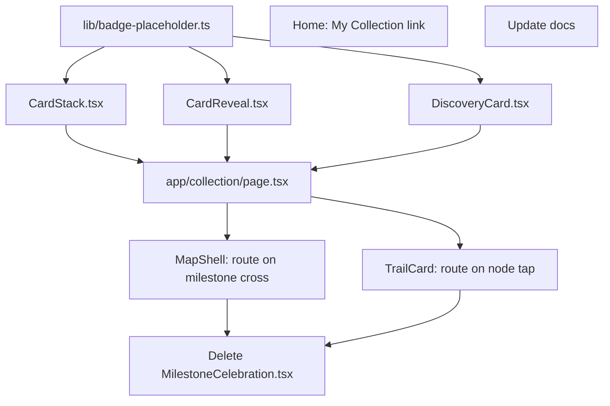

# Card Reveal & Collection (supersedes the 10/50-only Discovery Card)

**GitHub**: [#61](https://github.com/makaravind/experium-ai-tour-app/issues/61)
**Milestone**: m4-gamification — Gamification
**Status**: NOT STARTED

---

## Context

Today, crossing a trail milestone (1, 3, 5, 10, 15, 20, 30, 40, 50 exhibits discovered) shows `MilestoneCelebration` — a full-screen confetti overlay with a badge and "Explorer — N Discovered!" (built in #59). At milestones 10 and 50 only, that overlay also renders a "📸 Your Discovery Card is ready!" button, but it's a no-op stub — #61 was filed to wire it up to an actual Canvas-rendered, downloadable card.

During spec grilling, the scope grew well beyond the filed issue: instead of a single regenerate-on-demand card reachable only from the celebration overlay, every one of the 9 trail milestones now mints its own collectible card, and those cards live in a persistent, browsable collection — closer to a Pokémon-Pocket-style card binder than a one-off share image. This supersedes both the issue text ("Discovery Card (milestones 10 & 50)") and `docs/user-flows/flow-6-gamification-trail.md`'s "Discovery Cards unlock at milestones 10 and 50" / "no in-app persistence" framing. Same pattern as #59 absorbing #60 — see `.claude/current-milestone.md`.

Before: audio ends on a milestone cross → full-screen confetti overlay → dead-end button.
After: audio ends on a milestone cross → navigate straight to `/collection?reveal={m}` → tap-to-flip reveal (auto-flips after 2s) → lands in a fanned stack of every milestone card earned so far. Tapping any card in the stack opens it full-screen, where the name can be edited and the card can actually be downloaded/shared. Tapping an already-earned node on the Home trail bar replays the same reveal for that card.

A working interactive prototype of the whole flow (fan stack, tap-to-flip, confetti, canvas render, name edit, real `navigator.share`/`<a download>` export) was built in Open Design at `.../projects/71dad1fb-67b1-46ef-8286-29bd197b9d61/flow-6-card-reveal.html` — read it before starting; the canvas-drawing and download code there is a direct reference for step 4 below, not just a mock.

---

## Architecture Decisions

### Scope: all 9 milestones get cards, not just 10 & 50

**Decision**: Every `TRAIL_MILESTONES` entry (`1,3,5,10,15,20,30,40,50`) mints a card, not just 10 and 50.

**Why**: A "collection" with 2 possible items doesn't support a stack/binder UX — the product ask (Pokémon Pocket-style collecting) only makes sense with enough cards to feel like a set. `getCrossedMilestone` and the badge-threshold list already treat all 9 uniformly (`#59`'s own `TRAIL_MILESTONES` loop), so this isn't fighting existing code — it's removing an arbitrary `milestone === 10 || milestone === 50` gate that only ever existed on the old celebration overlay's CTA.

**Alternatives considered**: Keep 10/50-only, matching the filed issue exactly. Rejected — explicitly overridden by the user during spec grilling in favor of the fuller collection experience.

**Consequences**: `docs/user-flows/flow-6-gamification-trail.md` and `docs/decisions.md`'s "at milestone 10" line are now stale and need updating (step 10 below).

### Collection membership is fully derived — no new persisted state

**Decision**: "Which cards are unlocked" is never stored. It's computed on every render as `getCurrentSegment(totalDiscovered).achieved` (already exported by `lib/trail.ts`, unchanged).

**Why**: `totalDiscovered` is already persisted (`lib/store.ts`) and already updated before the audio-end reveal fires (`ExhibitPageClient.handleFirstPlay` calls `setTotalDiscovered` on the scan response, per #59's architecture). By the time a visitor lands on `/collection?reveal=10`, their card is already "in" the collection by this definition — there is no separate "add to collection" write to perform. This is simpler than it looks: the only thing `?reveal=` controls is whether the flip animation plays on arrival, not what the stack contains.

**Alternatives considered**: A `seenReveals: number[]` field in the store to avoid replaying the flip on revisit. Rejected per the resolved grill decision — trail-bar taps should always replay the reveal, so no "seen" tracking is needed at all.

### Dedicated `/collection` route, not an overlay

**Decision**: New `app/collection/page.tsx`, a sibling to `app/page.tsx` and `app/scan/page.tsx` — outside the `app/(map)/` route group, so it does not inherit `MapShell`'s map chrome or `TabBar`. Back caret calls `router.push('/')` (not `router.back()`, since arriving via the audio-end flow means "back" would land on `/s/[code]`, not Home).

**Why**: Matches the explicit decision to make this a real navigable destination rather than another stacked `fixed inset-0` overlay (unlike `SearchOverlay`/`MilestoneCelebration`/`InfoModal`, which are all plain component state). `app/scan/page.tsx` is the existing precedent for a standalone full-screen route with no `TabBar` and its own back control (`router.back()` there, since Scan's "back" destination is unambiguous).

**Alternatives considered**: Overlay mounted inside `MapShell` or `TrailCard` (rejected — duplicates state across two mount sites, no routing benefit, and the Pokémon-Pocket framing wants a persistent place to come back to, not a transient overlay).

### One route, three internal states — no dynamic `[milestone]` segment

**Decision**: `/collection` renders one of three states from local component state + a `?reveal=` query param, not three separate routes:
1. `?reveal=` absent (or pointing at a milestone not yet achieved) → fanned stack (`CardStack`).
2. `?reveal={m}` present and `m` is in `achieved` → tap-to-flip reveal (`CardReveal`) for `m`.
3. A card tapped in the stack → full-screen single view (`DiscoveryCard`) via `selectedMilestone` state, no URL change.

**Why**: This was explicitly left to be decided pragmatically rather than grilled. A dynamic `/collection/[milestone]` segment would make deep-linking marginally cleaner but adds a route + loading state for no real benefit here — nothing needs to be independently bookmarked or server-rendered, and the existing app has zero precedent for using the URL to drive overlay-style UI (`SearchOverlay`, `MilestoneCelebration` are all local state). The one case that does need to survive a URL (the audio-end → reveal handoff) is covered by the query param alone.

**Alternatives considered**: `/collection/[milestone]/page.tsx` with reveal-vs-view decided by a referrer flag. Rejected as more plumbing for the same outcome.

### Reveal mechanics: tap-to-flip, 2s auto-flip, always plays on `?reveal=` entry

**Decision**: `CardReveal` shows the card face-down with a shine sweep and "NEW CARD" pill. Tapping it (or a 2-second timer, whichever comes first) triggers a 3D flip (`rotateY(180deg)`) revealing the front face, plus one `canvas-confetti` burst. A "Continue →" button then calls `router.replace('/collection')` to drop the query param and land on the stack. This plays identically whether the milestone was just crossed or is being replayed from a Home trail-bar tap.

**Why**: Matches the resolved decision exactly (tap-to-flip with a 2s fallback; replay always plays, no exceptions). Using `router.replace` (not `push`) for the "Continue" step avoids leaving a `?reveal=10` entry in history that would re-trigger the animation on back/forward navigation.

**Consequences**: `canvas-confetti`'s dynamic-import-on-mount pattern is lifted directly from the deleted `MilestoneCelebration.tsx` (see step 9) — same library, same usage, new call site.

### Audio-end flow: skip the toast on a milestone cross, navigate straight to reveal

**Decision**: In `MapShell.handleAudioEnded`, when `getCrossedMilestone(prevTotal, newTotal)` returns a milestone, call `router.push(\`/collection?reveal=${crossed}\`)` and skip `setToast(...)` entirely. Non-milestone discoveries keep showing the toast exactly as today.

**Why**: #59 already treated the toast as invisible on a milestone hit (the celebration overlay covered it at the same instant). Navigating away makes that explicit instead of implicit — there's no overlay to cover the toast anymore, so showing it for the ~instant before navigation would just be a visible flicker.

### Placeholder badge differentiation: per-milestone color + numeral, centralized for #62

**Decision**: New `lib/badge-placeholder.ts` exports `MILESTONE_BADGE_COLORS: Record<number, string>` (one hex per milestone) and a `getBadgeColor(milestone: number): string` helper. Every card (mini stack card, reveal back-face, full-screen canvas) renders a solid circle in that color with the milestone number inside — no icon.

**Why**: With 9 cards visible in a stack at once, identical placeholder badges (the old shared `StarIcon` treatment) would make the "collection" look like 9 copies of the same card. A color + number is the cheapest way to make them individually recognizable before #62 ships real artwork. Centralizing the color map in one file (rather than inlining it in three components) means #62 only has to change one import later.

**Alternatives considered**: Reuse `StarIcon` on every badge, differentiated only by the number below it (matches today's `MilestoneCelebration` treatment exactly, simpler). Rejected per the resolved grill decision in favor of visual variety.

### Card rendering & export: Canvas + overlaid `<input>` + `navigator.share` with `<a download>` fallback

**Decision**: `DiscoveryCard` renders a 1080×1080 `<canvas>` (earthy gradient background per the design doc, badge circle, name, "Experium Park Explorer", "{m} Discovered"). Tapping the name's region on the canvas positions an absolutely-placed, transparent `<input>` over those exact coordinates (computed from `canvas.getBoundingClientRect()` and the fixed 1080px logical size); committing on blur/Enter writes to `useStore.getState().userInfo` (merging into the existing `{name, phone, email}` shape — only `name` changes) and redraws. Download: `canvas.toBlob` → if `navigator.canShare({files:[file]})` is true, `navigator.share({files:[file]})`; otherwise a blob URL + `<a download>` click. `AbortError` (user cancelled the share sheet) is swallowed silently; any other thrown error shows a "Couldn't save image. Try again?" retry banner.

**Why**: The app is a `display:"standalone"` PWA — on iOS Safari in that mode, a plain `<a download>` on a canvas blob frequently fails to save to Photos (it opens the image in-browser instead, breaking out of the installed app shell). `navigator.share` with a `files` payload is the only reliable "Save Image" path on iOS; preferring it everywhere it's supported (not just iOS) keeps the code to one primary path with one fallback, rather than branching on platform detection.

**Consequences**: Download/edit-name only exist in this full-screen view, never on the mini stack cards or the reveal — matches the resolved "only from full-screen single-card view" decision, and keeps `CardStack`/`CardReveal` purely presentational (no canvas, no store writes).

### Retire `MilestoneCelebration.tsx` entirely

**Decision**: Delete `components/exhibit/MilestoneCelebration.tsx` once `MapShell` and `TrailCard` no longer import it (steps 6–7). Its confetti-burst pattern is reused inside `CardReveal`, not kept as a shared component.

**Why**: The reveal screen fully replaces its role (badge + "Explorer — N Discovered!" + confetti) and adds the flip + card CTA on top — keeping both would mean two different "you hit a milestone" UIs that need to stay in sync. Same cleanup pattern #59 used to retire `MilestoneModal.tsx`.

---

## Implementation Plan

1. **New `lib/badge-placeholder.ts`** — export `MILESTONE_BADGE_COLORS: Record<number, string>` with one entry per `TRAIL_MILESTONES` value (e.g. sage → forest → gold → orange → umber → a distinct "legendary" accent for 50 — see the Open Design prototype's `COLORS` map for a ready-made palette) and `getBadgeColor(m: number): string`.

2. **New `components/collection/CardStack.tsx`** — presentational. Props: `milestones: number[]`, `onSelect: (m: number) => void`. Renders each milestone as a small square card (fixed earthy gradient background, per-milestone colored badge circle with the number via `getBadgeColor`), fanned with alternating rotation/offset by index (see the prototype's `renderStack()` for the transform math). Tapping a card calls `onSelect(m)`.

3. **New `components/collection/CardReveal.tsx`** — props: `milestone: number`, `onContinue: () => void`. Face-down state with shine sweep + "NEW CARD" pill; tap or a 2s `setTimeout` triggers `.flipped` (3D `rotateY`); on flip, dynamically `import('canvas-confetti')` and fire one burst (same options as the deleted `MilestoneCelebration`); after the flip transition, show a "Continue →" button calling `onContinue`.

4. **New `components/collection/DiscoveryCard.tsx`** — props: `milestone: number`, `onBack: () => void`. Owns the `<canvas>` (1080×1080), the name-edit `<input>` overlay, the Download button, and the retry banner. Port `drawCard`, the canvas click→edit-name handler, and `handleDownload` directly from the Open Design prototype (`flow-6-card-reveal.html`) — same gradient stops, same badge/name/eyebrow/count layout, same `navigator.share`/`<a download>`/retry logic — adapted to read `userInfo.name` / call `setUserInfo` from `useStore` instead of a local `userName` variable.

5. **New `app/collection/page.tsx`** — client component. Reads `totalDiscovered` from `useStore`, computes `achieved = getCurrentSegment(totalDiscovered).achieved`. Reads `reveal` via `useSearchParams()`. Renders: `CardReveal` if `reveal` parses to a number in `achieved`; else `DiscoveryCard` if a card is selected (local `useState<number | null>`); else `CardStack` with a back caret (→ `router.push('/')`) and an "{achieved.length}/9 cards collected" header.

6. **`app/(map)/layout.tsx` (`MapShell`)** — remove the `celebration` state and `MilestoneCelebration` import/render. In `handleAudioEnded`'s `setTimeout` body: when `getCrossedMilestone(prevTotal, newTotal)` returns non-null, `router.push(\`/collection?reveal=${crossed}\`)` and do *not* call `setToast`; when it returns null, keep the existing `setToast({ total: newTotal })` call unchanged.

7. **`components/exhibit/TrailCard.tsx`** — remove the `openMilestone` state and `MilestoneCelebration` import/render. Add `const router = useRouter()`. The done-node `onClick` (currently `() => setOpenMilestone(node.label as number)`) becomes `() => router.push(\`/collection?reveal=${node.label}\`)`.

8. **`app/page.tsx` (Home)** — add a "🗂️ My Collection →" link (reuse `ExploreParkLink`'s styling pattern, or a plain `btn-collection`-style button) below `<TrailCard />`, navigating to `/collection`.

9. **Delete `components/exhibit/MilestoneCelebration.tsx`** once steps 6 and 7 no longer import it.

10. **Docs** — update `docs/user-flows/flow-6-gamification-trail.md` (Discovery Cards section: all 9 milestones, not 10/50; note the dedicated `/collection` route and fanned-stack collection instead of "no in-app persistence"/"no My Cards section") and the "User info capture" row in `docs/decisions.md` (drop the "at milestone 10" specificity, since the tap-to-edit now happens on any card). Add a superseding note to `.claude/current-milestone.md` for #61, same pattern as the existing #59/#60 notes.

---

## Task Graph

---

## Code References

- `lib/trail.ts` — `TRAIL_MILESTONES`, `getCurrentSegment`, `getCrossedMilestone`; all reused unchanged
- `lib/store.ts:5-9,30-31` — `userInfo` shape and `totalDiscovered`, used (not extended) by this story
- `app/(map)/layout.tsx` — `MapShell`, `handleAudioEnded`, where `celebration` state/render is removed and `router.push` is added
- `components/exhibit/TrailCard.tsx` — done-node `onClick`, swapping local overlay state for routing
- `components/exhibit/MilestoneCelebration.tsx` — confetti-burst pattern to port into `CardReveal`, then delete
- `app/scan/page.tsx` — precedent for a standalone full-screen route outside `app/(map)/`, with its own back control
- `app/page.tsx` — Home, where the collection entry link is added
- `.../Open Design/.../projects/71dad1fb-67b1-46ef-8286-29bd197b9d61/flow-6-card-reveal.html` — working reference implementation of the fan stack, flip reveal, canvas card render, name-edit overlay, and share/download logic
- `docs/user-flows/flow-6-gamification-trail.md` — doc to update (step 10)
- `docs/decisions.md` — "User info capture" row to update (step 10)
- `.claude/current-milestone.md` — existing #59/#60 superseding-note pattern to follow for #61

---

## Acceptance Criteria (Technical)

- [ ] Crossing any of the 9 trail milestones (not just 10/50) during the audio-end flow navigates to `/collection?reveal={m}` instead of showing a toast
- [ ] `/collection?reveal={m}` shows the face-down card; tapping it or waiting 2s flips it with one confetti burst; "Continue →" strips the query param via `router.replace` and shows the stack
- [ ] Tapping an already-earned trail node on Home (`TrailCard`) replays the same reveal for that milestone, every time (no "seen once" suppression)
- [ ] `/collection` with no `reveal` param shows a fanned stack containing exactly `getCurrentSegment(totalDiscovered).achieved` — milestones not yet reached do not appear
- [ ] Each stack card and the reveal's back face show a distinct color (via `getBadgeColor`) + the milestone number
- [ ] Tapping a card in the stack opens a full-screen Canvas-rendered view with the badge, name (or "Your Name Here" placeholder), "Experium Park Explorer", and "{m} Discovered"
- [ ] Tapping the name on that view opens an inline edit field; committing updates `userInfo.name` in the store and is reflected on every other card immediately (shared field, not per-card)
- [ ] Download tries `navigator.share` with a PNG file first when supported, falls back to `<a download>` otherwise; a cancelled share sheet shows no error; any other failure shows "Couldn't save image. Try again?" with a working retry
- [ ] Back caret on `/collection` navigates to `/` (Home)
- [ ] `MilestoneCelebration.tsx` no longer exists; no file imports it

---

## Testing

- **What to test**: Nothing new at the pure-function level — `getCrossedMilestone` and `getCurrentSegment` are unchanged and already covered by `__tests__/trail.test.ts`. This story is almost entirely rendering/interaction/browser-API code.
- **Test type**: Manual QA on-device (per `m7-launch-ready`'s eventual E2E smoke pass). No new unit tests are expected.
- **What NOT to test**: Canvas pixel output, the flip animation's timing/easing, `canvas-confetti` physics, or `navigator.share`/`<a download>` browser behavior — these are visual/library/platform behavior, not this story's logic, same exclusion `#59`'s spec made for its confetti and animation.
