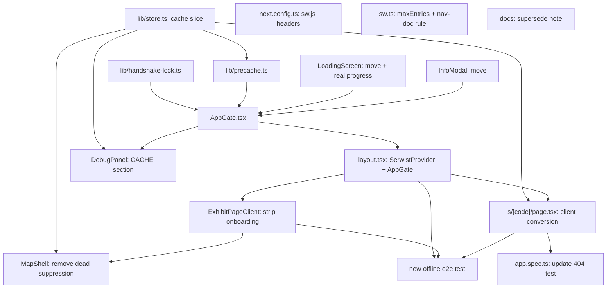

# Upfront Precache + App-Wide Onboarding Gate (supersedes Home-only trigger, drops images)

**GitHub**: [#64](https://github.com/makaravind/experium-ai-tour-app/issues/64)
**Milestone**: m5-pwa-offline — PWA + Offline
**Status**: NOT STARTED

---

## Context

Today, `serwist` is configured in `app/sw.ts` with a reactive `CacheFirst` rule for `.mp3`/fonts — but nothing in the app ever calls `navigator.serviceWorker.register()`, so that configuration is inert in production (see Architecture Decisions). Onboarding (loading screen + language pick + optional info modal) only runs inside `ExhibitPageClient`, gated by `localStorage.experium_onboarded`, so a visitor's first real contact with the app is tied to scanning an exhibit, not to the ticket-counter Home link the park journey assumes.

The filed issue asks for a bulk upfront download of audio + metadata + images, triggered on Home's first open, wired to `LoadingScreen`'s existing (currently fake, 1.8s-timer) progress UI. A `/grillme` session expanded and corrected this significantly:

- **Images are out.** `exhibits` has no `image_url` column and `components/exhibit/Gallery.tsx` is 100% placeholder gradients — there's nothing to precache yet. **#69** (m2c-field-data-collection) tracks adding real photos + wiring + precache integration.
- **Trigger moves from "Home" to "any entry route."** Home (`/`) and `/s/[code]` sit under different layout trees today (root `app/layout.tsx` vs the `(map)` route group). A visitor's first touch could just as easily be a direct `/s/[code]` link (shared by a friend, not the ticket counter). Redirecting that visitor to Home first was considered and rejected — the fix is a single gate in the **root** layout that covers every route, blocks in place, and reveals whatever the visitor actually navigated to once onboarding clears. No redirects.
- **`/s/[code]` has to stop being a server component.** It currently does a server-side Supabase query per request — which cannot work offline no matter what gets precached client-side. It converts to a client shell reading from the same precached dataset.
- **Two bugs were found that predate this issue** but become more load-bearing once the gate is app-wide: the service worker is never registered (above), and `/api/user/handshake` unconditionally inserts a new `users` row with no dedupe, which can split one visitor's trail progress across two accounts if onboarding ever races across two tabs — more likely once any route can kick it off. Both are fixed here rather than filed separately, since the gate component (`AppGate`) is being built from scratch anyway.

Before: visitor scans an exhibit → `ExhibitPageClient`'s local onboarding state machine (fake-timer loading screen → optional info modal) → exhibit renders. Home has no onboarding at all. The service worker config in `app/sw.ts` has never actually run in a browser.
After: visitor's *first* request to any route (Home, `/s/[code]`, `/map`, `/scan`) is intercepted by `AppGate` in the root layout. If online, it runs the fingerprint handshake, lets them pick a language, bulk-downloads that language's audio + all exhibit metadata with real progress, then (first time only) shows the optional info modal — then reveals whatever route they actually landed on. If offline with nothing cached, it shows #65's blocker. If already cached, it's a no-op pass-through. `ExhibitPageClient` no longer owns any onboarding state.

---

## Architecture Decisions

### Scope: audio + metadata only; images descoped

**Decision**: Precache covers exhibit audio (selected language) and metadata (name, type, tier, facts, qr code mapping). Images are dropped from this issue's scope entirely.

**Why**: `exhibits` has no image column and `Gallery.tsx` renders only placeholder gradients — there is no real image data anywhere in the system yet to precache. Building the precache path for a payload that doesn't exist is pure unverifiable plumbing.

**Alternatives considered**: Add `image_url` + wiring now so precache is "future-proof" — rejected, it would cache nothing and add surface area with no observable payoff this round. Blocking #64 on m2c-field-data-collection landing photos first — rejected, contradicts the issue's own "Blocked by: None."

**Consequences**: Follow-up tracked as **#69** (m2c-field-data-collection) — add `image_url`, wire it into `Gallery.tsx`, and extend the precache loop via the "Asset groups" seam (see below).

### `AppGate`: one root-layout gate, not a Home-specific screen

**Decision**: A new `components/onboarding/AppGate.tsx`, mounted in `app/layout.tsx` wrapping `{children}`, owns the entire fresh-visitor sequence for every route: fingerprint handshake → language pick + precache → optional info modal. It renders a full-screen cover while any of that is active and otherwise renders `children` untouched — no `router.push`/redirect anywhere in this flow.

**Why**: Home and `/s/[code]` are siblings under different layout subtrees; a Home-only gate can't see a visitor whose first request is `/s/[code]` (shared link). Redirecting that visitor to Home and back was considered and rejected during grilling — a route-agnostic gate that blocks *in place* is simpler and never loses the visitor's actual destination.

**Alternatives considered**: Home-specific `LoadingScreen` + redirect fallback for direct exhibit entry (the issue's literal "Home's first open" framing) — rejected, adds a redirect round-trip and still needs special-casing for `/map`/`/scan` direct entry. Silent background precache with no blocking UI — rejected, doesn't satisfy "wire `LoadingScreen` to real progress," and the project's own `docs/decisions.md` ("Offline UX (first load): blocker screen... don't over-engineer partial states") already favors a blocking screen over partial-state UI.

**Consequences**: `ExhibitPageClient`'s own `onboardingStep` state machine (the fingerprint-handshake effect, the `loading`/`info` branches) is fully removed — it only ever renders after `AppGate` has already cleared. `MapShell`'s onboarding-aware `PreviewSheet` suppression becomes dead code (the gate is a full-screen overlay sitting structurally above it) and is removed. `lib/store.ts`'s `onboardingStep`/`setOnboardingStep` fields are deleted — nothing reads them once both call sites are gone.

```ts
type GatePhase =
  | 'checking'        // mount-time cache-vs-flag check; renders the cover, nothing else yet
  | 'blocked-offline' // fresh (no usable cache) + no network — #65's blocker, built here (see below)
  | 'loading'         // fresh or gappy + online — language pick (first run only) + precache progress
  | 'asset-error'     // one or more assets hit their retry cap — visible error + "continue anyway"
  | 'info'            // optional name/phone/email, shown once per visitor after first successful clear
  | 'clear'           // render children as-is
```

### The service worker was never registered — add `SerwistProvider`

**Decision**: Add `@serwist/next`'s `<SerwistProvider swUrl="/sw.js" register cacheOnNavigation={false} reloadOnOnline={false}>` to `app/layout.tsx`, wrapping `AppGate`. `AppGate` explicitly waits for the service worker to be active/controlling (`useSerwist()`'s `serwist` instance, or `navigator.serviceWorker.ready`) before firing its first precache fetch.

**Why**: `app/sw.ts` configures `CacheFirst` for audio/fonts and `withSerwist` builds `public/sw.js` at build time, but nothing calls `navigator.serviceWorker.register()` anywhere in this codebase — confirmed by grepping the entire app source for `serviceWorker`, `register(`, `SerwistProvider`, and `useSerwist`: zero matches. Without registration, no request is ever intercepted, so none of the existing "passive caching" has actually been running in a real browser, and nothing `AppGate` fetches would be cached either — this is a hard prerequisite, not optional scope. The explicit SW-ready wait closes a second, related race: fetches issued before the SW is controlling the page bypass its `CacheFirst` interception entirely and are never cached, even though they succeed.

**Alternatives considered**: Mount `SerwistProvider` with its default options — rejected `reloadOnOnline: true` (its likely default) specifically, since it would force a full page reload the instant connectivity returns, wiping `AppGate`'s own in-progress state; `AppGate` already owns online/offline transition handling (see the gap-fill/backgrounding decision below), so the provider shouldn't also drive it. `cacheOnNavigation` is left `false` for now — evaluate it only after the custom nav-doc cache rule below is implemented, to avoid two mechanisms caching the same thing.

### `/s/[code]` becomes a client shell; one bulk dataset query

**Decision**: `app/(map)/s/[code]/page.tsx` converts from an `async` server component (currently does `await supabase.from('exhibit_qr_codes').select(...)` per request) to a `'use client'` component that reads `code` via `useParams()` and looks up the exhibit from a client-side cached dataset — the same one `AppGate`'s precache loop populates. The dataset itself is fetched with one bulk query, following the exact pattern `app/(map)/layout.tsx` already uses for the map's search index (`supabase.from('exhibits').select('id, name, type, tier, status, gps_lng, gps_lat, exhibit_qr_codes(code)')`), extended with `exhibit_audio(language, audio_url, status)` and `facts`, filtered to the visitor's selected language.

**Why**: A server component fundamentally cannot render offline — it needs a live round-trip to the Next.js server (and from there to Supabase) on every request, independent of anything cached client-side. There's already a working precedent in this exact codebase for bulk, client-side Supabase queries (the map's search index), so this isn't a new pattern, just reusing an existing one for a new consumer.

**Alternatives considered**: Precache rendered HTML/RSC payloads per route via explicit SW entries for all 50 codes — rejected, fragile against Next.js App Router's RSC payload format and needs re-caching on every content edit. Leave the server component as-is and loosen acceptance criteria to "assets cached, but a never-before-visited exhibit page still needs network to render" — rejected, defeats the point of the milestone.

**Consequences**: `e2e/app.spec.ts`'s `'unknown exhibit code returns 404'` test (`expect(res?.status()).toBe(404)`) will fail after this change — the page always returns `200` now, even for an unknown code, since the 404 decision moves client-side. That test needs to assert the rendered not-found UI instead of the HTTP status (see Testing).

```ts
interface CachedExhibit {
  id: string
  code: string | null                  // exhibit_qr_codes.code; null if no active QR yet
  status: 'active' | 'coming_soon'      // from exhibit_qr_codes.status, same meaning as today's server check
  name: string
  type: string | null
  tier: string
  facts: Fact[]
  audioUrl: string | null              // exhibit_audio.audio_url for the precached language; null if not published yet
}
```

Lookup behavior in the converted `page.tsx`:
1. Code found locally, `status === 'active'` → render exhibit normally (today's `ExhibitPageClient` path, now fed from the cache instead of server props).
2. Code found locally, `status === 'coming_soon'` → "Content coming soon" (same copy the server component shows today).
3. Code not found locally, online → fall back to the live per-code Supabase query (today's existing query, basically unchanged) as a cache-miss path; still-not-found after that → not-found UI.
4. Code not found locally, offline → a distinct "can't verify this code right now" state — **not** the same as case 3's not-found, since we genuinely don't know; conflating the two would misleadingly tell an offline visitor their marker is broken when it might just be a gap in their own cache.

### One nav-doc cache entry for the `/s/[code]` shell

**Decision**: Add a runtime caching rule to `app/sw.ts` for navigation requests to `/s/*`, using `NetworkFirst` with its own cache (`exhibit-shell-cache`) capped at `maxEntries: 1`.

**Why**: Once `/s/[code]` is a client shell, the HTML/JS document Next.js serves is identical regardless of `:code` — all per-exhibit logic now happens client-side after hydration. A visitor's OS camera app opening a *fresh* browser navigation to `/s/[code]` (not an in-app SPA transition) still needs the document itself served from somewhere when offline. Because the shell is code-agnostic, exactly one cached response covers every exhibit — no per-route caching needed. `NetworkFirst` (not `CacheFirst`) so an online visitor always gets the latest deployed shell; the cache is purely the offline fallback.

**Alternatives considered**: Rely on Next.js's client router cache — rejected, it only helps if the visitor already loaded that route this session; the real first-scan-after-precache case is a fresh OS-level navigation, which bypasses it entirely.

### `audio-cache`'s `maxEntries: 50` collides with exactly 50 exhibits

**Decision**: Raise `audio-cache`'s `ExpirationPlugin({ maxEntries: ... })` in `app/sw.ts` from `50` to `170`.

**Why**: There are exactly 50 exhibits, and precaching one language already fills the cap at exactly 50 entries. Any other audio fetch afterward — a visitor sampling a second language online, a retry producing a slightly different request — LRU-evicts one precached exhibit with zero signal to anyone, silently breaking "works fully offline" for that one exhibit. `170` covers all 3 languages × 50 exhibits (150) plus headroom, so the precached set can never self-evict regardless of what else gets fetched through the same cache.

**Alternatives considered**: A separate, unbounded cache name just for precached entries, keeping `maxEntries: 50` on the existing reactive cache for ad-hoc sampling — rejected as more moving parts (two cache names, two code paths) for a fix that a single config number already solves cleanly, given audio files are small (~500KB/min per `docs/decisions.md`).

### Fresh-vs-cached detection: Cache Storage contents are authoritative, in both directions

**Decision**: `AppGate`'s mount-time check never trusts `localStorage` alone. It reads `caches.open('audio-cache').then(c => c.keys())` and compares the count/keys against the current `CachedExhibit[]` dataset for the selected language. A `localStorage` completion flag that says "done" but doesn't match the actual cache contents is treated as incomplete (re-run gap-fill for the missing pieces); a flag that's missing or says "fresh" but the cache is actually already populated is treated as cached (skip onboarding entirely).

**Why**: Mobile browsers (iOS Safari especially) can evict service-worker caches under storage pressure independently of `localStorage`, and `localStorage` itself can get cleared independently of Cache Storage (manual clear, device issue). Trusting a flag in only one direction leaves two real failure modes: a visitor who believes they're offline-ready but isn't (flag says true, cache is actually empty), and a returning visitor stranded behind #65's "connect to internet" blocker mid-park even though their audio is still sitting in Cache Storage untouched (flag got cleared, cache didn't).

**Consequences**: The completion state must be scoped by language, not a bare boolean. If the visitor's currently-selected language differs from whichever language was last precached, that's always treated as fresh for that language, regardless of what the flag says for the previous one. (Superseded in shape, not in behavior, by "Asset groups" below — the per-language flag becomes one entry in `completionByGroup` rather than a bare top-level field.) **Superseded by #77:** the gate now verifies only `precacheLanguage`; a sheet language switch never re-gates, and nothing gates on `completionByGroup['audio-cache'].language` anymore.

### Precache state machine: progress, gaps, retries, broken-asset escape hatch

**Decision**: One combined mechanism covers the whole lifecycle:
- **Progress** is count-based (`assets fetched / total assets`), not byte-weighted. The completion flag (previous decision) is only set if every asset in the set succeeds.
- **Partial failure** (network drop mid-download) leaves the flag unset; the *next* gate run retries only the missing assets, not a full redownload.
- **Gap-fill UX is blocking, not silent**: any detected gap — a failed attempt, or a cache-verify mismatch on a returning visit — replays the same full-screen loading UI the visitor already saw once, rather than letting them straight into the app while it backfills invisibly.
- **Per-asset retry cap** (3 attempts, counts persisted in `localStorage` across gate runs so a single returning visitor doesn't restart the count to zero every reopen) exists specifically so a *permanently* broken asset (bad DB row, 404'd file — not a connectivity problem) can't loop the blocking screen forever.
- **On cap-out**, the screen stops pretending to retry and shows a visible error state naming which exhibit(s) failed, with a "continue anyway" action.
- **"Continue anyway" dismisses every currently-capped-out asset in one tap** (not one at a time) — but the error state lists all of them by name first, so the visitor knows which exhibits will stay online-only before dismissing.
- **Backgrounding mid-download** (visitor alt-tabs at the ticket counter during the ~25MB-per-language download, `docs/decisions.md`) is detected via `visibilitychange`; `AppGate` resumes the same gap-fill loop on foreground rather than leaving a stalled progress bar.

**Why**: This was explicitly chosen over simpler alternatives during grilling — silent background backfill and a silent "proceed anyway" were both offered as the simpler/recommended path and rejected in favor of visible, blocking failure signaling. A single permanently-broken asset is shared content, not a per-visitor fluke — without the cap-and-continue escape hatch, one bad `audio_url` row would brick onboarding for every future visitor until manually caught, which given this is a solo-dev project with no monitoring yet (see Observability below) could run unnoticed for a while.

**Alternatives considered**: Silent background backfill with no re-blocking screen (rejected — explicit user call, favoring visible correctness signaling over smoothness). Retry-only with no escape hatch on cap-out (rejected — a non-network failure can never succeed on retry, so this would permanently brick fresh onboarding for everyone on a single bad content row). One-asset-at-a-time "continue anyway" (rejected — whack-a-mole if more than one asset is ever broken simultaneously).

**Consequences**: Needs a persisted-across-sessions failure-tracking shape, e.g. `localStorage.experium_asset_failures: Record<assetUrl, { count: number }>`, separate from the per-language completion flag above.

### Handshake race: client-side lock, not server-side upsert

**Decision**: `AppGate` takes a short-lived `localStorage` lock (e.g. `experium_handshake_lock: { ts: number }`, considered stale after ~10s) before calling `/api/user/handshake`. Any other tab that finds the lock already held waits — via a `storage` event listener for `experium_visitor_id` appearing, with a poll fallback — instead of firing its own handshake call. The route itself (`app/api/user/handshake/route.ts`) stays an unconditional insert; no schema change.

**Why**: `/api/user/handshake` always inserts a new `users` row and returns a fresh UUID — the only thing preventing a double-call per visitor today is a client-side "already have an id, skip" check with a gap between checking and writing. Two tabs racing through that gap (e.g. Home open in one tab, a shared `/s/[code]` link opened in another before the first handshake resolves) end up with two `users` rows for one visitor, silently splitting their trail progress. The obvious-looking fix — upsert on `fingerprintHint` — turns out to be unsafe: `supabase/migrations/20260814000000_rename_fingerprint_id_to_hint.sql` renames `fingerprint_id` to `fingerprint_hint` **and drops its unique constraint in the same migration**, which reads as a deliberate call that FingerprintJS's free-tier signal isn't reliable enough to dedupe on (two different real visitors on similar devices can collide on the same hint). Upserting on it would risk merging two distinct real visitors into one account — a worse bug than the rare multi-tab race it would fix. A `localStorage`-based lock sidesteps this entirely: it never tries to recognize "is this the same person" from a fuzzy signal, only "is another tab of *this exact browser* already fetching an identity," which `localStorage` answers with certainty, not probability.

**Alternatives considered**: Upsert-by-fingerprint on the server (initially the chosen simpler fix during grilling, reversed after finding the migration above — see Context). Re-adding the dropped unique constraint and accepting the collision risk — rejected without stronger evidence the original drop was incidental rather than deliberate.

### Hydration flash: `AppGate`'s cover is the default initial render

**Decision**: `AppGate`'s very first render — before its mount effect has checked anything — shows its own neutral full-screen cover by default, not `children`. It swaps to the resolved phase (`loading`, `blocked-offline`, `asset-error`, `info`, or `clear`) once the mount-time check resolves.

**Why**: `app/layout.tsx` is a plain server component; `AppGate` is client-only and needs a mount effect to read `localStorage`/Cache Storage before it knows what to show. Without a default cover, the actual route's content underneath could paint for a frame (or longer on slow devices) before `AppGate` decides to cover it — a visible flash of real content on every single cold load, which a cheap default-visible cover avoids entirely.

### Observability: `console.log` now, real analytics tracked separately

**Decision**: Precache gap-fills, retry-cap-hit events, and "continue anyway" usage are logged via `console.log` for now. A follow-up issue (**#68**, m7-launch-ready, already filed) tracks replacing this with real observability (Vercel Analytics or equivalent) once that infrastructure exists.

**Why**: This is a solo-dev project with no monitoring in place yet. `docs/decisions.md` already has precedent for this exact shape of problem ("Offline UX (missing audio): inline error message + log to analytics"), but no analytics service is wired up today, so `console.log` is the honest interim.

### DebugPanel: a CACHE section, not a separate tool

**Decision**: Add a CACHE section to the existing `components/DebugPanel.tsx` rather than building new debug UI. Read-only summary — phase, language, fetched/total count, per-cache-name Cache Storage key counts (via a manual "Refresh" button), SW controlling status, completion flag, failed-asset count — plus a list naming only the non-cached/failed exhibits (reusing the same "list affected exhibits by name" computation the asset-error UI itself needs). Two actions: **Reset** (full fresh-visitor wipe — Cache Storage audio entries, the completion flag, the failure map, and `visitorId`/`userInfo`/`visitedExhibits` from the step 1 store slice) and **Fail random exhibit** (picks a random entry from the loaded `CachedExhibit[]` dataset, falling back to a one-off Supabase query if the dataset is still empty, and writes its failure count straight to the retry cap). Both actions call `location.reload()` immediately after writing, since `AppGate`'s fresh-check only runs at mount — without a reload neither action visibly does anything. Neither has a confirm dialog, matching every existing DebugPanel toggle (MARKER STATE override, MOCK GPS). `AppGate` mirrors its current `GatePhase` into `lib/debug-store.ts` on every transition (new field, following the existing `mapDebug` pattern) so `DebugPanel` can observe it without depending on `AppGate` directly; the dataset, completion flag, and failure map are read straight from the step 1 `lib/store.ts` slice — `DebugPanel` reads/writes the same persisted shape `lib/precache.ts` uses, no dedicated exported helper.

**Why**: `DebugPanel.tsx` is already mounted app-wide (`app/layout.tsx`, gated by `NEXT_PUBLIC_DEBUG_ENABLED` + `?debug=1`) with an established section pattern (STORE/MAP/MARKER STATE/MOCK GPS/GPS/API LOG) — extending it costs nothing a new component wouldn't also need, and keeps one place to look. It already reads `onboardingStep` off the store, which this spec deletes (see "AppGate" decision above), so the file needs an edit regardless of whether cache info is added. More importantly, this spec's own Acceptance Criteria use the word "simulated" for the broken-asset case and its Testing section flags backgrounding/multi-tab races as manual-only — hands-on verification was always going to be required; a debug action that can force those states on demand is the difference between that verification being practical to repeat and being tedious enough to skip.

**Alternatives considered**: A dedicated `markAssetFailed()`/`resetAll()` export from `lib/precache.ts`, keeping the persisted shape encapsulated — rejected in favor of `DebugPanel` reading/writing the shape directly; with exactly one caller, the export would be abstraction `lib/precache.ts` doesn't otherwise need. A manual exhibit picker (dropdown or typed code) for "fail an asset" — rejected for a plain random pick: a dropdown needs the dataset already loaded (chicken-and-egg on a cold run before any precache has happened), and a typed-code input needs its own Supabase lookup for no real benefit over picking at random. Confirm dialogs before Reset/Fail — rejected for consistency with every other instant DebugPanel toggle.

**Consequences**: `components/DebugPanel.tsx` and `lib/debug-store.ts` both need edits in addition to the files already listed below. `AppGate.tsx` (step 8) takes on one additional responsibility — mirroring its phase to `debug-store.ts` — beyond what's described there.

### Asset groups: one seam, not scattered `audio-cache` literals

**Decision**: Introduce one small concept instead of hardcoding `'audio-cache'`/"the audio URL" inline across `lib/precache.ts`, the fresh-check, the completion flag, and `DebugPanel`. An **asset group** is `{ cacheName: string; urls: string[] }`. Today there's exactly one, produced by a single `getAssetGroups()` helper in `lib/precache.ts`: `{ cacheName: 'audio-cache', urls: <every exhibit's audioUrl for the selected language> }`. The fetch loop, the Cache-Storage-authoritative fresh-check, and `DebugPanel`'s summary all iterate over groups rather than assuming "audio." The retry/failure map stays flat — `Record<assetUrl, { count }>`, keyed by raw URL — since URLs are already unique across any future group, no change needed there. The per-language completion flag becomes `completionByGroup: Record<cacheName, { language?: Language; complete: boolean }>` (one entry, `'audio-cache'`, today) instead of a bare `{ language, complete }`.

**Why**: Asked explicitly to architect so a future asset type (images, or anything else) is cheap to add without reopening logic that's already shipped and already has real visitor data sitting in `localStorage`. Four places hardcode `'audio-cache'`/`audioUrl` today; three of those four get touched a second time the day images land regardless. Naming the seam once now costs one small interface and a few call-site changes; discovering the need for it later means doing the same restructuring after the shape is already persisted for real visitors, which turns a rename into a migration.

**Alternatives considered**: Leave everything flat/audio-specific now, defer 100% of this restructuring to the images follow-up issue — rejected per this instruction; the cost asymmetry (cheap now vs. migration-shaped later) is worth fixing before shipping, not after. A generic `Record<AssetType, ...>` keyed by an enum of asset kinds (`'audio' | 'image' | ...`) — rejected in favor of keying by Cache Storage cache name directly: one fewer concept to keep in sync with `app/sw.ts`'s actual cache names, and the cache name is already what every other piece of this spec (the fresh-check, `maxEntries` planning, `DebugPanel`) organizes around.

**Consequences**: `lib/precache.ts` (step 5) exports `getAssetGroups()` instead of inlining an audio-only URL list. `lib/store.ts` (step 1) persists `completionByGroup` instead of a bare `{ language, complete }`. `DebugPanel`'s CACHE section (step 16) renders one row per group instead of one fixed audio-cache readout — today that's still exactly one row. Adding a second asset type later means: one new cache rule in `app/sw.ts`, one new entry returned from `getAssetGroups()`, and nothing else in the fetch/retry/completion/debug machinery changes shape.

---

## Implementation Plan

1. **`lib/store.ts`** — add a persisted slice: the `CachedExhibit[]` dataset (keyed by `code`), `completionByGroup: Record<cacheName, { language?, complete }>` (see "Asset groups" below — one entry, `'audio-cache'`, today), and the asset-failure tracking map. Remove `onboardingStep` and `setOnboardingStep` entirely — nothing reads them once steps 10 and 12 land.

2. **`next.config.ts`** — add a `headers()` entry setting `Cache-Control: no-cache` on `/sw.js`, so service-worker updates aren't delayed by default static-asset caching on Vercel's edge.

3. **`app/sw.ts`** — raise `audio-cache`'s `ExpirationPlugin({ maxEntries: 170 })` (from 50). Add a new runtime caching rule for navigation requests matching `/s/*`, `NetworkFirst`, cache name `exhibit-shell-cache`, `ExpirationPlugin({ maxEntries: 1 })`.

4. **New `lib/handshake-lock.ts`** — wraps the existing fingerprint-handshake fetch (lifted out of `ExhibitPageClient`, see step 10) with the `localStorage` lock + cross-tab wait described above. Exposes a single `getOrCreateVisitorId(): Promise<string>`.

5. **New `lib/precache.ts`** — the bulk Supabase query (step 1's `CachedExhibit[]` shape, mirroring `app/(map)/layout.tsx`'s existing query pattern), `getAssetGroups()` (see "Asset groups" below), the fetch loop (concurrency ~6, count-based progress callback, iterates groups), the Cache-Storage verify check (per group's `cacheName`), the per-asset retry-cap bookkeeping (flat, keyed by URL), and the `visibilitychange` resume hook. Writes results into the step 1 store slice.

6. **Move + rewire `components/exhibit/LoadingScreen.tsx` → `components/onboarding/LoadingScreen.tsx`** — replace the internal fake 1.8s timer with real `(pct, phase)` props driven by `lib/precache.ts`'s progress callback. Keep the existing language-picker UI and visual design; it now reports the chosen language up to `AppGate` instead of just gating its own `onDone`.

7. **Move `components/exhibit/InfoModal.tsx` → `components/onboarding/InfoModal.tsx`** — relocation only; it's now owned by `AppGate` instead of `ExhibitPageClient`, no internal logic change expected.

8. **New `components/onboarding/AppGate.tsx`** — the `GatePhase` state machine from the Architecture Decisions section. Mounts inside `SerwistProvider` (step 9), waits for SW-ready, runs the Cache-Storage-authoritative fresh check, and renders the matching UI for each phase: `loading` → step 6's `LoadingScreen`; `blocked-offline` → the new #65 blocker UI (retry button re-checks connectivity); `asset-error` → the capped-assets list + "continue anyway"; `info` → step 7's `InfoModal`; `clear`/default → `children`. Also mirrors its current phase into `lib/debug-store.ts` (new `cacheDebug` field, step 16) on every transition, following the existing `mapDebug` pattern, so `DebugPanel` can observe it without depending on `AppGate` directly.

9. **`app/layout.tsx`** — wrap `{children}` in `<SerwistProvider swUrl="/sw.js" register cacheOnNavigation={false} reloadOnOnline={false}>`, then in `<AppGate>`.

10. **`components/ExhibitPageClient.tsx`** — remove the fingerprint-handshake effect, the `onboardingStep` branches (`loading`/`info` renders), and the now-unused `LoadingScreen`/`InfoModal` imports. It assumes onboarding already happened by the time it mounts. Keep `markVisited`, `postScan`, `handleFirstPlay`, `handleQuartile`, and the `useMapStore` exhibit-page-data registration unchanged.

11. **`app/(map)/s/[code]/page.tsx`** — convert to `'use client'`. Read `code` via `useParams()`, `scan`/`scansrc`/`autoplay` via `useSearchParams()`. Look up the exhibit in the step 1 store slice; implement the four-case lookup behavior from the Architecture Decisions section (active / coming-soon / online-fallback-then-404 / offline-can't-verify).

12. **`app/(map)/layout.tsx` (`MapShell`)** — remove the `onboardingInProgress` check and its contribution to `sheetExhibit` (now dead, since `AppGate` fully covers the screen during onboarding).

13. **New `e2e/offline-precache.spec.ts`** — Playwright test using `context.setOffline(true)`: let precache complete online, go offline, navigate to an exhibit not yet visited this session, assert audio/metadata render from cache. Follow `e2e/visitor-flow.spec.ts`'s existing convention for controlling `localStorage` and mocking `/api/scan`.

14. **Update `e2e/app.spec.ts`** — the `'unknown exhibit code returns 404'` test can no longer assert `res?.status() === 404` (page.tsx now always returns 200). Assert the rendered not-found UI instead.

15. **Docs** — add a superseding note to `.claude/current-milestone.md`'s #64 bullet (trigger is app-wide, not Home-only; images dropped), same pattern as the existing #59/#60/#61 notes there.

16. **`components/DebugPanel.tsx` + `lib/debug-store.ts`** — add a CACHE section. Reads `CachedExhibit[]`, `completionByGroup`, and the asset-failure map straight from the step 1 `lib/store.ts` slice; reads live `GatePhase` from the new `cacheDebug` field step 8 writes to `debug-store.ts`. Renders one summary row per asset group (today: just `audio-cache`) plus the named problem list from the Architecture Decisions section above. Two actions, "Reset" and "Fail random exhibit", both calling `location.reload()` immediately after writing — no confirm dialog, matching existing toggles.

---

## Task Graph



---

## Code References

- `app/sw.ts` — existing `CacheFirst` runtime-caching rules for fonts/audio; where `maxEntries` and the new nav-doc rule get added
- `next.config.ts` — `withSerwist` config; where the `/sw.js` no-cache header gets added
- `@serwist/next`'s `SerwistProvider`/`useSerwist` (see its shipped `.d.ts`, no app code references them yet) — the missing registration piece
- `app/(map)/layout.tsx` (`MapShell`, lines ~76–101) — existing precedent for a bulk client-side `supabase.from('exhibits').select(...)` query; also where the dead `onboardingInProgress` suppression logic is removed
- `app/(map)/s/[code]/page.tsx` — current server component being converted
- `components/ExhibitPageClient.tsx` — current onboarding state machine (fingerprint handshake effect, `loading`/`info` branches) being stripped
- `components/exhibit/LoadingScreen.tsx` — fake-timer progress UI being moved and rewired to real progress
- `components/exhibit/InfoModal.tsx` — being relocated, read before moving to confirm no hidden coupling to `ExhibitPageClient`
- `lib/store.ts` — persisted slice shape; `onboardingStep` fields being removed
- `components/DebugPanel.tsx` — existing dev-only panel (STORE/MAP/MARKER STATE/MOCK GPS/GPS/API LOG sections); where the new CACHE section gets added
- `lib/debug-store.ts` — existing ephemeral debug-only store (`mapDebug`, `forcedMarkerState`, etc.); existing precedent for mirroring live state for `DebugPanel` to read; where the new `cacheDebug` field lives
- `app/api/user/handshake/route.ts` — stays unchanged (plain insert); the lock lives entirely client-side
- `supabase/migrations/20260814000000_rename_fingerprint_id_to_hint.sql` — evidence for why fingerprint-based dedupe is unsafe
- `e2e/visitor-flow.spec.ts` — prior art for controlling `localStorage` onboarding state and mocking `/api/scan` in tests
- `e2e/app.spec.ts` — contains the 404-status assertion that needs updating
- `docs/decisions.md` — "Offline UX (first load)" and "Offline UX (missing audio)" rows this spec builds on directly
- `.claude/current-milestone.md` — existing #59/#60/#61 superseding-note pattern to follow for #64

---

## Acceptance Criteria (Technical)

- [ ] A fresh visitor's first request to **any** route (`/`, `/s/[code]`, `/map`, `/scan`) with network available triggers `AppGate`'s handshake → language pick → precache sequence before that route's content is visible
- [ ] A fresh visitor whose first request is `/s/[code]` sees that exhibit after the gate clears — no redirect to Home occurs
- [ ] `SerwistProvider` is mounted and the service worker reaches `controlling` state before `AppGate` issues its first precache fetch
- [ ] `LoadingScreen`'s progress bar reflects real fetched/total count, not a fixed timer
- [ ] Once precache completes for the selected language, every exhibit with published audio in that language plays fully offline, and its metadata/images (n/a) render fully offline
- [ ] A returning visitor whose cache is intact (verified via Cache Storage contents, not just a flag) skips onboarding entirely, regardless of what `localStorage` says
- [ ] A returning visitor whose `localStorage` was cleared but whose Cache Storage is still intact is **not** sent through onboarding or shown #65's offline blocker
- [ ] A partial precache failure does not set the completion flag; the next gate run retries only the missing assets
- [ ] A permanently broken asset (simulated 404) hits its retry cap, shows a visible error naming the affected exhibit(s), and "continue anyway" clears all capped assets in one action
- [ ] Backgrounding the tab mid-precache and foregrounding it later resumes the gap-fill loop without requiring a manual retry
- [ ] Sampling a second language's audio online after precache completes does not evict any of the originally precached 50 entries (`audio-cache` cap verified at 170)
- [ ] `/api/user/handshake` is never called twice for the same physical visitor opening two tabs before the first call resolves
- [ ] A scanned code with `status: 'coming_soon'` shows "Content coming soon"; a genuinely unknown code shows a not-found state when online and a distinct "can't verify offline" state when offline

---

## Testing

- **What to test**: `lib/precache.ts`'s progress/retry/cap bookkeeping as pure logic (given a mock asset list and simulated fetch outcomes, does it set the completion flag correctly, cap retries at 3, and surface the right failed-asset list) — no DOM/SW involved. `lib/handshake-lock.ts`'s lock-acquire/wait/stale-takeover logic, mocking `localStorage` and `storage` events.
- **Test type**: unit (Vitest) for the two `lib/` modules above; Playwright e2e for the full offline flow.
- **Prior art**: `e2e/visitor-flow.spec.ts` — existing convention for controlling onboarding-related `localStorage` keys and mocking `/api/scan`; follow the same shape for the new offline test (step 13).
- **What NOT to test**: Cache Storage eviction behavior itself (browser-controlled, not this code's logic), the exact visual appearance of the loading screen/error states, Mapbox/map behavior (untouched by this spec).
- **Manual/e2e only**: the real multi-tab handshake race and real iOS Safari backgrounding/eviction behavior depend on actual browser timing that isn't practically unit-testable — verify by hand (two tabs, real device backgrounding) before considering this done, in addition to the automated offline e2e test. DebugPanel's CACHE section (step 16) is the mechanism for this: "Fail random exhibit" forces the retry-cap/asset-error/continue-anyway path without corrupting a real `audio_url` row, and "Reset" replays the full fresh-visitor flow repeatedly without manually clearing devtools storage each time.

---

## Open Questions

- [ ] Exact retry-cap count (3) and precache fetch concurrency (6) are reasonable defaults chosen while writing this spec, not independently grilled — flag during implementation if either needs tuning against real device/network behavior.
