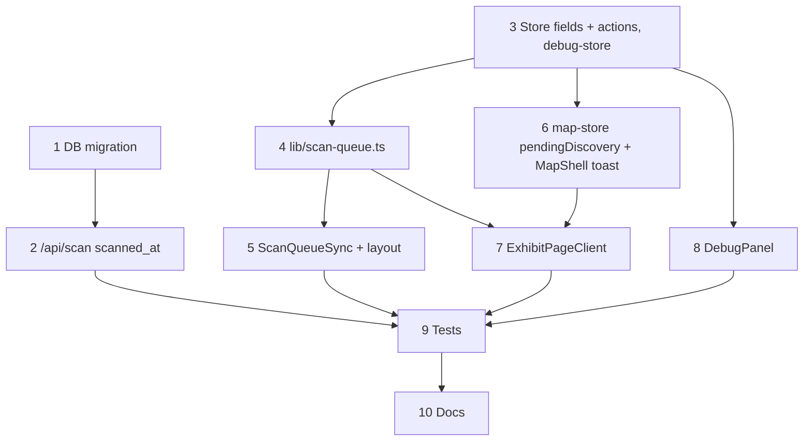

# Offline Scan Queue: Local-First Discovery, Reliable `/api/scan` Delivery

**GitHub**: [#67](https://github.com/makaravind/experium-ai-tour-app/issues/67)
**Milestone**: m5-pwa-offline — PWA + Offline
**Status**: DONE

---

## Context

Every exhibit page sends up to three `POST /api/scan` calls: one on page land, one on first play, one per listen quartile. They are fire-and-forget `fetch`es in `components/ExhibitPageClient.tsx`. Offline they reject, the error is swallowed, and nothing retries.

The page-land POST matters most. With `scansrc=onsite` (what the physical plates encode) the server flips `discovered = true` for that visitor and exhibit. That is the anti-fraud discovery trigger. The trail count, the `+1` toast and the milestone card reveal all come from the `total_discovered` in that response. Offline, the scan is lost for good, the count never moves, and no milestone fires.

Since #81, exhibit pages open offline, so scans in the park with no signal are now normal. Also lost: first-play and quartile POSTs, so the m7 analytics (listen rate, scans per marker per day) undercount.

After this story, every scan goes through a persisted queue. The device counts an onsite discovery itself the moment the page lands, so the toast and milestone reveal work offline. The queue replays to the server in order when connectivity returns, with the device's own scan time, and the server's total then corrects the local count.

---

## Architecture Decisions

### Local-first discovery

**Decision**: On page land with `scanSrc === 'onsite'`, the device adds the QR code to a persisted `discoveredCodes` list and bumps `totalDiscovered` by 1. The toast / milestone reveal at audio end uses that local `{ prevTotal, newTotal }`. The server's response does not drive the celebration anymore. This replaces `pendingDiscoveryPromise` in `lib/map-store.ts` with a plain value.

**Why**: The same path works online and offline, and there is no promise to await. The "onsite" flag already comes from the client (the server only checks `scan_src === 'onsite'`), so counting locally trusts the same input.

**Alternatives considered**:
- Deferred replay (issue's original framing): offline visitors see no `+1` or card until reconnect, and a late celebration needs somewhere to show. Rejected.
- Local count only when the POST fails: two code paths to test. Rejected.

**Consequences**:
- The count is per device. The server total wins once the queue is empty (see "Queue flush"). It can only go down on test devices or when the server rejects a code.
- Devices that already have `totalDiscovered > 0` have an empty `discoveredCodes`, so rescanning an old exhibit counts once more locally, until the queue empties and the server total replaces it. Acceptable, there are only test devices.
- `getCrossedMilestone` still assumes `+1` moves, which holds for local discovery. A server correction that jumps the total shows no celebration, the cards are derived from `totalDiscovered` in `/collection` anyway.

### One queue for every scan POST

**Decision**: `ExhibitPageClient` no longer calls `fetch`. It calls `enqueueScan(code, fields)` from a new `lib/scan-queue.ts`, which appends `{ id, code, scanned_at, fields }` to `scanQueue` in the persisted `experium-store` and immediately triggers a flush. Online, that is one POST right away, offline it stays queued.

**Why**: A single path is easier to reason about and test than "send, and queue on failure". The `visitorId` is added at flush time, not stored per entry, so entries survive a visitor-id that resolves later.

**Consequences**: The queue is unbounded. Quartile POSTs add a few entries per exhibit, which stays small for a 50-exhibit park.

### Queue flush rules

**Decision**: `flushScanQueue()` sends entries one at a time, oldest first. A module-level in-flight guard stops concurrent flushes. Per entry:
- 2xx: remove the entry.
- 4xx except 408 / 429: drop it (the server will never accept it).
- 408, 429, 5xx, network error, or 10s timeout: keep it and stop the flush; nothing after it is sent.

It is a no-op if there's no `visitorId`, the tab is hidden, or `navigator.onLine` is false. Triggers: an entry being added, app start, the `online` event, and the tab returning to the foreground. Use `AbortController` + `setTimeout` for the 10s timeout (broader support than `AbortSignal.timeout`).

After a 2xx, if the queue is now empty, set `totalDiscovered` to the response's `total_discovered`. If entries remain, leave it.

**Why**: Sending in order keeps the page-land entry ahead of first-play and quartile entries for the same exhibit. Replays are safe because `upsert_scan` merges rows by `(user_id, qr_code_id, scan_src)`, with `discovered = scans.discovered OR EXCLUDED.discovered`. On a captive or dead network (`navigator.onLine` true, nothing reaches the server) the 10s timeout keeps one stuck request from blocking the queue forever.

**Alternatives considered**: Background Sync API (not on iOS Safari); client-generated scan IDs for exact dedupe (needs a schema change, see Consequences).

**Consequences**: If a response is lost after the server applied the POST, the retry increments `scanned_count` by 1 extra when `is_qr_scan` is true. Accepted, it's an analytics count, not part of the trail.

### Device scan time

**Decision**: The queue entry's `scanned_at` (ISO string, set at enqueue) is sent in the POST body. `/api/scan` passes a valid one to `upsert_scan` as `p_scanned_at`, otherwise `null`. The SQL function inserts `LEAST(COALESCE(p_scanned_at, now()), now())` into `scans.scanned_at`. On conflict (a later scan of the same row) `scanned_at` is left alone and `updated_at` stays `now()`, i.e. sync time.

**Why**: Per-day and per-hour analytics need the time the visitor was at the marker, not when they got signal at the exit. The cap lives in SQL so a client clock set in the future can't write future rows.

**Consequences**: A past `scanned_at` isn't bounded. The client already controls `scan_src`, so anti-fraud here is soft by design.

### Migration shape

**Decision**: One migration drops the 9-argument `upsert_scan` and recreates it with a 10th parameter `p_scanned_at timestamptz DEFAULT now()`. No grants change (no migration grants `upsert_scan` explicitly).

**Why**: `CREATE OR REPLACE` with a different signature creates an overload instead of replacing, and PostgREST can't pick between overloads. Dropping first avoids that. With the default, the currently deployed app (which sends no `p_scanned_at`) keeps working after the migration.

**Consequences**: The migration must be applied **before** app `main` is pushed. If it isn't, the new app's POSTs fail with a 5xx (unknown parameter), which the queue keeps, so nothing is lost, only delayed.

### Multi-tab: rehydrate the persisted store

**Decision**: A client component `components/ScanQueueSync.tsx`, mounted in `app/layout.tsx` next to `AppGate`, calls `useStore.persist.rehydrate()` on every `storage` event whose key is `experium-store` (or `null`), and when the tab becomes visible. Only a visible tab flushes the queue, and it rehydrates first.

**Why**: Phone-camera scans can open each plate in a new browser tab. All tabs share one `localStorage` key, and zustand's `persist` writes the whole partialized state on every `set`. Without this, a stale tab's next write (even `markVisited` or a language change) overwrites newer `scanQueue` / `discoveredCodes` from another tab and silently loses scans. It also fixes the same hazard for `visitedExhibits` and `mapViewport` as a side effect.

**Alternatives considered**: Move the queue and discovered codes into their own localStorage keys read fresh on each change (more code: helpers plus a hook for the count); accept the risk (loses scans exactly in the situation this story exists for).

**Consequences**: Rehydrating replaces array references (`cachedExhibits`), which re-renders `AppGate` subscribers. Verify a tab that is mid-precache isn't disturbed (see Testing). If two windows are visible at once (split screen) both may flush; replays are idempotent apart from `scanned_count`.

### No store version bump

**Decision**: Add `discoveredCodes` and `scanQueue` to the store and `partialize` without bumping `version`.

**Why**: zustand's default persist `merge` is `{ ...currentState, ...persistedState }`. An old persisted state without the new keys keeps the initial `[]` defaults, so there's nothing to migrate.

### Visible but non-blocking sync status

**Decision**: When the exhibit's page-land scan is still in the queue at audio end, the `+1` toast reads `+1 🌿 · N/50 discovered · saved offline`. Nothing else is shown to visitors. The DebugPanel gets a QUEUE section (length, last flush result).

**Why**: Matches the preference for visible failure states that don't block the visitor.

### DebugPanel Reset clears discovery state

**Decision**: Reset also sets `totalDiscovered: 0`, `discoveredCodes: []` and `scanQueue: []`.

**Why**: Today Reset keeps `totalDiscovered` while clearing `visitorId`, so a stale count carries over to the new visitor, which breaks repeated testing of this very flow.

---

## Implementation Plan

1. **`supabase/migrations/20261017120000_upsert_scan_scanned_at.sql`**: `DROP FUNCTION public.upsert_scan(uuid, uuid, boolean, integer, integer, boolean, text, boolean, jsonb)`, then `CREATE FUNCTION` with the same body as `20260919000000_scan_src_per_row_history.sql` plus `p_scanned_at timestamptz DEFAULT now()`. The `INSERT` sets `scanned_at` to `LEAST(COALESCE(p_scanned_at, now()), now())`. Leave the `ON CONFLICT` branch as is.

2. **`app/api/scan/route.ts`**: read `scanned_at` from the body; if it's a string that `Date.parse` accepts, pass `new Date(scanned_at).toISOString()` as `p_scanned_at`, else `null`. No other change.

3. **`lib/store.ts` + `lib/debug-store.ts`**:
   - Store: add persisted `discoveredCodes: string[]`, `scanQueue: QueuedScan[]`, actions `discoverCode(code)`, `pushScan(entry)`, `removeScan(id)`. Add both fields to `partialize`. Keep the version at 1.
   - `discoverCode` returns `null` if the code is already in `discoveredCodes`, otherwise appends it, sets `totalDiscovered + 1`, and returns `{ prevTotal, newTotal }`.
   - Debug store: add `scanQueueDebug: { lastResult: string; at: number } | null` and a setter, following the `cacheDebug` pattern.

4. **`lib/scan-queue.ts`** (new): `enqueueScan(code, fields)` and `flushScanQueue()` as described in "Queue flush rules". Write each flush outcome to the debug store.

5. **`components/ScanQueueSync.tsx`** (new) and **`app/layout.tsx`**: one component, four effects (flush on mount, `online`, `visibilitychange` → rehydrate then flush, `storage` → rehydrate). Mount it beside `AppGate`, outside the gate, so a queue from a previous visit flushes even while the gate shows its own screen.

6. **`lib/map-store.ts` + `app/(map)/layout.tsx`**:
   - Replace `pendingDiscoveryPromise` (+ setter/clearer) with `pendingDiscovery: { exhibitId, prevTotal, newTotal } | null`, `setPendingDiscovery`, `clearPendingDiscovery`.
   - `handleAudioEnded` reads the value synchronously. Keep the order: clear first, then the `exhibitId` check, then the 500ms timer.
   - Toast state becomes `{ total: number; saved: boolean }`. `saved` is true when `useStore.getState().scanQueue` has an entry for `exhibitPageData.exhibit.qr_code`; render the extra ` · saved offline`.

7. **`components/ExhibitPageClient.tsx`**:
   - Delete `postScan`. All three call sites use `enqueueScan(qrCode, fields)`.
   - Page-land effect: keep the `visitorId` guard and `pageLandSentRef`. If `scanSrc === 'onsite'`, call `discoverCode(qrCode)` first and, when it returns a value, call `setPendingDiscovery({ exhibitId, ...result })` and `setTotalDiscovered(result.newTotal)`. Then enqueue.
   - Drop the `.then(res => res.json())` handling in page land and first play; the flush now applies server totals.
   - Update the comment block above the effect (it describes the promise design).

8. **`components/DebugPanel.tsx`**: QUEUE section (queue length, last flush result from `scanQueueDebug`); extend `resetCache` as in "DebugPanel Reset clears discovery state".

9. **Tests**: see Testing.

10. **Docs**: add a `docs/decisions.md` row ("Offline scans": local-first discovery, persisted queue, device `scanned_at`, server total wins when drained); update `docs/tech-architecture.md:148` (`POST /api/scan` accepts `scanned_at`); mark the spec done and update the tracker files after merge.

Deploy order: apply the migration (step 1) to Supabase first, then merge the app. Push only after the user has tested the local production build (push = Vercel prod deploy).

---

## Task Graph

Steps 1–2 (server side) run in parallel with 3 onward. Step 9's e2e needs everything else.

---

## Code References

- `components/ExhibitPageClient.tsx` — `postScan` (L34-42), page-land effect and its comment (L44-75), `handleFirstPlay` (L77-96), `handleQuartile` (L98-109)
- `app/(map)/layout.tsx` — `handleAudioEnded` (L125-144), toast state (L42) and render (L298-311)
- `lib/map-store.ts` — `pendingDiscoveryPromise` and its setter/clearer
- `lib/trail.ts` — `getCrossedMilestone` (assumes +1 moves)
- `lib/store.ts` — persist config and `partialize` at the bottom of the file
- `app/api/scan/route.ts` — `p_discovered: scan_src === 'onsite'`
- `supabase/migrations/20260919000000_scan_src_per_row_history.sql` — current `upsert_scan` and `total_discovered`
- `app/scan/page.tsx` + `lib/scan-utils.ts` — how `scansrc` reaches the exhibit URL
- `lib/handshake-lock.ts` — existing cross-tab `storage` event handling
- `lib/debug-store.ts`, `components/DebugPanel.tsx` — `cacheDebug` pattern, `resetCache`
- `docs/specs/gh-59-post-audio-celebration.md` — why milestone crossing compares `prevTotal` / `newTotal`
- `__tests__/store.test.ts`, `__tests__/handshake-lock.test.ts` — prior art for store and `StorageEvent` tests
- `e2e/visitor-flow.spec.ts` (L54-88) — mocking `/api/scan`, firing `ended` on the `<audio>` element

---

## Acceptance Criteria (Technical)

- [ ] An onsite scan of a new code, offline: `totalDiscovered` goes up by 1 at page land, and at audio end the toast reads `+1 🌿 · N/50 discovered · saved offline` (or `/collection?reveal=N` when it crosses a milestone)
- [ ] Rescanning the same code adds nothing and shows no toast; a scan with `scansrc=app` or none never changes the count locally
- [ ] Every scan POST (page land, first play, quartile) is persisted in `scanQueue` with a `scanned_at` before it is sent, and survives a reload
- [ ] Network error, timeout, 5xx, 408 and 429 leave the entry queued and stop the flush; nothing after it is sent. Other 4xx drop the entry
- [ ] The queue flushes on enqueue, app start, `online` and foregrounding, in order, one at a time, and only from a visible tab
- [ ] After a flush empties the queue, `totalDiscovered` equals the server's `total_discovered`; while entries remain it is left alone
- [ ] `scans.scanned_at` holds the device time, never later than `now()`; a POST without `scanned_at` still works
- [ ] The currently deployed app works after the migration is applied
- [ ] A stale second tab cannot overwrite queued scans or discovered codes
- [ ] DebugPanel shows the queue; Reset clears `totalDiscovered`, `discoveredCodes` and `scanQueue`
- [ ] Existing vitest and e2e suites pass (pre-existing: 3 `tsc` errors in `__tests__/placeholder.test.ts`, lint errors in built `public/sw.js`)

---

## Testing

- **What to test**: externally visible behavior only: queue state after each response type, order of requests, store totals, what the visitor sees.
- **Test type**:
  - vitest `__tests__/scan-queue.test.ts` with a mocked `fetch`: each response class (2xx / 4xx / 408 / 429 / 5xx / network error / timeout) → remove or keep and stop; order preserved; no `visitorId` → no request; a second `flushScanQueue()` while one is running does nothing; total corrected only when the queue is empty; `scanned_at` and `visitorId` present in the body.
  - vitest `__tests__/store.test.ts`: `discoverCode` increments once per code; defaults for the new fields; old persisted state without them hydrates with `[]`; both are in `partialize`; a `storage` event plus `persist.rehydrate()` picks up another tab's queue.
  - Playwright (new `e2e/offline-scan-queue.spec.ts`, dev server is enough because the offline part is `page.route('/api/scan', r => r.abort())`, no service worker): (1) onsite scan with the route aborted, `ended` on the `<audio>`, toast shows `saved offline`; seeded `totalDiscovered: 2` instead crosses milestone 3 and lands on `/collection?reveal=3`; (2) fulfil the route, dispatch `online`, requests arrive in order with `scanned_at`, queue empties; (3) two pages in one context: the second writes persisted state (e.g. a language change) after the first queued a scan, and `localStorage` still has the queued entry; (4) rescanning the same code adds no toast.
  - Manual: run the migration SQL with a future and a past timestamp (cap works), and a call without it (default works); check a tab that is mid-precache isn't disturbed by a rehydrate.
- **Prior art**: `__tests__/handshake-lock.test.ts` (`StorageEvent`), `__tests__/store.test.ts` (migration test), `e2e/visitor-flow.spec.ts` (mocking `/api/scan`, firing `ended`).
- **What NOT to test**: real network conditions and captive portals, the exact toast animation, `scanned_count` exactness after a lost response.

---

## Out of Scope

- Background Sync API, client-generated scan IDs, stuck-queue alerting (#68 covers precache/offline observability).
- iOS home-screen apps likely not sharing storage with Safari, where the camera opens links. Not checked on a device; a camera scan would look like a new visitor, and block them if offline. File separately if confirmed.
- Showing the late-synced result of a rejected (4xx) scan to the visitor.

---

## Open Questions

- [ ] Who applies the migration to Supabase (`supabase db push`)? — Aravind
- [ ] Update #67's description and acceptance criteria to local-first (the issue still says the milestone fires from the deferred response)? — Aravind
