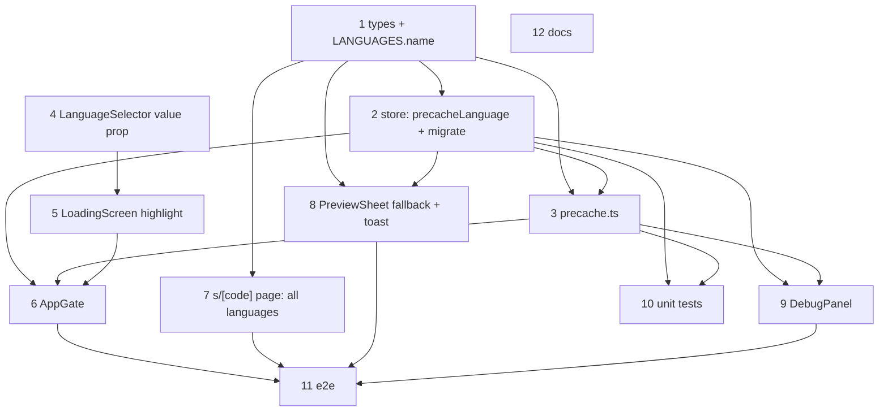

# Language Switch After Precache: No Re-download, Every Language in the Sheet

**GitHub**: [#77](https://github.com/makaravind/experium-ai-tour-app/issues/77)
**Milestone**: m5-pwa-offline — PWA + Offline
**Status**: NOT STARTED
**Follow-ups**: #78 (dataset refresh on online cold open), #79 (picker hides languages with no audio), #80 ("Refresh content" control)

---

## Context

#64 shipped an app-wide `AppGate` that blocks every route until the selected language's audio is in Cache Storage. Two regressions came with it, seen on the Vercel deploy:

1. **Every language switch re-runs onboarding.** A chip tap in `PreviewSheet` writes `store.language`. AppGate's language effect (`components/onboarding/AppGate.tsx` ~L184–187) sees the cache was built for another language and calls `run()`, which unconditionally sets `phase = 'loading'` (~L146). The gate *replaces* `children` with `LoadingScreen` (~L200–204), so the whole app unmounts: the sheet closes, MapLibre re-initialises, audio stops, and `ExhibitPageClient` re-sends its page-land scan. The store also remembers only one language (`cachedExhibits` and `completionByGroup['audio-cache'].language` are overwritten per run), so switching back to an already-downloaded language blocks again.
2. **The exhibit sheet shows only the selected language.** `fetchCachedExhibits(language)` keeps one `audio_url` per exhibit (`CachedExhibit.audioUrl`), and the cached branch of `app/(map)/s/[code]/page.tsx` (~L83–85) turns it into a one-row audio list. On `/s/baobab-forest` (EN + HI) the map-pin sheet shows both chips — it uses ParkMap's own query — but after Listen the exhibit page shows only the chosen one. Before #64 the server page passed every published `exhibit_audio` row.

Before: the precache language is whatever `store.language` currently is, enforced by a blocking re-download on every change. After: the precache language is the onboarding language, stored separately as `precacheLanguage`; the sheet lists every published language and switching streams the new one directly; a failed or missing language falls back to `precacheLanguage` with a toast. This matches `docs/user-flows/flow-1-qr-scan-to-exhibit.md` (L73, L111, L232): the sheet toggle shows EN | HI | TE, "switching reloads audio, restarts playback", and the choice becomes the new default.

---

## Architecture Decisions

### Precache covers the onboarding language only — a separate `precacheLanguage`

**Decision**: Add a persisted `precacheLanguage: Language | null` to `lib/store.ts`. It is the only language AppGate verifies, downloads and gap-fills. Only the LoadingScreen picker writes it (on any loading screen — first onboarding or a catch-up run), plus a fresh visitor's first run seeds it from `store.language`. Bottom-sheet chips and the fallback revert write `store.language` only.

**Why**: Playback preference and the offline guarantee are different things. Overloading `store.language` with both is what turns every chip tap into a ~25MB blocking download. Product call (grilled 2026-10-17): "Precache only contains initial data predefined. If the user is online it should directly play."

**Alternatives considered**: Background (non-blocking) download of each newly picked language — rejected: re-precaching user picks is exactly what's unwanted, and on park networks it competes with the audio being streamed. Keep blocking, but only when the new language has gaps, as an overlay — rejected, the first switch still blocks. Reuse `completionByGroup['audio-cache'].language` as the target instead of a new field — rejected: a stale run's `runPrecache` writes its own language there on finish (`lib/precache.ts` ~L196), so a mid-download re-target gets overwritten and the new language is never downloaded.

**Consequences**: A visitor who switches to Hindi in the sheet has offline audio only in their onboarding language; Hindi works online only. Audio streamed outside the precache likely isn't kept for offline either: media elements request byte ranges, the network answers `206`, and Cache API refuses to store `206` responses, so a replayed Hindi exhibit offline also falls back. `completionByGroup` stays as a record of the last run (DebugPanel reads it); nothing gates on its `language` field anymore.

### The dataset holds every published language; asset groups pick one

**Decision**: `CachedExhibit.audioUrl` becomes `audio` — every published URL keyed by language. `fetchCachedExhibits()` drops its `language` parameter; the Supabase select already returns every `exhibit_audio` row, only the mapping changes. `getAssetGroups(exhibits, language)` picks `audio[language]`, defaulting to `precacheLanguage`.

```ts
interface CachedExhibit {
  // …unchanged fields
  audio: Partial<Record<Language, string>> // published audio_url per language; replaces audioUrl
}
```

**Why**: The exhibit page must offer and play languages that aren't precached, without a network round-trip to learn their URLs. A language-agnostic dataset also removes the reason the gate refetched it on every switch.

**Alternatives considered**: Return to a live per-code Supabase query on `/s/[code]` when online, cached data offline — rejected: a round-trip on every exhibit open over park networks, and it undoes #64's "render from cache" decision. Add a `languages: string[]` list next to `audioUrl` — rejected: the chips would show, but tapping one has no URL to play.

**Consequences**: The persisted shape changes, so the store needs a migration (next decision). Every reader of `audioUrl` changes: `page.tsx`, `AppGate.tsx` (capped list), `DebugPanel.tsx`, `__tests__/precache.test.ts`, and the `e2e/visitor-flow.spec.ts` seed.

### Store migration drops the persisted dataset

**Decision**: The persist options get `version: 1` and a `migrate` that, for version 0, returns the stored state with `cachedExhibits: []` and `precacheLanguage` seeded from `completionByGroup['audio-cache']?.language ?? language`.

**Why**: Old rows have no `audio` field (`getAssetGroups` would throw), and there's no dataset refresh yet (#78). Converting old rows in place would keep existing devices single-language, so Bug 2 would look unfixed on any already-onboarded phone. An empty dataset makes the next cold open run the normal catch-up, which refetches it; the mp3s are already in Cache Storage, so it's near-instant. Seeding from the completion record keeps whichever language was actually fully downloaded.

**Alternatives considered**: Convert in place (`audio = { [completion.language]: audioUrl }`) — rejected for the reason above. No version bump, defensive `e.audio?.[lang]` reads — rejected: same single-language problem, plus scattered null checks.

**Consequences**: Every existing device sees one short loading screen after deploy, and must be online for it (offline → "Connect to the internet"). Acceptable pre-launch.

### AppGate never leaves `clear` once it gets there

**Decision**: Delete the language effect (~L184–187), the `clear && languageIsStale()` foreground branch (~L179), `languageIsStale`, and `run()`'s `staleLanguage` checks (~L119–139). `run()` resolves `target = precacheLanguage ?? language` (persisting it when unset), and `checkFresh`, `runPrecache` and the capped list all use `target`. The mount check becomes: dataset present and no gaps for `target` → `clear`.

**Why**: With chips no longer triggering the gate, the language paths were the only post-clear transitions. Once they're gone, `phase` stays `clear` for the session and `children` never unmount mid-visit — which is what fixes the closing sheet, the map re-init, the stopped audio and the duplicate page-land scan.

**Consequences**: Cold open verifies only `precacheLanguage`. A returning visitor whose preference is Hindi but who onboarded in English goes straight in, and Hindi streams.

### The LoadingScreen picker re-targets the precache and cancels the old download

**Decision**: The picker stays on every loading screen (first onboarding and catch-up runs) and highlights `precacheLanguage` via a new `value` prop on `LanguageSelector`. A tap sets `store.language` (the selector's existing behaviour) and `precacheLanguage` (AppGate's `handleLanguageChange`), then calls `run()`; tapping the already-targeted language is a no-op. `precacheGroups` gets an `isCancelled?: () => boolean` option, checked before each fetch, so a re-target stops scheduling the old language (in-flight fetches finish) instead of downloading all of it first. AppGate passes `() => restartRef.current`.

**Why**: Product call: returning visitors can change their offline language on a catch-up screen. Without `value`, the picker would highlight `store.language` (e.g. Hindi) while downloading English. Without cancellation, today's restart logic finishes the whole stale language (~25MB) before starting the new one.

**Alternatives considered**: Picker on first onboarding only — rejected by product. An `AbortController` threaded into `fetch` — rejected: more plumbing for little gain when at most `CONCURRENCY` in-flight files finish.

### Fallback: revert to `precacheLanguage` + toast

**Decision**: `PreviewSheet` owns failure detection, since it owns the only `<audio>` element.

| Trigger | When | Reason |
|---|---|---|
| `<audio>` `error` event (ignore `MEDIA_ERR_ABORTED`) | any time — including a chip tap, since `preload="metadata"` fetches on src change | `error` |
| no `playing` event within 8s | after the sheet starts playback: Listen, autoplay, src swap while playing, revert auto-play | `timeout` |
| selected language has no audio for this exhibit | on Listen / autoplay (`hasAudio && !currentSrc`) | `missing` |

For any reason:
- `precacheLanguage` differs from the failing language and this exhibit has audio in it → `setLanguage(precacheLanguage)`, toast, and play it when there was play intent (Listen, autoplay, or already playing). The revert changes the saved preference, so later exhibits use it too.
- Otherwise (the failing language *is* the precache language, or the exhibit has no audio in it) → toast only; pause and show the Play state rather than a fake "playing" ring.
- `console.log('[audio] fallback', { from, to, reason })` — interim until #68.

Copy uses English language names (new `name` field on `LANGUAGES`):

| Reason | Revert | No revert target |
|---|---|---|
| error / timeout | "Hindi needs internet. Switched to English." | "Couldn't play audio. Check your connection." |
| missing | "Not available in Telugu. Switched to English." | "Not available in Telugu." |

**Why**: Product calls (grilled): try normally; on offline or timeout show an error toast and switch back; "timeout" means 8s to start only — once playing, buffering is left alone; a missing language takes the same path. The timer covers "connected but no data", where no `error` ever fires.

**Alternatives considered**: Keep the new choice and toast without reverting — rejected by product (repeated failures offline). Also revert on mid-play stalls — rejected: cuts off a long buffer and restarts from 0. A per-exhibit fallback that keeps the global preference — rejected: needs an "effective language" concept and a selector value in the sheet too.

**Consequences**: The toast is local state in `PreviewSheet`, auto-dismissed after 3s, styled like MapShell's discovery toast (`app/(map)/layout.tsx` ~L298–311). It must render *outside* the sheet's `motion.div`: the sheet is CSS-transformed, which makes a `position: fixed` child position relative to the sheet instead of the viewport. Auto-play after a timeout revert happens outside a tap; iOS may refuse it, in which case the toast still shows and the visitor taps Play (see Open Questions).

---

## Implementation Plan

1. **`lib/types.ts`, `lib/utils.ts`** — replace `CachedExhibit.audioUrl` with `audio` (shape above). Add an English `name` ("English" / "Hindi" / "Telugu") to `LanguageOption` and `LANGUAGES` for the toast copy.

2. **`lib/store.ts`** — add `precacheLanguage: Language | null` (default `null`) and `setPrecacheLanguage`; add it to `partialize`. Add `version: 1` and `migrate` per the migration decision.

3. **`lib/precache.ts`** —
   - `fetchCachedExhibits()`: no parameter; build `audio` from every row with `status === 'published' && audio_url`.
   - `getAssetGroups(exhibits = store.cachedExhibits, language = store.precacheLanguage ?? store.language)`: URLs from `e.audio[language]`.
   - `precacheGroups`: accept `isCancelled`; once it returns true, stop taking new URLs and stop the retry loop. Still verify against Cache Storage at the end.
   - `runPrecache(language, onProgress, isCancelled)` passes it through. `checkFresh(language)` uses `getAssetGroups(exhibits, language)`.

4. **`components/common/LanguageSelector.tsx`** — optional `value?: Language`; highlight `value ?? store.language`. Click behaviour unchanged (writes `store.language`, then calls `onChange`).

5. **`components/onboarding/LoadingScreen.tsx`** — new prop for the highlighted language, passed to `LanguageSelector` as `value`.

6. **`components/onboarding/AppGate.tsx`** —
   - Delete `languageIsStale`, the `language` subscription, the language effect, the stale foreground branch, and `run()`'s `staleLanguage` logic.
   - In `run()`, after the `NO_PRECACHE_KEY` check: resolve and persist `target`; `checkFresh(target)`; `runPrecache(target, onProgress, () => restartRef.current)`.
   - `handleLanguageChange(code)`: return if `code === precacheLanguage`; otherwise `setPrecacheLanguage(code)` and `run()`.
   - Subscribe to `precacheLanguage`; pass it to `LoadingScreen`; use `e.audio[precacheLanguage]` for the capped list and the "Continue anyway" URLs.

7. **`app/(map)/s/[code]/page.tsx`** — the cached branch builds `ExhibitAudio[]` from every entry of `cached.audio` (`status: 'published'`). Drop the now-unused `language` subscription.

8. **`components/exhibit/PreviewSheet.tsx`** — implement the fallback decision:
   - read `precacheLanguage`; track play intent in a ref (set by `listen()` and by a src swap while playing; cleared on pause, collapse and exhibit change);
   - `onError` on `<audio>`; the 8s start timer armed where the table says, cleared on `playing`, pause, collapse, exhibit change and unmount;
   - the `missing` check at the top of `listen()`, before `expand()`;
   - after a revert, the existing `currentSrc` effect swaps the src but only plays when `!el.paused` — don't rely on `paused` after a failed start (browser-dependent); play explicitly when the revert carried play intent, and not otherwise (e.g. a chip tap that failed while paused);
   - toast state, 3s auto-dismiss, rendered outside the `motion.div`.

9. **`components/DebugPanel.tsx`** — `failRandomExhibit` and `failedExhibitNames` read `e.audio[precacheLanguage]`; call `fetchCachedExhibits()` without an argument; `resetCache` and `toggleNoPrecache` also clear `precacheLanguage`.

10. **Unit tests** — `__tests__/precache.test.ts`: `getAssetGroups` on the new shape picks one language and dedupes; `precacheGroups` stops scheduling once `isCancelled` flips. `__tests__/store.test.ts`: `precacheLanguage` default and setter; v0 → v1 migration via `useStore.persist.getOptions().migrate` (drops `cachedExhibits`, seeds from the completion record, falls back to `language`).

11. **e2e** —
    - `e2e/gate-helpers.ts`: add a HI row (`FAKE_HI_AUDIO_URL`) to `mockPrecacheDataset`; rewrite `passLanguageGate`, whose "Choose your language to begin" copy was removed in d1627d9 (precache now auto-starts with EN).
    - `e2e/visitor-flow.spec.ts`: drop the stale copy assert (~L38); move the returning-visitor seed (~L110–139) to the v1 shape (`audio`, `precacheLanguage: 'en'`, `version: 1`), otherwise the migration sends it through the loading screen.
    - `e2e/offline-precache.spec.ts`: drop the stale copy assert (~L38–40).
    - New `e2e/language-switch.spec.ts`, driven through the exhibit-page sheet (map pins are a WebGL canvas and hard to click reliably) — cases under Testing.

12. **Docs** — `docs/decisions.md`: add a row "Precache language: onboarding language only; sheet switches stream online; failures revert + toast", and update "Offline UX (missing audio)" (L43: inline error → revert + toast). In `docs/specs/gh-64-upfront-precache.md`, add a "superseded by #77" note to the "Fresh-vs-cached detection" consequences (language-scoped completion). Mark #77 in `.claude/current-milestone.md` on merge.

---

## Task Graph



---

## Code References

- `components/onboarding/AppGate.tsx` — gate state machine; the language effect, stale checks and the `runningRef`/`restartRef` restart logic this change edits
- `lib/precache.ts` — dataset query, asset groups, the `precacheGroups` worker loop, `checkFresh`
- `lib/store.ts` — persisted slice and `partialize`; where `version`/`migrate` go (zustand v5 `persist`)
- `app/(map)/s/[code]/page.tsx` — cached vs live branches; the one-row audio list (~L83–85); the live branch (~L127) is the shape to match
- `components/exhibit/PreviewSheet.tsx` — `currentSrc` (~L69), src-swap effect (~L114–122), `listen()` (~L144–160), autoplay effect (~L162–166), chip list (~L180–183, ~L327–329), `<audio>` (~L219–243)
- `app/(map)/layout.tsx` — `sheetAudio` wiring (~L111–124); discovery toast pattern (~L152–157, ~L298–311)
- `components/ExhibitPageClient.tsx` — derives `languages` from the audio list (~L126); the page-land scan guard (~L55–75) that a remount re-fires
- `components/common/LanguageSelector.tsx`, `components/onboarding/LoadingScreen.tsx` — picker wiring
- `components/DebugPanel.tsx` — CACHE section readers and resetters of the precache slice
- `app/sw.ts` — `audio-cache` CacheFirst + RangeRequests rule (why streamed audio isn't kept offline)
- `docs/user-flows/flow-1-qr-scan-to-exhibit.md` (L73, L111, L232) — documented sheet toggle behaviour
- `docs/specs/gh-64-upfront-precache.md` — the precache design this amends
- `e2e/gate-helpers.ts`, `e2e/visitor-flow.spec.ts` — dataset mocking and localStorage seeding prior art

---

## Acceptance Criteria (Technical)

- [ ] Once AppGate reaches `clear`, no `store.language` change moves `phase` off `clear`; `children` stay mounted (no `LoadingScreen` render, no second page-land `/api/scan` POST)
- [ ] `CachedExhibit.audio` holds every published language and the `/s/[code]` cached branch passes all of them, so the sheet shows every language the exhibit has (`/s/baobab-forest` → EN + HI after picking HI)
- [ ] Online, choosing a non-precached language sets the `<audio>` src to that language's URL and plays it without any precache run
- [ ] An `error` (not aborted), or no `playing` within 8s of a sheet-started play → `store.language = precacheLanguage`, toast with the specified copy, and playback when there was play intent
- [ ] `hasAudio && !currentSrc` on Listen → the same revert path with "Not available in …" copy
- [ ] No revert target → toast only; the sheet shows the Play state
- [ ] Cold open checks and fills only `precacheLanguage`: a visitor with `language: 'hi'`, `precacheLanguage: 'en'` and a complete EN cache reaches `clear` without fetching any HI file
- [ ] The loading-screen picker highlights `precacheLanguage`; a tap sets it, stops scheduling the old language's fetches and downloads the new one; tapping the current target does nothing
- [ ] A v0 persisted store migrates to v1 (`cachedExhibits` emptied, `precacheLanguage` seeded), and the next online cold open refetches the dataset with every language
- [ ] Unit and e2e suites pass, including the fixed stale asserts

---

## Testing

- **What to test**: externally visible behaviour — chips shown, which src plays, toast text, whether the loading screen appears, what lands in Cache Storage, the persisted store shape after migration.
- **Test type**: unit (Vitest) for `lib/precache.ts` and the store migration; Playwright e2e for the sheet and gate flows.
- **Prior art**: `__tests__/precache.test.ts` `harness()` — dependency-injected fake Cache Storage, the model for the `isCancelled` test. `e2e/gate-helpers.ts` (`mockPrecacheDataset`, `seedAudioCache`) and the `e2e/visitor-flow.spec.ts` returning-visitor seed — the model for dataset/route mocking and localStorage seeding.
- **New e2e cases** (`e2e/language-switch.spec.ts`; the dev server is enough, failures are simulated with `page.route`):
  - Returning visitor on `/s/baobab-forest` sees EN + HI chips; tapping HI never shows the loading screen and Listen stays visible.
  - HI route fulfilled → Listen plays the HI src.
  - HI route aborted → toast "Hindi needs internet. Switched to English.", EN chip selected, EN src.
  - HI route never answered → revert after 8s (Playwright `page.clock`, or a ~9s wait).
  - Seeded `language: 'te'` → Listen → "Not available in Telugu. Switched to English."
  - Catch-up run (EN URL missing from the cache, `language: 'hi'`, `precacheLanguage: 'en'`) → picker highlights English; tap Hindi → persisted `precacheLanguage` becomes `hi` and the HI URL is fetched.
- **What NOT to test**: Cache API's `206` rejection, browser autoplay policy, toast styling, MapLibre pin taps.
- **Manual (device)**: iOS Safari auto-play after a timeout revert; the 8s threshold on the park's real network; a production build (`E2E_PROD=1`) offline cold open after a sheet switch to HI.

---

## Open Questions

- [ ] Does iOS Safari allow auto-play after a timeout revert (no tap in the call stack)? If not, accept the toast + paused fallback — device test
- [ ] Is 8s right on park networks? — field test
