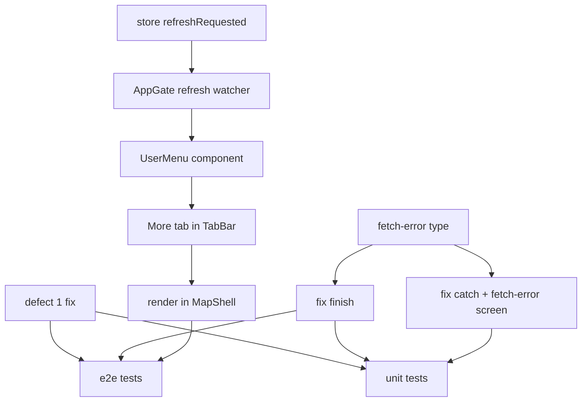

# Refresh Content + Offline Blocker Fix

**GitHub**: [#78](https://github.com/makaravind/experium-ai-tour-app/issues/78) · [#80](https://github.com/makaravind/experium-ai-tour-app/issues/80) · [#65](https://github.com/makaravind/experium-ai-tour-app/issues/65) — collapsed into one PR
**Milestone**: m5-pwa-offline
**Status**: DONE — merged to `main` as `79642c2`

---

## Context

Since #64 shipped the upfront precache (`AppGate`), the exhibit dataset is fetched once on first visit and never refreshed. Park operators can upload new exhibits or audio (e.g. m2c uploads), but returning visitors with a complete cache never see them — no new pins, no new audio. The fix is a manual "Refresh content" action, not an automatic cold-open refresh (exhibit data changes rarely; a visitor-triggered refresh is the right tradeoff).

At the same time `AppGate` has two offline-handling bugs (#65) that make the blocker screen appear when it shouldn't. These become more visible with this PR because a dataset refresh creates new file gaps, so partial-cache scenarios become common. All three issues are fixed together.

**Before**: No way to refresh content. Offline blocker appears for returning visitors with a saved cache but no network. "Connect to the internet" appears when something fails mid-download while online.

**After**: A "More" tab (⋯) in the tab bar opens a menu. Tapping "Refresh content" while online triggers the full AppGate loading screen, gap-fills new audio, then returns to the app. The offline blocker only shows when there is genuinely no dataset at all.

---

## Architecture Decisions

### Manual refresh only — no automatic cold-open refresh

**Decision**: No automatic dataset refresh on app start. A manual "Refresh content" button (#80) is the only trigger.

**Why**: Exhibit data is static — operators upload content once, not continuously. A visitor who opens the app a week later gets the same dataset they had. An automatic cold-open refresh adds latency and complexity for a scenario that almost never matters. The manual button is the right UX: visitors or operators trigger it when they know content has changed.

**Alternatives considered**: Refresh on every cold open (original #78 intent) — rejected because the data is static and the cost is always paid. Refresh on foreground — rejected, that's even more frequent.

**Consequences**: If an operator publishes new content, returning visitors won't see it until they tap Refresh. This is acceptable given the update cadence.

---

### "Refresh content" triggers the full AppGate loading screen

**Decision**: Tapping "Refresh content" sets a `refreshRequested` flag in the Zustand store. `AppGate` watches it, resets to `'checking'`, and re-runs `run()`. The visitor sees the same loading screen as first-time onboarding.

**Why**: The loading screen provides honest feedback (how many files are downloading), handles language-picker edge cases, and reuses the existing `runPrecache` path without duplicating logic. A silent background swap was considered and rejected — the user explicitly asked for visible feedback since the refresh downloads real files.

**Alternatives considered**: Silent `setCachedExhibits()` swap with no loading screen — rejected by Aravind. Exposing `run()` via context/ref — rejected, store flag is simpler and keeps `AppGate` self-contained.

**Consequences**: The tab bar is hidden while refreshing (AppGate covers `children`). This is intentional — same as first-time onboarding.

**State machine addition**:

`GatePhase` in `lib/debug-store.ts` gets one new value:

```ts
export type GatePhase =
  'checking' | 'blocked-offline' | 'fetch-error' | 'loading' | 'asset-error' | 'info' | 'clear'
```

`'fetch-error'` is used when the dataset query or handshake throws while the device is online (Defect 2, see below).

---

### Debug mode: full cache wipe before refresh

**Decision**: When `useDebugStore.getState().isActive` is true and a refresh is triggered, delete `'audio-cache'` from Cache Storage before calling `run()`. Normal visitors always get gap-fill only.

**Why**: Debug mode is for testing the full download flow. Gap-fill in debug would silently skip files that are already cached, making it impossible to verify the download path.

**Alternatives considered**: A separate "Full reset" button — rejected, the existing DebugPanel → Reset already does this. Making gap vs wipe a parameter of `runPrecache` — rejected, only the refresh trigger needs the wipe; adding a parameter would change the interface for a single caller.

**Consequences**: Only affects `?debug=1` sessions. The wipe happens in the `refreshRequested` effect in `AppGate`, not inside `runPrecache`.

---

### #65 Defect 1: offline + dataset saved → let the visitor through

**Decision**: The `!online` early-exit in `AppGate.run()` (~L130) is split: no dataset → blocker; dataset exists → `nextAfterClear()`.

**Why**: A returning visitor with the full audio tour cached but no network should use the app normally. The existing `#77` revert+toast handles missing audio inside the app. The blocker is only for first-time visitors who genuinely cannot proceed.

**Code change** (decision-critical):

```ts
// Before
if (!online) {
  setPhase('blocked-offline')
  return
}

// After
if (!online) {
  setPhase(hasDataset ? nextAfterClear() : 'blocked-offline')
  return
}
```

---

### #65 Defect 2: failed-while-online ≠ no connection

**Decision**: Two separate fixes:

1. `finish()` in `AppGate`: split `result.offline || groups.some(!g.complete)` — offline → `'blocked-offline'`; incomplete without offline → `'asset-error'` (server errors that hit the retry cap, not a network outage).

2. `catch` block in `AppGate.run()`: check `navigator.onLine` at catch time. If online, the dataset query or handshake failed for a non-network reason → `'fetch-error'` (new phase). If offline → `'blocked-offline'` as before.

**Why**: "Connect to the internet" is wrong when the device is online. These are different failure modes with different user actions: network outage = wait and retry; server error = retry now; asset errors = continue anyway.

**Code change** (decision-critical):

```ts
// finish() — before
else if (result.offline || result.groups.some((g) => !g.complete)) setPhase('blocked-offline')

// finish() — after
else if (result.offline) setPhase('blocked-offline')
else if (result.groups.some((g) => !g.complete)) setPhase('asset-error')
```

```ts
// catch block — before
catch {
  if (!restartRef.current) setPhase('blocked-offline')
}

// catch block — after
catch {
  if (!restartRef.current) setPhase(navigator.onLine ? 'fetch-error' : 'blocked-offline')
}
```

The `'fetch-error'` screen: "Something went wrong" title, "Couldn't load the tour data. Check your connection and try again." body, "Try again" button calling `run()`.

---

### UserMenu component placement

**Decision**: New `components/more/UserMenu.tsx` — a self-contained component that renders both the "More" tab button and the floating menu sheet. `TabBar.tsx` is extended to include the More tab, and `UserMenu` is rendered alongside `TabBar` in `MapShell`.

**Why**: Keeps the menu sheet and its open/close state co-located. `TabBar` stays a thin nav wrapper; `UserMenu` owns its own `open` state.

**Consequences**: Two components rendered in `MapShell` for navigation (`TabBar` + `UserMenu`). The More tab's position is controlled by `TabBar`'s flex layout; `UserMenu`'s sheet is absolutely positioned above it.

---

## Implementation Plan

1. **Add `'fetch-error'` to `GatePhase`** (`lib/debug-store.ts:25`): add `'fetch-error'` to the union. This is a type-only change that unblocks the AppGate edits.

2. **Fix Defect 1** (`components/onboarding/AppGate.tsx:130`): split the `!online` early-exit to check `hasDataset`. One-line change.

3. **Fix Defect 2 — `finish()`** (`AppGate.tsx:87`): split `result.offline || !complete` into two branches as shown above.

4. **Fix Defect 2 — `catch`** (`AppGate.tsx:152-154`): check `navigator.onLine`, set `'fetch-error'` or `'blocked-offline'`. Add the `fetch-error` screen render block below the existing `blocked-offline` block (same `Screen` component, different copy + retry button calling `run()`).

5. **Add `refreshRequested` to the store** (`lib/store.ts`): add `refreshRequested: boolean` (default `false`, session-only — not persisted) and `setRefreshRequested: (v: boolean) => void`.

6. **Wire refresh trigger in `AppGate`** (`AppGate.tsx`): add a `useEffect` that watches `refreshRequested`. When it becomes `true` and `phaseRef.current === 'clear'`: clear the flag immediately, optionally wipe `'audio-cache'` (if `useDebugStore.getState().isActive`), then call `run()`. Wait for `run` to be in the dependency array.

7. **Build `UserMenu`** (`components/more/UserMenu.tsx`): new component. Owns `open: boolean` state. Renders a floating sheet positioned `bottom: 106px` (above the tab bar) with a caret, containing a "Refresh content" row. Row is disabled with "Offline" badge when `!navigator.onLine`; reactively updates on `window` `online`/`offline` events. Online tap: dismiss sheet, call `useStore.getState().setRefreshRequested(true)`. Offline tap: nudge animation, no action. "Log out" and "Profile" rows are present as `aria-disabled` placeholders with a "Soon" badge.

8. **Add "More" tab to `TabBar`** (`components/exhibit/TabBar.tsx`): add a 4th tab button after the Map link. The button does not navigate — it calls an `onMoreClick` prop or dispatches a custom event. Since `UserMenu` owns its open state, wire via a shared Zustand flag or a callback prop. Simplest: `UserMenu` receives no props and manages everything internally; add a `triggerOpen` export or use a Zustand `moreMenuOpen` flag. Evaluate during implementation — keep it local if possible.

9. **Render `UserMenu` in `MapShell`** (`app/(map)/layout.tsx`): add `<UserMenu />` alongside `<TabBar />`. Both are absolutely positioned within the map shell.

10. **Unit tests** (`__tests__/precache.test.ts`): add a `checkFresh` test — `hasDataset: true`, device offline, gaps present → gate should reach `nextAfterClear()` not `blocked-offline`. Mock `navigator.onLine = false`.

11. **E2E test** (`e2e/offline-precache.spec.ts`): add a case — visitor has dataset + audio cached, DevTools offline, cold open → lands on map (not blocker).

---

## Task Graph



---

## Code References

- `components/onboarding/AppGate.tsx` — gate state machine, all three defects live here
- `lib/precache.ts` — `checkFresh`, `runPrecache`, `fetchCachedExhibits`; understand before touching AppGate
- `lib/debug-store.ts:24` — `GatePhase` union, `isActive` for debug mode detection
- `lib/store.ts` — where `refreshRequested` will be added; see existing session-only fields (no `persist` call for session fields)
- `components/exhibit/TabBar.tsx` — current 3-tab nav; step 8 extends this
- `app/(map)/layout.tsx` — `MapShell`; where `TabBar` is rendered and `UserMenu` will be added
- `docs/specs/gh-64-upfront-precache.md` — full gate state machine history and why decisions were made
- `docs/specs/gh-77-language-switch-after-precache.md` — `precacheLanguage`, revert+toast (handles missing audio after refresh)
- `__tests__/precache.test.ts` — existing unit tests for `checkFresh` and `precacheGroups`; prior art for step 10
- `e2e/offline-precache.spec.ts` + `e2e/gate-helpers.ts` — existing e2e offline tests; prior art for step 11

---

## Acceptance Criteria (Technical)

- [ ] Online cold open with a complete cache: AppGate passes through to `clear` without triggering a refresh (refresh is manual-only)
- [ ] Tapping "Refresh content" while online: `refreshRequested` becomes true → AppGate resets phase to `checking` → loading screen appears → `runPrecache` gap-fills new audio → app returns to `clear`
- [ ] Debug mode on: tapping "Refresh content" deletes `'audio-cache'` before `runPrecache`, forcing a full re-download
- [ ] Tapping "Refresh content" while offline: row shows "Offline" badge, nudge animation, no AppGate trigger
- [ ] Offline + dataset saved + gaps: `AppGate.run()` reaches `nextAfterClear()`, not `blocked-offline`
- [ ] Offline + no dataset: `blocked-offline` unchanged
- [ ] `runPrecache` throws while online: AppGate shows `'fetch-error'` screen ("Something went wrong"), not "Connect to the internet"
- [ ] `runPrecache` throws while offline: AppGate shows `'blocked-offline'` as before
- [ ] `finish()` with incomplete groups and not offline: `'asset-error'`, not `'blocked-offline'`
- [ ] "More" tab appears in tab bar; "Log out" and "Profile" rows are disabled with "Soon" badge

---

## Testing

- **Unit** (`__tests__/precache.test.ts`): `checkFresh` with `hasDataset=true`, `navigator.onLine=false`, gaps present → confirm gate logic reaches `nextAfterClear()`. No E2E needed for this logic unit.
- **E2E** (`e2e/offline-precache.spec.ts`): prod build (`E2E_PROD=1`), seed Cache Storage with dataset + audio, DevTools offline, cold open → app reaches map. Use existing helpers in `e2e/gate-helpers.ts` as the model.
- **What NOT to test**: internals of `runPrecache` (covered by existing precache tests), `UserMenu` open/close state (UI detail), debug wipe path (debug-only, not worth e2e).

---

## Open Questions

- [ ] Where exactly does the caret position for the "More" menu sheet land — does the tab bar's flex layout leave enough room for a 4th tab without squishing Scan? Verify in browser before finalising `TabBar` layout.
