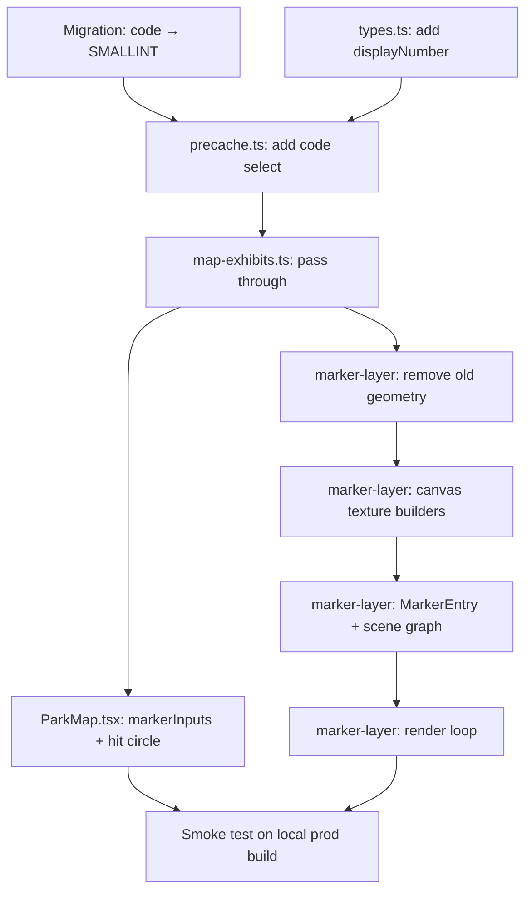

# Concentric Circle Marker Redesign with Exhibit Numbers

**GitHub**: [#84](https://github.com/makaravind/experium-ai-tour-app/issues/84)
**Status**: NOT STARTED

---

## Context

The current map markers are 3D extruded metal pins (Three.js WebGL custom layer). They look visually polished but carry no identifying information — a visitor cannot cross-reference a marker on the app to a marker on the printed park map.

This story redesigns the markers into concentric circle buttons: a white disc center showing an exhibit number, surrounded by a dark gap and a colored outer ring indicating state. The design is still rendered in Three.js (WebGL canvas textures — no DOM markers) so panning/zooming stays smooth on mid-range Android at 100 markers. The exhibit number comes from a new `SMALLINT` `exhibits.code` column that will serve as the permanent park reference number (1–99) used on printed materials, signage, and the in-app exhibit list.

Before: unnamed metallic pins, no cross-reference capability.  
After: numbered circle buttons, visitors can say "I'm at exhibit 7" and find it on the physical map.

---

## Architecture Decisions

### Rendering: Three.js canvas textures, not HTML DOM markers

**Decision**: Keep the existing `type: 'custom'` MapLibre WebGL layer. Replace Three.js extruded geometry with flat `PlaneGeometry` quads textured with Canvas 2D-drawn concentric circles.

**Why**: At ~100 markers, HTML DOM markers (MapLibre's `new Marker({ element })`) cause ~600 DOM mutations per animation frame during map pan/zoom. On mid-range Android that produces visible stutter. Three.js renders all 100 markers in a single `render()` call — GPU-only, no DOM touched.

**Alternatives considered**: MapLibre HTML markers — simpler CSS animations, prototype maps 1:1. Rejected because of pan/zoom performance on mobile.

**Consequences**: CSS animations from the prototype must be simulated in the render loop (already done for active rise and sparkle in the current code — same pattern).

---

### Texture strategy: one baked canvas per marker × state

**Decision**: At layer init, bake a 96×96 Canvas 2D texture for each exhibit × each base state (`unvisited`, `visited`, `coming_soon`) = 3 textures per marker. Swap the active texture on state change. No separate "active" texture variant — active state is represented by the lift animation only.

**Why**: Keeps the scene graph identical to the current code (one quad per marker, texture swap on state change). 297 textures at 96×96 × 4 bytes ≈ 10MB GPU — acceptable for a 99-exhibit park.

**Alternatives considered**:  
- Shared ring texture per state + per-marker number disc (two quads per marker) — saves GPU memory but adds alignment complexity and z-fighting risk.  
- Re-baking texture on state change — memory-efficient but adds per-frame complexity.

**Consequences**: State changes (unvisited → visited) swap the texture, same as current material swap. Exhibit numbers are baked in at init; if a number changes the layer must be recreated (acceptable — numbers are static).

```
buildDiscTexture(num: number, tintKey: TintKey): THREE.CanvasTexture
  Canvas 96×96, center at (48, 48)
  R_outer = 44   (4px padding for anti-alias)
  R_gap   = 30   (= 44 − 8/56 × 96 ≈ 30.3)
  R_disc  = 25   (= 44 − 11/56 × 96 ≈ 25.1)

  1. Fill circle R_outer: radial gradient (ring-light at top-left → ring-color at 48% → ring-dark at edge)
  2. Fill circle R_gap:   rgba(0,0,0,0.22) — the dark depth channel
  3. Fill circle R_disc:  radial gradient white (#fff → #efefef)
  4. Text at (48,48):     number, ~14px bold, #1c1c1c

  coming_soon variant: globalAlpha=0.65 for ring; number color #aaa; disc #f5f5f5→#e8e8e8
```

---

### Number source: `exhibits.code` migrated to `SMALLINT`

**Decision**: Use `exhibits.code` (currently `TEXT UNIQUE NOT NULL`, orphaned — never queried in the app) as the display number. Migrate the column to `SMALLINT`. Seed existing rows with serial integers via migration; values will be updated manually to the actual park reference numbers.

**Why**: `exhibits.code` already exists on the right table, is already `UNIQUE`, and is currently unused — no join or new column needed. `exhibit_qr_codes.code` (the QR scan URL key, e.g. `"A7X3"`) is untouched.

**Alternatives considered**: Add a new `display_number` column — rejected since `exhibits.code` is already there and purpose-fits. Use `exhibit_qr_codes.code` — rejected because it lives on the wrong table (would require a join with ambiguity when one exhibit has multiple QR codes).

**Consequences**: `exhibits.code` becomes the permanent park exhibit reference number. The precache select must include it. `CachedExhibit` and `MapExhibit` get a new `displayNumber: number | null` field. `MarkerInput` gets `number: number`.

---

### Animations: drop spin, keep rise + shadow, add breathe + ripple

**Decision**:

| Animation | Status | Notes |
|---|---|---|
| Active rise (translateY) | Keep | Same `easeOutCubic` over `RISE_DURATION_MS=400` |
| Active shadow shrink | Keep | Same lerp logic |
| Active spin (rotation.y) | **Drop** | Meaningless for a flat circle |
| Nearby sparkle sprite | **Replace** | → Breathing aura ring (scale 1→1.14, opacity 0.12→0.38, period 2600ms) |
| Ripple on activate | **Add** | Scale 1→1.9, opacity 0.6→0, 480ms, triggered when `activeExhibitId` changes to this marker |

**Why**: Spin was visually motivated by the metallic 3D surface. A flat circle spinning conveys nothing. Breathe fits the concentric-circle visual language (another ring, pulsing). Ripple gives tap feedback, which the old design lacked entirely.

---

### Hit circle alignment: center-anchored

**Decision**: Update `ParkMap.tsx` hit circle `circle-translate` from `[0, -HIT_CIRCLE_RADIUS]` to `[0, 0]`.

**Why**: The current pin is bottom-anchored (tip at GPS point, head above) — hence the upward translate. The new circle is center-anchored (circle centered on GPS point). No translate needed.

---

## Implementation Plan

1. **Migration — alter `exhibits.code` to `SMALLINT`**  
   New file `supabase/migrations/{timestamp}_exhibits_code_to_number.sql`. Drop the `TEXT` column, add `SMALLINT UNIQUE NULL`, then set serial values (`ROW_NUMBER() OVER (ORDER BY created_at)`) for existing rows. Keep `NOT NULL` deferred until numbers are manually validated.

2. **`lib/types.ts` — add `displayNumber`**  
   Add `displayNumber: number | null` to `CachedExhibit` and `MapExhibit`. No change to `PreviewExhibit` (doesn't need it).

3. **`lib/precache.ts` — include `code` in select**  
   Add `code` to the `exhibits` select string. Map it to `displayNumber: row.code ?? null` in the return.

4. **`lib/map-exhibits.ts` — pass `displayNumber` through**  
   Add `displayNumber: e.displayNumber ?? null` to the returned `MapExhibit`.

5. **`components/map/ParkMap.tsx` — two changes**  
   a. Add `number: exhibit.displayNumber ?? 0` to `markerInputs` construction (line ~339).  
   b. Change all three `circle-translate` entries from `[0, -HIT_CIRCLE_RADIUS_*]` to `[0, 0]`.

6. **`components/map/marker-layer.ts` — full rewrite**  
   See sub-steps below. Keep the file structure and export signature identical (`createMarkerLayer`, `MarkerInput`).

   6a. **Remove**: `buildPinGeometry`, `buildStudioEnv`, `makeSparkleTexture`, `makeStandardMaterial`, `TINTS`, `TintKey` (re-add with new color values), all spin constants, sparkle constants, `baseMaterials`, `activeMaterials`, `pmremRenderTarget`.

   6b. **Add canvas builder** `buildDiscTexture(num, tintKey)` — 96×96 Canvas 2D per the texture strategy above.

   6c. **Add ring texture builders** `makeAuraTexture()` and `makeRippleTexture()` — shared 128×128 canvases, white circle stroke only (colored via `MeshBasicMaterial.color` at render time).

   6d. **Update `MarkerInput`** — add `number: number`.

   6e. **Update `MarkerEntry`** — replace `pin`/`sparkle` with `disc`, `aura`, `ripple`. Add `discTextures: Record<TintKey, THREE.CanvasTexture>` and `rippleStartMs: number`.

   6f. **Update `createMarkerEntry`** — build 3 disc textures per marker. Create 4 meshes: `disc` (PlaneGeometry + MeshBasicMaterial), `aura` (PlaneGeometry + MeshBasicMaterial, transparent), `ripple` (same), `shadow` (existing).

   6g. **Update `render()`** — remove spin, remove PMREM env, add breathe logic (aura scale+opacity via sin), add ripple logic (one-shot elapsed animation). Detect new active marker to trigger `rippleStartMs`. Swap `disc.material.map` to the correct state texture. Scale disc by `scaleFactor = pinPx / MARKER_DESIGN_PX` where `MARKER_DESIGN_PX = 56`.

   6h. **Update `onRemove`** — dispose disc textures per marker, dispose shared aura/ripple textures.

---

## Task Graph



---

## Code References

- `components/map/marker-layer.ts` — current implementation; keep `render()` structure, `renderOrder` sort, `triggerRepaint` logic
- `lib/nearby.ts` — `pinPixelHeight(zoom, lat)` returns 24–96px (clamped, 12m world target); this is `pinPx` in the render loop
- `lib/precache.ts:55` — `fetchCachedExhibits()` — the select to extend with `code`
- `lib/map-exhibits.ts` — `toMapExhibits()` — the mapping to extend with `displayNumber`
- `components/map/ParkMap.tsx:339` — `markerInputs` construction to extend with `number`
- `components/map/ParkMap.tsx:50` — `HIT_CIRCLE_RADIUS_*` constants and `circle-translate` paint property
- `supabase/migrations/20260809000000_initial_schema.sql:39` — `exhibits.code TEXT UNIQUE NOT NULL` definition
- `/Users/ametku/Library/Application Support/Open Design/namespaces/release-stable/data/projects/71dad1fb-67b1-46ef-8286-29bd197b9d61/marker-redesign-prototype.html` — full CSS prototype with all 5 states, exact color tokens, animation keyframes

---

## Acceptance Criteria

- [ ] Map markers render as concentric circle buttons (white disc + dark gap + colored ring)
- [ ] Each marker displays its exhibit reference number (1–99) in the white disc
- [ ] State colors match prototype: unvisited `#dda15e`, visited `#588157`, coming_soon `#8f8f8f` (dimmed)
- [ ] Active marker rises with `easeOutCubic` over 400ms; shadow shrinks accordingly
- [ ] Activating a marker triggers a 480ms ripple ring expanding from 1× to 1.9× opacity 0.6→0
- [ ] Nearby markers show a breathing aura ring (scale 1→1.14, opacity 0.12→0.38, 2600ms period)
- [ ] Marker size scales with zoom level (24–96px range via `pinPixelHeight`)
- [ ] `exhibits.code` is `SMALLINT`; existing rows have serial numbers assigned
- [ ] No spin animation on any marker state
- [ ] Map pan/zoom remains smooth (no visible stutter) with all markers visible

---

## Testing

- **What to test**: `toMapExhibits` passes `displayNumber` through; `fetchCachedExhibits` maps `code` to `displayNumber`
- **Test type**: unit
- **Prior art**: `__tests__/map-exhibits.test.ts` — tests `toMapExhibits` shape; add `displayNumber` assertion there
- **What NOT to test**: Three.js render loop internals, canvas texture pixel output, animation timing
