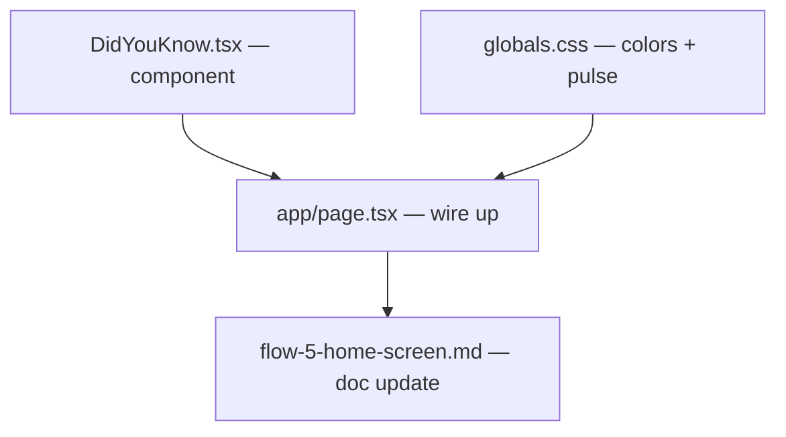

# Did You Know — Fact Cards on Home Screen

**GitHub**: #95
**Milestone**: m4-gamification
**Status**: NOT STARTED

---

## Context

The home screen currently shows a trail card, collection link, Scan Now, and Explore. It gives visitors no taste of what's actually in the park before they start scanning.

This feature adds a "Did You Know?" section: 3 random exhibit facts, presented as sticker-style cards that peek from the left edge of the screen. The interaction is intentionally multi-step and playful — a pulsing invite button reveals the deck, the deck fans into a swipeable carousel, and tapping a card opens the existing `PreviewSheet`. No new modal, no new info surface. The Listen button in the sheet navigates to `/s/{code}` exactly as it does today.

Designs: `.claude/skills/grillme/../../../Library/Application Support/Open Design/…/flow-5-did-you-know.html`

---

## Architecture Decisions

### Reuse PreviewSheet for exhibit detail — no custom modal

**Decision**: When a card is tapped, set `selectedDykExhibit` state in `app/page.tsx` and render `<PreviewSheet exhibit={selectedDykExhibit} audio={[]} />`. Dismiss on close.

**Why**: `PreviewSheet` already handles the no-audio case: when `audio` is empty, the Listen button calls `router.push(`/s/${exhibit.qr_code}?scansrc=app`)`. That's the exact navigation behaviour requested. Building a new modal would duplicate this logic and add a separate code path to maintain.

**Alternatives considered**: Custom bottom sheet in `DidYouKnow.tsx` — rejected because it duplicates the exhibit card layout and breaks if PreviewSheet evolves (e.g. language selector, tier badge).

**Consequences**: `PreviewSheet` must be rendered in `app/page.tsx`, which is outside the `(map)` layout. This is safe — `BottomSheet` uses `position: fixed` internally so it isn't clipped by the home div's `overflow: hidden`.

---

### Pick 3 exhibits on mount — no persisted state

**Decision**: Select 3 exhibits with `useMemo(() => pickRandom(factsExhibits, 3), [])` inside `DidYouKnow`. The `[]` dep array means one fresh shuffle per app mount, not per render.

**Why**: The issue explicitly says "no state". Persisting the selection adds a store key with no user value. A per-mount shuffle is sufficient; the user sees the same 3 cards throughout a session.

**Consequences**: Cards change on hard refresh / next visit, which is desirable — the section feels fresh each time.

---

### Placeholder colors derived from exhibit type

**Decision**: Map `exhibit.type` → a CSS gradient class (`c-plant`, `c-water`, `c-structure`, `c-landmark`). Fall back to `c-plant` for unknown types.

**Why**: No exhibit photos exist yet. The color gives each card a distinct identity while being easy to swap for real images later (just replace the class background with an `img`).

---

### Peek offset via CSS transform, not `left`/`margin`

**Decision**: The stack container uses `transform: translateX(-105px)` as its default CSS. JS overrides with `element.style.transform = 'translateX(5px)'` to slide in. The CSS `transition` on the element handles animation.

**Why**: `transform` doesn't affect layout (no reflow), and CSS transitions run on the compositor thread (smooth on mobile). Using `left` or `margin-left` would reflow the page on every animation frame.

---

## Implementation Plan

1. **Create `components/home/DidYouKnow.tsx`**

   Props: `onSelect: (exhibit: PreviewExhibit) => void`

   Internal state: `expanded: boolean` (default `false`).

   Data: read `cachedExhibits` from `useStore`. Flatten all facts across all exhibits into a `(fact, exhibit)` pair pool. Pick 3 pairs randomly with `useMemo`. Each card shows one fact from one exhibit. Duplicates across cards are fine if the pool is small. Hide the section entirely only when the pool is empty. Convert the exhibit of each pair to `PreviewExhibit` shape (`id`, `name`, `type`, `tier`, `qr_code`, `facts`, `displayNumber`).

   Render two states gated on `expanded`:

   - **Peek state** (`expanded === false`): A `div` with `marginLeft: -20px` (compensate for page padding). Inside, a `.dyk-stk` div with CSS `transform: translateX(-105px)` and a transition. Three stacked `div`s — back and mid are `position: absolute; inset: 0`, front is `position: relative` (sets height). Front card shows a 80px colored image area + "Did you know?" eyebrow + truncated first fact. A pulsing green button (`position: absolute`) sits at the visible right edge of the deck. On click: animate stack in via ref (`stkRef.current.style.transform = 'translateX(5px)'`), then after 420ms fade out peek and set `expanded = true`.

   - **Carousel state** (`expanded === true`): Horizontal scroll container (`overflow-x: auto; scroll-snap-type: x mandatory`), negative side margins to bleed to screen edge. Three `dyk-item` wrappers, each with a sticker card (rotated ±2°, 170px wide) and exhibit name below. Tap → `onSelect(exhibit)`. Dot indicators sync via scroll listener.

2. **Update `app/page.tsx`**

   Add `selectedDykExhibit: PreviewExhibit | null` with `useState(null)`.

   Insert `<DidYouKnow onSelect={setSelectedDykExhibit} />` between the trail card block and `<div className="flex-1" />`.

   Below the home div, render:

   ```tsx
   {selectedDykExhibit && (
     <PreviewSheet
       exhibit={selectedDykExhibit}
       audio={[]}
       onClose={() => setSelectedDykExhibit(null)}
     />
   )}
   ```

   `PreviewSheet` is `position: fixed` internally so it renders above everything regardless of DOM placement.

3. **Add placeholder color tokens to `globals.css`** (if not already present as inline styles — prefer Tailwind arbitrary values or CSS classes to avoid runtime style objects)

   ```css
   .dyk-c-plant     { background: linear-gradient(140deg, #3a6b4a, #588157 45%, #7eb87e); }
   .dyk-c-water     { background: linear-gradient(140deg, #1a5276, #2980b9 55%, #76b4d8); }
   .dyk-c-structure { background: linear-gradient(140deg, #7d6608, #b8860b 50%, #d4a843); }
   .dyk-c-landmark  { background: linear-gradient(140deg, #6b2737, #a0394a 50%, #c97080); }
   ```

4. **Pulse animation** — add `@keyframes dyk-ping` to `globals.css` (same pattern as the existing `listen-pulse-ring` in `PreviewSheet`). Apply with a Tailwind arbitrary animation or a small CSS class.

5. **Update `docs/user-flows/flow-5-home-screen.md`** — add the Did You Know section to the Screen Layout table and Interactions table.

---

## Task Graph



---

## Code References

- `app/page.tsx` — home page; insert `DidYouKnow` here and manage `selectedDykExhibit` state
- `components/exhibit/PreviewSheet.tsx` — the exhibit component being reused; note lines 212–216: `listen()` calls `router.push(/s/${code}?scansrc=app)` when `!hasAudio` — this is the navigation we want
- `lib/store.ts` — `cachedExhibits: CachedExhibit[]` is the data source; already in Zustand persist
- `lib/types.ts` — `CachedExhibit` and `PreviewExhibit` shapes; `CachedExhibit` has `facts: Fact[]`, `code`, `displayNumber` — all needed
- `components/exhibit/TrailCard.tsx` — adjacent component in home page; follow its pattern for reading from store
- `components/common/BottomSheet.tsx` — understand how `PreviewSheet` renders so you're confident it won't be clipped by the home div's `overflow: hidden`

---

## Acceptance Criteria (Technical)

- [ ] Home screen renders a peek zone with 3 stacked cards when the flattened fact pool is non-empty; renders nothing when pool is empty
- [ ] Pulse button animates continuously until tapped
- [ ] Tap on pulse: stack animates to fully visible (≥420ms spring), then carousel fades in
- [ ] Carousel shows 3 cards; scroll-snap keeps one card centered; dots sync to scroll position
- [ ] Tapping any card opens `PreviewSheet` with that exhibit's data and no audio
- [ ] Tapping Listen in the sheet navigates to `/s/{code}?scansrc=app`
- [ ] Closing the sheet (swipe down / X) returns user to the home screen with the carousel still visible
- [ ] The 3 selected exhibits are stable within a session (no reshuffle on re-render)
- [ ] Component renders nothing when `cachedExhibits` is empty or no exhibit has any facts (pre-precache)

---

## Testing

- **What to test**: fact selection logic (only exhibits with facts, exactly 3 chosen), `onSelect` callback fires with correct exhibit, carousel dot sync
- **Test type**: unit (Vitest + Testing Library)
- **Prior art**: `__tests__/` — check for existing component tests following the Testing Library pattern
- **What NOT to test**: animation timing, CSS transitions, scroll behaviour — these are visual and belong in the prototype/E2E layer

---

## Open Questions

_None — resolved._

| Question | Answer |
|---|---|
| Prefer unvisited exhibits? | No — fully random, no filter on `visitedExhibits` |
| Fewer than 3 exhibits with facts? | Flatten all facts across all exhibits into a pool; pick from the pool. Each card shows one fact from one exhibit. Hide section only when pool is empty. |
