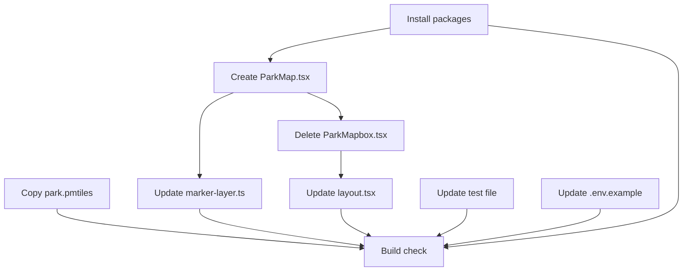

# MapLibre + PMTiles Migration (replace Mapbox GL JS)

**GitHub Milestone**: [m2b — #16](https://github.com/makaravind/experium-ai-tour-app/milestone/16)
**Closes**: [#66](https://github.com/makaravind/experium-ai-tour-app/issues/66) (Mapbox offline investigation — resolved by this migration)
**Status**: NOT STARTED

---

## Context

The map currently uses Mapbox GL JS with a tileset hosted on Mapbox Studio (`aravindmetku.nedour`). This creates two problems: (1) every map load requires a valid `NEXT_PUBLIC_MAPBOX_TOKEN`, which will stop working if the token expires or the free tier is exceeded, and (2) Mapbox tiles are fetched from Mapbox's CDN at runtime — they cannot be precached by the service worker, so the map never works offline (issue #66).

This migration replaces Mapbox GL JS with MapLibre GL JS (a fully open-source, API-compatible fork) and switches the tile source to a self-hosted PMTiles file placed in `public/`. After this migration: no Mapbox token, no external tile CDN, and `park.pmtiles` becomes a static asset that the service worker can precache (wired in the m5-pwa-offline milestone).

The Three.js custom marker layer (`marker-layer.ts`) is preserved without logic changes — only its TypeScript imports are updated to reference `maplibre-gl` types. All MapLibre runtime methods used (`map.project`, `map.getCanvas`, `map.getZoom`, `map.getCenter`, `Marker`, `CustomLayerInterface`) are identical to their Mapbox counterparts.

---

## Architecture Decisions

### PMTiles served from `public/` not Supabase Storage

**Decision**: `park.pmtiles` lives in `experium-ai-tour-app/public/park.pmtiles` and is served as a Next.js static asset at `/park.pmtiles`.

**Why**: Static assets in `public/` are versioned with each deploy, served with zero server logic, and are precacheable by serwist without any additional cache-route configuration (m5 picks this up automatically). Supabase Storage would require a separate upload step on every tile update and explicit service-worker route rules.

**Alternatives considered**: Supabase Storage — useful only if the tile file needs to update independently of a deploy (not a v1 requirement).

**Consequences**: Updating the park map requires a new deploy. Acceptable for v1.

---

### Inline style object replaces Mapbox hosted style

**Decision**: The `new maplibregl.Map({ style: ... })` call uses an inline `StyleSpecification` object instead of a `mapbox://styles/...` URL string.

**Why**: There is no MapLibre-hosted satellite basemap to use as fallback. The park is fully covered by the ortho, and `maxBounds` already prevents panning outside it, so no basemap is needed. The inline style is simpler and removes the last external dependency.

**Consequences**: Outside the park ortho bounds, the background is dark (`#0f172a`). Visitors cannot pan far enough to see empty space due to `maxBounds`.

```js
style: {
  version: 8,
  sources: {
    park: { type: 'raster', url: 'pmtiles:///park.pmtiles', tileSize: 256, minzoom: 14, maxzoom: 19 },
  },
  layers: [
    { id: 'bg',   type: 'background', paint: { 'background-color': '#0f172a' } },
    { id: 'park', type: 'raster',     source: 'park' },
  ],
},
```

---

### PMTiles protocol URL: `pmtiles:///park.pmtiles`

**Decision**: Three slashes (`pmtiles:///park.pmtiles`) — an absolute path from the root.

**Why**: Relative URLs (`pmtiles://park.pmtiles`) resolve relative to the current page path. The map is rendered from multiple routes (e.g. `/map`, `/exhibit/:id`), so a relative URL would break on any route other than root. Three slashes unambiguously resolves to `/park.pmtiles` from any route.

---

### Precaching deferred to m5

**Decision**: No service-worker changes in this migration.

**Why**: The serwist precache config lives in the m5-pwa-offline milestone (`impl/gh-64`), which is already in progress. `park.pmtiles` in `public/` is automatically picked up when that precache work lands. Touching the SW config here would create a merge conflict.

---

## Implementation Plan

1. **Install packages** — in `experium-ai-tour-app/`, remove `mapbox-gl` and add `maplibre-gl@^4` and `pmtiles@^3`.

2. **Copy `park.pmtiles` to `public/`** — copy `sample-map/pmtiles-poc/park.pmtiles` to `experium-ai-tour-app/public/park.pmtiles`. This is the processed drone orthophoto (11 MB). See `docs/drone-survey-mapbox.md` §5 for how to regenerate it from the GeoTIFF when the park tile needs updating.

3. **Create `components/map/ParkMap.tsx`** — this is a rename + edit of `ParkMapbox.tsx`. Changes:
   - `import mapboxgl from 'mapbox-gl'` → `import maplibregl from 'maplibre-gl'`
   - `import 'mapbox-gl/dist/mapbox-gl.css'` → `import 'maplibre-gl/dist/maplibre-gl.css'`
   - Add `import { Protocol } from 'pmtiles'`
   - Remove `const ORTHO_ID = 'aravindmetku.nedour'`
   - Rename `ParkMapboxProps` → `ParkMapProps`, `ParkMapbox` → `ParkMap`
   - All `mapboxgl.*` refs → `maplibregl.*`
   - Remove `mapboxgl.accessToken = process.env.NEXT_PUBLIC_MAPBOX_TOKEN!`
   - Before `new maplibregl.Map(...)`, register the protocol: `const protocol = new Protocol(); maplibregl.addProtocol('pmtiles', protocol.tile.bind(protocol))`
   - Replace the `style: 'mapbox://styles/...'` string with the inline style object (see Architecture Decisions above)
   - In `map.on('load')`, remove the `map.addSource('ortho', ...)` and `map.addLayer({ id: 'ortho-layer', ... })` calls — the park raster is now part of the initial style

4. **Delete `components/map/ParkMapbox.tsx`** — the old file is replaced by `ParkMap.tsx`.

5. **Update `marker-layer.ts`** — swap three type references:
   - `import type mapboxgl from 'mapbox-gl'` → `import type maplibregl from 'maplibre-gl'`
   - `map: mapboxgl.Map` → `map: maplibregl.Map`
   - `mapboxgl.CustomLayerInterface` → `maplibregl.CustomLayerInterface` (two occurrences)
   - No logic changes — all runtime methods are identical between the two libraries.

6. **Update `app/(map)/layout.tsx`** — update the import and JSX:
   - `import ParkMapbox from '@/components/map/ParkMapbox'` → `import ParkMap from '@/components/map/ParkMap'`
   - `<ParkMapbox .../>` → `<ParkMap .../>`

7. **Update `__tests__/calcPeekChips.test.ts`** — two changes:
   - `vi.mock('mapbox-gl/dist/mapbox-gl.css', ...)` → `vi.mock('maplibre-gl/dist/maplibre-gl.css', ...)`
   - `await import('@/components/map/ParkMapbox')` → `await import('@/components/map/ParkMap')`

8. **Update `.env.example`** — remove the `NEXT_PUBLIC_MAPBOX_TOKEN=pk.eyJ1...` line.

9. **Run `npm install`** and verify `npm run build` passes with no type errors.

---

## Task Graph



Steps 2, 7, and 8 are independent and can run in parallel with the component work.

---

## Code References

- `components/map/ParkMapbox.tsx` — the file being migrated; read in full before editing
- `components/map/marker-layer.ts` — Three.js custom layer; only type imports change
- `app/(map)/layout.tsx:7,211` — the two import sites to update
- `__tests__/calcPeekChips.test.ts` — test file with mock to update
- `sample-map/pmtiles-poc/index.html` — the working POC; shows exactly how protocol registration and inline style are wired
- `docs/drone-survey-mapbox.md` §5 — PMTiles generation pipeline (GeoTIFF → `park.pmtiles`)

---

## Acceptance Criteria (Technical)

- [ ] `mapbox-gl` is absent from `package.json`; `maplibre-gl` and `pmtiles` are present
- [ ] `public/park.pmtiles` exists and is ~11 MB
- [ ] `NEXT_PUBLIC_MAPBOX_TOKEN` does not appear anywhere in the app source or `.env.example`
- [ ] `ParkMapbox.tsx` is deleted; `ParkMap.tsx` exports `default ParkMap` and `calcPeekChips`
- [ ] `marker-layer.ts` imports from `maplibre-gl`, not `mapbox-gl`
- [ ] `npm run build` passes with no TypeScript errors
- [ ] `npm test` passes (calcPeekChips unit tests green)
- [ ] Map renders the park ortho in the browser at `localhost:3000/map` with no Mapbox token in env

---

## Testing

- **What to test**: `calcPeekChips` logic is library-agnostic — the existing unit test in `__tests__/calcPeekChips.test.ts` covers it; update the mock path and it should pass unchanged.
- **Test type**: unit (existing); manual browser smoke-test for map render + GPS dot + pin tap
- **Prior art**: `__tests__/calcPeekChips.test.ts` — mocks the map object, tests peek chip placement logic
- **What NOT to test**: Three.js marker rendering, MapLibre internals, tile loading

---

## Open Questions

- [ ] Does the `impl/gh-64` precache branch need to be rebased after this lands? — check with self before merging
