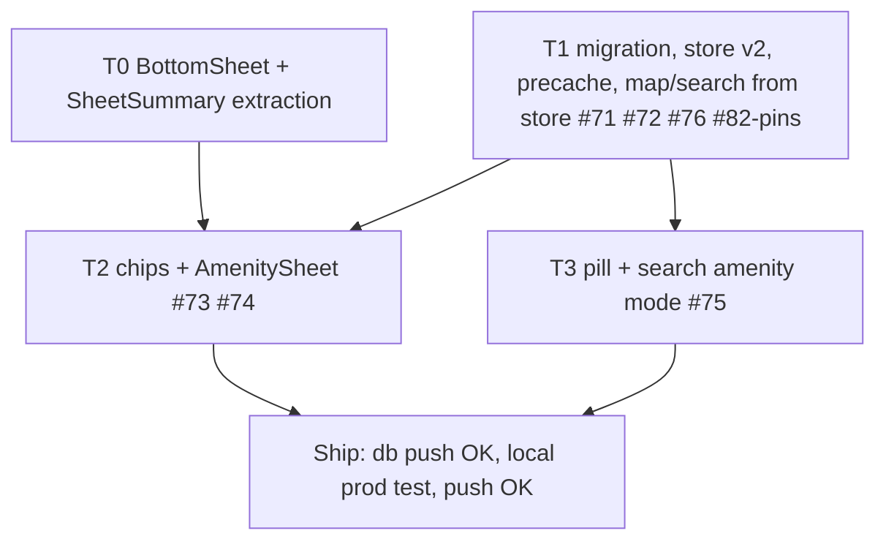

# Amenities Layer (washrooms, ticketing, food, gate)

**GitHub**: [#71](https://github.com/makaravind/experium-ai-tour-app/issues/71) · [#72](https://github.com/makaravind/experium-ai-tour-app/issues/72) · [#73](https://github.com/makaravind/experium-ai-tour-app/issues/73) · [#74](https://github.com/makaravind/experium-ai-tour-app/issues/74) · [#75](https://github.com/makaravind/experium-ai-tour-app/issues/75) · [#76](https://github.com/makaravind/experium-ai-tour-app/issues/76) — whole milestone, one spec, one production push. Also absorbs the pins half of [#82](https://github.com/makaravind/experium-ai-tour-app/issues/82). #70 is a duplicate of #71.
**Milestone**: m3-amenities ([#17](https://github.com/makaravind/experium-ai-tour-app/milestone/17))
**Status**: IMPLEMENTED — merged to main as `7dcbcb9` (2026-10-18). Migrations applied to production Supabase the same day. Follow-up: search overlay + pill micro-animations.
**UI mock**: `references/amenities-ui-mock.html` (screens 1, 2a, 2b, 3a, 3b)

---

## Context

Visitors have no way to find washrooms, ticketing, food or gates. This adds a purely informational layer: flat 2D chips on the map, a peek/expanded bottom sheet (no audio, no QR), and an "Amenities" mode in search.

Two things changed since the issues were written:

1. **Offline precache (m5)** — amenities must ride the same dataset fetch, store and refresh path as exhibits (#64, #78, #80), not a separate API.
2. **Exhibit pins are not offline-capable.** `ParkMap` queries Supabase on `map.load`; `CachedExhibit` has no GPS. Amenities read from the store, so the same fix is made for exhibit pins here (user decision: GPS must be cached, it is the only way exhibits show offline).

**Before**: no amenities; exhibit pins and search need network.
**After**: amenity chips, sheet and search work offline from the persisted store; exhibit pins and search do too.

---

## Architecture Decisions

### No `/api/amenities/all` — fetch Supabase directly (#72 reduced)

**Decision**: skip the API route. Public-read RLS (`anon_select_amenities`) + a `fetchCachedAmenities()` in `lib/precache.ts`, next to `fetchCachedExhibits()`.
**Why**: exhibits are read the same way with the anon key; a route would only proxy a read.
**Consequences**: #72 is retitled "fetchCachedAmenities + CachedAmenity type" (or closed as superseded).

### Amenities and exhibit GPS live in the persisted store

**Decision**: new persisted `cachedAmenities: CachedAmenity[]`. `runPrecache` fetches exhibits and amenities in one `Promise.all`; **either failing throws**, which `AppGate` already treats as a dataset failure (`fetch-error` online, `blocked-offline` offline). Map, sheet and search read only from the store, never Supabase.
**Why**: offline-by-construction; explicit failure over silently missing amenities.
**Alternatives considered**: tolerate an amenities failure and continue — rejected, hides outages.
**Consequences**: an amenities outage blocks first load. One cheap table; accepted for v1.
**Refresh**: the `refreshRequested` effect in `AppGate` also clears `cachedAmenities`. No `hasDataset` change — zero amenities is valid.

### Persist v1 → v2: clear `cachedExhibits`

**Decision**: bump `version` to 2. `migrate` clears `cachedExhibits` and sets `cachedAmenities: []` for any `version < 2`, keeping the existing `version === 0` branch (`precacheLanguage`).
**Why**: persisted `cachedExhibits` has no GPS. After the bump `hasDataset` is false, so `AppGate` re-runs `runPrecache` online. (Adding only the `cachedAmenities` key would not need a bump — see gh-67 — but the exhibit shape change does.)
**Consequences**: an offline returning test device is blocked until one online open. Pre-launch, acceptable.

```ts
migrate: (persisted, version) => {
  const state = (persisted ?? {}) as Partial<Store>
  if (version === 0) { /* existing: cachedExhibits: [], precacheLanguage */ }
  if (version < 2) return { ...state, cachedExhibits: [], cachedAmenities: [] } as Store
  return state as Store
}
```

### Exhibit pins and search come from the store (#82 pins)

**Decision**: `CachedExhibit` gains `gps_lat: number | null`, `gps_lng: number | null` and `exhibitStatus: ExhibitStatus` (`exhibits.status`; name chosen because `CachedExhibit.status` already means "QR active"). `fetchCachedExhibits` selects them. One converter in `lib/`:

```ts
// lib/map-exhibits.ts — callers: ParkMap, (map)/layout
export function toMapExhibits(cached: CachedExhibit[]): MapExhibit[]
// drops null-GPS rows; qr_code = status === 'active' ? code : null;
// languages = Object.keys(audio); status = exhibitStatus
```

`ParkMap` reads `useStore.getState().cachedExhibits` on `map.load` and drops its Supabase query. The layout drops `exhibitsForSearch` state, the `onExhibitsLoaded` prop and the `mapFailed` fallback query; search derives `toMapExhibits(cachedExhibits)`. Net deletion.
**Consequences**: the map no longer shows live DB edits — new or moved exhibits appear after "Refresh content" (same as audio). Search now works offline and in `mapFailed`. #82 keeps only the pmtiles/ortho part.

### `amenities` table: TEXT + CHECK, no seed in the schema migration

**Decision**: match the existing schema (TEXT + CHECK everywhere, `FLOAT8` GPS, `TIMESTAMPTZ`).

```sql
CREATE TABLE amenities (
  id          UUID PRIMARY KEY DEFAULT gen_random_uuid(),
  name        TEXT NOT NULL,
  type        TEXT NOT NULL CHECK (type IN ('washroom','ticketing','food','gate')),
  description TEXT,
  photos      TEXT[] NOT NULL DEFAULT '{}',
  gps_lat     FLOAT8 NOT NULL,
  gps_lng     FLOAT8 NOT NULL,
  created_at  TIMESTAMPTZ NOT NULL DEFAULT now()
);
ALTER TABLE amenities ENABLE ROW LEVEL SECURITY;
CREATE POLICY "anon_select_amenities" ON amenities FOR SELECT TO anon USING (true);
CREATE POLICY "admin_all_amenities"   ON amenities FOR ALL TO authenticated USING (true) WITH CHECK (true);
```

Adding a type = drop/re-add the CHECK + a new icon in code. No `updated_at` (nothing reads it).
Types changed from the issues (restaurant/club → **food/gate**) per user.
**Mock seed**: separate migration `…_seed_mock_amenity.sql`, one row: fixed UUID, `washroom` "Main Washroom", description "Near Gate 2 · Token ₹5", `photos '{}'`, at (17.937684, 78.461197) ≈ 39 m from Baobab Forest (17.937484, 78.460897), the only exhibit with GPS today. The real-data migration (after m2c field work) deletes it by id and inserts the real rows.

### Photos: placeholder only (v1)

**Decision**: `photos` is stored and carried in `CachedAmenity` but the UI ignores the URLs. `Gallery` renders placeholders (as for exhibits today); count = `max(1, photos.length)`.
**Why**: no exhibit renders real photos yet; the SW has no image cache. Real photos for exhibits and amenities should share one image-cache design later.

### Shared sheet: extract `BottomSheet` + `SheetSummary` from `PreviewSheet` (T0)

**Decision**: user wants the exhibit mechanics reused, not copied. `PreviewSheet` (614 lines) mixes sheet mechanics with audio/exhibit content. Extract:

- `components/common/BottomSheet.tsx` — `y` motion value, full/peek measurement, drag + `useDragControls`, grab-handle button, `SHEET_SPRING`, `REVEAL_AT`, scrim, reset on item change.
  - props: `itemId: string | null` (null hides; change resets to peek), `onClose?` (shows scrim), `onCollapse?` (fires on every collapse / item change / hide — `PreviewSheet` resets audio here); ref handle `{ expand(velocity?), collapse(velocity?) }` (`listen()` expands, `onEnded` collapses); children `({ expanded, collapse }) => ReactNode`.
- `SheetSummary` — peek row (thumb + name + badge) vs expanded `Gallery` + ✕ + title. Props: `expanded`, `thumb`, `name`, `badge`, `onCollapse`, optional gallery `count` / palette. `Gallery` gets an optional placeholder-palette prop (amenities use the mock's slate-blue gradient).
- `PreviewSheet` = `BottomSheet` + `SheetSummary` + audio/facts content. **No behavior or visual change.**
- `AmenitySheet` ≈ 50 lines: `BottomSheet` + `SheetSummary` + description line + `Type · 38m away` badge.

**Gate**: all existing exhibit vitest + e2e pass unchanged, plus a manual pass on a local prod build, before anything builds on it.
**Risk**: audio-state coupling in `PreviewSheet`; mitigated by the gate.

### Selection state and interactions

- `useMapStore` gains `activeAmenityId: string | null` + setter. Exhibit selection stays in layout (`mapSelectedExhibit`). Mutual exclusion lives in the layout handlers (`handlePinTap` clears the amenity; `handleAmenityTap` clears the exhibit), so one sheet at a time.
- **Chips**: DOM `maplibregl.Marker`s from `cachedAmenities` (30px rounded square, white icon, 8px name label, 3px ring when selected). Chip click `stopPropagation` so the map click (`ParkMap.tsx:450`) doesn't also fire. Four inline SVGs from the mock; `gate` icon drawn (arch) — mock has none.
- **Select** → `activeAmenityId` set, map `flyTo` the chip's center at current zoom (ParkMap subscribes to `activeAmenityId`), peek opens.
- **Deselect**: scrim tap, map-background tap (`handleMapTap`), exhibit pin tap, normal search bar open. Amenities pill / row tap keep it.
- **Exhibit page `/s/[code]`**: chips hidden while `isExhibitPage`; `activeAmenityId` cleared on entering it (incl. QR scan).
- **Not touched**: nearby logic (`nearbyExhibitIds`), `calcPeekChips` (exhibits only — no off-screen amenity chips), `mapFailed` (no chips/pill/sheet).
- **No GPS fix**: peek badge drops `· distance`; search sorts A–Z without distance sub-line. No error UI (`geoError` has its own surface).
- Expanded: ✕ collapses; no route / history entry (Android back leaves the map screen, same as exhibits).

### Search: Amenities mode in `SearchOverlay` (#75)

- `SearchOverlay` gets `initialMode: 'exhibits' | 'amenities'` + local `amenityMode` state; reads `cachedAmenities` from the store.
- Map-screen pill (under the search bar, per mock) opens it in `amenities`; the normal bar opens `exhibits`. The overlay pill toggles; ✕ on the pill returns to exhibits; toggling clears the query.
- Amenity mode: placeholder "Search amenities", blue input border, no `TrailCard`, header `All amenities · N places`, rows (icon square, name, distance sub-line) sorted by distance; typing filters by name; no exhibits mixed in.
- `sortAmenities(amenities, query, userPosition)` in `lib/search.ts` (pure; distance via `haversineMetres`, formatting identical to exhibit rows).
- Row tap → close overlay, select the amenity (see Selection state).
- One small `AmenitiesPill` component (two callers: map screen, overlay). Hidden when `mapFailed`.

### Out of scope

- Real amenity photos / image cache (exhibits too) — later.
- Report flag on the peek sheet — m7. When built, `reports.qr_code_id` is `NOT NULL FK exhibit_qr_codes`; m7 must add a nullable `amenity_id` + CHECK that exactly one is set, and add the flag to both sheets.
- Amenity off-screen peek chips, clustering, collision handling.
- Live DB sync of the map (refresh-only by design).
- Real GPS rows (m2c field data) — separate migration later.

---

## Implementation Plan

**T0 — Sheet extraction (no behavior change)**
1. `components/common/BottomSheet.tsx` — extract mechanics from `PreviewSheet.tsx` (~L57–70 state, L157–234 measure/animate/expand/collapse, L289–318 motion.div + drag, L361–371 handle).
2. `SheetSummary` (new file under `components/common/`) from `PreviewSheet.tsx` ~L373–440; `Gallery` optional palette prop.
3. Rewrite `PreviewSheet` on top; audio reset moves to `onCollapse`. Verify: exhibit vitest + e2e green, manual prod build.

**T1 — Data layer (parallel with T0)**
4. Migrations: `…_create_amenities.sql` (schema + RLS) and `…_seed_mock_amenity.sql`.
5. `lib/types.ts`: `AmenityType`, `CachedAmenity`; `CachedExhibit` += `gps_lat`, `gps_lng`, `exhibitStatus`.
6. `lib/precache.ts`: `fetchCachedExhibits` selects GPS + `status`; `fetchCachedAmenities()`; `runPrecache` `Promise.all`, `setCachedAmenities`.
7. `lib/store.ts`: `cachedAmenities` (persisted, in `partialize`), `setCachedAmenities`, version 2 + migrate. `AppGate` refresh effect clears it too.
8. `lib/map-exhibits.ts`: `toMapExhibits`. `ParkMap` reads the store instead of Supabase; layout deletes `exhibitsForSearch` state, `onExhibitsLoaded`, `mapFailed` fallback query.

**T2 — Chips + sheet (after T0, T1) — #73, #74**
9. `useMapStore.activeAmenityId`; layout handlers + mutual exclusion + `isExhibitPage` clearing.
10. Amenity icons (`components/icons/index.tsx`, `AmenityTypeIcon`); chip DOM markers in `ParkMap` (+ selected ring, flyTo on `activeAmenityId`).
11. `components/amenity/AmenitySheet.tsx`; mount in `app/(map)/layout.tsx` beside `PreviewSheet`.

**T3 — Search (after T1; parallel with T2) — #75**
12. `sortAmenities` in `lib/search.ts`; `AmenitiesPill`; `SearchOverlay` amenity mode; pill on the map screen.

**Ship (after all)**
13. Merge locally into app `main`. `npx --yes supabase@latest db push --dry-run` from `experium-ai-tour-app/` → only the two new migrations must appear. **Apply with Aravind's explicit OK, before any push** (otherwise `runPrecache` throws for every visitor).
14. Local prod build (`build` + `npm run start`), Chrome DevTools MCP: online + offline pass, v1→v2 upgrade. Push app `main` only on explicit OK (push = Vercel deploy; don't check Vercel after).
15. Housekeeping (with OK): close #70 as duplicate of #71; retitle/close #72; update #76 and #82 bodies; replace restaurant/club wording in #71, #73, #75 and the milestone description; add `milestones-tracker/milestones.md` section; delete nothing in prod until m2c (mock row stays until the real-data migration).

---

## Task Graph



T0 ∥ T1; T2 ∥ T3.

---

## Code References

- `components/exhibit/PreviewSheet.tsx` — source of the extraction; sections above
- `components/exhibit/Gallery.tsx` — placeholder-only gallery
- `components/exhibit/SearchOverlay.tsx`, `lib/search.ts` — search; "m away" formatting ~L140
- `components/map/ParkMap.tsx` — load query ~L237 (to remove), click handlers ~L443–457, `flyToTarget` effect ~L513, `youMarker` DOM marker precedent ~L340
- `app/(map)/layout.tsx` — `handlePinTap`, `handleMapTap`, `handleSearchSelect`, `exhibitsForSearch`, `mapFailed` fallback query ~L77–105
- `lib/precache.ts` — `fetchCachedExhibits` L48, `runPrecache` ~L194
- `lib/store.ts` — persist `version: 1`, `migrate`, `partialize` ~L138–166
- `components/onboarding/AppGate.tsx` — `refreshRequested` effect ~L177
- `lib/map-store.ts` — add `activeAmenityId`
- `lib/nearby.ts` — `haversineMetres`
- `supabase/migrations/20260809000000_initial_schema.sql` ~L178–200 — RLS policy precedent; `20260811100000_move_gps_to_exhibits.sql` — `FLOAT8` GPS
- Specs: `gh-78-dataset-refresh.md`, `gh-64-upfront-precache.md`, `gh-67-offline-scan-queue.md` ("No store version bump"), `gh-57-off-screen-peek-chips.md`, `gh-56-search-feature.md`

---

## Acceptance Criteria (Technical)

- [ ] `amenities` table exists in prod with RLS; anon can SELECT; CHECK allows only washroom/ticketing/food/gate
- [ ] Mock row visible ~39 m from Baobab Forest on the map
- [ ] `runPrecache` writes `cachedAmenities`; throws if the amenities query fails (gate shows `fetch-error` online)
- [ ] "Refresh content" clears and refetches amenities and exhibit GPS
- [ ] Persist v1 device upgrades: dataset cleared, refetched online, pins + chips appear
- [ ] Offline cold open (prod build): exhibit pins and amenity chips render; search lists both; no Supabase request for map data
- [ ] Chip tap: ring, map centers, peek shows name, desc line, `Type · distance`; handle drag/tap expands to hero + thumbs + badge + name + description; ✕ collapses; scrim tap closes
- [ ] Only one of exhibit / amenity sheet open at a time; map-background tap clears either
- [ ] Chips hidden on `/s/[code]`; QR scan clears the amenity selection
- [ ] No GPS fix: badge omits distance; search A–Z, no distance sub-line
- [ ] Amenities pill on map opens search in amenity mode (no TrailCard, distance-sorted, "N places"); pill ✕ returns to exhibits; row tap selects + opens peek
- [ ] `mapFailed`: no chips / pill; search lists exhibits from the store
- [ ] `PreviewSheet` behavior unchanged: all existing exhibit tests pass untouched

---

## Testing

- **Unit** (vitest, existing style): `sortAmenities` (distance order, A–Z fallback, case-insensitive filter, empty query); `toMapExhibits` (null GPS dropped, `qr_code` only when active, `languages` from audio keys); `fetchCachedAmenities` mapping; `runPrecache` sets `cachedAmenities` and throws on amenities failure; store v1→v2 `migrate` clears `cachedExhibits`, `cachedAmenities` defaults `[]`; refresh clears amenities.
- **E2E** (`e2e/`; extend `gate-helpers.ts` — exhibits mock gains GPS + `status`, new `**/rest/v1/amenities?*` route): chip → peek → expand → ✕ → scrim close; pill → overlay amenity mode → row → peek; exhibit pin after amenity leaves one sheet; offline (`E2E_PROD=1`): block network after load, pins + chips + search still work; all existing e2e unchanged (T0 gate).
- **Manual** (prod build, DevTools MCP): mock row vs Baobab Forest overlap, v1→v2 upgrade.
- **Not tested**: sheet spring feel (manual only), SVG icon pixels.

---

## Open Questions

- [x] Does the gate unmount `children` during "Refresh content"? **Yes** (phase goes to loading), so `ParkMap` remounts and re-reads the store — no subscription needed (verified in T1).
- [x] `exhibitStatus` kept; `CachedExhibit.status` not renamed.
- [ ] Mock seed row: keep through launch until m2c, or delete before any public launch? (Spec assumes the real-data migration deletes it; row still in production.)
- [x] Distance format copied from exhibit rows as-is (`Nm away`, no km threshold).
