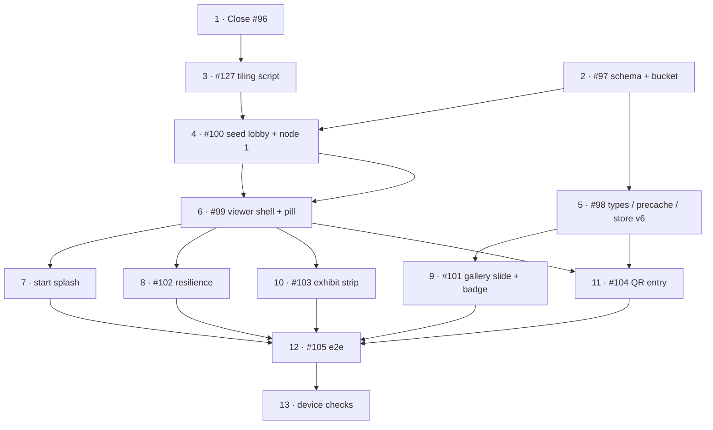

# m9a — Virtual Tour Viewer

**Milestone**: [m9a-virtual-tour-viewer](https://github.com/makaravind/experium-ai-tour-app/milestone/20) (GH milestone #20)
**Issues**: #96 (close), #97, #98, #99, #100, #101, #102, #103, #104, #105, #127 + NEW start-splash issue
**Status**: NOT STARTED
**Next**: [m9b-virtual-tour-navigation](./m9b-virtual-tour-navigation.md)
**Flow doc**: `docs/user-flows/flow-8-virtual-tour.md` (V2 text is partly superseded — see "Supersedes" below)
**Design**: Open Design project `71dad1fb-…`, `flow-8-virtual-tour.html` (v2, hi-fi 390×788)

---

## Context

The app has audio exhibits, a MapLibre map and an offline-first PWA shell, but no 360° experience. A drone survey produced **42 equirectangular panoramas** (12000×6000, PNG/JPEG, no EXIF/XMP so no GPS and unknown yaw), stored locally in `~/Downloads/Panos` and `~/Downloads/Panos 2`. The filename is the number of a **red handwritten capture spot** on `Experium_ Drone Mapping (1) - 360 markers.pdf` (1–40, plus `37A`, plus `Front Top View`). The yellow numbers on that PDF are *exhibit* markers — a different numbering. Do not conflate them.

m9a delivers the **foundation**: DB schema, the panorama tiling/upload pipeline, a working `/tour` viewer on real nodes (the lobby `Front Top View` plus one numbered node), the start splash, the gallery 360° slide, the exhibit-strip, the `?mode=virtual-tour` QR entry and e2e coverage. It does **not** deliver navigation between nodes, exhibit markers in the panorama, the authoring tool, or the full graph — those are m9b.

Before: `app/tour-test/page.tsx` is a throwaway prototype (hard-coded nodes, `/pano/*.jpg`, `🌿` pins). After: `/tour` reads `tour_nodes` from Supabase and renders tiled panoramas. Leave `tour-test` alone until m9b ships, then delete it.

---

## Decisions locked in the grill session

| # | Decision | Notes |
|---|---|---|
| 1 | **Real nodes, lobby first** | No stub panorama. m9a seeds the lobby + one numbered real node. |
| 2 | **Tiled panoramas** | 4096×2048 top level, 512 px tiles (8×4), multi-level pyramid via `EquirectangularTilesAdapter`. #127 stays in m9a. Overrides `content-pipeline.md` "v1 = single JPEG". |
| 3 | **Top level = 4096** | Script is repeatable; bump later by re-running. |
| 4 | **Lobby = `Front Top View`** | High aerial over the gate. Single edge to node `1` (m9b). Needs a manual lat/lng at the gate. |
| 5 | **Hosting = Supabase Storage** (closes #96, option A) | New public bucket `panoramas`. ~122 MB for 42 nodes. Egress is the only risk (see below). |
| 6 | **Column is `tiles_url`**, not `panorama_url` | #97/#99 text says `panorama_url` — it is wrong. `tiles_url` = URL of the manifest JSON. |
| 7 | **`preview_url`** per node | 1024×512 `preview.jpg` (~50 KB). Used by the gallery slide + splash backdrop. Precached. |
| 8 | **Node-name pill + `label`** | `tour_nodes.label`, defaults to `"Node N"` until renamed. |
| 9 | **One node per exhibit** | `exhibits.tour_node_id` + `tour_heading` + `tour_pitch`. No join table (revisit only if aerial views feel sparse). |
| 10 | **Pitch is stored** | `exhibits.tour_pitch`, `tour_edges.pitch`. Fixing pitch at 0° floats pins in the sky on aerial panos. |
| 11 | **No yaw assumptions** | No north alignment, no `north_offset`, no GPS-computed bearings. Every yaw/pitch is clicked in `/admin/tour` (m9b). |
| 12 | **Design extras in scope**: start splash (with slow/offline), node-name pill, markers → `PreviewSheet`, exit splash, persisted 360° pin, live-panning gallery slide | m9a owns start splash, pill, gallery slide. m9b owns the rest. **Minimap is deferred.** |

### Supersedes (flow-8 doc / old issue text → new)

- `panorama_url` → `tiles_url`. "lat/lng not stored" → `tour_nodes` has `lat`, `lng`.
- "Panorama source: single 4096 JPEG v1; tiles v2" → tiles now.
- "Offline: entry points hidden; toast on drop" → entry hidden offline; the **splash** carries slow/offline states; mid-tour drop still toasts (#102).
- Gallery 360° slide: static → **live-panning** `preview_url` (precached).
- The flow-8 markdown should be updated to match once m9a merges (not part of this spec's issues).

---

## Architecture Decisions

### Schema

**Decision**: one migration, `supabase/migrations/2026MMDDHHMMSS_virtual_tour.sql`:

```sql
CREATE TABLE tour_nodes (
  id          UUID     PRIMARY KEY DEFAULT gen_random_uuid(),
  label       TEXT     NOT NULL,          -- shown in the node pill; e.g. 'Park Entrance', 'Node 14'
  pano_ref    TEXT     NOT NULL UNIQUE,   -- capture-spot label from the PDF: '1'…'40', '37A', 'lobby'
  tiles_url   TEXT     NOT NULL,          -- manifest.json URL in the `panoramas` bucket
  preview_url TEXT     NOT NULL,          -- 1024x512 preview.jpg URL
  lat         FLOAT8   NULL,              -- NULL until placed in /admin/tour (m9b); lobby seeded manually
  lng         FLOAT8   NULL,
  is_lobby    BOOLEAN  NOT NULL DEFAULT false
);
CREATE UNIQUE INDEX tour_nodes_one_lobby ON tour_nodes (is_lobby) WHERE is_lobby;

CREATE TABLE tour_edges (
  from_node_id UUID     NOT NULL REFERENCES tour_nodes(id) ON DELETE CASCADE,
  to_node_id   UUID     NOT NULL REFERENCES tour_nodes(id) ON DELETE CASCADE,
  bearing      SMALLINT NOT NULL CHECK (bearing BETWEEN 0 AND 359),   -- yaw in from_node's pano, degrees
  pitch        SMALLINT NOT NULL DEFAULT -15 CHECK (pitch BETWEEN -90 AND 90),
  PRIMARY KEY (from_node_id, to_node_id)
);

ALTER TABLE exhibits
  ADD COLUMN tour_node_id UUID     NULL REFERENCES tour_nodes(id) ON DELETE SET NULL,
  ADD COLUMN tour_heading SMALLINT NULL CHECK (tour_heading BETWEEN 0 AND 359),
  ADD COLUMN tour_pitch   SMALLINT NULL CHECK (tour_pitch BETWEEN -90 AND 90);
```

RLS on both new tables: `ENABLE`, `anon_select_*` (`FOR SELECT TO anon USING (true)`), `admin_all_*` (`FOR ALL TO authenticated`) — copy the amenities migration (`20261018000000_create_amenities.sql`). A second migration (or the same file) creates the `panoramas` storage bucket (public read) and its RLS policy; copy `20260812052738_storage_audio_rls_policies.sql`.

**Why**: `pano_ref` gives the content pipeline and the m9b authoring tool a stable natural key tied to the PDF, independent of UUIDs. The partial unique index enforces exactly-one lobby, which `/tour` (no param) depends on. `lat`/`lng` nullable because only m9b places nodes.
**Alternatives considered**: `panorama_url` single-image column (rejected, tiles); a join table for exhibit↔node (rejected, Q7); computed bearings (rejected, Q11).
**Consequences**: `tiles_url` is a *manifest*, not an image. Bearings are degrees in DB and converted to radians at the PSV boundary.

### Tile pyramid and manifest

**Decision**: `tools/tile-panorama.js` (Node, `sharp` — already a devDependency of the app; add to `tools/package.json` if missing). Input: a master image path, a `pano_ref`, optional `--label`. Output under `panoramas/<pano_ref>/`:

```
manifest.json       // { width:4096, baseUrl, levels:[{width,cols,rows}…], tilePattern }
preview.jpg         // 1024x512, q85, ~50 KB  -> tour_nodes.preview_url
base.jpg            // ~512x256 low-res for PSV `baseUrl` (~15 KB)
l0/{col}_{row}.jpg  // level 0: 1024 wide, 2x1
l1/…                // level 1: 2048 wide, 4x2
l2/…                // level 2: 4096 wide, 8x4  (512 px tiles)
```

Each level is resized from the 12000×6000 master, then cut into 512×512 tiles, JPEG q85. Total ≈ 2.9 MB per node. The script uploads with the service-role key (read `.env.local` the same way `tools/upload-audio.js` does), `upsert: true`, `cacheControl: '31536000'`, and prints `tiles_url` and `preview_url`.

`manifest.json` shape the viewer depends on:

```json
{
  "baseUrl": ".../panoramas/37A/base.jpg",
  "levels": [ {"width":1024,"cols":2,"rows":1}, {"width":2048,"cols":4,"rows":2}, {"width":4096,"cols":8,"rows":4} ],
  "tileUrl": ".../panoramas/37A/l{level}/{col}_{row}.jpg"
}
```

The viewer builds `tileUrl: (col,row,level) => manifest.tileUrl.replace(...)` — **PSV 5.15 `EquirectangularMultiTilesPanorama`** (`levels`, `baseUrl`, `tileUrl(col,row,level)`; cols/rows must be powers of 2). Verified against `@photo-sphere-viewer/equirectangular-tiles-adapter@5.15.1`.

**Why**: first render drops from 2–3 s to <0.5 s on mobile LTE (tiny `base.jpg`, then only visible tiles). The manifest lets the viewer stay URL-driven so re-tiling at a higher resolution later needs no code change.
**Alternatives considered**: single 4096 JPEG (rejected, Q2); 6144/8192 top level (rejected, storage/egress — re-run the script to upgrade).
**Consequences**: ~1,800 small objects in Storage. Masters are never committed (12000×6000 PNGs are ~90 MB). Run locally, never in CI.

**Egress ceiling (record this)**: a viewer fetches only visible tiles; ~3 MB per 5 nodes. Supabase free tier is 5 GB/month ≈ 1,500 tour sessions/month. Past that → Pro plan or Cloudflare R2 (only URLs are stored, so it is a swap). Confirm the project's plan before launch.

### Viewer (`/tour`)

**Decision**: `app/tour/page.tsx`, a client page **outside** the `(map)` group (no MapShell, no tab bar). Dynamic-import PSV with `ssr: false`. Add `@photo-sphere-viewer/equirectangular-tiles-adapter@^5.15.1` to `package.json` (core, markers-plugin and virtual-tour-plugin are already present at `^5.15.1`). Params: `?node=<id>&heading=<degrees>&exhibitId=<id>`. On mount: one query for all `tour_nodes` + `tour_edges`; resolve the current node (`node` param, else `is_lobby`); build the viewer with the tiles adapter; initial yaw = `heading` (degrees→radians) only on entry. Top-left Map pill `router.push('/map')` (m9b replaces it with the exit-splash path). Top bar shows the node-name pill (`label`). `/tour` is added to `PAGES` in `app/sw.ts` so the shell is in `pages-cache`.

m9a renders **one node at a time without edges or markers**; do not wire VirtualTourPlugin links yet (m9b), but construct the plugin so m9b only adds data. The plugin's `preload` stays `false` until m9b.

**Why**: a standalone route keeps the viewer's bundle off the map. The all-nodes-upfront query keeps m9b navigation instant (the dataset is tiny).
**Consequences**: the viewer is online-only; the shell is cached but panoramas are not.

### Start splash

**Decision**: a `TourSplash` overlay shown on every entry to `/tour` (home, gallery, QR). Behaviour per the design (`Start splash`, `slow`, `offline` frames):
1. Fetch the node graph and the target node's `base.jpg`. Show the splash for **≥ 0.8 s** so it never flickers.
2. At **15 s** without readiness: "Taking longer than expected" with **Keep waiting** (restarts the 15 s timer, progress kept) and **Cancel** (back to where the visitor tapped).
3. `navigator.onLine === false` or the graph fetch fails fast: "Virtual tour needs internet" with **Try again** and **Back to map**. Fails immediately, no spinner.
4. Anchored entry (gallery slide / QR): the splash names the exhibit ("Starting at Canopy Weaver Spider") and uses that node's `preview_url` as a blurred backdrop; Cancel returns to the exhibit. Lobby entry says "Starting at <label>".

**Why**: loading ~3 MB over park 4G must never look like a blank viewer; this replaces #102's toast for the *initial* load.
**Consequences**: #102 shrinks to lobby resolve + empty state + mid-tour "Needs internet" toast. Use timeouts from `lib/timeouts.ts`.

### Gallery 360° slide

**Decision**: `Gallery` gains `onTourEnter?: () => void` and `tourPreviewUrl?: string | null`. When `tourPreviewUrl` is set, the **last** slide renders a CSS-panned `<div>` (background image = `preview_url`, `background-position` animated over ~20 s, `prefers-reduced-motion` → static) with a "360°" badge and a "Tap to explore" hint. Tapping calls `onTourEnter()` and does **not** open `FullscreenModal`. `PreviewSheet`'s 56×56 thumbnail shows a small "360°" badge when the exhibit has a tour node. Navigates to `/tour?node=<tour_node_id>&heading=<tour_heading>&exhibitId=<id>`.

**Why CSS pan, not a second PSV**: the slide is in an exhibit sheet; a second WebGL context is heavy and unnecessary for an ambient preview.
**Note**: `Gallery` is currently a placeholder (it renders `count` gradient slides — see `components/exhibit/Gallery.tsx`; it is used from `components/common/SheetSummary.tsx:43`). The 360° slide is appended after the existing `count`; check `SheetSummary` to pass the props through.

### Precache of previews

**Decision**: `preview_url` of every node that has a linked exhibit is added to the AppGate upfront precache. Extend `getAssetGroups` in `lib/precache.ts` with a third group (new cache name in `lib/cache-names.ts`); `fetchCachedExhibits` selects `tour_node_id, tour_heading, tour_pitch, tour_nodes(preview_url)` and `CachedExhibit` gains `tour_node_id: string|null`, `tour_heading: number|null`, `tour_pitch: number|null`, `tour_preview_url: string|null`. Bump persisted store `version` 5 → 6 with the same "drop dataset, one catch-up run" migration (`lib/store.ts:153`).

**Why**: the exhibit page and the QR redirect resolve the tour with no network call; the slide pans offline. Full panoramas stay online-only. ~2 MB total.
**Consequences**: every existing device re-runs the precache once after this ships (same as #77).

---

## Implementation Plan

1. **Close #96** with a short comment: Supabase Storage (option A), egress ceiling above.
2. **#97 Schema.** Write the migration above (tables, indices, RLS, `panoramas` bucket policy, exhibit columns). Apply to production Supabase (no staging project — apply deliberately; the migration is additive and nullable so it is safe). Regenerate/update any generated types in use.
3. **#127 Tiling script.** `tools/tile-panorama.js` per the pyramid above. Add `--dry-run` (writes to `/tmp/tiles/<pano_ref>` and uploads nothing) so the output can be inspected before upload. Test on `Front Top View.png` (90 MB) and `37A.jpg`.
4. **#100 Seed.** Create the `panoramas` bucket; tile + upload the lobby (`pano_ref='lobby'`, source `Front Top View.png`) and node `1`. Insert `tour_nodes` rows via a small `tools/seed-tour-nodes.js` (mirrors `tools/seed-sections.js`): lobby with `is_lobby=true`, `label='Park Entrance'`, `lat/lng` at the gate (get from `references/pdf-markers-gps.json` or the Gate amenity); node `1` with `label='Node 1'`. Document the operator workflow (tile → upload → seed) in `docs/content-pipeline.md` ("Panorama Processing Pipeline" section currently describes the superseded single-JPEG flow — update it).
5. **#98 Types / precache / store.** Extend `CachedExhibit`, `PreviewExhibit` (`lib/types.ts`), the `fetchCachedExhibits` select + mapping, `getAssetGroups` (preview group), store `version: 6`.
6. **#99 Viewer shell.** Add the adapter dependency; `app/tour/page.tsx`; node load; tiles adapter wiring; heading; Map pill; node-name pill; add `/tour` to `PAGES` in `app/sw.ts`. Reuse the PSV bootstrapping from `app/tour-test/page.tsx` for imports only; do not copy its hard-coded data.
7. **Start splash (NEW issue).** `TourSplash` component + states (normal / anchored / slow / offline); wire into `/tour`. Min display 0.8 s; 15 s timer; offline detection.
8. **#102 Resilience.** Lobby resolve when `node` is absent; empty state when no lobby/no nodes ("Virtual tour isn't available yet"); mid-tour tile load failure → "Needs internet" toast.
9. **#101 Gallery slide + badge.** `Gallery` props, CSS-pan slide, `PreviewSheet` badge, wiring in `SheetSummary`; navigate to `/tour` with params.
10. **#103 Exhibit strip.** Collapsed pill at the bottom when `exhibitId` is present: exhibit name + "Tap to listen", links to `/s/[qr_code]`. Back returns to `/tour?…` (history).
11. **#104 QR entry.** In `components/ExhibitPageClient.tsx`, on `?mode=virtual-tour` and a cached exhibit with `tour_node_id`, `router.replace` to `/tour?node=…&heading=…&exhibitId=…`; with no tour node, render the normal exhibit page.
12. **#105 e2e.** Specs with `page.route` mocks for `tour_nodes`/`tour_edges`, the manifest and tile URLs (same-origin fixtures like `e2e/gate-helpers.ts`); WebKit-specific flakes `test.skip` with explanation (see `CLAUDE.md`).
13. **Manual device checks (HITL)**: iOS Safari renders and is swipeable; splash slow/offline states on throttled network; memory with 8×4 tiles on a low-end Android.

---

## Task Graph



Parallelisable once their inputs exist: 3 ‖ 2; 7 ‖ 8 ‖ 10; 9 ‖ 11.

---

## Code References

- `app/tour-test/page.tsx` — throwaway PSV + VirtualTourPlugin + MarkersPlugin bootstrapping (imports/dynamic setup). Delete in m9b.
- `components/exhibit/Gallery.tsx`, `components/common/SheetSummary.tsx:43`, `components/exhibit/PreviewSheet.tsx` — gallery + sheet thumbnail.
- `components/ExhibitPageClient.tsx` — exhibit page; `?mode=` handling goes here.
- `lib/precache.ts` (`fetchCachedExhibits`, `getAssetGroups`), `lib/store.ts:153` (persist `version` + `migrate`), `lib/cache-names.ts`, `components/onboarding/AppGate.tsx` — upfront precache flow; prior art `docs/specs/gh-64-upfront-precache.md`, `gh-77-language-switch-after-precache.md`.
- `lib/types.ts` — `CachedExhibit`, `PreviewExhibit`, `MapExhibit`.
- `app/sw.ts:19` — `PAGES` list.
- `supabase/migrations/20261018000000_create_amenities.sql` — RLS pattern; `20260812052738_storage_audio_rls_policies.sql` — bucket policy pattern.
- `tools/upload-audio.js`, `tools/seed-sections.js` — script conventions (`.env.local` loading, service-role client).
- `e2e/gate-helpers.ts` (`mockPrecacheDataset`), `e2e/amenities.spec.ts` — e2e mocking prior art. Baseline failures: `reference_e2e-baseline-failures` (8 mobile-chrome already fail on main — compare against that list).
- `@photo-sphere-viewer/equirectangular-tiles-adapter@5.15.1` `index.d.ts` — `EquirectangularMultiTilesPanorama` type.

---

## Acceptance Criteria (Technical)

- [ ] Migration applied to prod: `tour_nodes`, `tour_edges`, exhibit columns, RLS (`anon` SELECT), `panoramas` bucket public read; exactly-one-lobby index rejects a second lobby.
- [ ] `node tools/tile-panorama.js <master> <pano_ref>` produces `manifest.json`, `base.jpg`, `preview.jpg` (≤ ~60 KB, 1024×512) and 3 levels (2×1, 4×2, 8×4) and uploads; re-running is idempotent.
- [ ] Lobby (`Front Top View`) and node `1` tiled, uploaded and seeded; both load in `/tour`.
- [ ] `/tour` (no params) opens the lobby; `/tour?node=<id>&heading=<deg>` opens that node with initial yaw = heading; Map pill goes to `/map`; no tab bar.
- [ ] First paint of the lobby on throttled Fast 4G < ~1 s to a visible low-res image, sharp tiles stream in.
- [ ] Splash: ≥ 0.8 s; 15 s slow state with Keep waiting/Cancel; offline fails immediately with Try again/Back to map; anchored variant names the exhibit.
- [ ] `/tour` with no lobby row shows the empty state, not a crash.
- [ ] Gallery shows the 360° slide last iff the exhibit has a tour node; tapping navigates with the three params and does not open the fullscreen modal; thumbnail badge shown; slide pans offline from the precached preview.
- [ ] `?mode=virtual-tour` redirects to the tour for linked exhibits and falls back to the exhibit page otherwise.
- [ ] Exhibit strip appears only with `exhibitId`; back from `/s/…` returns to `/tour?…`.
- [ ] Store `version` 6; existing devices re-run precache once; `/api`-less (client Supabase) dataset includes the new fields.
- [ ] `/tour` in `PAGES`; entry points hidden offline.
- [ ] `npm run lint`, typecheck and unit tests pass; new e2e specs pass on Chromium + WebKit (skips explained).

---

## Testing

- **What to test**: external behaviour — correct node resolved, heading applied (assert via the PSV viewer's position through an exposed `window.__psv` hook only if needed), splash states, gallery slide presence/absence, redirect rules, empty state, offline entry hidden.
- **Test type**: e2e (Playwright) with mocked Supabase REST, manifest and tile requests; unit tests for the tiling script's pure helpers (level/grid math, manifest builder) and for degrees→radians conversion.
- **Prior art**: `e2e/gate-helpers.ts` (`mockPrecacheDataset`), `e2e/amenities.spec.ts`, `e2e/offline-pages.spec.ts` (offline), `e2e/language-switch.spec.ts`.
- **What NOT to test**: PSV internals / WebGL rendering; the pixel content of tiles; real Supabase Storage in CI.

---

## Open Questions

- [ ] Supabase plan tier (free 5 GB vs Pro egress) — Aravind, before launch.
- [ ] Gate lat/lng for the lobby node — take the Gate amenity's coordinates unless Aravind prefers another point.
- [ ] Lobby label wording ("Park Entrance") — Aravind.
- [ ] `37A` and `Front Top View` have no red-dot position on the PDF — placed in `/admin/tour` (m9b).
