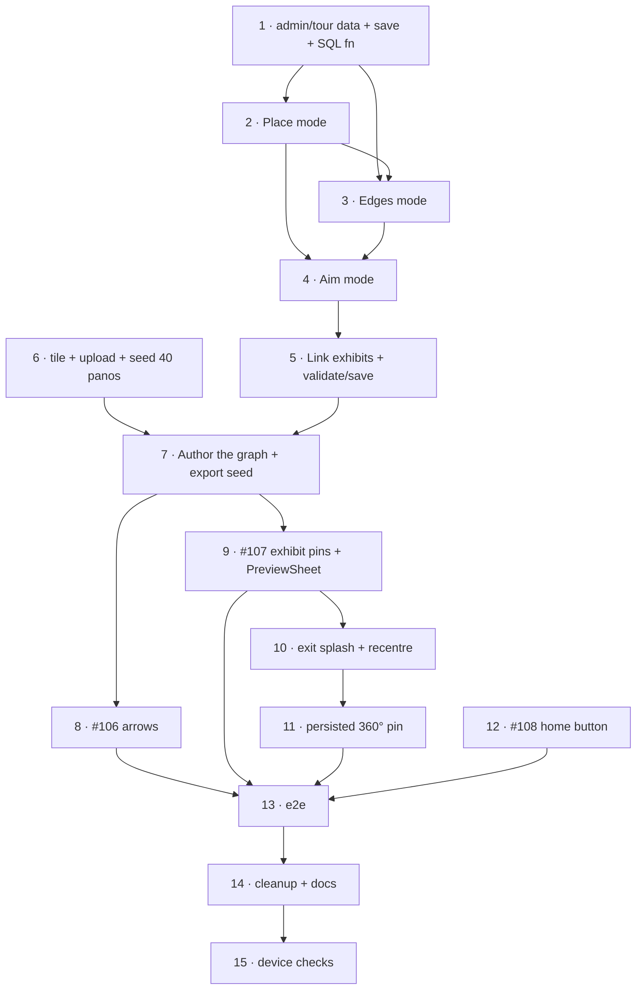

# m9b — Virtual Tour Navigation

**Milestone**: [m9b-virtual-tour-navigation](https://github.com/makaravind/experium-ai-tour-app/milestone/21) (GH milestone #21)
**Issues**: #106, #107, #108 + NEW: `/admin/tour` authoring tool, tile+author the 42-node graph (data task), exit splash + map recentre, persisted 360° map pin
**Status**: IMPLEMENTED (steps 1–6, 8–14); production graph authoring (7) and device checks (15) open
**Depends on**: [m9a-virtual-tour-viewer](./m9a-virtual-tour-viewer.md) (schema, tiling pipeline, `/tour` shell, start splash all exist)
**Design**: Open Design project `71dad1fb-…`, `flow-8-virtual-tour.html` (v2). **The minimap is out of scope** (deferred).

---

## Context

m9a ships a working `/tour` on two real nodes (lobby + node `1`). m9b makes it a *street view*: visitors tap arrows to walk between nodes, tap exhibit pins in the panorama to open the exhibit, and leave via the Map pill, landing on the map where they were standing.

The old gate — "blocked until drone footage received" — is gone: the 42 panos exist. The remaining hard problem is **authoring**. The panos have no EXIF/XMP, so their yaw is unknown and **nothing may be assumed** (no north alignment, no GPS-computed bearings). Roughly 42 node positions, ~100 directed edges (each with a yaw + pitch clicked in its own pano), and exhibit↔node links (with yaw + pitch) must be authored by eye. Doing that in the Supabase dashboard is error-prone, so m9b builds a dev-only `/admin/tour` tool — same pattern as the existing `/admin` exhibit tool (`docs/specs/exhibit-admin-tool.md`).

Before: one node at a time, no edges. After: the full 42-node graph is live; arrows, pins, exit splash and a persisted "360° pin" on the map work.

---

## Decisions locked in the grill session

| # | Decision |
|---|---|
| 1 | **Authoring tool `/admin/tour`** (dev-only, `next dev`): place nodes on the map, accept/reject proposed edges, click yaw+pitch in the pano for every arrow/pin. |
| 2 | **Edge proposals from the path network** (`public/park-paths.json`, `lib/park-paths.ts`), nearest-neighbour fallback; the human confirms each edge. Stored as ordinary `tour_edges` rows; nothing reads the path network at runtime. |
| 3 | **A→B and B→A are separate clicks** (different camera orientation per pano). |
| 4 | **Pitch is stored** (`tour_edges.pitch`, `exhibits.tour_pitch`), captured by the same click as yaw. |
| 5 | **No yaw assumptions**, no `north_offset`. |
| 6 | **Node placement = click on the map** in the tool (42 clicks); `37A` is placed like any other. |
| 7 | **One node per exhibit.** Tool proposes the nearest node to each exhibit; the human overrides; exhibits at markers 41+ (no pano) keep `tour_node_id = NULL`. |
| 8 | **Marker tap opens the existing `PreviewSheet`** (no tour-only card). Overrides flow-8's "tap navigates to `/s/[code]`". |
| 9 | **Exit splash** → map centred on the last node. The Map pill is the only exit (minimap deferred). |
| 10 | **Persisted 360° pin** on the map at the last tour spot (design: "Your spot stays on the map as a 360° pin"). |
| 11 | Home button renamed "360° Virtual Tour →" (#108), hidden offline. |

---

## Architecture Decisions

### Arrows and pins use PSV's VirtualTourPlugin + MarkersPlugin

**Decision**: build `nodes` for `VirtualTourPlugin` from `tour_nodes` + `tour_edges`: each edge becomes a `link` with `position: { yaw, pitch }` (DB degrees → radians), `name` from the target node's `label`. Exhibit pins are `markers` on the node with `position: { yaw: tour_heading, pitch: tour_pitch }`, orange (unvisited) / green (visited) from the visitor's discovered set (same source as map pins — see `lib/trail.ts` / `useStore`). Use the plugin's `preload: true` so adjacent nodes' `base.jpg` + first tiles prefetch.
**Why**: the plugin already handles arrow rendering, transitions and history; we only supply data. `preload` makes hops feel instant, which is what hides the 2–3 s a cold panorama would take.
**Consequences**: the arrow's visual direction cue is the yaw you author. If the authored yaw is wrong the arrow points the wrong way — hence the verify-by-eye tool.
**Verify while building**: with the *tiles adapter* the plugin accepts a tile config object as a node's `panorama`; confirm that `preload: true` is compatible with tile configs on 5.15 (fallback: preload `base.jpg` only via `baseUrl`). Document the result in the PR.

### Marker tap → PreviewSheet

**Decision**: `/tour` renders `PreviewSheet` itself (it is not inside the `(map)` layout, where the sheet is normally mounted — `app/(map)/layout.tsx:391`). Data comes from the cached dataset (`useStore().cachedExhibits`), mapped to `PreviewExhibit`; audio from the cached `audio` map. Close = tap the panorama or swipe down; no dim layer. **Navigate** = same route as the Map pill: exit splash, then `/map` centred on the exhibit with `activeExhibitId` set (so the map's own sheet opens and the visitor taps its Navigate). No refactor of `handleNavigate` in the map layout.
**Why**: reuse, not duplication; the design explicitly says "no tour-only card".
**Assumption to confirm**: "Navigate" opens the sheet on the map rather than immediately starting a route (the route needs the visitor's GPS, owned by the map layout). Confirm with Aravind during review.

### Exit splash and map recentre

**Decision**: tapping the Map pill (and Navigate in the sheet) shows `ExitSplash` ("Back to the map · Landing at <label> · Spot saved · Centring the map"), max 0.6 s when the map is cached. Steps: (1) write `tourSpot = { nodeId, lat, lng, heading, label, at }` to the persisted store; (2) `router.push('/map')`; (3) on map mount, if `tourSpot` is set and was just written (`at` within ~10 s), call a new `map.flyTo({ center: [lng, lat], zoom: 19 })` via a new `flyToTourSpotTrigger` in `lib/map-store.ts` (same pattern as `recenterTrigger` / `flyToParkTrigger`, registered inside `ParkMap`).
**Why**: matches the design's exit frames; the trigger pattern already exists in the map store.
**Consequences**: nodes without `lat/lng` can't recentre (fall back to `flyToParkTrigger`). After m9b all 42 nodes have positions.

### Persisted 360° pin

**Decision**: `tourSpot` lives in the persisted zustand store (`lib/store.ts`, bump `version` 6 → 7 with a *non-destructive* migration — add the field, **keep** the cached dataset, unlike earlier bumps). `ParkMap` renders it as a `maplibregl.Marker` (DOM element: white puck + view cone rotated to `heading`, "360°" chip) at the saved spot; tapping it opens `/tour?node=<id>&heading=<h>`. Cleared when the visitor taps a different tour entry or via the pin's own dismiss.
**Why**: a DOM marker is the simplest thing that works; the exhibit pins are a three.js custom layer, and bolting a node pin into it is needless risk (v1 mentality). One pin only, not a node layer.
**Alternatives considered**: showing all 42 nodes on the map (rejected, the design removed the 40-node overlay); GeoJSON symbol layer (more setup, no benefit for a single point).
**Consequences**: `heading` in the cone is the tour's last yaw converted to compass degrees only if the node is north-aligned, which we do **not** assume — so the cone is **omitted**; the puck + "360°" chip only. (Design shows a cone; flag in review.)

### `/admin/tour` authoring tool

**Decision**: `app/admin/tour/page.tsx` + `components/admin/tour/*` + `app/api/admin/tour/{data,save}/route.ts`, guarded by `adminGuard()` / `requireAdminPage()` (`lib/admin/guard.ts`). Edits are **staged client-side and saved in one batch** (live DB, no staging project — same rule as the exhibit tool). Save calls a new Postgres function `admin_apply_tour(changes jsonb)` so node/edge/exhibit changes commit atomically (mirror `admin_apply_changes` in `supabase/migrations/20261110000100_sections.sql`).

Tool modes, left→right as the workflow:

1. **Place** — list of all `tour_nodes` (thumbnail = `preview_url`, label, `pano_ref`, placed ✓/✗) beside the MapLibre park map (reuse `components/admin/AdminMap.tsx` basemap code). Select a node, click the map to set `lat/lng`. Editable `label`.
2. **Edges** — "Propose edges" runs the path-network algorithm client-side: snap each placed node to its nearest point on `park-paths.json` (reuse `lib/park-paths.ts` projection helpers; export what's needed), connect nodes adjacent along a path (no other node between them), and for nodes > ~40 m from any path fall back to the 2–3 nearest neighbours (`haversineMetres` in `lib/nearby.ts`). Each proposed edge is shown on the map with accept/reject; accepted edges create **two directed rows**.
3. **Aim** — embedded PSV for the selected node. Lists its outgoing edges and linked exhibits. Click an edge (or exhibit) in the list, then click the target in the panorama: the click's yaw/pitch (PSV `click` event → `data.yaw/pitch` in radians → degrees) is stored on that edge/exhibit. Shows existing arrows/pins live so you can verify by eye.
4. **Link exhibits** — "Propose links": for each exhibit with `gps_lat/lng`, nearest placed node within a radius (default 40 m, adjustable); the human accepts/overrides/clears. Exhibits with no pano keep `NULL`. Then aim each linked exhibit in step 3.
5. **Validate + Save** — summary of the diff; blockers: node without lat/lng, edge without yaw, a directed edge whose reverse is missing, an exhibit with a node but no yaw/pitch, the lobby unreachable. Save disabled until blockers are cleared (or an explicit override for work-in-progress saves).

**Why**: ~150 yaw/pitch values cannot be validated blind; click-to-aim turns each guess into a visual check, and bundles node placement, edge proposal and exhibit linking into one place.
**Alternatives considered**: Supabase dashboard only (error-prone); computing yaw from GPS (rejected — would need north-aligned panos).
**Consequences**: authoring only possible on the dev machine, against the live DB.

### Data task: tile, upload and author all nodes

**Decision**: a runbook, not code. Batch-run the m9a `tools/tile-panorama.js` over all 42 masters (small `tools/tile-all.sh` or a loop over the two `Panos` folders), creating `tour_nodes` rows via the seed script (`pano_ref` = filename stem, e.g. `37A`, `lobby` for `Front Top View`). Then author in `/admin/tour`. Record the final graph as a data migration (`supabase/migrations/…_seed_tour_graph.sql`) generated from the DB so it is reproducible.
**Why**: "content pipeline is code" (project guideline). 42 × ~2.9 MB ≈ 122 MB uploaded; allow time for ~1,800 objects.
**Consequences**: the 90 MB PNG masters stay out of git.

---

## Implementation Plan

1. **`/admin/tour` data + save plumbing.** `GET /api/admin/tour/data` (nodes, edges, exhibits with tour columns), `POST /api/admin/tour/save` calling `admin_apply_tour`. Write the migration with the SQL function and validation (edge endpoints exist; yaw 0–359; one lobby).
2. **Tool: Place mode.** Node list + map click-to-place + label editing.
3. **Tool: Edges mode.** Path-network proposal algorithm (pure functions in `lib/admin/tour-edges.ts`, unit-tested) + accept/reject UI.
4. **Tool: Aim mode.** PSV panel, click→yaw/pitch capture, live arrows/pins preview.
5. **Tool: Link-exhibits mode + validate/save.**
6. **Batch tile + upload + seed** the remaining 40 panos (data task, runs in parallel with 2–5 using the first nodes as the dev set).
7. **Author the graph** in the tool: place 42 nodes, accept edges, aim ~100 directed edges + exhibit pins; save; export the seed migration.
8. **#106 Navigation arrows** in `/tour`: VirtualTourPlugin nodes/links from DB (degrees→radians), `preload: true`, tap → transition; node-name pill updates; static URL (no replace).
9. **#107 Exhibit pins**: MarkersPlugin pins at `tour_heading`/`tour_pitch` with unvisited/visited state; tap → `PreviewSheet` mounted in `/tour`.
10. **Exit splash + recentre**: `ExitSplash`, `tourSpot` in the store (v7, non-destructive), `flyToTourSpotTrigger` in `lib/map-store.ts` + `ParkMap`, Map pill + Navigate wiring.
11. **Persisted 360° pin** on `ParkMap` (DOM marker, tap → `/tour`).
12. **#108 Home**: keep `ExploreParkLink` ("Explore the Park →") and add a second button "360° Virtual Tour →" linking to `/tour`, hidden offline. The design's Home frame shows both; flow-8 and #108 say *rename*, so **follow the design (add, don't rename)** and update the flow-8 and #108 text.
13. **e2e**: extend m9a's specs with a mocked 3-node graph: arrow tap changes the node pill; pin tap opens the sheet; Map pill → exit splash → `/map` with `tourSpot` set; home button hidden offline; spot pin tap returns to `/tour`.
14. **Cleanup**: delete `app/tour-test/page.tsx` and `public/pano/*` prototype assets once `/tour` supersedes it; update `docs/user-flows/flow-8-virtual-tour.md` and `docs/tech-architecture.md` to the final design.
15. **Device checks (HITL)**: iOS Safari hop latency with `preload`, memory across 10+ hops, offline hiding, exit→map recentre accuracy.

---

## Task Graph

Steps 8 and 9 can be built against the 2–3 seeded nodes from m9a while the graph is still being authored (7); 12 is independent. 6 can start the moment m9a's tiling script is merged.

---

## Code References

- `docs/specs/exhibit-admin-tool.md` + `docs/specs/amenity-admin.md` — pattern for dev-only admin, staged edits, batch save.
- `app/admin/page.tsx`, `components/admin/AdminMap.tsx`, `lib/admin/{guard,changeset,working,validation,types}.ts`, `app/api/admin/{data,save}/route.ts` — structure to mirror.
- `supabase/migrations/20261110000100_sections.sql` — `admin_apply_changes` RPC pattern.
- `lib/park-paths.ts` (`loadParkPaths`, `findRoute`, projection helpers), `public/park-paths.json` (named paths with `coords: [lat,lng][]`), `lib/nearby.ts` (`haversineMetres`).
- `app/(map)/layout.tsx` (PreviewSheet mount at ~L391, `handleNavigate` at ~L207, `loadParkPaths` at ~L155), `components/map/ParkMap.tsx` (trigger registration at ~L562–571), `lib/map-store.ts` (trigger pattern).
- `components/exhibit/ExploreParkLink.tsx`, `app/page.tsx:63` — home button.
- `lib/store.ts:153` — persist version + migrate (previous bumps drop the dataset; this one must not).
- `app/tour-test/page.tsx` — PSV plugin wiring reference; delete in step 14.
- `@photo-sphere-viewer/virtual-tour-plugin` / `markers-plugin` 5.15.1 docs — links, `preload`, marker positions in radians.
- `e2e/gate-helpers.ts`, `e2e/offline-pages.spec.ts` — mocking and offline prior art.

---

## Acceptance Criteria (Technical)

- [ ] `/admin/tour` is 404 in production builds; in dev it loads all nodes/edges/exhibits and saves atomically via `admin_apply_tour`.
- [ ] Place: every one of the 42 nodes has `lat/lng`; label editable.
- [x] Edges: proposals appear for placed nodes; accepting one creates both directed rows; each directed row has `bearing` and `pitch` set by a panorama click; save blocks on a missing reverse edge or missing yaw.
- [x] Link exhibits: proposals within the radius; exhibits with no pano remain `NULL`; each linked exhibit has `tour_heading` + `tour_pitch`.
- [ ] Production graph: lobby → node `1` reachable; all 42 nodes reachable from the lobby; no orphan edges; seed migration committed.
- [x] `/tour`: arrows at authored yaw/pitch; tap transitions to the next node, node pill updates, URL static; adjacent panoramas preloaded.
- [ ] Exhibit pins at authored yaw/pitch, orange/green by visited state; tap opens `PreviewSheet` (listen works from cache; close by tapping the panorama or swipe).
- [x] Map pill/Navigate → exit splash (≤ 0.6 s when cached) → `/map` centred on the last node; `tourSpot` persists across reload; 360° pin shows and re-enters the tour.
- [x] Store `version` 7 migration keeps `cachedExhibits`.
- [x] Home shows "360° Virtual Tour →" below "Explore the Park →"; hidden offline.
- [x] Prototype (`app/tour-test`, `public/pano`) removed; flow-8 and tech-architecture updated.
- [ ] `npm run lint`, typecheck, unit and e2e pass (compare against the known baseline failures list).

---

## Testing

- **What to test**: external behaviour — arrow tap changes node; pin tap opens the sheet; exit sets `tourSpot` and lands on `/map`; offline hides the home button; tool validation rules (blockers) and the edge-proposal function.
- **Test type**: unit (edge proposal: path adjacency, off-path fallback, no duplicates; changeset diff; validation), e2e for the visitor flows with a mocked graph; the tool itself is dev-only and covered by unit tests plus a manual authoring pass.
- **Prior art**: `__tests__/` for `lib/admin` unit tests (see the existing changeset/validation tests), `e2e/amenities.spec.ts`, `e2e/gate-helpers.ts`.
- **What NOT to test**: PSV internals, tile pixels, exact yaw values of the production graph (data), the three.js pin layer.

---

## Open Questions

- [ ] **Navigate semantics** — opens the map sheet vs starts a route directly (assumed: opens the sheet on the map). Aravind.
- [ ] **Cone on the map pin** — omitted because panos aren't assumed north-aligned; the design shows one. Accept the puck + chip only? Aravind.
- [ ] **Home button** — design adds it beside "Explore the Park"; flow-8/#108 say rename. Following the design. Confirm.
- [ ] **Preload with tile configs** — verify VirtualTourPlugin `preload` works with `EquirectangularTilesAdapter` nodes on 5.15.1; fallback is preloading `base.jpg` only. Dev, during step 8.
- [ ] **Red dots for 37A and Front Top View** — no map positions; placed by hand in step 7. Aravind.
- [ ] **Edge-proposal thresholds** (40 m off-path, k = 2–3 nearest) — tune during step 3 on real positions.
