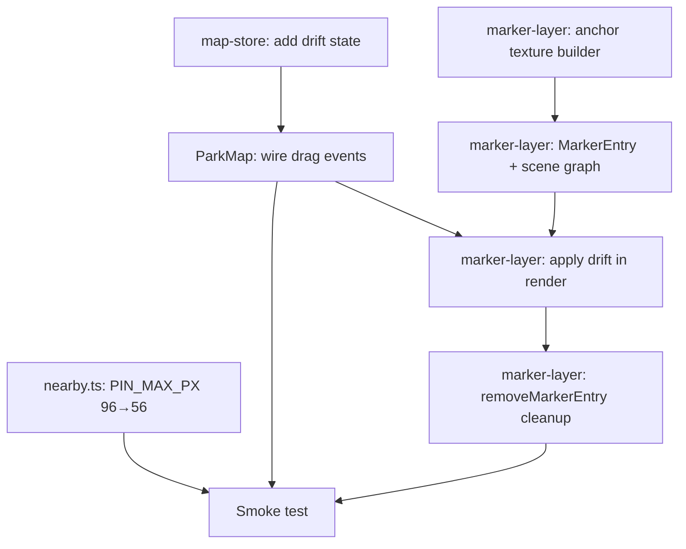

# Marker Drift UX + Zoom Optimisation

**GitHub**: TBD
**Status**: NOT STARTED

---

## Context

The park map currently starts at zoom 19.5 — close enough that visitors can only see a few exhibits at a time and have no spatial overview of the park. At zoom 20+ the markers (concentric-circle discs) fill the exhibit footprint entirely, obscuring the very thing they label.

This story makes three related changes. First, the landing zoom drops to 18.5, giving visitors a wider park overview on first load. Second, the on-screen pin size cap is halved so markers stay legible without covering their exhibit. Third, the marker visual behaviour is rethought: instead of sitting statically on the geo-coordinate, each marker drifts slightly opposite to the pan direction while the visitor is dragging, exposing the exhibit image underneath, then springs back to rest directly over the coordinate when the drag ends. A short dashed caret and a small anchor dot connect the drifted marker to the exact geo-point so the visitor never loses the spatial reference.

**Before**: Landing at z19.5, pins up to 96 px, markers permanently centred on coord.  
**After**: Landing at z18.5, pins capped at 56 px, markers drift ~28 % of pan velocity (max 42 px) opposite to pan direction with a caret to geo-anchor, spring back on release.

---

## Architecture Decisions

### Drift tracked globally, applied per marker in Three.js pivot space

**Decision**: Store a single `{ x, y }` drift offset in `useMapStore`. `ParkMap.tsx` accumulates it on `map.on('drag')` by computing the screen-pixel delta between consecutive projected center positions. The `render()` loop in `marker-layer.ts` reads it from the store each frame, decays it toward zero when `mapStore.isDragging` is false, and offsets each marker's `disc.position` within the pivot group. The geo-anchor dot and caret line are also children of the pivot group and are shown whenever `|drift| > 2 px`.

**Why**: All markers drift together in lockstep — same offset, same frame — because the pan gesture moves the entire viewport by one amount. One shared value is cheaper and visually correct. Storing in `useMapStore` keeps ParkMap.tsx and the custom layer decoupled: ParkMap owns the input, the layer owns the rendering.

**Alternatives considered**:
- Per-marker drift with individual springs — more natural for zoomed-out views where markers are far apart, but pan moves all markers identically so there is nothing to differentiate.
- CSS transform on an HTML canvas overlay — avoids Three.js scene complexity, but a second canvas on top of the map delays compositing and can jitter mid-animation.

**Consequences**: The custom layer calls `useMapStore.getState()` every render frame (already does this for `activeExhibitId`, `nearbyExhibitIds`). Adding two more scalar reads is negligible.

---

### Geo-anchor dot + caret as Three.js children of the pivot group

**Decision**: Add two new meshes to each `MarkerEntry`:
- `anchor`: a small `PlaneGeometry(1,1)` quad textured with a 32×32 solid circle canvas at pivot-local `(0, 0, 0)`. Visible only when `|drift| > 2`.
- `caret`: a `THREE.Line` with two vertices, `(0, 0, 0)` and `(driftX, driftY, 0)` in pivot space, updated every frame.

The pivot is already placed at `map.project([lng, lat])` which is the geo-coordinate. So anchor and caret need no coordinate transform — `(0,0)` in pivot space IS the geo-point.

**Why**: The pivot group already anchors to the geo-coordinate. Children placed at `(0,0)` in that group sit exactly on the coordinate without any additional matrix work. The drift offset is applied only to `disc.position` and `aura.position`, which already move relative to the pivot.

**Alternatives considered**: Draw caret and anchor on a separate 2D canvas overlay. Works, but requires a synchronised DOM layer above the WebGL canvas and per-frame position calculations outside the existing render loop.

**Consequences**: `removeMarkerEntry()` must dispose anchor texture and line geometry. Two extra render-order slots per marker needed in the depth sort.

---

### Drift accumulation via projected-center delta, not raw pointer delta

**Decision**: On each `map.on('drag')` event in `ParkMap.tsx`, project the same reference lat/lng (park center, `STARTING_CENTER`) at the previous and current camera state to get a screen-pixel delta, then apply:

```ts
const prevPx = map.project(prevCenter)   // projected before this drag tick
const currPx = map.project(currCenter)   // after this drag tick
const dx = currPx.x - prevPx.x          // positive = map content moved right
const dy = currPx.y - prevPx.y

mapStore.setPanDrift({
  x: clamp(drift.x - dx * DRIFT_FACTOR, -DRIFT_MAX, DRIFT_MAX),
  y: clamp(drift.y - dy * DRIFT_FACTOR, -DRIFT_MAX, DRIFT_MAX),
})
```

`DRIFT_FACTOR = 0.28`, `DRIFT_MAX = 42`.

**Why**: Raw pointer delta (`e.clientX`) is independent of zoom level — a 50 px drag at z20 moves the map much less than at z17. Using projected pixels gives the correct screen-space delta regardless of zoom, so the drift always "feels" proportional to how far the exhibit moved on screen.

**Alternatives considered**: Track `e.clientX / e.clientY` directly — simpler, but zoom-dependent. Touch events report positions in a different coordinate space, adding a normalization step that the projection approach avoids.

---

## Implementation Plan

1. **`lib/map-store.ts` — add drift state**  
   Add `panDrift: { x: number; y: number }` and `isDragging: boolean` to the store, with `setPanDrift` and `setIsDragging` setters. Initialize both to zero/false.

2. **`lib/nearby.ts` — lower the pin cap**  
   Change `PIN_MAX_PX` from `96` to `56`. No other changes to this file.

3. **`ParkMap.tsx` — lower landing zoom + wire drift events**  
   a. Change `STARTING_ZOOM` from `19.5` to `18.5`.  
   b. Keep a `dragPrevCenter` ref. On `map.on('dragstart')`, set it to `map.getCenter()`. On `map.on('drag')`, compute the projected delta as above and call `setPanDrift`. On `map.on('dragend')`, call `setIsDragging(false)`. On `map.on('dragstart')`, also call `setIsDragging(true)`.  
   c. The existing `map.on('dragstart', () => setFollowMode('idle'))` line stays — add the new calls after it.

4. **`marker-layer.ts` — add `anchor` texture builder**  
   Add `makeAnchorTexture(): THREE.CanvasTexture`. Canvas 32×32, filled white circle, radius 13. No outline. Used for all markers' anchor dot (shared texture, colored per-marker via `MeshBasicMaterial.color`).

5. **`marker-layer.ts` — extend `MarkerEntry`**  
   Add `anchor: THREE.Mesh` and `caret: THREE.Line` to the type. In `createMarkerEntry()`, create them: anchor is `PlaneGeometry(1,1)` + `MeshBasicMaterial({ map: anchorTexture, transparent: true, opacity: 0 })`. Caret is `THREE.Line` with a `BufferGeometry` of 2 points at `(0,0,0)` and `(0,0,0)`. Add both to the pivot group (before disc so they render beneath it).

6. **`marker-layer.ts` — apply drift in `render()`**  
   At the top of the render function, read `mapStore.panDrift` and `mapStore.isDragging`. If not dragging, decay: `driftX *= DECAY; driftY *= DECAY` (persist decayed value back to store). Then for each marker:  
   - `entry.disc.position.set(driftX, riseOffsetPx + driftY, 0)` (was `set(0, riseOffsetPx, 0)`)
   - `entry.aura.position.set(driftX, riseOffsetPx + driftY, 0)` (same offset)
   - `entry.ripple.position.set(driftX, riseOffsetPx + driftY, 0)` (same)
   - `entry.shadow.position` unchanged (stays at geo-coord to look grounded)
   - If `|driftX| > 2 || |driftY| > 2`: show anchor + caret, update caret geometry vertices to `(0,0,0)` → `(driftX, driftY, 0)`, set anchor/caret opacity 1
   - Else: set anchor opacity 0, caret opacity 0

7. **`marker-layer.ts` — extend `removeMarkerEntry()`**  
   Dispose anchor texture (only if it is the per-entry instance; if shared, skip), dispose caret geometry.

8. **Smoke test**  
   Run `npm run dev`, open `/map`. Verify: starts at z18.5; at z20 pins stay small; dragging pans markers off their coords with a caret visible; releasing lets them spring back.

---

## Task Graph



---

## Code References

- `components/map/marker-layer.ts:363` — `entry.disc.position.set(0, riseOffsetPx, 0)` — the line to extend with drift offset
- `components/map/marker-layer.ts:281–312` — `render()` frame setup: where to read mapStore and decay drift
- `components/map/ParkMap.tsx:568` — `map.on('dragstart', …)` — where to attach the new drag listeners
- `lib/map-store.ts` — existing store shape to extend with `panDrift` + `isDragging`
- `lib/nearby.ts:7` — `PIN_MAX_PX` constant to change

---

## Acceptance Criteria (Technical)

- [ ] Map opens at zoom 18.5 when no saved viewport exists
- [ ] At zoom 20, marker diameter does not exceed 56 px on any device (verify via debug overlay zoom badge)
- [ ] While dragging, each marker visibly displaces from its geo-coord in the direction opposite to pan (displacement ≤ 42 px)
- [ ] While drifted (displacement > 2 px), a dashed caret and small anchor dot are visible connecting each marker to its coordinate
- [ ] When drag ends, all markers animate back to rest directly over their geo-coord within ~10 frames
- [ ] Saved viewport (returning user) uses the saved zoom, not 18.5

---

## Testing

- **What to test**: marker screen position relative to its geo-projected position during and after a simulated pan gesture
- **Test type**: unit (render function inputs/outputs, not WebGL draw calls)
- **Prior art**: `__tests__/map/` — check for existing ParkMap or marker-layer unit tests
- **What NOT to test**: Three.js draw calls, WebGL state, pixel-level rendering — test the coordinate math only
