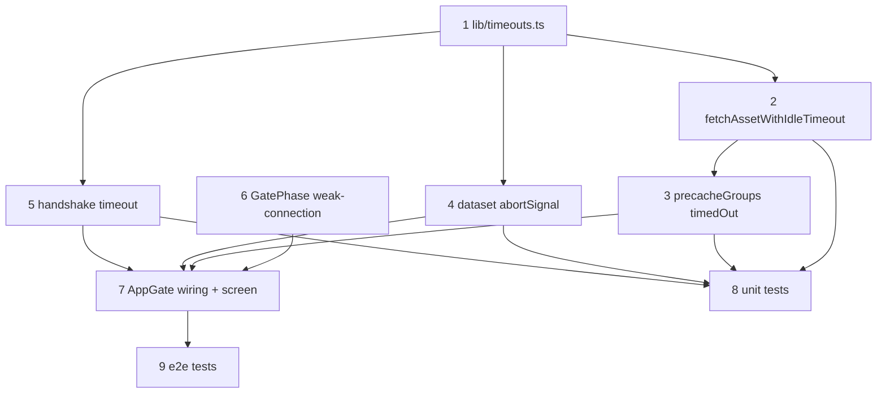

# Request Timeouts + Weak-Connection Screen

**GitHub**: [#86](https://github.com/makaravind/experium-ai-tour-app/issues/86)
**Milestone**: m5b-offline-hardening
**Status**: NOT STARTED

---

## Context

`AppGate` blocks the app until the dataset and every audio file for the precache language are in Cache Storage (#64). Three requests on that path have no timeout:

| # | Request | Where | Visitor sees when it stalls |
|---|---|---|---|
| a | Dataset queries (`exhibits`, `amenities`) | `lib/precache.ts:232` → `fetchCachedExhibits` / `fetchCachedAmenities` | "Preparing your audio tour…" at 0%, forever |
| b | One mp3 download (headers or body) | `lib/precache.ts:122-125` `realDeps.fetchAsset` | "Downloading 37 of 50", frozen |
| c | Handshake POST | `lib/handshake-lock.ts:39`, awaited via `Promise.all([runPrecache, idPromise])` at `AppGate.tsx:145-157` | "Downloading 50 of 50", 100%, frozen |

The park's coverage is weak and patchy ("lie-fi"). `navigator.onLine` stays `true` whenever the phone has a radio link, so the existing offline detection (`precache.ts:191`, `AppGate.tsx:163`) never fires. Browsers don't time out a slow fetch; it hangs until the OS gives up on the connection, which can take minutes or never happen. The current escape hatches are hidden:
- A language tap aborts (b) only.
- `onForeground` (`AppGate.tsx:178`) queues a restart but aborts nothing, so it waits for the hang.
- Reloading the page works, but nothing suggests it.

**Before**: A stalled request leaves the loading screen frozen, with no feedback and no way out.

**After**: Every request on the gate path has a bounded wait. A timeout ends the run on a visible **Weak connection** screen with **Try again**. A timeout never counts as a failed attempt. Try again resumes the gap-fill, so files already cached are not downloaded again.

---

## Architecture Decisions

### Timeout values: 15s dataset, 10s handshake, 15s idle per audio file

**Decision**:

| Request | Timeout | Kind |
|---|---|---|
| Dataset queries | 15s | total, per query (both run in parallel, so ~15s worst case) |
| Handshake POST | 10s | total |
| Audio file | 15s | **idle**: no bytes received for 15s, counted from request start and reset on every body chunk |

All three live as named constants in one file so they can be tuned after field testing:

```ts
// lib/timeouts.ts
export const DATASET_TIMEOUT_MS = 15_000
export const HANDSHAKE_TIMEOUT_MS = 10_000
export const AUDIO_IDLE_TIMEOUT_MS = 15_000
```

**Why**: The dataset and handshake responses are tiny, so a fixed total timeout is right for them. An mp3 is 0.5–5 MB, and on slow 3G a healthy download can legitimately take over a minute. A total timeout would kill slow-but-progressing downloads; an idle timeout only kills stalled ones. The values were agreed with Aravind and will be re-tuned from park field tests.

**Alternatives considered**: A total timeout per mp3 was rejected because it punishes slow-but-working links. Making the timeouts configurable at runtime (debug panel or env vars) was rejected as unrequested; edit the constants.

**Consequences**: A visitor on a link that's alive but trickling (bytes every <15s) keeps downloading indefinitely, with the progress bar slowly moving. That's intended.

---

### A timeout is a connectivity problem: stop the run, never count an attempt

**Decision**: A timeout raises a dedicated `ConnectionTimeoutError`. In `precacheGroups` it is handled like the existing `offline` branch: set a new `timedOut` flag, stop taking new URLs, run no retry rounds, and **don't** increment `failures[url]`. `PrecacheResult` gets `timedOut: boolean`.

```ts
// lib/timeouts.ts
export class ConnectionTimeoutError extends Error {
  name = 'ConnectionTimeoutError'
}
```

Error classification order in the `precacheGroups` catch (`precache.ts:189-198`):
1. `AbortError`: the caller aborted it (language switch). Return; no flag, no count. Unchanged.
2. `ConnectionTimeoutError`: set `timedOut = true` and return. No count.
3. `!deps.isOnline()`: set `offline = true` and return. No count. Unchanged.
4. Otherwise: count the attempt. Unchanged here; **#2 narrows this to 404/410 only**.

**Why**: A stall says nothing about the asset itself. Counting it would let three weak-signal stalls mark a file as given up permanently (audit #2). Stopping the whole run, instead of skipping to the next file, avoids hammering a dead link with 6 parallel workers × N files and gets the visitor to the Try again screen within ~15s.

**Alternatives considered**: Count timeouts as failures (status quo behaviour once fetches error): rejected, this is exactly the audit #2 trap. Skipping the stalled file and continuing: rejected, if one file stalls the link is usually dead for all of them, and the visitor would wait 15s × remaining files.

**Consequences**: One flaky file on an otherwise good link stops the run, and the visitor must tap Try again. That's acceptable: Try again only fetches what's missing.

**Cross-dependency (#2)**: Audit #2 makes 5xx and generic network errors connectivity problems too, so they also stop the run with no count. #2 should reuse this `timedOut` path; renaming it to `connectivity` is #2's call. Whichever spec lands first owns the catch-block rewrite, and the second rebases onto it.

---

### Implementing the timeouts: manual `AbortController` + `setTimeout`, linked to the caller's signal

**Decision**: Each timed request creates its own `AbortController`:
- A `setTimeout` aborts it on timeout.
- The caller's signal (language-switch abort, `AppGate.tsx:198`) is forwarded into it.

After a failure, inspect *why* it aborted: the caller's signal → rethrow as `AbortError` (existing semantics); the timer → throw `ConnectionTimeoutError`.

- **Audio** (`fetchAsset`): after `fetch` resolves, read `res.body` with `getReader()` instead of `res.arrayBuffer()`, and reset the idle timer on every chunk. The timer starts before `fetch`, so it also covers "headers never arrive".
- **Dataset**: pass the signal via supabase-js `.abortSignal(signal)` on both queries. postgrest-js does **not** throw on abort; it returns `{ error }`. So after the query, check `signal.aborted` and throw `ConnectionTimeoutError` in that case, before the existing `error || !data` throw (`precache.ts:61, 91`).
- **Handshake**: `fetch('/api/user/handshake', { signal })` with a 10s timer. The FingerprintJS step is local CPU work and isn't timed.

**Why**: `AbortSignal.any` (needed to combine the caller and timeout signals) isn't available before iOS Safari 17.4, and iOS visitors are in scope. `AbortSignal.timeout` would work for the dataset and handshake, but one consistent pattern is simpler to read. The idle timer needs manual reset logic either way.

**Alternatives considered**: `Promise.race` against a timer without aborting: rejected, the stalled fetch keeps the socket and bandwidth busy. Overriding `global.fetch` in `createClient` (`lib/supabase.ts`): rejected, it would apply the dataset timeout to every Supabase call, including the live `/s/[code]` lookup.

**Consequences**: About 15 lines of reader-loop code in `fetchAsset`. The function becomes worth exporting for unit tests (see Testing).

---

### New gate phase `weak-connection`, with a visible screen

**Decision**: Add `'weak-connection'` to `GatePhase` (`lib/debug-store.ts:24-25`). `AppGate` renders it with the existing `Screen` component:
- Title: **"Weak connection"**
- Body: "The download stalled. Move closer to the park entrance or connect to Wi-Fi, then try again."
- Button: **Try again** → `run()`

It's entered from two places:
- `finish()`: if `result.timedOut`, go to `weak-connection`. This check comes **first**, before the capped and offline checks, because a timed-out run didn't attempt the remaining files, so the capped or incomplete list would be misleading.
- `run()` catch: if the error is a `ConnectionTimeoutError` (dataset or handshake), go to `weak-connection`. Otherwise keep today's `fetch-error` / `blocked-offline` split.

Also add `'weak-connection'` to the `onForeground` retry list (`AppGate.tsx:180`), so switching apps and coming back retries automatically, matching `blocked-offline` and `fetch-error`.

**Why**: Aravind prefers explicit, visible failure states over silent fallbacks. A separate phase, rather than reusing `fetch-error` or `blocked-offline`, gives copy that tells the visitor what to do (move, or use Wi-Fi). `blocked-offline` says "connect to the internet", which is wrong when the phone is connected, and `fetch-error` sounds like an app bug.

**Alternatives considered**: Silent background retry while keeping the progress bar: rejected by Aravind (visitor waits without knowing why). Reusing `fetch-error`: rejected, wrong copy.

**Consequences**: The `GatePhase` union gains a value. DebugPanel shows it automatically via `setCacheDebug`.

---

### Handshake stays inside the gate's `Promise.all`; abort the orphaned run on failure

**Decision**: Per Aravind, keep `idPromise` in the `Promise.all` at `AppGate.tsx:145-157`. The gate still waits for the visitor ID. With the 10s timeout, a stalled handshake now ends on `weak-connection` instead of hanging.

Fix a side effect this exposes: when `idPromise` rejects first, `Promise.all` rejects immediately, but `runPrecache` keeps downloading in the background. Tapping Try again then starts a second run in parallel with the orphaned one. In the `run()` catch, call `abortRef.current?.abort()` before setting the phase.

**Why**: Moving the handshake out of the gate was deferred (it's tied to audit #9). The abort-on-catch is needed for correctness once handshake failures become a common, user-visible path.

**Alternatives considered**: Removing the handshake from the gate: deferred by Aravind.

**Consequences**: A failed handshake throws away in-flight audio downloads. Files already cached stay cached; Try again resumes the gap-fill. Audit #9 (offline discoveries lost when no visitor ID exists) stays open.

---

## Implementation Plan

1. **Add `lib/timeouts.ts`.** Add the three constants and `ConnectionTimeoutError`. One place for field tuning.

2. **Time out the audio download in `lib/precache.ts`.** Replace `realDeps.fetchAsset` (L122-125) with an exported `fetchAssetWithIdleTimeout(url, signal?, idleMs = AUDIO_IDLE_TIMEOUT_MS)`:
   - Make an inner controller and forward the outer signal's `abort` into it.
   - Arm the idle timer and `fetch` with the inner signal. Keep the `!res.ok` throw.
   - Loop `reader.read()`, re-arming the timer on each chunk.
   - Clear the timer and the outer listener in `finally`.
   - On a caught error: outer signal aborted → rethrow the original `AbortError`; timer fired → throw `ConnectionTimeoutError`; anything else → rethrow.
   
   `realDeps.fetchAsset` points at it.

3. **Classify the error in `precacheGroups`** (`precache.ts:181-199`). Add `let timedOut = false`. In the catch, add the `ConnectionTimeoutError` branch between `AbortError` and the `isOnline` check (see the classification order above). Add `!timedOut` to the `while` and worker-loop conditions next to `!offline`. Return `timedOut` in the result and add it to `PrecacheResult` (L29-36).

4. **Time out the dataset queries in `lib/precache.ts`.** `fetchCachedExhibits` and `fetchCachedAmenities` each create a controller with a `DATASET_TIMEOUT_MS` timer and call `.abortSignal(controller.signal)` on the query. After the await: clear the timer; if `controller.signal.aborted`, throw `ConnectionTimeoutError`; otherwise keep the existing error handling.

5. **Time out the handshake in `lib/handshake-lock.ts`.** In `handshake()` (L35-47), wrap the `fetch` with a controller and a `HANDSHAKE_TIMEOUT_MS` timer. On abort, throw `ConnectionTimeoutError`. The existing `finally` in `getOrCreateVisitorId` already releases the lock and stops the heartbeat. Check that a timeout propagates out of the `for (;;)` loop rather than retrying: it does, since the throw happens inside the `try`.

6. **Add the phase.** Add `'weak-connection'` to `GatePhase` in `lib/debug-store.ts`.

7. **Wire it into `components/onboarding/AppGate.tsx`:**
   - `finish()` (L88-97): check `result.timedOut` first → `setPhase('weak-connection')`.
   - `run()` catch (L161-164): `abortRef.current?.abort()`, then if `err instanceof ConnectionTimeoutError` → `weak-connection`, else today's online/offline split. Keep the `restartRef` guard.
   - `onForeground` (L178-181): add `'weak-connection'` to the retry list.
   - Render the screen: a new branch next to `blocked-offline`, using `Screen` and `buttonClass`, with the copy above.

8. **Unit tests.** See Testing.

9. **e2e tests.** See Testing.

---

## Task Graph



---

## Code References

- `experium-ai-tour-app/lib/precache.ts:29-36` — `PrecacheResult`; add `timedOut`
- `experium-ai-tour-app/lib/precache.ts:55-102` — dataset queries; add the abort signal and timeout check
- `experium-ai-tour-app/lib/precache.ts:117-128` — `realDeps`; `fetchAsset` to replace
- `experium-ai-tour-app/lib/precache.ts:147-220` — `precacheGroups`; the worker loop and catch to extend (same block audit #2 rewrites)
- `experium-ai-tour-app/lib/handshake-lock.ts:35-47` — `handshake()`
- `experium-ai-tour-app/components/onboarding/AppGate.tsx:88-97` — `finish()`
- `experium-ai-tour-app/components/onboarding/AppGate.tsx:99-176` — `run()`: `Promise.all` with `idPromise`, catch, restart logic
- `experium-ai-tour-app/components/onboarding/AppGate.tsx:178-181` — `onForeground` retry list
- `experium-ai-tour-app/components/onboarding/AppGate.tsx:234-265` — the `blocked-offline` / `fetch-error` screens to copy the pattern from
- `experium-ai-tour-app/lib/debug-store.ts:24-25` — `GatePhase`
- `docs/specs/gh-64-upfront-precache.md` — "Precache state machine" decision (original retry and offline semantics)
- `docs/specs/gh-78-dataset-refresh.md` — `fetch-error` phase and the "failed-while-online ≠ no connection" decision this extends

---

## Acceptance Criteria (Technical)

- [ ] A dataset query with no response within 15s ends the run on `weak-connection`. It does not hang on `loading`.
- [ ] A handshake with no response within 10s ends the run on `weak-connection`. The handshake lock is released (`experium_handshake_lock` absent from localStorage).
- [ ] An mp3 whose headers never arrive, or whose body stops sending bytes, aborts after 15s idle and the run ends on `weak-connection`.
- [ ] An mp3 that keeps sending bytes slowly (each chunk <15s apart) is **not** aborted, regardless of total time.
- [ ] After a timeout, `assetFailures` in the persisted store is unchanged for every URL.
- [ ] After a timeout, no new audio fetches start (run stopped, no retry round).
- [ ] When the handshake times out mid-download, the in-flight precache fetches are aborted; no orphaned run continues after the screen shows.
- [ ] Try again on `weak-connection` re-runs and fetches only uncached files.
- [ ] Returning to the tab while on `weak-connection` re-runs automatically.
- [ ] A language switch mid-download still aborts immediately and re-targets, as before. It doesn't show `weak-connection`, and the outer abort isn't treated as a timeout.
- [ ] The timeout values exist only in `lib/timeouts.ts`.

---

## Testing

- **What to test**: Gate phase outcomes and persisted failure counts under stalled requests; idle vs total timeout semantics.
- **Test type**:
  - **Unit (vitest, fake timers)**, in `__tests__/precache.test.ts`, `__tests__/precache-dataset.test.ts` and `__tests__/handshake-lock.test.ts`:
    - `fetchAssetWithIdleTimeout`:
      - fetch never resolves → rejects with `ConnectionTimeoutError` after 15s;
      - body stream emits a chunk every 10s for 60s → resolves;
      - body emits once then stalls → rejects after 15s idle;
      - outer abort → rejects with `AbortError`, not a timeout.
    - `precacheGroups`: an injected `fetchAsset` throwing `ConnectionTimeoutError` → `timedOut: true`, `failures` unchanged, no further URLs fetched.
    - Dataset query: mocked query that never settles → `runPrecache` rejects with `ConnectionTimeoutError` at 15s. **Note:** the supabase mock in `precache-dataset.test.ts` (L7-9, `select: async () => …`) must grow an `.abortSignal()` method in the chain.
    - `handshake-lock`: fetch never resolves → `getOrCreateVisitorId` rejects with `ConnectionTimeoutError` at 10s, and the lock key is removed.
  - **e2e (Playwright)**, new `e2e/weak-connection.spec.ts`. Use routes that are never fulfilled, with ~30s test timeouts:
    - the `exhibits` dataset route → "Weak connection" visible;
    - the mp3 route → "Weak connection" visible, and the `assetFailures` read from `localStorage['experium-store']` is empty. Then fulfil the route and click Try again → the gate passes;
    - the handshake route → "Weak connection" visible.
- **Prior art**:
  - `e2e/language-switch.spec.ts:242` — "abort: language switch cancels stalled download": the never-fulfilled route pattern.
  - `e2e/gate-helpers.ts` — `mockPrecacheDataset`, `seedAudioCache`, `passLoadingGate`, `silentWav`.
  - `__tests__/precache.test.ts:31-36` — injected `fetchAsset` / `isOnline` deps.
- **What NOT to test**:
  - The internal timer plumbing (when the controller or listener is cleared).
  - The exact screen copy beyond the title.
  - Real network throttling: field tests cover that.

---

## Open Questions

- [ ] Are the timeout values right? 15s / 10s / 15s are starting points; re-tune after the Experium field test (Aravind).
- [ ] Should a timed-out Try again use a longer timeout on the second attempt? Not planned; revisit if field tests show repeated timeouts on slow-but-alive links (Aravind).
