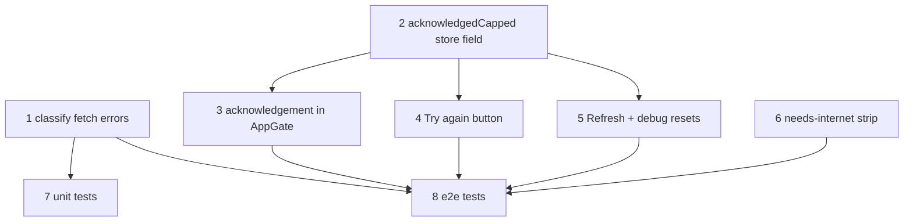

# Asset Failure Handling: Only Real 404s Cap, Acknowledge Once, Retry + "Needs Internet" Strip

**GitHub**: [#87](https://github.com/makaravind/experium-ai-tour-app/issues/87)
**Milestone**: m5b-offline-hardening
**Status**: NOT STARTED

---

## Context

`AppGate` (#64) downloads every audio file for the visitor's language up front. When one file fails, `precacheGroups` retries it and records a persisted attempt count in `assetFailures`. After `MAX_ATTEMPTS` (3) the file is "capped": never retried, listed on the `asset-error` screen ("Some audio couldn't be downloaded"), with only a "Continue anyway" button.

The offline audit found this turns a transient blip into a permanent nag:

- **Any error while `navigator.onLine` is true counts** (`lib/precache.ts:189-198`) — 5xx, CORS, network resets, stalls. In a park with weak signal `onLine` is almost always true.
- **Retries are back-to-back** (`precache.ts:180-206`): a 20-second Supabase hiccup burns all 3 attempts in one run.
- **Counts persist forever** (`assetFailures` in `lib/store.ts` `partialize`) and a capped URL is filtered out of every later run (`precache.ts:176`), so it can never succeed and clear itself.
- **Refresh doesn't reset them**: the `refreshRequested` effect (`components/onboarding/AppGate.tsx:184-193`) clears the dataset but not `assetFailures`. Debug mode deletes `audio-cache` and still keeps the counts.
- **The screen re-blocks on every page load**: the "only capped gaps left" check (`AppGate.tsx:130-134`) runs before the offline check, and "Continue anyway" (`AppGate.tsx:283-284`) only sets in-memory phase. Every OS-camera QR scan is a fresh page load, so the visitor taps "Continue anyway" at every marker.
- **No way out**: no retry button.

**Before**: one flaky moment → error screen before every exhibit, forever, until browser data is cleared.

**After**: only a genuinely missing file (HTTP 404/410) can be capped. Everything else is a connectivity problem: no attempt counted, run stops, visitor sees the weak-connection screen from #1. A capped set is shown once; after "Continue anyway" it doesn't block again until the set changes. Exhibits whose audio isn't cached show a small "Needs internet" strip at the top of their sheet. The error screen gets "Try again", and Refresh clears all failure state.

---

## Architecture Decisions

### Only 404/410 count toward the cap

**Decision**: `fetchAsset` throws an error carrying the HTTP status. `precacheGroups` increments `failures[url]` only when the status is 404 or 410. Any other failure (5xx, 408/429, thrown network/CORS errors, the no-bytes timeout from #1) stops the run without counting, exactly like today's "network dropped" path: `offline = true` on the result.

**Why**: 404/410 means the file really isn't at that URL; retrying won't help and the visitor should know. Everything else is the network or the server being temporarily unhealthy, and burning permanent attempts on it is what created the nag. Treating it like the existing offline path reuses the "stop, don't count" machinery that already exists (`precache.ts:191-194`).

**Alternatives considered**:
- Exponential backoff between retry rounds: rejected (user decision) — with classification in place, transient errors no longer burn attempts, so backoff adds code for little gain.
- Count 5xx too but reset counts on each launch: rejected — still nags within a launch and hides real server outages.

**Consequences**:
- A server returning 500 for one file forever (e.g. a corrupt object) never caps; the visitor sees the weak-connection screen on each run until it's fixed. Acceptable: it's visible, and that's an ops bug.
- `PrecacheResult.offline` now means "stopped for connectivity", not strictly `navigator.onLine === false`. Rename the doc comment (`precache.ts:34`); keep the field name to avoid churn.

```ts
// lib/precache.ts — decision-critical shape only
export class AssetFetchError extends Error {
  constructor(public status: number, url: string) { super(`${status} ${url}`) }
}
const isPermanent = (err: unknown) =>
  err instanceof AssetFetchError && (err.status === 404 || err.status === 410)

// in the worker catch, after the AbortError check:
if (!isPermanent(err) || !deps.isOnline()) { offline = true; return }  // connectivity: don't count
// ...existing count / cap / retry.push
```

### "Continue anyway" is remembered per set of capped URLs

**Decision**: New persisted store field `acknowledgedCapped: string[]` (sorted URLs). "Continue anyway" writes the current capped URL list into it. AppGate treats a capped set as acknowledged when **every currently capped URL is in `acknowledgedCapped`**; in that case it goes to `nextAfterClear()` instead of `asset-error`, both in the mount check (`AppGate.tsx:130-134`) and in `finish()` (`AppGate.tsx:88-97`).

**Why**: The visitor already said "I know, carry on". Re-asking at every page load is what made this a blocker. Keying on the URL set means a *new* failure (a different exhibit, or a language switch to a language with its own capped file) shows the screen again with the full list.

**Alternatives considered**:
- A boolean "acknowledged" flag: rejected — would hide newly capped files.
- Session-only acknowledgement (`sessionStorage`): rejected — OS-camera scans open fresh tabs/sessions on some browsers, which reintroduces the nag.

**Consequences**:
- Subset check, not equality: if one capped file later succeeds (e.g. after Try again), the remaining ones are still acknowledged.
- No persist version bump needed: zustand's `persist` merges stored state over the initial state, so existing visitors get `acknowledgedCapped: []` by default. Add it to `partialize` (`lib/store.ts`).

### "Needs internet" strip at the top of the exhibit sheet

**Decision**: `PreviewSheet` checks whether the audio URL it would play (current playback `language`, via `currentSrc`, `PreviewSheet.tsx:67`) is in Cache Storage (`caches.open('audio-cache')` → `match(url)`), on exhibit change and `currentSrc` change. If not cached, render a thin strip at the top of the sheet content: "Needs internet to play". Shown only while offline (`navigator.onLine === false`); online the file streams, so the strip would be noise.

**Why**: After acknowledging, the visitor still needs to know which exhibits won't play offline. This is the visible-but-non-blocking pattern the user prefers for in-app states. Cache Storage is authoritative (same principle as `findMissing`): it covers capped files, files missing after a gap-fill, and languages that were never precached, without trusting counters.

**Alternatives considered**:
- Derive from `assetFailures`: rejected — misses files that are missing for other reasons (#3 not-saved, other-language playback).
- Top-of-screen banner like the GPS one: rejected by user — collides with the GPS banner.

**Consequences**:
- One async Cache Storage lookup per sheet open; cheap.
- Exhibits with no audio in any language (`hasAudio === false`) don't show the strip — "not available" is a different message, already handled by `fallback('missing')`.
- When the player falls back to the precache language (`PreviewSheet.tsx:116-131`), `currentSrc` changes and the strip re-evaluates.
- On lie-fi (`onLine` true, no data) the strip stays hidden; the player's existing start-timeout toast covers that case.

### "Try again" on the asset-error screen

**Decision**: Add a primary "Try again" button above "Continue anyway". It deletes the listed URLs from `assetFailures` and from `acknowledgedCapped`, then calls `run()`. "Continue anyway" becomes the secondary button.

**Why**: The only escape today is clearing browser data. Try again lets a visitor at the gate (good Wi-Fi) recover a file that was capped by a real-but-temporary 404 (e.g. ops re-uploading).

**Consequences**: If the file is still 404, it caps again in ~1 run (3 immediate attempts) and the screen returns — correct.

### Refresh clears all failure state

**Decision**: The `refreshRequested` effect (`AppGate.tsx:184-193`) also resets `assetFailures` to `{}` and `acknowledgedCapped` to `[]` before `run()`. DebugPanel's two reset paths (`components/DebugPanel.tsx:74-75`, `98-99`) also reset `acknowledgedCapped`.

**Why**: "Refresh content" should mean "try everything again". Today it silently skips capped files.

**Consequences**: Overlaps with #4 (full content wipe on Refresh), which owns the full wipe list. This spec only guarantees failure counts and acknowledgements are part of it; whichever lands second merges into the other's effect.

---

## Implementation Plan

1. **Classify fetch errors** — `lib/precache.ts`. Add `AssetFetchError` with `status`; `realDeps.fetchAsset` (`precache.ts:122-126`) throws it on `!res.ok`. In the `precacheGroups` worker catch (`precache.ts:189-199`), after the `AbortError` return: if the error isn't a 404/410 (or the device is offline), set `offline = true` and return without counting. Update the `offline` doc comment (`precache.ts:34`).
2. **Store field** — `lib/store.ts`. Add `acknowledgedCapped: string[]` + `setAcknowledgedCapped`, default `[]`, add to `partialize`. No version bump.
3. **Acknowledgement in AppGate** — `components/onboarding/AppGate.tsx`. Add an `allAcknowledged(urls)` check (every URL in `acknowledgedCapped`). Use it in the mount-time capped check (`:130-134`) and in `finish()` (`:88-97`): acknowledged → `nextAfterClear()`. "Continue anyway" (`:283-284`) writes the current capped URLs before advancing.
4. **Try again button** — same file, `asset-error` screen (`:266-290`). Add "Try again" (primary, existing `buttonClass`) that removes listed URLs from `assetFailures` and `acknowledgedCapped`, then `run()`. Restyle "Continue anyway" as secondary.
5. **Refresh resets** — `AppGate.tsx:184-193` sets `assetFailures: {}` and `acknowledgedCapped: []` before `run()`. `DebugPanel.tsx:74-75`, `98-99` reset `acknowledgedCapped` too.
6. **"Needs internet" strip** — `components/exhibit/PreviewSheet.tsx`. A small effect keyed on `currentSrc` sets `audioCached: boolean | null` from `caches.open('audio-cache').then(c => c.match(currentSrc))`. Track online state with the same `useSyncExternalStore` online/offline subscription as `components/more/UserMenu.tsx:7-17`. Render the strip at the top of the sheet content when `hasAudio && audioCached === false && !online`. Guard `typeof caches === 'undefined'` (treat as not cached).
7. **Unit tests** — `__tests__/precache.test.ts`, `__tests__/store.test.ts`.
8. **E2E tests** — new cases in `e2e/offline-precache.spec.ts`.

---

## Task Graph



---

## Code References

- `lib/precache.ts:122-126` — `realDeps.fetchAsset`, where the status is lost today.
- `lib/precache.ts:176` — capped URLs filtered out of `todo`; unchanged, but explains why counts never clear.
- `lib/precache.ts:189-199` — the catch block to change. **Shared with #1** (timeouts become "connectivity, don't count") and **#3** (not-saved files): coordinate so all three land in one consistent classification.
- `components/onboarding/AppGate.tsx:88-97` — `finish()` phase selection.
- `components/onboarding/AppGate.tsx:130-134` — mount-time "only capped gaps" check.
- `components/onboarding/AppGate.tsx:184-193` — Refresh effect.
- `components/onboarding/AppGate.tsx:215-219, 266-290` — `cappedExhibits` and the asset-error screen.
- `components/DebugPanel.tsx:110-118` — "force-cap a random asset" debug action; useful for manual testing.
- `components/exhibit/PreviewSheet.tsx:67, 116-131` — `currentSrc` and the language fallback.
- `lib/store.ts` `partialize` — where `acknowledgedCapped` must be added.
- `__tests__/precache.test.ts:79-113` — prior art for cap / carry-across-runs / offline-no-count tests with injected deps.
- `e2e/gate-helpers.ts:15-30` — `mockPrecacheDataset` + `FAKE_AUDIO_URL` route to override with 404/500.

---

## Acceptance Criteria (Technical)

- [ ] `fetchAsset` returning 500 / thrown network error: no entry added to `failures`, `result.offline === true`, run stops.
- [ ] `fetchAsset` returning 404 or 410: counted; capped after 3 attempts, listed in `groups[].capped`.
- [ ] After "Continue anyway", a reload with the same capped set goes straight to the app (no `asset-error`), online or offline.
- [ ] A new capped URL not in `acknowledgedCapped` shows `asset-error` again listing all capped exhibits.
- [ ] "Try again" removes listed URLs from `assetFailures` and `acknowledgedCapped` and re-runs; a now-200 file ends cached and the gate clears.
- [ ] Refresh resets `assetFailures` and `acknowledgedCapped` before re-running; a previously capped file is fetched again.
- [ ] Exhibit sheet shows "Needs internet to play" at the top when the current-language audio isn't in `audio-cache`, and hides it when it is.
- [ ] Existing visitors' persisted state loads without migration errors; `acknowledgedCapped` defaults to `[]`.

---

## Testing

- **What to test**: classification (404/410 counts, 5xx/network doesn't), acknowledgement persists across reloads, a new capped set re-blocks, Try again recovers, Refresh retries capped files, strip visibility.
- **Test type**: unit (`precacheGroups` with injected `fetchAsset` throwing `AssetFetchError(404|500)`); e2e (Playwright) for the gate and strip.
- **E2E cases**:
  - Audio route returns 500 three times → weak-connection / blocked screen, `assetFailures` empty in localStorage.
  - Audio route returns 404 → `asset-error` once; tap Continue anyway; reload → app shows directly; open the exhibit online → no strip; go offline → strip visible.
  - Then switch the route to 200, tap Refresh → file cached, strip gone.
- **Prior art**: `__tests__/precache.test.ts:79-113` (cap behaviour with fake deps); `e2e/offline-precache.spec.ts:71` (seeded dataset + manipulated Cache Storage).
- **What NOT to test**: the exact Cache Storage lookup call in `PreviewSheet`, strip styling, console logs.

---

## Open Questions

- [x] Hide the "Needs internet" strip while online? **Yes** — shown only when offline and not cached (Aravind).
- [ ] Phase/copy for the connectivity stop is defined by #1 (weak-connection screen). If #2 lands first it falls through to today's `blocked-offline`. — resolve at implementation order
