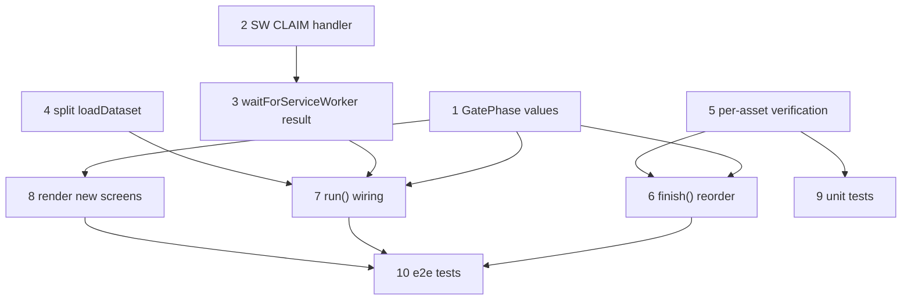

# Cache Save Verification + Honest Gate Failures (no more empty asset-error list)

**GitHub**: [#88](https://github.com/makaravind/experium-ai-tour-app/issues/88)
**Milestone**: m5b-offline-hardening
**Status**: NOT STARTED

---

## Context

`AppGate` downloads every asset through the page (`fetch` in `lib/precache.ts` `realDeps.fetchAsset`) and relies on the service worker's `CacheFirst` rule to write each response into Cache Storage as a side effect. The precache loop counts an asset as "fetched" the moment the page finishes reading the body — it never checks the SW actually saved it. Only at the very end does `precacheGroups` re-read Cache Storage (`findMissing`), discover the gap, and report the group `complete: false`. `finish()` then routes "incomplete but nothing capped" to `'asset-error'`, whose list only renders *capped* exhibits — so the visitor sees **"Some audio couldn't be downloaded. These exhibits will need a connection to play:"** followed by an empty list, taps "Continue anyway", and walks into the park believing the tour is offline-ready. Every later launch re-downloads everything that wasn't saved (tens–hundreds of MB of mobile data) and lands on the same empty screen.

Downloaded-but-not-saved happens in three real situations:

1. **SW not controlling yet.** `waitForServiceWorker` races control against a 4s timer (`SW_WAIT_MS`). On a first visit over park-gate 3G the SW install (all `/_next/static` chunks, fonts, 5 page documents) easily takes longer, so the first batch of audio fetches bypasses the SW and is never cached. A shift-reload has the same effect permanently: the page loads uncontrolled and `clientsClaim` already ran, so `controllerchange` never fires.
2. **Storage full.** The SW's `cache.put` throws `QuotaExceededError` inside `waitUntil`, but the response was already handed to the page, so `fetchAsset` resolves normally.
3. **No SW at all.** In-app browsers (Paytm, PhonePe, Google Lens, WhatsApp webviews — common QR scanners in India) and Firefox private mode have no service worker. `waitForServiceWorker` returns immediately, every asset downloads, none is saved.

**Before**: progress bar reaches 100%, then an empty asset-error list; silent re-download loop on every launch.
**After**: the gate waits properly for SW control (~20s), refuses to start the bulk download without it, and shows an "Open in Chrome/Safari" screen (Copy link / Continue online) instead. Each asset is verified in Cache Storage right after its fetch; three consecutive not-saved assets abort the run and show a "low storage" screen. The asset-error list can never be empty.

---

## Architecture Decisions

### Precache never starts without SW control

**Decision**: `waitForServiceWorker` waits up to **20s** (`SW_WAIT_MS = 20_000`) and returns a result — `'controlled' | 'unsupported' | 'timeout'` — instead of resolving silently. `run()` only proceeds to the bulk download on `'controlled'`. `'unsupported'` (`!('serviceWorker' in navigator)`) and `'timeout'` both go to a new `'no-offline-support'` phase. Dev mode (`NODE_ENV === 'development'`, SW disabled) keeps today's behaviour and is treated as `'controlled'`.

**Why**: Downloading without control is pure waste — nothing gets saved, and the visitor pays the data cost on every launch. The 4s race was a "don't strand the visitor" guard; the browser screen now does that job explicitly instead of silently degrading.

**Alternatives considered**: Keep 4s and re-fetch pre-control assets once control arrives (rejected — still double-downloads, and still lies when control never arrives). Wait indefinitely (rejected — strands in-app-browser visitors on a spinner).

**Consequences**: First visits on slow networks show "Preparing your audio tour…" for up to 20s longer before the progress bar starts. Acceptable: it's the same screen, and the alternative is a broken offline tour.

### Recover the shift-reload case with an explicit claim

**Decision**: When `sw.ready` resolves with an active worker but `navigator.serviceWorker.controller` is still `null` after a short grace period (~1s), the page posts `{ type: 'CLAIM' }` to `registration.active`. `app/sw.ts` adds a `message` listener that calls `self.clients.claim()` for that message. The page keeps waiting on `controllerchange` within the same 20s budget.

**Why**: After a hard reload, the page is uncontrolled by spec and `clientsClaim: true` only runs on activate, so the visitor would hit the browser screen on a perfectly capable browser. One message handler fixes it.

**Alternatives considered**: Tell the visitor to reload (rejected — they won't understand why).

**Consequences**: One small addition to `sw.ts`; no Serwist config change.

### Verify each asset in Cache Storage right after its fetch

**Decision**: Add `isCached(cacheName, url): Promise<boolean>` to `PrecacheDeps`. After `fetchAsset` resolves, `precacheGroups` polls `isCached` for up to **2s** (e.g. every 250ms) because the SW writes the cache inside `waitUntil` *after* handing the response to the page — the put can complete a few hundred ms after `arrayBuffer()`. Only a verified asset increments `fetched` and clears its `failures` entry.

A not-saved asset is **not** a failure attempt (it's not the asset's fault) — it never touches `failures`, so it can't contribute to the retry cap from #2.

**Why**: "Downloaded" ≠ "saved" is the root cause. Checking per asset turns an end-of-run surprise into an immediate, attributable signal, and lets the run stop early.

**Alternatives considered**: Trust the end-of-run `findMissing` and just fix the screen (rejected — still downloads the whole tour into a full disk before saying anything). `navigator.storage.estimate()` up front (rejected for now — total audio size isn't known in advance, and per-asset verification catches the same problem cheaply).

**Consequences**: The worker queue must keep each URL's `cacheName` (today `todo` is a flat `string[]` from `Object.values(missing).flat()`, `precache.ts:173`). Needed anyway once #5 adds the `map-tiles-cache` group.

### Three consecutive not-saved assets abort the run as "storage full"

**Decision**: `precacheGroups` tracks a consecutive not-saved counter (reset to 0 on any verified save). At **3**, it stops taking new URLs (same mechanism as `offline`) and returns `saveFailed: true` in `PrecacheResult`. In-flight fetches from other workers are allowed to finish; they are not counted.

**Why**: The run is already controlled when it starts (previous decision), so a not-saved asset almost always means quota. Three in a row filters out a single racy put while capping the wasted data at a handful of files instead of the whole tour.

**Consequences**: A non-quota put failure would also surface as "low storage". Acceptable — the copy suggests freeing space and retrying, which is the only visitor action available either way.

### New gate phases; asset-error can never be empty

**Decision**: Add two `GatePhase` values in `lib/debug-store.ts`: `'no-offline-support'` and `'storage-error'`. `finish()` is reordered:

```
saveFailed                      → 'storage-error'
any group capped                → 'asset-error'   (list guaranteed non-empty)
offline                         → 'blocked-offline'
incomplete, nothing capped      → 'fetch-error'   (generic "Try again")
else                            → nextAfterClear()
```

The last-but-one row is the fix for the empty list: incomplete-for-an-unknown-reason (e.g. eviction mid-run) gets the existing generic retry screen, never `'asset-error'`.

| Phase | Title | Body | Buttons |
|---|---|---|---|
| `no-offline-support` | This browser can't save the tour offline | Open this link in Chrome or Safari to use the tour without internet. | **Copy link** · Continue online |
| `storage-error` | Your phone is low on storage | Free some space and try again. | **Try again** (`run()`) |

**Why**: Visible failure with a specific reason and a next action (project preference: explicit, visible failure states).

### "Continue online" is session-scoped and still loads the dataset

**Decision**: "Continue online" sets `sessionStorage['experium_continue_online'] = '1'`. While set, `run()` skips the SW wait and the bulk audio download, but still runs the **dataset** query (exhibits + amenities) so the map has pins and search works, then goes to `nextAfterClear()`. Audio streams from the network on play. If the visitor is offline with no saved dataset, the existing `'blocked-offline'` screen applies.

**Copy link**: `navigator.clipboard.writeText(location.href)`; on rejection (some webviews block clipboard), show the URL as selectable text in the same card so the visitor can long-press copy.

**Why**: User decision — remembered per session so every scan in the same webview doesn't re-show the screen, but a new session re-offers the better (offline) path.

**Consequences**: `runPrecache` is split so the dataset half can run alone (see Implementation Plan step 4).

---

## Implementation Plan

1. **Gate phases** (`lib/debug-store.ts` `GatePhase`): add `'no-offline-support'` and `'storage-error'`. Type-only; unblocks AppGate edits. Check `components/DebugPanel.tsx` renders unknown phases sensibly.

2. **SW claim handler** (`app/sw.ts`): add a `message` listener — on `event.data?.type === 'CLAIM'`, `event.waitUntil(self.clients.claim())`. Place it next to the existing `install` listener (`sw.ts:22`).

3. **`waitForServiceWorker` returns a result** (`components/onboarding/AppGate.tsx:21-35`): raise `SW_WAIT_MS` to `20_000`; return `'controlled' | 'unsupported' | 'timeout'`; after `sw.ready`, if still no controller after ~1s, post `CLAIM` to `registration.active`, keep waiting on `controllerchange` within the same budget. Dev mode returns `'controlled'`.

4. **Split dataset load from asset download** (`lib/precache.ts:225-245`): extract the `Promise.all([fetchCachedExhibits(), fetchCachedAmenities()])` + store writes into `loadDataset()`; `runPrecache` calls it then `precacheGroups`. "Continue online" calls `loadDataset()` only. (If #1 has landed, the 15s dataset timeout lives inside this function.)

5. **Per-asset verification in `precacheGroups`** (`lib/precache.ts:146-219`):
   - Add `isCached` to `PrecacheDeps` (`precache.ts:38-44`); real impl opens the cache and `match`es the URL (`realDeps`, `precache.ts:116-127`).
   - Keep `{ url, cacheName }` pairs in `todo`/`queue` instead of bare strings (`precache.ts:173-183`); `findMissing`'s output is already keyed by cache name.
   - After `fetchAsset`, poll `isCached` up to 2s. Saved → `delete failures[url]`, `onProgress(++fetched)`, reset consecutive counter. Not saved → increment consecutive counter, no `failures` change; at 3 set `saveFailed = true` and stop like `offline`.
   - Add `saveFailed: boolean` to `PrecacheResult` (`precache.ts:29-36`); include `saveFailed` in the loop exit condition alongside `offline`/`cancelled()`.

6. **`finish()` reorder** (`AppGate.tsx:85-94`): implement the table in Architecture Decisions. Incomplete-not-capped goes to `'fetch-error'`.

7. **`run()` wiring** (`AppGate.tsx:96-168`):
   - At the top (after the debug escape hatch), if `sessionStorage['experium_continue_online']` is set: if offline and no dataset → `'blocked-offline'`; else `await loadDataset()` (catch → existing `fetch-error`/`blocked-offline` logic), then `nextAfterClear()`.
   - Replace `await waitForServiceWorker()` (`AppGate.tsx:108`) with a result check, keeping the existing `checkFresh` fast path in front of the block: wait → `checkFresh` → cache already complete → `'clear'` (offline-ready from an earlier session, regardless of control) → else if not `'controlled'` → `setPhase('no-offline-support')` and return → else continue to the bulk download.

8. **Render the two new screens** (`AppGate.tsx`, below the `fetch-error` block ~`:249-265`): reuse `Screen` + `buttonClass`. `no-offline-support`: primary Copy link (with "Link copied" confirmation / selectable-URL fallback), secondary Continue online (sets sessionStorage key, re-runs `run()`). `storage-error`: Try again → `run()`.

9. **Unit tests** (`__tests__/precache.test.ts`): see Testing.

10. **E2E tests** (`e2e/offline-precache.spec.ts`): see Testing.

---

## Task Graph



---

## Code References

- `components/onboarding/AppGate.tsx` — `waitForServiceWorker` (`:21-35`), `finish` (`:85-94`), `run` (`:96-168`), `cappedExhibits` (`:203-208`), asset-error screen (`:267-292`)
- `lib/precache.ts` — `PrecacheDeps` (`:38-44`), `realDeps` (`:116-127`), `findMissing` (`:130-140`), `precacheGroups` (`:146-219`), `runPrecache` (`:225-245`)
- `app/sw.ts` — `install` listener (`:22-28`), `skipWaiting`/`clientsClaim` (`:30-34`), audio `CacheFirst` rule (`:47-56`) — the put that can silently fail
- `lib/debug-store.ts` — `GatePhase` union
- `docs/specs/gh-64-upfront-precache.md` — why the gate is blocking and visible; origin of the retry cap
- `docs/specs/gh-78-dataset-refresh.md` — `fetch-error` phase and `finish()` history
- `__tests__/precache.test.ts` — fake-deps pattern for `precacheGroups`
- `e2e/offline-precache.spec.ts`, `e2e/gate-helpers.ts` — prod-build e2e gate tests and dataset mocks

---

## Acceptance Criteria (Technical)

- [ ] `waitForServiceWorker` waits up to 20s and returns `'controlled' | 'unsupported' | 'timeout'`; no audio `fetch` is issued while `navigator.serviceWorker.controller` is `null` (prod build)
- [ ] Uncontrolled page with an active SW (shift-reload) gains control via the `CLAIM` message and proceeds normally
- [ ] No SW (or never controlled) + gaps → `'no-offline-support'` screen with Copy link and Continue online
- [ ] No SW + cache already complete from an earlier session → `'clear'`
- [ ] Continue online: sets `sessionStorage['experium_continue_online']`, loads dataset only, reaches the app; reload in the same session skips the screen; new session shows it again
- [ ] Copy link writes `location.href` to the clipboard; on clipboard rejection the URL is shown as selectable text
- [ ] `precacheGroups` counts an asset only after `isCached` confirms it (≤2s poll); not-saved assets never change `failures`
- [ ] 3 consecutive not-saved assets stop the run with `saveFailed: true`; gate shows `'storage-error'`; Try again re-runs
- [ ] `finish()` never routes to `'asset-error'` unless at least one asset is capped; incomplete-not-capped → `'fetch-error'`
- [ ] `'asset-error'` list is never rendered empty

---

## Testing

- **Unit** (`__tests__/precache.test.ts`, fake deps):
  - `isCached` false for every asset → run stops with `saveFailed: true`; `fetchAsset` called at most `3 + concurrency - 1` times; `failures` unchanged.
  - `isCached` false once, then true → run completes; consecutive counter reset.
  - `isCached` true only on the 3rd poll → asset counted as saved (poll window works).
  - Mixed groups (`audio-cache` + a second cache name) → each URL verified against its own cache.
- **E2E** (`E2E_PROD=1`):
  - Context with `serviceWorkers: 'block'` → `'no-offline-support'` screen; Continue online → app reachable (map visible); `page.reload()` → no screen.
  - Hard-reload case: CDP `Network.setBypassServiceWorker` on, reload, off → gate still reaches `'clear'`/loading (claim path).
- **Manual** (field): storage-full is not practical in Playwright — verify on a device with near-full storage, or temporarily stub `isCached` to `false` in a debug build.
- **What NOT to test**: Serwist internals, the exact poll interval, `Screen` styling.

---

## Cross-dependencies

- **#1 (request timeouts)** — same worker loop in `precacheGroups` and same `fetchAsset`. #1's no-bytes timeout and weak-connection screen sit in the fetch's catch; this spec's verification runs after a *successful* fetch. Land in either order, but resolve the `finish()` ordering together: weak-connection (from #1) should sit next to `offline`, after `storage-error`.
- **#2 (asset failure handling)** — owns the `'asset-error'` screen (Try again button, acknowledged-set, 404/410-only counting). This spec only guarantees `'asset-error'` is reached with a non-empty capped list. Not-saved assets must not feed #2's counts.
- **#5 (map in the download)** — adds a `map-tiles-cache` group; the `{ url, cacheName }` queue change here is a prerequisite. The pmtiles SW handler awaits its put before responding, so verification passes on the first poll.
- **#4 (full refresh)** — the wipe must not clear `sessionStorage['experium_continue_online']` (session preference, not content).

---

## Open Questions

- [x] 20s SW wait: **confirmed** for now; tune after field test (Aravind).
- [x] Continue online still shows the info/profile modal (`nextAfterClear()` as today): **confirmed** (Aravind).
