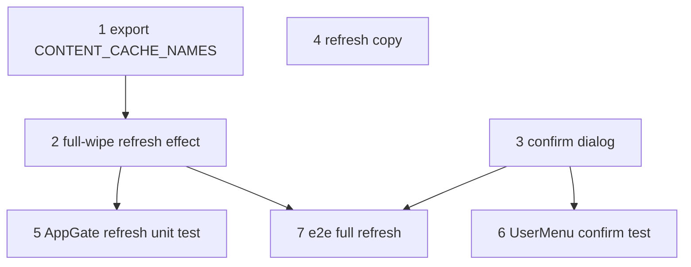

# Refresh Content = Full Wipe + Re-download

**GitHub**: [#89](https://github.com/makaravind/experium-ai-tour-app/issues/89)
**Milestone**: m5b-offline-hardening
**Status**: NOT STARTED

---

## Context

#78 shipped "Refresh content" (More menu → `UserMenu`) as a **gap-fill**: it clears the saved dataset and re-runs `AppGate`, which re-queries Supabase and downloads only audio missing from Cache Storage. Already-cached audio is kept, failure counts are kept, and the map tiles are never touched. Only debug sessions wipe `audio-cache` first.

The offline audit found this leaves residue a visitor can't clear:
- audio re-recorded at the same URL keeps playing the old version (CacheFirst, no revalidation);
- assets that hit the retry cap stay capped forever, because `assetFailures` survives a refresh (`lib/precache.ts:175`);
- `park.pmtiles` is cached by pathname forever (`app/sw.ts:79-87`), so new drone imagery never arrives;
- audio for URLs no longer in the dataset lingers and counts toward the 170-entry limit.

The decision (offline audit, 2026-10-21) keeps the data model of #78: no automatic refresh, because exhibit data is mostly static. But **the Refresh button becomes the one reliable "start over"**: wipe every piece of downloaded content, then re-download everything through the normal AppGate loading screen.

**Before**: Refresh = re-query dataset + gap-fill audio. Cached audio, map tiles, failure counts and completion flags survive.

**After**: Refresh → confirm step → wipe all content caches and content state → AppGate loading screen downloads everything again → app. The visitor's own data (identity, discoveries, pending scans, profile, language) is untouched.

---

## Architecture Decisions

### Wipe everything that is content; keep everything that is the visitor

**Decision**: Refresh deletes:

| What | Where |
|---|---|
| `audio-cache` | Cache Storage |
| `map-tiles-cache` | Cache Storage |
| `cachedExhibits`, `cachedAmenities` | persisted store |
| `assetFailures`, `completionByGroup` | persisted store |
| "Continue anyway" acknowledgements (added by offline audit #2) | persisted store |

It keeps `visitorId`, `discoveredCodes`, `totalDiscovered`, `scanQueue`, `userInfo`, `language`, `precacheLanguage`, `visitedExhibits` and `mapViewport`.

**Why**: The user asked for "no residual data" for content. Visitor data is not content. Wiping it would reset discoveries and lose queued scans, which is a different feature (log out / reset).

**Alternatives considered**: Reuse DebugPanel's `resetCache` (`components/DebugPanel.tsx:71-86`). Rejected: it also clears identity, discoveries and the scan queue, then hard-reloads.

**Consequences**: `precacheLanguage` is kept, so the re-download targets the language the visitor already chose. Audio cached for other languages is deleted along with everything else; the player's existing fallback (`PreviewSheet.tsx:116`) covers it.

### Never touch the service worker's own caches

**Decision**: Do not delete the Serwist precache (app JS/CSS/fonts) or `pages-cache`.

**Why**: These hold the app shell, not content. They are refreshed by each deploy's SW install (`app/sw.ts:22-28`). Deleting them would break offline navigation until the SW reinstalls, which a page can't trigger.

**Consequences**: "Refresh" doesn't update the app code. That's correct: code updates arrive via deploy.

### Wipe first, then download (no download-then-swap)

**Decision**: Delete the caches and state, then call `run()`. Accept that a failed re-download leaves the visitor without offline content until they retry.

**Why**: v1 simplicity. Downloading into a parallel cache and swapping would need a second cache name per group, plus SW handler changes so CacheFirst reads the right one. The risk is bounded:
- Refresh is already disabled offline (`components/more/UserMenu.tsx:90-96`);
- the confirm step (next decision) tells the visitor to use good Wi-Fi;
- a stalled or failed run lands on the visible weak-connection / fetch-error screen (offline audit #1) with "Try again".

**Alternatives considered**: Download-then-swap. Rejected as over-engineering for a rarely used button.

**Consequences**: After a mid-refresh failure, a later cold open still behaves correctly. Cache Storage is authoritative: `checkFresh` sees an empty dataset, and AppGate blocks or downloads exactly as for a first visit.

### Confirm before wiping

**Decision**: Tapping "Refresh content" (online) opens a confirm dialog instead of starting immediately.
- Copy: "Re-download all content? This deletes the saved tour and downloads it again (~X MB). Use good Wi-Fi."
- Buttons: **Re-download** (primary) and **Cancel**.

**Why**: The action is now destructive. Re-downloading tens of MB on park cellular is costly, and a failure leaves no offline content.

**Size estimate**: use `navigator.storage.estimate()` → `usage`, rounded to whole MB, as "~X MB". Content dominates origin usage, so current usage approximates what will be re-downloaded. If `estimate` is unavailable or throws, omit the "(~X MB)" clause. Don't sum `Content-Length` with HEAD requests: that means N network calls just to render a dialog.

**Consequences**: The dialog is local state in `UserMenu`. Nothing new goes in the store.

### Wipe lives in AppGate's existing refresh effect

**Decision**: Extend the `refreshRequested` effect (`components/onboarding/AppGate.tsx:181-190`):
- drop the debug-only branch (`if (useDebugStore.getState().isActive) await caches.delete('audio-cache')`);
- always delete both content caches and reset the content state;
- then `run()`.

**Why**: Same trigger path as #78; `UserMenu` stays a dumb button. The debug branch becomes redundant because every refresh is now a full wipe.

**Consequences**: Move the cache-name list `PRECACHE_CACHE_NAMES` (`components/DebugPanel.tsx:9`) into `lib/precache.ts` as an export, since AppGate and DebugPanel both need it.

```ts
// AppGate refresh effect — decision-critical shape only
await Promise.all(CONTENT_CACHE_NAMES.map((n) => caches.delete(n)))
useStore.setState({
  cachedExhibits: [], cachedAmenities: [],
  assetFailures: {}, completionByGroup: {},
  /* #2 acknowledgement field */
})
await run()
```

The order of the two wipe steps doesn't matter for correctness. Cache Storage is authoritative, so a crash between them is repaired on the next `checkFresh`.

---

## Implementation Plan

1. **Export the content cache list** (`lib/precache.ts`)
   - Add `export const CONTENT_CACHE_NAMES = ['audio-cache', 'map-tiles-cache']`.
   - Replace the local `PRECACHE_CACHE_NAMES` in `components/DebugPanel.tsx:9` with the import, and update its three uses (lines 72, 96).

2. **Make the refresh effect a full wipe** (`components/onboarding/AppGate.tsx:181-190`)
   - Replace the debug-only `caches.delete('audio-cache')` and the two `setCached*([])` calls with the wipe above.
   - Include the #2 acknowledgement field if #2 has landed. Otherwise leave a one-line note at the reset for #2 to fill in.
   - Keep the `phaseRef.current !== 'clear'` guard and the immediate `setRefreshRequested(false)`.
   - Leave `useDebugStore` imported only if still used elsewhere in the file (it is: `setPhase`).

3. **Add the confirm dialog** (`components/more/UserMenu.tsx:90-99`)
   - Online tap: close the menu, open a confirm dialog (component-local `useState`).
   - On open, read `navigator.storage?.estimate?.()` for the size line.
   - **Re-download** calls `useStore.getState().setRefreshRequested(true)`; **Cancel** closes it.
   - Offline tap: keep the existing shake animation.
   - Style it like the AppGate `Screen` card (`AppGate.tsx:39-60`): same `bg-ex-paper` card, `btn-3d-green` primary button, plus a text-style Cancel.

4. **Update the refresh copy** (`UserMenu.tsx:164-166`)
   - Online subtitle: "Delete and re-download all exhibit audio, map & data".

5. **Unit tests** (`__tests__/precache.test.ts:207-237`)
   - Extend "AppGate Refresh content": stub `caches.delete`, seed `assetFailures` / `completionByGroup` and the kept fields.
   - After `setRefreshRequested(true)`: both caches deleted, content state empty, kept fields unchanged, and `runPrecache` called after the deletes.

6. **UserMenu confirm test** (new `__tests__/user-menu.test.tsx`, or next to existing component tests)
   - Cancel leaves `refreshRequested` false.
   - Re-download sets it true.
   - The size clause is omitted when `navigator.storage` is undefined.

7. **E2E** (`e2e/offline-precache.spec.ts`)
   - Precache from `/`, count audio route hits, then open More → Refresh → confirm.
   - Expect the loading screen and a second full set of audio fetches, not zero (proves no gap-fill).
   - `audio-cache` is repopulated afterwards; `experium_visitor_id`, `discoveredCodes` and `scanQueue` are unchanged.
   - Use the helpers in `e2e/gate-helpers.ts`.

---

## Task Graph



---

## Code References

- `components/onboarding/AppGate.tsx:181-190` — current refresh effect (gap-fill + debug-only wipe); the main change.
- `components/onboarding/AppGate.tsx:96-168` — `run()`. After the wipe, `checkFresh` returns `hasDataset: false`, so it takes the full-download path.
- `components/more/UserMenu.tsx:90-99, 145-175` — Refresh row, offline guard, shake animation.
- `components/DebugPanel.tsx:9, 71-86` — existing cache list and full reset; the model for what *not* to clear.
- `lib/store.ts:144-177` — persisted fields (`partialize`); source of the wipe/keep split.
- `app/sw.ts:47-56, 78-88` — `audio-cache` and `map-tiles-cache` definitions; neither may be renamed without updating `CONTENT_CACHE_NAMES`.
- `docs/specs/gh-78-dataset-refresh.md` — the shipped behavior this spec amends.
- `__tests__/precache.test.ts:207-237` — existing refresh unit test to extend.
- `e2e/offline-precache.spec.ts`, `e2e/gate-helpers.ts` — e2e prior art.

---

## Acceptance Criteria (Technical)

- [ ] Online Refresh tap opens a confirm dialog. Cancel changes nothing: no cache deleted, `refreshRequested` stays false.
- [ ] The dialog shows "~X MB" from `navigator.storage.estimate().usage` when available, and omits it otherwise.
- [ ] Re-download deletes `audio-cache` and `map-tiles-cache` and resets `cachedExhibits`, `cachedAmenities`, `assetFailures`, `completionByGroup` and the #2 acknowledgements, before `run()` starts.
- [ ] `visitorId`, `discoveredCodes`, `totalDiscovered`, `scanQueue`, `userInfo`, `language`, `precacheLanguage`, `visitedExhibits` and `mapViewport` are unchanged after a refresh.
- [ ] The Serwist precache and `pages-cache` are untouched. Offline navigation still works right after a refresh.
- [ ] After a successful refresh, every audio URL for `precacheLanguage` is re-fetched from the network, not served from the old cache.
- [ ] A previously capped asset is attempted again on refresh.
- [ ] A refresh that fails mid-download lands on the existing visible error screens (fetch-error / weak-connection from #1), and "Try again" completes it.
- [ ] Debug sessions behave the same as normal sessions (the debug-only branch is removed).
- [ ] Offline Refresh tap: shake animation, no dialog, unchanged.

---

## Testing

- **What to test**:
  - the confirm gate;
  - the exact wipe/keep split of store fields;
  - both content caches deleted before the run;
  - end-to-end: a refresh re-fetches every asset instead of gap-filling.
- **Test type**: unit (AppGate effect, UserMenu dialog) + one e2e on the prod build.
- **Prior art**:
  - `__tests__/precache.test.ts` "AppGate Refresh content" — already renders AppGate with mocked `checkFresh`/`runPrecache`;
  - `e2e/offline-precache.spec.ts` — route-counting audio fetches and Cache Storage inspection.
- **What NOT to test**:
  - `runPrecache` internals (covered elsewhere);
  - the exact MB number;
  - dialog animation and styling.

---

## Cross-dependencies

- **Offline audit #2**: adds the "Continue anyway" acknowledgement field that this wipe must reset. Whichever lands second adds the field to the reset.
- **Offline audit #5**: makes `map-tiles-cache` a precache group. Before #5, wiping it means the map re-downloads on the first map open (today's lazy behavior). After #5, the refresh loading screen re-downloads the map too.
- **Offline audit #1**: provides the timeouts and weak-connection screen this spec relies on for a failed refresh.

---

## Out of Scope

- Automatic or background dataset refresh: rejected, data is mostly static.
- Stale "coming soon" markers for visitors who never refresh: accepted.
- Audio URL versioning: not needed, since Refresh now wipes the cache.
- Pruning orphaned ExpirationPlugin IndexedDB metadata after `caches.delete`. It's harmless: orphans are the oldest entries and get evicted first.

---

## Open Questions

- [ ] Is `storage.estimate().usage` close enough for the "~X MB" copy on iOS Safari, which reports coarse or padded values? Check on a device during the field test. **Agreed fallback: drop the number if inaccurate** (Aravind).
