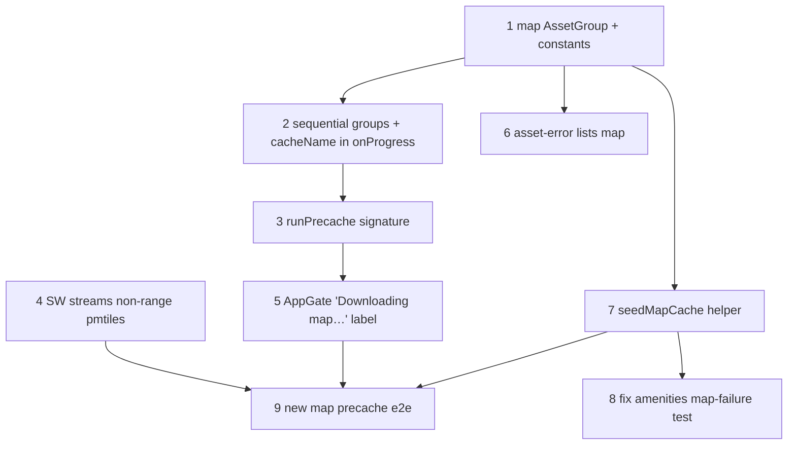

# Map Tiles in the Offline Guarantee (precache `park.pmtiles` in AppGate)

**GitHub**: [#90](https://github.com/makaravind/experium-ai-tour-app/issues/90)
**Milestone**: m5b-offline-hardening
**Status**: NOT STARTED

---

## Context

`AppGate` (#64) promises "after this screen, the tour works offline" — but it only downloads audio. The park map is `public/park.pmtiles` (**11.8 MB**), excluded from the Serwist precache manifest (`next.config.ts:22`) because the precache route can't serve byte ranges. Instead a dedicated runtime handler in `app/sw.ts:73-88` caches the whole file into `map-tiles-cache` the first time the map asks for any range. So the map only becomes offline-capable if `ParkMap` happens to mount while the visitor is online — and `ParkMap` only mounts under the `(map)` layout (`/map`, `/s/*`), never on `/`, `/collection` or `/scan`.

Result today: a Home-entry visitor (typed URL, home-screen icon → `start_url: '/'`) clears the gate, walks into the park, opens the map offline and gets `MapStub`. A QR-entry visitor gets a dark map for 90+ s on 3G while the SW downloads the full file before answering the first range request, and if they lose signal mid-download the map is never cached.

**Before**: offline guarantee = dataset + audio. Map cached opportunistically on first `ParkMap` mount.
**After**: offline guarantee = dataset + audio + map. `getAssetGroups` returns a second group `{ cacheName: 'map-tiles-cache', urls: ['/park.pmtiles'] }`. The gate downloads audio first, then the map, showing "Downloading map…" during the map step. The gate is hard: nothing renders (so `ParkMap` never mounts) until every group is in Cache Storage. Map updates reach visitors only through Refresh (#4).

---

## Architecture Decisions

### Map is a second `AssetGroup`, not a special case

**Decision**: Extend `getAssetGroups` (`lib/precache.ts:108-114`) to return `[audioGroup, { cacheName: 'map-tiles-cache', urls: ['/park.pmtiles'] }]`. No other precache plumbing changes to *include* it.

**Why**: The asset-group seam was built for exactly this (#64 "Add future asset types by returning more entries here"). Everything downstream already iterates groups: `checkFresh` → `findMissing` (mount-time gap detection), `precacheGroups` (fetch + retry cap), `runPrecache` → `setCompletionByGroup` per group, `AppGate.finish` (`groups.some(...)`). Adding a group gives gap detection, retries, the offline-abort rule and completion flags for free.

**Alternatives considered**: Put `park.pmtiles` back in the Serwist precache manifest — rejected, the precache route ignores `Range` and always returns 200 full, which the pmtiles reader rejects (the reason for `PRECACHE_EXCLUDE`). Have `ParkMap` mount hidden during the gate to warm the cache — rejected, couples the gate to MapLibre/WebGL and still gives no progress or completion signal.

**Consequences**: The map group is language-independent, so `completionByGroup['map-tiles-cache'].language` is the precache language at the time — harmless, nothing reads `language` for this group. Existing visitors with complete audio but no map will see the loading screen once on their next online launch (`checkFresh` now reports the map gap) — intended.

### Cache key compatibility: SW `url.pathname` vs `findMissing`'s `norm`

**Decision**: Keep the SW handler's cache key as `url.pathname` (`'/park.pmtiles'`). No key change needed.

**Why (verified)**: `cache.put('/park.pmtiles', …)` inside the SW resolves the relative string against the SW's location, so the stored `Request.url` is `https://<origin>/park.pmtiles`. `findMissing` (`precache.ts:130-140`) reads `cache.keys()` → absolute URLs, and `norm('/park.pmtiles')` (`precache.ts:46-52`) resolves against `location.href` → the same `https://<origin>/park.pmtiles`. Same origin, same path, no query → match. `ParkMap` requests `pmtiles:///park.pmtiles` (`ParkMap.tsx:261`), which the pmtiles `Protocol` fetches as `/park.pmtiles` with a `Range` header → same handler, same key → served from the cached full copy via `createPartialResponse`.

**Consequences**: The group URL must stay exactly `'/park.pmtiles'` (no `?v=`); a query string would be dropped by the SW key (`url.pathname`) but kept by `norm`, causing a permanent "missing" gap.

### Page-side `fetch('/park.pmtiles')` goes through the SW handler and stores the full file

**Decision**: The precache step for the map is a plain non-range `fetch('/park.pmtiles')` from the page via the existing `realDeps.fetchAsset` (`precache.ts:121-125`). The SW handler is changed so a **non-range** request streams the body to the page while storing it, instead of waiting for the whole store first.

**Why (verified + the one required SW change)**: The matcher (`sw.ts:78`, pathname ends with `.pmtiles`) matches the page fetch, the handler misses the cache, fetches `url.href` and `cache.put`s the full 200 response — so yes, a non-range page fetch caches the whole file today. **But** the handler does `await cache.put(url.pathname, full.clone())` *before* returning (`sw.ts:84-86`): `put` reads the entire 11.8 MB clone, so the page receives response headers only after the full download. That collides with #1's "15 s with no bytes" idle timeout — the page would see zero bytes for the whole download and abort on any link slower than ~6 Mbps. Fix: for non-range requests, tee the body, start the put on one branch (kept alive with `event.waitUntil`), return the other branch immediately. Bytes flow to the page as they arrive, so the idle timer behaves. Range requests (the map's own reads) keep awaiting the stored copy, since they must be sliced from it.

```ts
// sw.ts pmtiles handler, miss path — decision-critical shape only
const net = await fetch(url.href)
if (!net.ok || !net.body) return net
const [toCache, toPage] = net.body.tee()
const stored = cache.put(url.pathname, new Response(toCache, net))
event.waitUntil(stored)
if (request.headers.has('range')) {
  await stored
  return createPartialResponse(request, (await cache.match(url.pathname))!)
}
return new Response(toPage, net)
```

**Alternatives considered**: Exempt the map from #1's idle timeout (total timeout or none) — rejected, a stalled 11.8 MB download is exactly the hang #1 exists to kill. Fetch the map with a `Range: bytes=0-` header from the page — rejected, still hits the same await-before-respond path.

**Consequences**: The page can finish reading its branch a few ms before `put` commits. `findMissing` after the run, and #3's per-file save check, could then see the map as missing. `fetchAsset` must not count the map done until it's in the cache: #3's verification should re-check briefly (e.g. poll `caches.match` up to ~2 s) before declaring "not saved". This must be coordinated with #3.

### Order: audio first, then map; groups run sequentially

**Decision**: `precacheGroups` processes groups **in array order, one group at a time** (audio group fully drained, including its retry rounds, before the map group starts), instead of flattening all groups into one queue (`precache.ts:173-175`). `onProgress` gains a third argument, the cacheName of the group currently downloading: `onProgress(fetched, total, cacheName)`.

**Why**: User decision: audio is the core content, so it gets the bandwidth first. A flattened queue with concurrency 6 would download the 11.8 MB map in parallel with the first audio files on a thin link. Sequential groups also give `AppGate` an unambiguous signal for the label.

**Alternatives considered**: Keep one queue but sort the map last — rejected, the map would still start while the last 5 audio files download, and "which step are we in" becomes fuzzy. Two separate `precacheGroups` calls from `runPrecache` — rejected, duplicates the progress/total bookkeeping and the final verification.

**Consequences**: An offline abort during audio stops the whole run (map not started) — same as today's offline rule. Capped or failed audio files do **not** stop the map group; the run continues to the next group and the final result reports both.

### Progress label: "Downloading map…" (count-based, not byte-weighted)

**Decision**: Progress stays count-based: `total = audio files + 1`. While the map group runs, `AppGate`'s label is `Downloading map…` instead of `Downloading {n} of {total}`. The bar sits at `N/(N+1)` (~98%) during the map download.

**Why**: User decision (A1). Byte-weighted progress needs `Content-Length` for every asset up front (HEAD requests or a reader-loop byte counter). That's more code for a cosmetic gain, and the label already explains the pause.

**Alternatives considered**: Byte-weighted progress (A2) — rejected per user.

**Consequences**: A visitor on a slow link sees ~98% for a long time. The label is the mitigation; field testing may revisit this.

### Hard gate: no in-flight dedupe guard in the SW

**Decision**: No module-level "download in progress" promise in the SW handler. The gate blocks all children until every group is cached, so `ParkMap` never mounts before the map file is stored.

**Why**: User decision. The duplicate-download problem (multiple `ParkMap` mounts each starting a full fetch) only exists when the map mounts before caching. Under the hard gate that can't happen on the precache path.

**Consequences**: Residual duplicate-fetch paths remain only when a visitor bypasses the gate: "Continue anyway" with the map capped, the debug `NO_PRECACHE_KEY` escape hatch, or the offline-with-dataset pass-through (`AppGate.tsx:133-135`). In those cases the old slow behaviour returns (first range request waits for the full download; possible double download). Accepted.

### Map updates only via Refresh

**Decision**: No build-hash versioning of `park.pmtiles`. A new drone image reaches a visitor only when they tap Refresh content, which (#4) wipes `map-tiles-cache` along with all other content caches.

**Why**: User decision. The map changes rarely, and #4 already defines Refresh as a full wipe and re-download.

**Consequences**: After a deploy with new tiles, visitors who don't refresh keep the old imagery indefinitely. No correctness risk: the file is self-contained.

---

## Implementation Plan

1. **`lib/precache.ts` — add the map group.** In `getAssetGroups` (`:108-114`), append `{ cacheName: 'map-tiles-cache', urls: ['/park.pmtiles'] }` after the audio group. Define `MAP_CACHE = 'map-tiles-cache'` and `MAP_URL = '/park.pmtiles'` in a tiny dependency-free module (e.g. `lib/cache-names.ts`) so `sw.ts`, `precache.ts`, `AppGate` and tests share them. Don't import `lib/precache.ts` from `sw.ts`: it pulls in Supabase and the zustand store. Update the JSDoc ("One group today…").

2. **`lib/precache.ts` — run groups sequentially and report the active group.** Restructure `precacheGroups` (`:146-219`) so the retry loop (`:179-205`) runs per group in array order. Keep a single `fetched`/`total` across groups so the bar is continuous. Change the `onProgress` type to `(fetched, total, cacheName) => void`. Offline (`offline = true`) and cancellation break out of the outer group loop too. The final `findMissing` verification (`:208`) is unchanged.

3. **`lib/precache.ts` — thread the new callback signature through `runPrecache`** (`:225-245`). The signature change is type-only; the callback is passed through as-is.

4. **`app/sw.ts` — stream non-range pmtiles fetches.** In the pmtiles handler (`:79-87`), on a cache miss: tee the network body, start `cache.put` on one branch under `event.waitUntil`, return the other branch for non-range requests, and await the put then slice for range requests (see the decision snippet). Hit path unchanged. Read `event` from the handler options (Serwist `RouteHandlerCallbackOptions`). Don't cache non-ok responses (unchanged: return them as-is).

5. **`components/onboarding/AppGate.tsx` — label.** In the `runPrecache` progress callback (`:146-149`), when `cacheName === 'map-tiles-cache'` set the label to `Downloading map…`, otherwise `Downloading {fetched} of {total}`.

6. **`components/onboarding/AppGate.tsx` — asset-error screen lists the map.** `cappedExhibits` (`:205-208`) only knows audio URLs, so a capped map shows an empty or incomplete list. Add a "Park map" row when `assetFailures['/park.pmtiles']` (normalized) is at the cap, or when the map group is incomplete. Coordinate with #2 (reworks this screen: Try again, acknowledged set) and #3 (never-empty list with reasons). Whichever lands later must keep the map row. The same applies to the "only capped gaps left" mount check (`:128`): it already iterates all gaps, so it covers the map automatically.

7. **e2e helpers — seed the map cache.** Add `seedMapCache(page, body?)` to `e2e/gate-helpers.ts`, mirroring `seedAudioCache` (`:78-90`): put a response under `/park.pmtiles` in `map-tiles-cache` at every document load. Default body: the real `public/park.pmtiles` bytes so maps render. Wire it wherever `seedAudioCache` is used by specs that expect to pass the gate without exercising the download.

8. **e2e — update `amenities.spec.ts:140-148` ("map failure hides chips…").** It aborts `**/park.pmtiles`. Under the hard gate that now fails the *gate*, not the map. Instead seed `map-tiles-cache` with garbage bytes so the gate passes and the pmtiles reader fails at `ParkMap` mount (→ `onLoadError` → stub). Keep the assertions.

9. **e2e — new map precache tests** in `e2e/offline-precache.spec.ts` (see Testing).

---

## Task Graph



---

## Code References

- `experium-ai-tour-app/lib/precache.ts:108-114` — `getAssetGroups`, the seam to extend
- `experium-ai-tour-app/lib/precache.ts:146-219` — `precacheGroups`: flattened queue (`:173-175`), workers (`:182-199`), final verification (`:208`)
- `experium-ai-tour-app/lib/precache.ts:46-52, 130-140` — `norm` + `findMissing` (cache-key comparison)
- `experium-ai-tour-app/lib/precache.ts:225-245, 253-261` — `runPrecache`, `checkFresh`
- `experium-ai-tour-app/app/sw.ts:73-88` — pmtiles runtime handler (cache key `url.pathname`, await-put-then-respond)
- `experium-ai-tour-app/next.config.ts:18-22` — why pmtiles is excluded from the precache manifest
- `experium-ai-tour-app/components/onboarding/AppGate.tsx:118-157` — run flow; `:146-149` progress callback; `:205-208, 267-292` asset-error list
- `experium-ai-tour-app/components/map/ParkMap.tsx:251-262` — `Protocol` registration and `pmtiles:///park.pmtiles` source; `:522` error handler (#6)
- `experium-ai-tour-app/e2e/gate-helpers.ts:78-90` — `seedAudioCache` pattern to copy
- `experium-ai-tour-app/e2e/offline-precache.spec.ts:12-69` — fresh-visitor precache then offline, model for the new test
- `experium-ai-tour-app/e2e/amenities.spec.ts:140-148` — test that breaks under the hard gate
- `docs/specs/gh-64-upfront-precache.md` — asset-group seam and gate design
- `docs/specs/m2b-maplibre-pmtiles-migration.md` — pmtiles URL form, file origin

---

## Acceptance Criteria (Technical)

- [ ] `getAssetGroups()` returns the audio group first and `{ cacheName: 'map-tiles-cache', urls: ['/park.pmtiles'] }` second
- [ ] A fresh online visitor entering at `/` passes the gate only after `caches.open('map-tiles-cache')` contains `<origin>/park.pmtiles` with the full file length
- [ ] No map request starts until every audio file has been attempted (including retry rounds); verified via request order in e2e
- [ ] While the map downloads, the loading screen shows `Downloading map…`
- [ ] A non-range `fetch('/park.pmtiles')` from the page receives body bytes progressively (first chunk before the full file is stored), so #1's 15 s idle timeout doesn't fire on a slow-but-flowing link
- [ ] After the gate, Home-entry → offline → `/map` renders raster tiles (not `MapStub`)
- [ ] Cold open with complete audio but missing map, online → loading screen runs once (map only) → clear
- [ ] A capped map download appears as "Park map" on the asset-error screen
- [ ] Existing e2e suite passes, with `amenities.spec.ts` map-failure test reworked to seeded-garbage pmtiles

---

## Testing

- **What to test**: externally visible gate behaviour and offline map rendering: request order (audio before map), the label during the map step, map rendering offline after a Home-entry gate, one-time catch-up for an audio-complete/map-missing visitor, capped-map listing.
- **Test type**: e2e (Playwright, prod build. The SW is disabled in dev, `next.config.ts:46`). One unit test for `precacheGroups` sequential ordering with fake deps (it already takes `listCached`/`fetchAsset`/`isOnline` injection).
- **Prior art**: `e2e/offline-precache.spec.ts` ("fresh visitor precaches on load, then exhibit works offline") for the precache-then-offline shape. `e2e/language-switch.spec.ts:242` ("abort: language switch cancels stalled download") for stalled-route handling. `lib/precache` unit tests (fake `PrecacheDeps`) for ordering.
- **What NOT to test**: internal tee/stream mechanics of the SW handler, pmtiles reader internals, exact percentage values.
- **Note**: compare against the known 8 mobile-chrome e2e baseline failures on `main`, not a clean run.

---

## Cross-dependencies

- **#1 (timeouts)**: the 15 s no-bytes idle timeout applies to the 11.8 MB map download. Step 4 (streaming) is what makes that work; without it the map always times out on links under ~6 Mbps. Land #1 and #5 together, or #5's step 4 first.
- **#3 (save verification)**: per-file "saved?" check must tolerate the tee/put commit lag (brief re-check) and must cover the map group. #3's "stop after 3 not-saved in a row" counts per run. One map file can't trip it alone, but storage-full is most likely to surface on the map, so its message should apply.
- **#4 (full Refresh)**: the Refresh wipe must delete `map-tiles-cache` (today the debug refresh deletes only `audio-cache`, `AppGate.tsx:185`).
- **#2 (failure counting)**: the map URL participates in `assetFailures` like any audio URL. Only 404/410 count once #2 lands.
- **#6 (map error recovery)**: with the map guaranteed cached, `ParkMap` startup errors should become rare. #6's Retry strip remains the fallback for gate-bypass paths.

---

## Open Questions

- [ ] Does the SW build (`@serwist/next` bundling `app/sw.ts`) resolve the `@/lib/cache-names` alias, or should the constants be duplicated in `sw.ts` with a comment? — implementer, check at build time
- [ ] Storage quota on low-end Android/iOS for ~12 MB map + all audio across 3 languages: any eviction seen in the field? — field test
