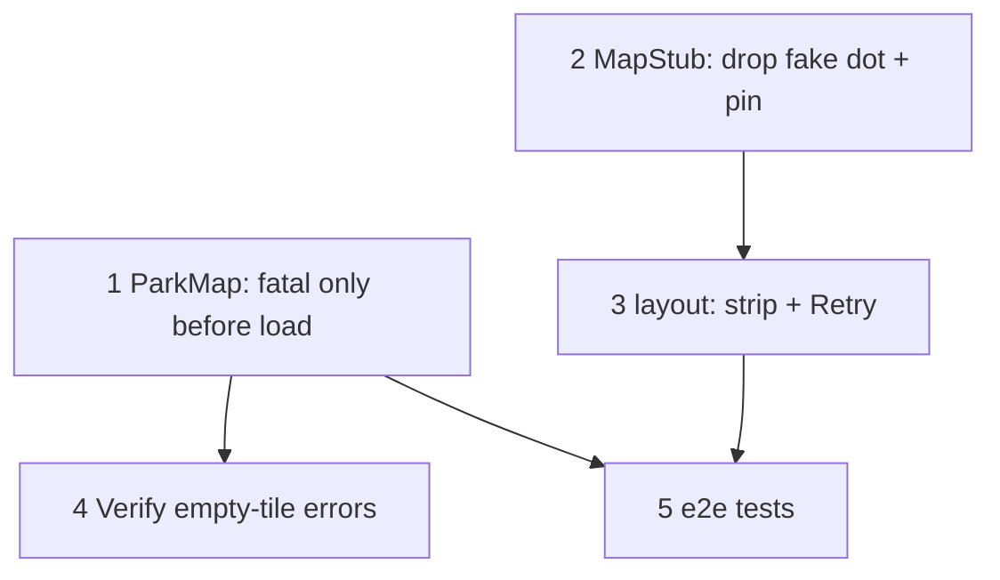

# Map Error Recovery (startup-only fatal errors, Retry strip, honest fallback)

**GitHub**: [#91](https://github.com/makaravind/experium-ai-tour-app/issues/91)
**Milestone**: m5b-offline-hardening
**Status**: NOT STARTED

---

## Context

`ParkMap` wires MapLibre's `error` event straight to `onLoadError` (`components/map/ParkMap.tsx:522`). MapLibre emits `error` for *any* failure — a single raster tile that fails to load or decode, a source error, a transient fetch — not just "the map couldn't start". `MapShell` (`app/(map)/layout.tsx:42`) turns that into `mapFailed = true`, which is never reset. Because the `(map)` layout stays mounted across `/map` and `/s/*`, the visitor loses the real map for the rest of the session: amenities pill/sheet hidden (`layout.tsx:143, 293, 310`), search skips fly-to and jumps to the exhibit page (`layout.tsx:175, 197`; `SearchOverlay.tsx:134, 216`), GPS/nearby stops (ParkMap is unmounted).

The replacement, `MapStub` (`components/exhibit/MapStub.tsx`), is an illustration with a fake GPS dot (`MapStub.tsx:~67`) and a fake exhibit pin (`MapStub.tsx:~94`). Nothing tells the visitor the map is unavailable, so a visitor can read the fake dot as their real position.

**Before**: one bad tile mid-pan → fake drawing for the whole session; only a full reload recovers.

**After**: only a failure before the map's `load` event counts as fatal. Post-load errors are logged to the debug panel and ignored (MapLibre already leaves the bad tile blank and carries on). When the map does fail, a top strip reads "Map couldn't load — Retry"; Retry mounts a fresh `ParkMap`. The fallback is a plain background — no fake dot, no fake pin.

This pairs with offline audit #5 (map file in the upfront download): once `park.pmtiles` is guaranteed cached before the app opens, startup failures should be rare, so the remaining risk is post-load noise — which is exactly what this spec stops treating as fatal.

---

## Architecture Decisions

### Fatal = error before `load`; everything after is non-fatal

**Decision**: `ParkMap` tracks a local `loaded` flag, set as the first line of the `map.on('load')` handler (`ParkMap.tsx:280`). The `error` handler calls `onLoadError()` only while `loaded` is false. After load, it logs the error and returns.

**Why**: Before `load`, an error means the style/source/protocol never came up — there is no usable map. After `load`, MapLibre handles tile-level failures itself (blank tile, keeps rendering); tearing down a working map for one tile is strictly worse for the visitor.

**Alternatives considered**:
- Inspect the error (e.g. `sourceId === 'park'`, error message) and decide per type — more precise but brittle against MapLibre/pmtiles message changes; the load boundary is a stable, simple rule.
- Count errors and fail after N — arbitrary threshold, still kills a working map.

**Consequences**: If the map breaks badly *after* load (e.g. every tile failing), the visitor sees a mostly dark map rather than the fallback. Accepted: the map file is fully cached after #5, so this is unlikely, and the debug panel shows the errors.

### Post-load errors go to the debug panel, not the UI

**Decision**: Post-load errors call `useDebugStore.getState().logApi('map error', { message })` plus a `console.warn('[map] …')`, matching the `[precache]` / `[audio]` log-prefix style.

**Why**: Field testing needs visibility into tile errors without showing anything to visitors. `logApi` already exists (`lib/debug-store.ts:55`) and renders in `DebugPanel`.

**Alternatives considered**: a new `mapErrors` slice in the debug store — extra state for one caller; `logApi` is sufficient.

### Retry = clear `mapFailed`; the conditional render remounts `ParkMap`

**Decision**: The strip's Retry button calls `setMapFailed(false)`. Since `layout.tsx:215` renders `ParkMap` only when `!mapFailed`, flipping the flag mounts a brand-new `ParkMap`: new `maplibregl.Map`, new `pmtiles` `Protocol`, re-run of the init effect. No `key` bump is needed.

**Why**: The user-approved behaviour is "remount ParkMap". The existing conditional already guarantees a fresh mount — a `key` counter would be redundant state. The unmount path already cleans up (`map.remove()`, `removeProtocol('pmtiles')`, trigger resets — `ParkMap.tsx:524-532`), so a remount starts clean.

**Alternatives considered**: `key={mapKey}` bump — equivalent result, one extra piece of state. Use it only if a future change keeps `ParkMap` mounted while failed.

**Consequences**: Retry while offline with the map file uncached fails again and the strip stays — correct, visible behaviour.

### Failure strip at the top, replacing the GPS banner while failed

**Decision**: When `mapFailed`, render a top strip (`role="alert"`) styled like the existing GPS banner (`layout.tsx:228-249`: absolute, top 0, full width, `zIndex: 30`, small text + pill button): "Map couldn't load" + a "Retry" button. While `mapFailed`, the GPS banner is not rendered.

**Why**: Same position and visual language as the only existing strip, so it reads as a system message, not content. Both banners occupy `top: 0`; showing both would overlap. GPS state is meaningless without a map (ParkMap is unmounted, `geoError` may be stale), so the map strip wins.

**Alternatives considered**: stacking the two strips — extra layout work for a state where GPS info is useless.

**Consequences**: Strip colour: reuse the GPS banner's yellow (`bg-yellow-300 text-black`) unless design says otherwise (see Open Questions).

### Honest fallback: plain background only

**Decision**: `MapStub` keeps only its background (gradient + optional decorative terrain is acceptable) and drops the GPS dot block and the exhibit pin block. The `discovered` prop is removed (it only coloured the fake pin), and the call site `layout.tsx:216` is updated.

**Why**: The fake dot/pin look like real location data. With the strip carrying the message, the background just needs to not lie. The file's own header comment already marks it as a placeholder.

**Alternatives considered**: delete `MapStub` entirely and render a solid `bg-ex-bg` div — also fine; keeping the component with only the background is the smaller diff. Either satisfies the decision; prefer whichever is fewer lines.

**Consequences**: `listenedCurrentExhibit` is no longer read in `layout.tsx` for the stub; remove the selector if nothing else uses it (check before removing).

---

## Implementation Plan

1. **`ParkMap.tsx` — gate fatal errors on `load`.** Inside the init effect add `let loaded = false`. Set `loaded = true` as the first statement of the `map.on('load', …)` handler (before the `cancelled` check is fine either way; just before any `await`). Replace `map.on('error', onLoadError)` (`:522`) with a named handler: if `!loaded` → `onLoadError()`; else → `console.warn('[map] error after load', e.error?.message)` and `useDebugStore.getState().logApi('map error', { message: e.error?.message })`. Update the matching `map.off('error', …)` in cleanup (`:528`) to the same named handler.

2. **`MapStub.tsx` — remove fake dot and pin.** Delete the "GPS dot" block and the "Current exhibit pin" block, the `discovered` prop, the now-unused `PinIcon` import and the unused `MAP.gps*` / `pinShadow` palette entries. Keep the background.

3. **`app/(map)/layout.tsx` — failure strip + Retry.** Update the `MapStub` call (`:216`) to drop `discovered`. Add the strip: rendered when `mapFailed`, same classes/position as the GPS banner, text "Map couldn't load", button "Retry" → `setMapFailed(false)`. Change the GPS banner condition (`:228`) to `geoError && !mapFailed`. Remove the `listenedCurrentExhibit` selector (`:48`) if step 3 leaves it unused.

4. **Verify the empty-tile question (see Open Questions)** on a local prod build: pan to the edges of the ortho at zoom 18–19 with DevTools console open and the debug panel on; note whether `map error` entries appear. Record the result in this spec. This doesn't change the code (post-load errors are ignored either way), but it tells us how noisy the log will be in the field.

5. **e2e tests** (see Testing).

---

## Task Graph

---

## Code References

- `experium-ai-tour-app/components/map/ParkMap.tsx:250-278` — map construction (inline style, `pmtiles:///park.pmtiles` source).
- `experium-ai-tour-app/components/map/ParkMap.tsx:280` — `map.on('load')` handler; where `loaded = true` goes.
- `experium-ai-tour-app/components/map/ParkMap.tsx:522-532` — error wiring and cleanup (`map.remove`, `removeProtocol`).
- `experium-ai-tour-app/app/(map)/layout.tsx:42, 143, 175, 197, 215-225, 293, 310` — every `mapFailed` read/write.
- `experium-ai-tour-app/app/(map)/layout.tsx:228-249` — GPS banner; the strip pattern to copy.
- `experium-ai-tour-app/components/exhibit/SearchOverlay.tsx:134, 216` — map-failed search behaviour (unchanged).
- `experium-ai-tour-app/components/exhibit/MapStub.tsx` — fallback to simplify.
- `experium-ai-tour-app/lib/debug-store.ts:35, 55` — `logApi`.
- `docs/specs/m2b-maplibre-pmtiles-migration.md` — why the style is inline and how the pmtiles protocol is registered.
- `docs/specs/offline-audit-05-*.md` — map file in the upfront download (makes startup failures rare).

---

## Acceptance Criteria (Technical)

- [ ] An `error` event emitted before `load` sets `mapFailed` (fallback + strip shown).
- [ ] An `error` event emitted after `load` does **not** set `mapFailed`; the real map stays; a `map error` entry appears in the debug store's `apiLog`.
- [ ] While `mapFailed`, a top strip with "Map couldn't load" and a "Retry" button is visible; the GPS banner is not.
- [ ] Tapping Retry mounts a fresh `ParkMap`; if the map file is now reachable, the map renders and the strip disappears; if not, the strip comes back.
- [ ] The fallback renders no GPS dot and no pin; `MapStub` has no `discovered` prop.
- [ ] Existing map-failed behaviour is otherwise unchanged (amenities pill hidden, search opens exhibit pages directly).
- [ ] `npm run lint` and `npm run build` pass.

---

## Testing

- **What to test**: visible behaviour on map startup failure, post-load failure, and Retry.
- **Test type**: e2e (Playwright, prod build).
- **Prior art**: `e2e/amenities.spec.ts:140` — "map failure hides chips, pill and sheet" uses `page.route('**/park.pmtiles', (route) => route.abort())` to force a startup failure. Extend that file or add `e2e/map-error.spec.ts`:
  1. **Startup failure → strip → Retry recovers**: abort `park.pmtiles`, open `/map`, expect the strip; `page.unroute`, click Retry, expect the strip gone and the map canvas present.
  2. **Post-load error is ignored**: open `/map`, wait for map ready, then fire an error on the live map (e.g. `page.evaluate` on the map instance if exposed in debug, or route a subsequent tile range to fail — whichever is reliable); expect no strip and the Amenities pill still visible.
  3. **Honest fallback**: in the startup-failure state, assert no GPS-dot / pin element is rendered.
- Note: if the e2e run has the service worker active and `park.pmtiles` already cached, `page.route` may not intercept the SW's fetch — follow whatever the existing amenities test does to get a reliable failure.
- **What NOT to test**: MapLibre internals, exact error messages, debug-panel rendering.

---

## Open Questions

- [x] **Do empty pmtiles tiles inside the ortho bounds emit MapLibre `error` events?** Verified 2026-10-22 on a local prod build (impl/gh-91): panned to ortho edges at zoom ~19; no `[map] error after load` console entries or debug-store `logApi` entries appeared. Empty/out-of-range tiles are handled gracefully — the debug log will be silent in the field for this case.
- [ ] **iOS WebGL context loss** after backgrounding can blank the map without an `error` event. Out of scope here; verify in the field test — owner: Aravind.
- [x] Strip colour: **reuse GPS-banner yellow** (Aravind).
