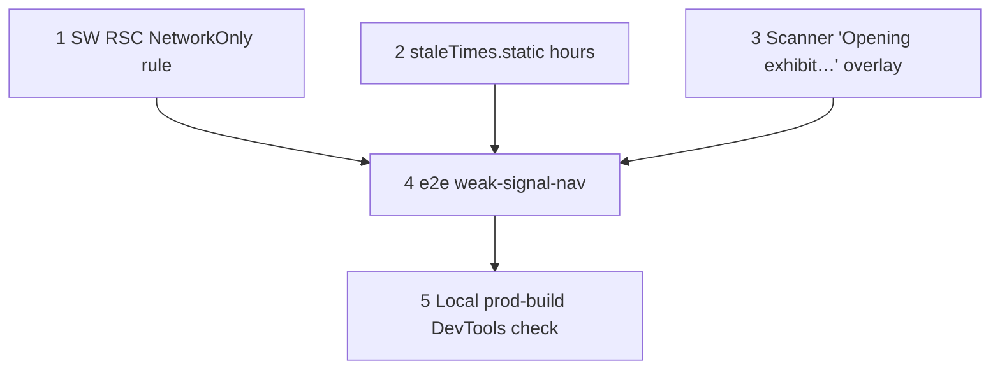

# Weak-Signal Navigation: Taps Never Hang

**GitHub**: [#92](https://github.com/makaravind/experium-ai-tour-app/issues/92)
**Milestone**: m5b-offline-hardening
**Status**: NOT STARTED

---

## Context

Every page in the app is a client page that reads the local store, and after the upfront precache the app has everything it needs. But every in-app navigation (`<Link>`, `router.push`, `router.replace`) still asks the server first: Next fetches the route's RSC payload (`?_rsc=…`, header `RSC: 1`). The service worker has no rule for those requests (`app/sw.ts:35-89` covers fonts, `.mp3`, `mode === 'navigate'` and `.pmtiles` only), so they go straight to the network with no timeout.

| Connection | What happens today | Visitor sees |
|---|---|---|
| Good | RSC fetch succeeds, client transition | instant |
| Fully offline | fetch rejects fast → Next falls back to a full browser navigation → SW serves `pages-cache` (#81) | works, full reload |
| **Weak / lie-fi** | fetch hangs until the OS gives up | **tap does nothing for seconds to minutes** |

#81 explicitly left the weak-signal row out of scope ("Dead-connection tab taps … follow up if seen on device"). In a park it is the common case. The worst instance is the in-app scanner: `app/scan/page.tsx:52` stops the camera *before* `router.replace` on line 53, so a hang leaves a black screen.

Affected taps: tab bar Home / Scan / Map (`components/exhibit/TabBar.tsx`), Home's Explore park / Scan now / My Collection, map tap on an exhibit → `/map` (`app/(map)/layout.tsx:161`), amenity search → `/map` (`:188`), search select with map failed → `/s/<code>` (`:198`), map Home button (`:259`), milestone reveal after audio (`:118`), Listen on a pin without audio → `/s/<code>` (`components/exhibit/PreviewSheet.tsx:173`), trail node → `/collection?reveal=` (`components/exhibit/TrailCard.tsx:131`), collection back / continue (`app/collection/page.tsx:23,30`), scanner redirect (`app/scan/page.tsx:53`).

**Before**: on weak signal a tap can freeze indefinitely; in-app scan goes black.
**After**: a tap either completes as a client transition or, within ~3s, becomes a full page load served from `pages-cache`. The scanner shows "Opening exhibit…" until the next page takes over. Tab-bar taps don't touch the network for hours after the first prefetch.

---

## Architecture Decisions

### RSC requests: `NetworkOnly` with a 3s timeout in the SW

**Decision**: Add a runtime rule to `app/sw.ts`, first in `runtimeCaching`:

```ts
{
  matcher: ({ request }) => request.headers.get('RSC') === '1',
  handler: new NetworkOnly({ networkTimeoutSeconds: 3 }),
}
```

Nothing is cached.

**Why**: When the payload fetch fails, Next 15.5 already does the right thing. In `node_modules/next/dist/client/components/router-reducer/fetch-server-response.js`, the `catch` (line ~152) logs "Failed to fetch RSC payload … Falling back to browser navigation." and returns `flightData: url.toString()`, which the router turns into a hard navigation. A non-OK or non-RSC response takes the same path via `doMpaNavigation` (line ~127). The hard navigation is a `mode: 'navigate'` request, so the existing `NetworkFirst` rule (3s timeout, `pages-cache`) answers from cache. The only missing piece is that a hanging fetch never fails. Serwist's `NetworkOnly` turns a slow response into a network error: `networkTimeoutSeconds` — "any network requests that fail to respond within the timeout will result in a network error" (`node_modules/serwist/dist/index.d.mts:1269-1274`). That makes the page's fetch reject, and Next falls back.

Prefetch requests (`Next-Router-Prefetch: 1`) also carry `RSC: 1` and go through the same rule. A timed-out prefetch fails silently; that's fine.

**Alternatives considered**:
- Cache RSC payloads (NetworkFirst + saved copy) — rejected. Payloads depend on `Next-Router-State-Tree` and the build ID (`fetch-server-response.js` checks `getAppBuildId() !== response.b`). A stale or mismatched copy can render the wrong tree or crash.
- Timeout in app code (wrap `router.push`) — rejected. `<Link>` navigations can't be wrapped, and the fetch lives inside Next.
- State-based exhibit navigation — deferred (see Out of Scope).

**Consequences**:
- On weak signal every tap becomes a full reload: audio playing in the map layout stops and the map re-initialises from cache. **Accepted** by product.
- Online, a slow server response over 3s also becomes a full reload. Realistically that's a Vercel cold start on `/s/<code>`, which renders on demand. The visitor still lands on the right page, just with a reload. 3s matches the navigation rule; tune after field tests.

### Keep prefetched static routes for hours (`staleTimes.static`)

**Decision**: `next.config.ts` adds `experimental: { staleTimes: { static: 6 * 60 * 60 } }` (seconds; 6 hours, roughly one park visit).

**Why**: The default is 300s (`node_modules/next/dist/server/config-shared.js:201-204`; build injects it as `__NEXT_CLIENT_ROUTER_STATIC_STALETIME`, `node_modules/next/dist/build/define-env.js:94`). `/`, `/map`, `/scan`, `/collection` are prerendered, so their auto prefetch is upgraded to a FULL entry (`prefetch-cache-utils.js:242-246`). FULL entries are reused without any request until `prefetchTime + STATIC_STALETIME_MS` (`prefetch-cache-utils.js:294-297`). With 6h, tab-bar taps after the first visible-link prefetch never hit the network. That avoids the 3s wait and the full reload.

**Consequences**:
- The router cache is in memory. A full reload (including the fallback from the first decision) empties it, and offline prefetches can't refill it. After one fallback, later taps fail fast again. Acceptable.
- `/s/<code>` is dynamic and `router.push` doesn't prefetch, so these still go to the network. They are covered by the SW rule.
- A deploy mid-visit: a stale prefetched payload from the old build is still reused for up to 6h. These pages read only the local store and render the same client components, so this is harmless. A new SW (skipWaiting) doesn't touch the in-memory router cache.
- `dynamic` stays at the default 0.

### Scanner: "Opening exhibit…" overlay until the next page takes over

**Decision**: In `app/scan/page.tsx`, a found code sets an `opening` state before `stopCamera()` + `router.replace(...)`. The page renders a full-screen overlay (spinner + "Opening exhibit…") on top of the video while `opening` is true. Nothing clears it: the overlay disappears when the scan page unmounts on a client transition, or when the document unloads on the fallback reload.

**Why**: The camera has to stop (it's in use and drains battery), but a stopped `<video>` paints black. Showing progress costs one state flag. With the SW rule, the worst case is about 3s plus a cached page load.

**Alternatives considered**: keep the last frame (draw it to the canvas and show that) — more code for no extra reassurance. Delay stopping the camera until unmount — the cleanup already does that, but a client transition keeps the camera live for up to 3s for no reason.

---

## Implementation Plan

1. **`app/sw.ts`** — import `NetworkOnly` from `serwist` (alongside `CacheFirst, NetworkFirst`). Add the RSC rule as the **first** `runtimeCaching` entry, with a one-line comment pointing at Next's fallback. RSC requests aren't `mode: 'navigate'` and aren't `.mp3`/`.pmtiles`, so order isn't strictly required; putting it first keeps it obviously ahead of anything broader added later.
2. **`next.config.ts`** — add `experimental.staleTimes.static` to `nextConfig` (`next.config.ts:7-16`), with a comment on why hours (park visit, offline taps).
3. **`app/scan/page.tsx`** — `const [opening, setOpening] = useState(false)`. In `scanFrame` (lines 50-54) call `setOpening(true)` before `stopCamera()`. Render the overlay above the viewfinder and top bar (`zIndex` above 10) with spinner + "Opening exhibit…". Match the existing toast styling (`bg-black/80`, `text-white`, `font-body`). Hide the "Not an exhibit QR code" toast and error while `opening`.
4. **`e2e/weak-signal-nav.spec.ts`** (new) — see Testing. Prod build only, same skip pattern as `e2e/offline-pages.spec.ts`.
5. Verify in a local prod build with Chrome DevTools: throttle to a custom profile with very high latency, tap Map from Home after 6+ min (clock), check that it lands within ~4s. Check the "Failed to fetch RSC payload … Falling back" console line.

Steps 1, 2, 3 are independent. Step 4 depends on 1–3 (write it first and see it fail on `main`). Step 5 is last.

---

## Task Graph



---

## Code References

- `app/sw.ts:35-89` — `runtimeCaching`; the navigation `NetworkFirst` rule (`:57-72`) that serves the fallback reload from `pages-cache`
- `next.config.ts:7-16` — `nextConfig` (headers only today); `withSerwist` wrapper below it
- `app/scan/page.tsx:48-58` — QR detected → `stopCamera()` → `router.replace`; `:145-155` existing error/toast overlays to match
- `components/exhibit/TabBar.tsx` — the `<Link>`s whose prefetch `staleTimes` extends
- `node_modules/next/dist/client/components/router-reducer/fetch-server-response.js` — `catch` → "Falling back to browser navigation"; `doMpaNavigation` for non-OK responses
- `node_modules/next/dist/client/components/router-reducer/prefetch-cache-utils.js:242-297` — prerendered → FULL upgrade; static staletime reuse
- `node_modules/serwist/dist/index.d.mts:1269-1274` — `NetworkOnlyOptions.networkTimeoutSeconds`
- `e2e/offline-pages.spec.ts:80-96` — stale-prefetch offline tab test; same shape, different network condition
- `docs/specs/gh-81-offline-pages.md` — `pages-cache` design this relies on

---

## Acceptance Criteria (Technical)

- [ ] With RSC requests hanging (never fulfilled) and stale or no prefetch, tapping Map from Home reaches `/map` and renders the map screen within 5s
- [ ] Same for an exhibit → `/map` map tap and a search/pin → `/s/<code>` push
- [ ] Online with a normal network, navigations stay client-side (no full reload; audio keeps playing across `/s/A` → `/map`)
- [ ] 6+ minutes after load (fake clock), offline, tab-bar taps complete as client transitions with no RSC request and no reload
- [ ] In-app scan of a valid code shows "Opening exhibit…" immediately; never a bare black screen
- [ ] RSC responses are never written to Cache Storage
- [ ] Existing e2e (minus the known baseline failures), vitest, lint and `tsc` pass

---

## Testing

- **What to test**: what the visitor sees — the URL and screen after a tap, timing bound, whether a reload happened (e.g. a `window` marker set before the tap survives a client transition and is gone after a reload), and the scanner overlay.
- **Test type**: e2e (Playwright, Chromium, `E2E_PROD=1`; the SW rule only exists in the prod build).
- **Cases** (`e2e/weak-signal-nav.spec.ts`):
  1. **Hanging RSC → fallback**: precache from `/`, then `page.route` matching `_rsc=` that never fulfils (keep `/map` documents served normally or from cache). Fast-forward past any prefetch, tap Map, expect `/map` + map screen within 5s, and that the marker is gone (reload happened).
  2. **Long staleTimes**: `page.clock.install()`, precache from `/`, wait for the tab-bar prefetches, go offline, `fastForward('06:00')`. Tap Map, expect `/map` with the marker still present (client transition). This replaces the current stale-prefetch assumption in `offline-pages.spec.ts:80`. Update that test's comment (it describes the 5-min refetch) but keep it as the cold-offline fallback check with `fastForward` beyond 6h.
  3. **Scanner overlay**: hard to drive a real camera. Instead, add a minimal hook: stub `getUserMedia` + `jsQR` via `page.addInitScript`, or mock the scan result by serving a fake video stream (`--use-fake-device-for-media-stream` with a QR `.y4m`). Hang RSC; expect "Opening exhibit…" visible before `/s/<code>` loads. If camera stubbing proves too costly, cover the overlay with a vitest component test of `ScanPage` with `jsQR` mocked.
- **Prior art**: `e2e/offline-pages.spec.ts` (precache helpers, clock, tab-bar locators), `e2e/language-switch.spec.ts:176` (requests that never answer), `e2e/gate-helpers.ts`.
- **What NOT to test**: Serwist's timeout internals, Next's router cache implementation, the exact 3s value.

---

## Out of Scope / Deferred

- **State-based exhibit navigation (deferred)**: make map-tap → `/map` and search/pin → `/s/<code>` change component state instead of the URL, so in-park actions never hit the router and audio never stops mid-story. Touches `app/(map)/layout.tsx`, `PreviewSheet`, and everything that reads `/s/` from the URL. Pick up as its own story if field tests show audio cut-offs from weak-signal reloads.
- Caching RSC payloads.
- Audio continuity across the fallback reload.

---

## Open Questions

- [ ] Is 3s right for the RSC timeout given Vercel cold starts on `/s/<code>` online? — revisit after field tests (product)
- [ ] 6h `staleTimes.static` — confirm it covers a full visit, including long lunch breaks — product
- [ ] Scanner e2e: fake-camera stream vs. component test — implementer's call during step 4
