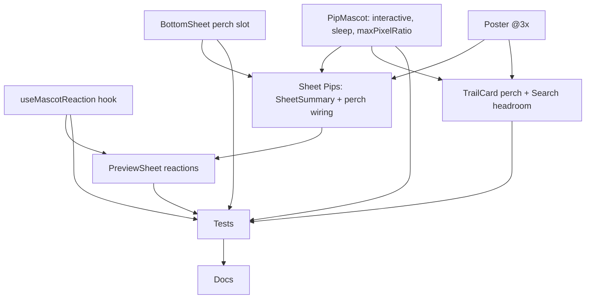

# Bigger, livelier Pip (kid delight)

**GitHub**: TBD (issue not created yet — see Open Questions)
**Milestone**: TBD
**Status**: IMPLEMENTED (2026-11-20, app `main` @ `09e6e6d`); device checks open — real-iOS `BottomSheet` drag / swipe-close (e2e ran under dummy Supabase, WebKit not run), expanded Pip over gallery dots/counters
**Builds on**: [animated-pip-mascot.md](animated-pip-mascot.md) (implemented, app `main` @ `3a9a43d`)

---

## Context

Pip ships at 62×72 (`SheetSummary`) and 48×56 (`TrailCard`) — a corner icon. The goal is for kids to love it: bigger, perched like a character, reacts to touch and to what's happening.

| Spot | Before | After |
|---|---|---|
| Exhibit/amenity sheet, collapsed | 62×72 in a slot right of the name; name column reserves `pr-16` | ~108 px, **perched on the sheet's top-right edge**, top third over the map; name column full width |
| Exhibit/amenity sheet, expanded | same corner slot | separate ~110 px Pip **straddling the gallery's bottom-right edge**; crossfades with the collapsed one |
| `TrailCard` (home + search) | 48×56 inline | ~104 px, **perched on the card's top edge**, left of the ⓘ button |
| Behaviour | `idle` / `speaking` / `celebrating` (trail), no touch | tap → hop; event reactions; falls asleep when ignored |

Out of scope: `LoadingScreen` (stays 112 px), new characters/palette, sound effects, `CardReveal`/milestone overlay.

---

## Architecture Decisions

### Perch outside the sheet's scroll container via a `BottomSheet` slot

**Decision**: `BottomSheet` splits into an outer draggable wrapper (fixed, `y`, drag, shadow, `height: fullH`; **no** overflow clip) and an inner `div` that keeps `rounded-t-3xl overflow-y-auto overflow-x-clip bg-ex-paper`. A new optional `perch?: ReactNode` prop renders inside the outer wrapper in an absolutely positioned container (`right: 16px`, `top: 0`, above the inner scroller); the consumer offsets its Pip upward. **As built:** `SheetPerchPip` is 108 px with `-translate-y-[70px]` (~65% of the box above the edge, feet at the handle row, ~29 px inside the sheet). The "top third" / `size × 0.38` figure from the mockup put Pip's feet on the name's first line at 375 px, so the no-overlap constraint won. The part of Pip inside the sheet must not cover the name, Featured pill or type badge (verify at 375 px; if it does, lift Pip higher rather than shrinking the name column). It fades out while `expanded` (opacity + `visibility: hidden`, so it cannot take taps).

**Why**: Today the sheet root is `overflow-y-auto overflow-x-clip`, which clips anything hanging above the top edge. The outer/inner split lets Pip overflow while still following the sheet's drag (same `y` motion value).

**Alternatives considered**: portal Pip to `document.body` and track `y` manually — rejected: duplicate drag math, z-index and tab-bar interplay. Keep Pip inside the sheet — rejected: that is option A (grow in place), which costs name width and reads as an icon.

**Consequences**: Highest-risk change: drag, wheel/touch scroll and `dragListener={false}` + `dragControls` must behave exactly as before. Verify with the existing e2e suite (sheet specs) and a real phone. `AmenitySheet` gets the perched Pip for free (idle only).

### Two Pip instances in the sheet, crossfaded, both kept mounted

**Decision**: Collapsed Pip lives in `perch`; expanded Pip lives in `SheetSummary` at the gallery's bottom-right (absolute, top third over the photo). Both stay mounted; the inactive one is `opacity-0 invisible`, 150 ms fade. Both receive the same `state`.

**Why**: Remounting resets `ready`, flashing the poster (and idle pose) on every expand/collapse. wobnimo shares one WebGL context and sleeps off-screen, so a second instance is cheap. `speaking` only ever occurs while expanded (`onCollapse={resetAudio}` pauses audio), so the expanded Pip is the "speaking" star.

**Consequences**: `SheetSummary` drops its in-row Pip and the `pr-16` reserve; `mascotState` prop stays but now drives the expanded Pip only (collapsed Pip is driven by `PreviewSheet`/`AmenitySheet` through `perch`).

### Tap = wobnimo `poke()`, via `interactive` + canvas pointer events

**Decision**: Drop `interactive={false}`. `PipMascot` gains an `interactive?: boolean` prop (default `false`; `true` for all three new spots). The canvas wrapper becomes `pointer-events-auto` (wrapper root stays `pointer-events-none`); `onPoke` wakes Pip (see sleep). No custom `surprised` for taps — poke already hops with a full spin and a happy face.

**Why**: wobnimo's `interactive` listens for `click` and `pointermove` on the canvas (follow + hop). Our wrapper's `pointer-events-none` currently blocks both. Reduced-motion / no-WebGL2 users get the poster only: no tap reaction (nothing to poke).

**Consequences**: Pip's box swallows taps that would hit the map beneath (~108 px square at the sheet's top-right). The sheet's `onClose` backdrop is a sibling below it, so a Pip tap does not close the sheet. Keep Pip clear of the sheet's drag handle (centered, 36 px).

### Sleep is app-driven, in the wrapper

**Decision**: `PipMascot` owns an idle timer: when the requested `state` is `idle` and ~20 s pass with no poke / state change, the effective state becomes `sleeping`. Any poke or change of `state` wakes it and restarts the timer. Never sleeps while `speaking`, `celebrating`, `sad`, `surprised` or `thinking`.

**Why**: wobnimo has no auto-sleep (its docs say to show `sleeping` after "a couple of minutes idle", app-side). Putting it in the wrapper gives every spot sleep without per-site code.

### Transient reactions via a small hook

**Decision**: `useMascotReaction()` returns `[reaction, react(state, ms)]`; `reaction` auto-clears to `null` after `ms` (timer cleared on unmount / replaced by newer reaction). `PreviewSheet` computes `pipState = isPlaying ? 'speaking' : (reaction ?? 'idle')` — `speaking` always wins.

| Trigger | State | Duration |
|---|---|---|
| Sheet opens / new exhibit selected (`PreviewSheet` only) | `surprised` | ~1.2 s |
| Audio finishes (`onEnded`) | `celebrating` | ~2 s (shows on the collapsed perched Pip, since `onEnded` auto-collapses) |
| Audio fallback (`error` / `timeout` / `missing`) or the "Needs internet to play" banner appears | `sad` | ~3 s |
| New discovery on `TrailCard` (existing) | `celebrating` | 3 s |

**Why**: Reaction state is event-driven and lives with the audio element in `PreviewSheet`; a hook keeps timer cleanup in one tested place. `AmenitySheet` has no audio → idle + tap + sleep only.

### Crisp rendering

**Decision**: Re-render `public/pip.webp` at pixelRatio 3 (~336 px, same method as step 2 of the first spec: wobnimo `snapshot(pip, { state: 'idle', size: 112, pixelRatio: 3 })` in headless Chromium → `cwebp -q 90 -alpha_q 100`). Pass `maxPixelRatio={3}` to the canvas (wobnimo default is 2).

**Why**: At ~108 px the 112 px / ratio-1 poster is visibly soft, and the poster is what shows on first paint, under reduced motion, and while the chunk loads.

### TrailCard: perch left of the ⓘ button

**Decision**: Pip ~104 px, `absolute`, `right: 44px`, `top: -44px` (card is `relative`). ⓘ button (`top-3.5 right-3.5`, 28 px) stays untouched and tappable. The lead text row keeps `pr-8` → bump to clear Pip's inside-card portion (~60 px tall). Home (`app/page.tsx`) needs no extra vertical room: Pip overlaps the empty right side of the subtitle line. The search overlay (`SearchOverlay.tsx`, TrailCard first child of an `overflow-y-auto` list) gets `pt-11` headroom above `TrailCard` so Pip is not clipped.

**Why**: Home is `fixed overflow-hidden` with a `pb-[110px]` stack; adding height risks pushing bottom content off-screen on 375×667. Pip's right edge placement keeps the ⓘ button free.

**Consequences**: The subtitle "You're on a roll — keep going." ends ≈ x 230 and Pip's left edge lands ≈ x 233 on 375 px: tight. Verify visually; fallback is a smaller Pip (~96) or `top: -36px`.

---

## Implementation Plan

1. **Poster @3x** — re-render `public/pip.webp` (see Crisp rendering). Keep the file < ~30 KB; confirm still 1:1 transparent.
2. **`PipMascot` upgrade** (`components/common/PipMascot.tsx`) — add `interactive` prop (→ wobnimo `interactive`, `pointer-events-auto` on the canvas wrapper only), `maxPixelRatio={3}`, `onPoke` wake, 20 s sleep timer (effective state), keep poster / WebGL2 / reduced-motion / `CanvasBoundary` behaviour. Poster stays `pointer-events-none`.
3. **`useMascotReaction` hook** — `lib/use-mascot-reaction.ts` (or `components/common/`): `[reaction, react(state, ms)]`, timer cleanup, newest reaction wins.
4. **`BottomSheet` perch slot** — outer/inner split + `perch` prop (see decision). No behaviour change to drag/scroll/close/peek footer.
5. **Sheet Pips** — `SheetSummary`: remove in-row Pip and `pr-16`; add expanded Pip at the gallery's bottom-right (~110 px, top third over photo; only meaningful when `expanded`, fade both ways). `PreviewSheet` and `AmenitySheet` pass the collapsed Pip through `BottomSheet`'s `perch` (~108 px, `interactive`). Size constants shared so the upward offset (≈ size × 0.38 above the edge) stays in sync. Visual target: option B in `/tmp/pip-sheet-options.html`.
6. **`PreviewSheet` reactions** — wire `useMascotReaction`: `surprised` on exhibit change, `celebrating` in `onEnded`, `sad` on fallback / banner; `pipState = isPlaying ? 'speaking' : reaction ?? 'idle'` feeds both Pips.
7. **`TrailCard` perch** — size ~104, `right: 44px; top: -44px`, `interactive`; lead row padding; `SearchOverlay` `pt-11` headroom. Existing celebrate logic unchanged.
8. **Tests** — see Testing.
9. **Docs** (outer repo, separate branch) — `docs/decisions.md` (Pip mascot section: perch, two instances, sleep/poke, reactions table), `docs/design.md` (spots table: new sizes/states), `CLAUDE.md` index line.

---

## Task Graph

---

## Code References

- `components/common/PipMascot.tsx` — wrapper (`pointer-events-none`, `interactive={false}`, `CanvasBoundary`, probe); gains interactive/sleep/pixel ratio
- `components/common/BottomSheet.tsx:139` — root `fixed … overflow-y-auto overflow-x-clip` (the clip to split); `y`, drag props, `children({expanded,collapse,expand})`
- `components/common/SheetSummary.tsx:~89` — current in-row Pip + `pr-16` column; gallery block for the expanded Pip
- `components/exhibit/PreviewSheet.tsx:73,298,349-372,389` — `isPlaying`, `onCollapse={resetAudio}`, `onEnded` (auto-collapses), `onError`/`fallbackRef`, "Needs internet" banner, `mascotState`
- `components/amenity/AmenitySheet.tsx:39` — `BottomSheet` + `SheetSummary` (idle)
- `components/exhibit/TrailCard.tsx:~140-230` — celebrate state, card (`relative`), ⓘ button `top-3.5 right-3.5`, Pip mount
- `app/page.tsx:58`, `components/exhibit/SearchOverlay.tsx:155` — TrailCard mounts (home subtitle overlap; overlay clipping)
- `node_modules/wobnimo/dist/mascot-*.d.ts` — `interactive` (follow pointer + hop on click), `maxPixelRatio` (default 2), `poke()`; `react.d.ts` `onPoke`; AGENTS.md: sleeping is app-driven
- `__tests__/pip-mascot.test.tsx`, `__tests__/trail-card.test.tsx` — prior art (module-level probe cache → `vi.resetModules()`, mocked `wobnimo/react`)

---

## Acceptance Criteria (Technical)

- [ ] Collapsed exhibit and amenity sheets show Pip ~108 px perched on the sheet's top-right edge, top third over the map; name column has full width (no `pr-16` reserve)
- [ ] Perched Pip follows the sheet while dragging, is not clipped, and is hidden (not tappable) when expanded
- [ ] Expanded sheet shows a separate ~110 px Pip straddling the gallery's bottom-right; both Pips crossfade without a poster flash
- [ ] `TrailCard` shows Pip ~104 px perched on its top edge, left of the ⓘ button (ⓘ still tappable); not clipped in the search overlay; no extra height on home
- [ ] Tapping Pip (live canvas) plays wobnimo's poke (hop + spin + happy); the tap does not close the sheet or reach the map
- [ ] Reduced-motion / no-WebGL2: poster only, no tap reaction, no sleep, no crash
- [ ] Reactions: `surprised` on sheet open / new exhibit; `speaking` while audio plays (always wins); `celebrating` ~2 s after audio ends (visible on the collapsed Pip); `sad` ~3 s on audio fallback / "Needs internet"; trail `celebrating` unchanged
- [ ] Idle Pip falls asleep after ~20 s with no poke / state change and wakes on poke or state change; never sleeps during other states
- [ ] Poster re-rendered @3x; canvas uses `maxPixelRatio` 3
- [ ] `BottomSheet` drag / scroll / swipe-close / peek-footer behaviour unchanged (existing e2e Chromium + WebKit green)
- [ ] `tsc` error count unchanged vs `main` (4 pre-existing), eslint 0 errors, unit tests green
- [ ] Docs updated (decisions, design, CLAUDE.md index)

---

## Testing

- **Unit** (vitest, `__tests__/`): 
  - `PipMascot`: `interactive` forwarded to mocked wobnimo `Mascot`; `onPoke` wakes sleeping Pip; sleep after 20 s of `idle` (fake timers) and not during `speaking`; state change wakes; poster-only (no sleep/poke) under reduced motion / no WebGL2.
  - `useMascotReaction`: sets, auto-clears after `ms`, newest wins, no state update after unmount.
  - `BottomSheet`: `perch` renders outside the scroll container, is hidden when `expanded`, existing children API unchanged.
  - `PreviewSheet` reactions (mock `PipMascot` to expose `state`): `surprised` on open, `celebrating` after `onEnded`, `sad` on error, `speaking` overrides reaction.
  - `TrailCard`: existing celebrate tests stay green; perch position classes present.
- **Prior art**: `__tests__/pip-mascot.test.tsx`, `__tests__/trail-card.test.tsx`, `__tests__/amenity-sheet.test.tsx`.
- **E2E**: existing suite (sheet open/expand/collapse/close, drag) is the regression check for the `BottomSheet` split — do not add canvas assertions; WebKit flakes stay skipped per `CLAUDE.md`.
- **Manual (real phone)**: drag/scroll feel of the sheet; perched Pip not clipped; tap hop; sleep → wake; audio finish → celebrate; Pip over home subtitle at 375×667; search overlay headroom; poster crispness on retina.

---

## Delivery

One PR in the app repo; commits in order: poster → `PipMascot` upgrade → hook → `BottomSheet` perch slot → sheet Pips → `PreviewSheet` reactions → `TrailCard` perch → tests. Docs are a separate commit/branch in the outer repo. Each commit leaves the app working.

---

## Open Questions

1. Create a GitHub issue on the project board (`makaravind` account switch) and fill in **GitHub**/**Milestone**?
2. Does the perched Pip (~108 px square) cover a map pin often enough to annoy? If so, shrink to ~96 or offset further right.
3. Home subtitle overlap is ≈3 px from touching ("You're on a roll — keep going."): confirm at 375 px; fallback is ~96 px Pip or `top: -36px`.
4. Does the `BottomSheet` outer/inner split change drag-vs-scroll behaviour on iOS Safari? (e2e is not enough; needs a device check.)
