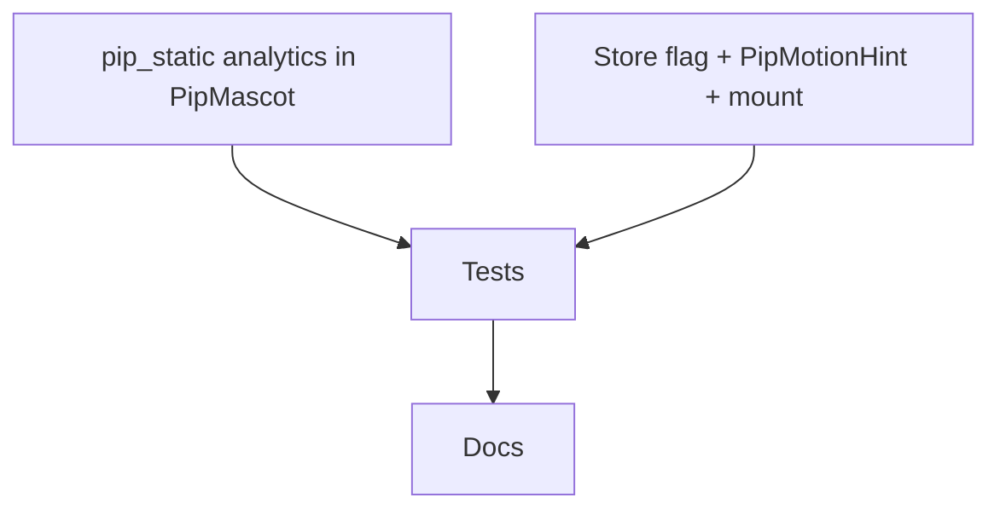

# Pip reduced-motion hint

**GitHub**: TBD (issue not created yet)
**Milestone**: TBD
**Status**: IMPLEMENTED (2026-11-20, app `main` @ `26e2710`). Defaults used for open questions: top-of-screen card, English only, `pip_static` once per page load, ready signal = `AppGate` phase `clear` + `introDone`
**Builds on**: [pip-mascot-bigger.md](pip-mascot-bigger.md), [animated-pip-mascot.md](animated-pip-mascot.md)

---

## Context

On a real iPhone Pip "stayed static". Cause: iOS **Reduce Motion** was on, so `PipMascot` correctly kept the poster (`prefers-reduced-motion`). Android worked. Working as designed, but the visitor can't tell why Pip is still.

This story adds a **one-time dismissible hint** when Pip is poster-only because of Reduce Motion, plus **analytics** to see how many visitors never see a live Pip.

Out of scope: an in-app "Let Pip move" override toggle (overrides an OS accessibility setting; later, if the numbers justify it), hints for no-WebGL2 / canvas failure (visitor can't fix those), any change to when Pip animates.

---

## Architecture Decisions

### One app-wide `PipMotionHint`, shown once

**Decision**: New `components/common/PipMotionHint.tsx` (`'use client'`), mounted once in the app shell (next to `ErrorTracker`, `app/layout.tsx`). It renders only when `matchMedia('(prefers-reduced-motion: reduce)').matches`, the persisted flag `pipMotionHintSeen` is `false`, and the loading screen is not up (wait for the gate to finish — find the existing "app ready / onboarded" signal; do not show it over `LoadingScreen`). Dismiss ("Got it") sets `pipMotionHintSeen = true`. No auto-dismiss.

**Why**: Pip appears on home, the map sheets and the loading screen, so a per-screen hint would repeat or be missed. Visitors landing straight on `/s/<code>` never see home. One shell-level component shows it once wherever they start.

**Consequences**: Re-detects reduced motion only on mount (a mid-session toggle is ignored; fine).

### Copy and platform steps

**Decision**: Title/body: "Pip is resting. Reduce Motion is on, so Pip holds still." Second line with steps by platform (UA sniff, `ios` | `android` | `other`):
- iOS: "Turn it off in Settings → Accessibility → Motion → Reduce Motion."
- Android: "Turn it off in Settings → Accessibility → Remove animations." (label varies by vendor — say "may be named differently")
- other: no steps, just the explanation.

**Why**: The visitor fixed it themselves once they knew where to look; the exact path is the useful part. Android already worked in testing, but its Reduce-motion equivalent exists and is worded differently per vendor.

### Persist a single boolean, no migration

**Decision**: Add `pipMotionHintSeen: boolean` (default `false`) + `setPipMotionHintSeen` to `lib/store.ts`, include in `partialize`. No version bump: zustand persist's default merge keeps the default for a missing key, and existing visitors should see the hint once (they never saw it).

**Why**: Unlike `lastCelebratedTotal`, a missing value means "not seen yet", which is the desired outcome.

### Analytics via `track` (`@vercel/analytics`), existing naming

**Decision**: snake_case events, no PII:

| Event | Props | When |
|---|---|---|
| `pip_static` | `reason: 'reduced_motion' \| 'no_webgl2' \| 'canvas_failed'` | Once per page load, from `PipMascot` where the probe decides (module-level "already tracked" flag so it isn't per-instance); `canvas_failed` from `CanvasBoundary.componentDidCatch` |
| `pip_motion_hint_shown` | `platform: 'ios' \| 'android' \| 'other'` | When the hint mounts visible |
| `pip_motion_hint_dismissed` | `platform` | On "Got it" |

**Why**: `pip_static` answers "how many visitors never see an animated Pip, and why" (reduced motion vs devices that can't do WebGL2 vs crashes); the hint events show whether the hint is seen and cleared.

---

## Implementation Plan

1. **`pip_static` analytics in `PipMascot`** — `track('pip_static', { reason })` once per page load (module-level flag), reasons from the existing probe (`reduced_motion` when `matchMedia` matches, `no_webgl2` when `getContext('webgl2')` is null) and `CanvasBoundary` (`canvas_failed`). Guard against SSR (`getCanAnimate` already runs client-only via `useSyncExternalStore`; keep the track call out of render — fire from an effect or the probe's first call).
2. **Store flag + `PipMotionHint`** — `lib/store.ts` flag/setter/partialize; `components/common/PipMotionHint.tsx` with the conditions, copy, platform detection (small pure helper `detectPlatform(userAgent)` in `lib/`), dismiss button, `track` calls; mount in the app shell. Follow an existing toast/card look (`DiscoveryCard`, `app/scan/page.tsx` toast) for style; must not cover the tab bar or the sheet's close controls — top-of-screen safe-area card is the default.
3. **Tests** — see Testing.
4. **Docs** (outer repo, separate branch) — `docs/decisions.md` (Pip section: hint + analytics events), `docs/design.md` (behaviours: reduced-motion hint), `CLAUDE.md` index line.

---

## Task Graph

---

## Code References

- `components/common/PipMascot.tsx` — `getCanAnimate` probe (reduced-motion + WebGL2), `CanvasBoundary`
- `lib/store.ts` — persisted store (`name: 'experium-store'`, `version: 11`), `partialize`
- `app/layout.tsx:58` — `<Analytics />`; `components/ErrorTracker.tsx` — prior art for an always-mounted client component using `track`
- `app/scan/page.tsx:156`, `components/collection/DiscoveryCard.tsx:196` — toast styling prior art
- `components/onboarding/LoadingScreen.tsx`, `AppGate` — the "app ready" signal to wait for
- `__tests__/pip-mascot.test.tsx` — prior art (module-level probe cache → `vi.resetModules()` + dynamic import; stub `matchMedia`)

---

## Acceptance Criteria (Technical)

- [ ] With Reduce Motion on and the flag unset, the hint appears once after the loading screen, not over it
- [ ] "Got it" hides it and persists `pipMotionHintSeen`; it never shows again (reload, new route)
- [ ] With Reduce Motion off, or the flag set, nothing is rendered
- [ ] iOS UA shows the iOS steps, Android UA the Android steps, anything else the explanation only
- [ ] `pip_static` fires once per page load with the right `reason` (`reduced_motion`, `no_webgl2`, `canvas_failed`); not once per Pip instance
- [ ] `pip_motion_hint_shown` / `pip_motion_hint_dismissed` fire with `platform`
- [ ] No hint for `no_webgl2` / `canvas_failed`
- [ ] Hint does not cover the tab bar or sheet close controls on 375×667
- [ ] tsc error count unchanged (4 pre-existing), eslint 0 errors, unit tests green, existing e2e unchanged

---

## Testing

- **Unit** (vitest, `__tests__/`): hint visible only when reduced motion + flag unset + app ready; dismiss sets flag and calls `track`; platform copy per UA; `detectPlatform`; `pip_static` reasons and once-per-load (mock `@vercel/analytics`, stub `matchMedia`, `vi.resetModules()` per case for the module-level flag); store default `pipMotionHintSeen === false` and persisted.
- **Prior art**: `__tests__/pip-mascot.test.tsx`, `__tests__/store.test.ts`.
- **What NOT to test**: real iOS Settings behaviour; WebGL.
- **Manual**: real iPhone with Reduce Motion on → hint appears once, steps correct; turn it off → Pip animates; Android unaffected.

---

## Delivery

One PR in the app repo; commits: store flag + `detectPlatform` → `PipMotionHint` + mount → `pip_static` analytics → tests. Docs are a separate commit/branch in the outer repo.

---

## Open Questions

1. Hint position and look: top-of-screen safe-area card (default) vs bottom toast vs reuse an existing toast style?
2. Exact copy wording (kid/parent friendly)? Hindi version needed, or English only?
3. Which signal means "app ready, loading screen gone"? (`AppGate` state or the persisted onboarded flag — implementer to confirm.)
4. Is `track('pip_static', …)` once per page load enough, or do you want it once per visitor (needs a persisted flag)?
5. Create a GitHub issue and fill in GitHub / Milestone?
