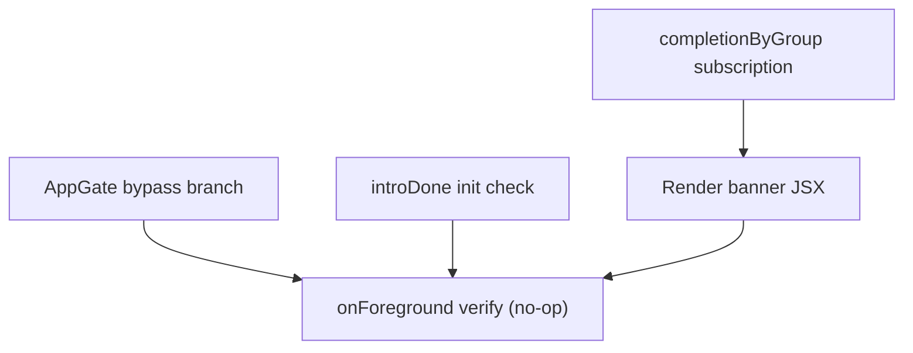

# QR-Scan Bypass + Setup Banner

**GitHub**: _(issue TBD)_
**Milestone**: _(TBD)_
**Status**: NOT STARTED

---

## Context

Today `AppGate` wraps every route in `app/layout.tsx` and blocks rendering until the full precache is complete — audio, map tiles, and the exhibit dataset. A first-time visitor who scans a QR code and lands on `/s/[code]` sees a loading screen with a progress bar before they hear a single word of narration.

This is fine for the home-screen entry path but is jarring for the QR-scan path: the visitor scanned because they want audio _right now_. The precache (which can take 30–60 seconds on a slow connection) should be a background concern, not a gate.

The filed change does two things:

1. **Bypass the gate** for direct `/s/[code]` visits — let the visitor through immediately, loading exhibit data via the live Supabase fetch that already exists in the page.
2. **Show a persistent non-blocking banner** on exhibit pages when the setup is incomplete, nudging the visitor to complete the precache by navigating to `/`.

Before: visitor scans → AppGate loading screen (up to 60s) → exhibit renders.  
After: visitor scans → exhibit renders immediately → slim top banner "App setup incomplete · Tap to finish" persists until they tap it (→ `/`, AppGate runs normally) or they've already precached (banner hidden).

---

## Architecture Decisions

### AppGate detects `/s/*` path and short-circuits `run()`

**Decision**: At the top of `run()` in `AppGate.tsx`, check `window.location.pathname.startsWith('/s/')`. If true, skip the SW wait and precache entirely; call `setPhase(nextAfterClear())` and return.

**Why**: The `/s/[code]` page already has a live-fetch fallback path (Supabase query when `cachedExhibits` is empty). There is no need to download the full cache before letting the user hear audio. The gate's only job is building the offline cache — that job can wait.

**Alternatives considered**: Bypass only when partially set up (cache warm but incomplete) — rejected, adds complexity with no user benefit. Bypass + run precache silently in the background — rejected for this issue; background precache without a visible gate creates race conditions with the existing `runningRef`/`restartRef` logic and is a separate, more involved change.

**Consequences**: A first-time QR scanner reaches the exhibit page without a `visitorId` in the store. Handled by firing `getOrCreateVisitorId()` as a fire-and-forget side effect in the bypass branch (see below). Any first-play analytics that fire before the handshake resolves will be anonymous.

### `getOrCreateVisitorId` is fire-and-forget on the bypass path

**Decision**: In the bypass branch, call:
```ts
getOrCreateVisitorId()
  .then((id) => useStore.getState().setVisitorId(id))
  .catch(() => {})
```
Do not await it. The exhibit page renders immediately; the ID lands in the store whenever the handshake resolves (~300ms for returning visitors from localStorage, ~800ms+ for first-timers).

**Why**: Awaiting the handshake reintroduces latency that defeats the bypass. The handshake is fast for returning visitors (localStorage hit) and the analytics miss on the first play of a first-timer is an acceptable tradeoff given the UX gain.

**Alternatives considered**: Block exhibit render on handshake completion — rejected (defeats the bypass). Skip handshake entirely on bypass — rejected (would lose scan attribution for first-time visitors who never go through AppGate).

### IntroScreen is skipped on the bypass path

**Decision**: `introDone` is initialised from `sessionStorage.getItem(INTRO_DONE_KEY)`. On the bypass path, also write `INTRO_DONE_KEY` to `sessionStorage` so the intro overlay never renders over the exhibit.

**Why**: A full-screen video intro playing over an exhibit the visitor is trying to hear is a worse experience than deferring the intro to the home-screen path.

**Consequences**: A first-time visitor who enters via QR scan never sees the intro video unless they navigate to the home screen in a subsequent session.

### InfoModal is kept on the bypass path

**Decision**: `nextAfterClear()` returns `'info'` if `localStorage.getItem(ONBOARDED_KEY)` is falsy, else `'clear'`. The bypass uses `nextAfterClear()` — so an un-onboarded visitor sees the InfoModal as a full-screen overlay before the exhibit renders.

**Why**: The InfoModal collects name/phone/email for personalisation — it is lightweight (one screen, fast to fill out) and tied to first-visit onboarding, not to the precache. Skipping it would mean un-onboarded users never get the personalisation prompt at all.

### Banner lives in the map shell layout and reads `completionByGroup` from the store

**Decision**: The banner strip is added to `app/(map)/layout.tsx` (the `MapShell` component). It reads `completionByGroup` from the Zustand store to determine if precache is complete, and `isExhibitPage` (already derived from `usePathname`) to gate visibility.

```ts
const completionByGroup = useStore((s) => s.completionByGroup)
const precacheComplete = Object.values(completionByGroup).some((v) => v.complete)
const showSetupBanner = isExhibitPage && !precacheComplete
```

**Why**: The map layout already renders on every `/s/[code]` and `/map` route. `completionByGroup` is reactive (Zustand subscription) — the banner disappears automatically the moment AppGate sets any group to `complete: true`, with no polling or extra state.

**Alternatives considered**: Separate banner component mounted in the exhibit page — rejected, duplicates layout concerns already owned by `MapShell`. Custom `bypassed` flag in the store — rejected, `completionByGroup` is already the canonical answer to "is the cache ready?"

**Consequences**: The banner is visible on `/map` too if the user somehow reaches the map without going through AppGate. Acceptable — the nudge is still accurate there.

### Banner is hidden when GPS or map-failure banners are active

**Decision**: Do not render the setup banner when `mapFailed || !!geoError`. Both of those banners occupy `top: 0` with `zIndex: 30` — stacking three banners there would be illegible.

**Why**: Map failure and GPS denial are more urgent and actionable in the moment. The setup banner will reappear once those conditions clear.

---

## Implementation Plan

1. **`AppGate.tsx` — bypass branch in `run()`**
   - At the top of `run()`, after the `sessionStorage.getItem(NO_PRECACHE_KEY)` check, add:
     ```ts
     if (typeof window !== 'undefined' && window.location.pathname.startsWith('/s/')) {
       // Mark intro as done so it never plays over the exhibit
       try { sessionStorage.setItem(INTRO_DONE_KEY, '1') } catch {}
       // Fire-and-forget handshake
       getOrCreateVisitorId()
         .then((id) => useStore.getState().setVisitorId(id))
         .catch(() => {})
       setPhase(nextAfterClear())
       return
     }
     ```
   - Import `getOrCreateVisitorId` from `@/lib/handshake-lock` (already imported elsewhere in the file via `idPromise`).

2. **`AppGate.tsx` — initialise `introDone` correctly on bypass**
   - The `introDone` useState initialiser already reads `sessionStorage.getItem(INTRO_DONE_KEY)`. Since step 1 writes that key before `setPhase` is called, the intro animation component will render with `introDone = true` on the next render cycle — no flash.
   - Verify: the `AnimatePresence` + `motion.div` for the intro only mounts when `!introDone`. No changes needed beyond the `sessionStorage.setItem` in step 1.

3. **`app/(map)/layout.tsx` — add `completionByGroup` subscription**
   - Add to the existing store subscriptions near the top of `MapShell`:
     ```ts
     const completionByGroup = useStore((s) => s.completionByGroup)
     const precacheComplete = Object.values(completionByGroup).some((v) => v.complete)
     const showSetupBanner = isExhibitPage && !precacheComplete && !mapFailed && !geoError
     ```

4. **`app/(map)/layout.tsx` — render the setup banner**
   - Add the banner JSX after the existing GPS error banner block and before the search bar. It must be exclusive with `mapFailed` and `geoError` (already handled by `showSetupBanner`):
     ```tsx
     {showSetupBanner && (
       <button
         type="button"
         className="absolute left-0 right-0 top-0 flex items-center justify-center gap-3 px-4 py-2 text-sm font-semibold bg-ex-forest text-white"
         style={{ zIndex: 30 }}
         onClick={() => router.push('/')}
       >
         App setup incomplete · Tap to finish
       </button>
     )}
     ```
   - Use `bg-ex-forest text-white` (green) to distinguish it from the yellow `bg-yellow-300` alert banners. It's an invitation, not a warning.
   - No dismiss button. It auto-hides when `precacheComplete` becomes true.

5. **Verify `onForeground` resume does not re-run on bypass path**
   - `onForeground` calls `run()` only when `phaseRef.current` is `'loading'`, `'blocked-offline'`, `'fetch-error'`, `'weak-connection'`, or `'storage-error'`. On the bypass path `phase` is `'clear'` or `'info'`, so no resume fires. No change needed.

6. **Manual smoke test**
   - Clear localStorage, open `/s/1` directly (simulate QR scan)
   - Exhibit should render without a loading screen
   - Banner should appear at the top
   - Tap banner → navigates to `/` → AppGate loading screen runs → precache completes → returns to app
   - Navigate back to `/s/1` → banner is gone

---

## Task Graph



Steps 1–2 can be done in the same edit. Steps 3–4 are a single edit in a different file.

---

## Code References

- `components/onboarding/AppGate.tsx` — the gate; bypass logic goes in `run()` around line 159 (after the `NO_PRECACHE_KEY` check)
- `app/(map)/layout.tsx` — map shell; banner goes after the GPS error block (~line 298), before the search bar (~line 322)
- `lib/precache.ts` — `nextAfterClear`, `runPrecache`, `checkFresh`; understand what the bypass is skipping
- `lib/handshake-lock.ts` — `getOrCreateVisitorId`; the fire-and-forget call in step 1
- `lib/store.ts:46` — `completionByGroup` shape: `Record<string, { language?: Language; complete: boolean }>`
- `app/(map)/s/[code]/page.tsx` — confirm the live-fetch path works without `cachedExhibits` (it does: falls through to Supabase query when `cached` is undefined)
- `e2e/offline-precache.spec.ts` — prior art for testing AppGate phases

---

## Acceptance Criteria (Technical)

- [ ] Visiting `/s/<code>` directly (no prior visit) renders the exhibit without showing a loading screen
- [ ] The top banner "App setup incomplete · Tap to finish" is visible on the exhibit page when `completionByGroup` has no complete entry
- [ ] Tapping the banner navigates to `/` and AppGate runs its normal precache flow
- [ ] After precache completes and the user navigates back to `/s/<code>`, the banner is not shown
- [ ] The IntroScreen video does not play when entering via `/s/<code>`
- [ ] The InfoModal does show on `/s/<code>` for un-onboarded visitors
- [ ] The banner is not shown when `mapFailed` or `geoError` is active
- [ ] A returning visitor with full cache (bypasses AppGate fast-path, `completionByGroup` has `complete: true`) does not see the banner

---

## Testing

- **What to test**: AppGate bypass (gate phase goes to `clear`/`info` immediately on `/s/*`); banner visibility conditions; banner auto-hide when `completionByGroup` updates
- **Test type**: unit (AppGate phase transitions); e2e (full flow: land on exhibit → see banner → tap → precache → return → no banner)
- **Prior art**: `e2e/offline-precache.spec.ts` — models mocking Cache Storage and asserting on AppGate phase outputs
- **What NOT to test**: `getOrCreateVisitorId` internals (already covered by its own tests); MapLibre rendering

---

## Open Questions

- [ ] Should the banner also appear on `/map` when the user navigated there without going through AppGate? (Currently yes, per the `completionByGroup` check — but the map requires the `.pmtiles` file which also isn't cached yet, so the map will fail to load anyway and the map-failure banner will take priority.)
