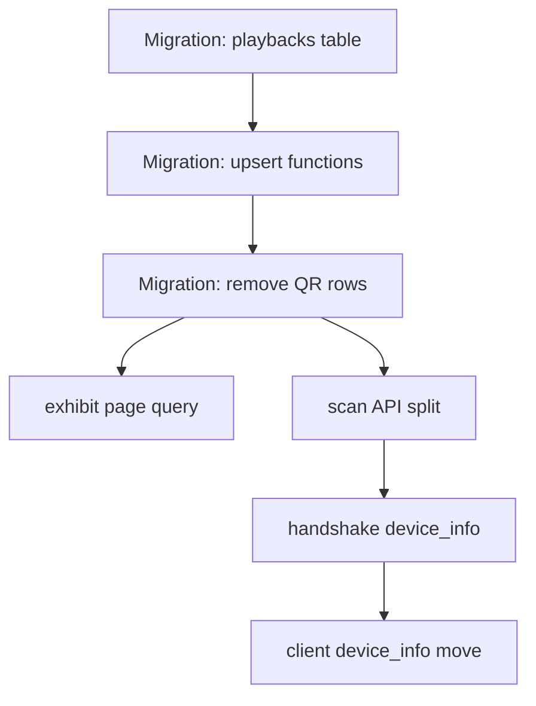

# Decouple exhibits from QR codes + split scans/playbacks

**Milestone**: m2b-ortho (batch-1 data)
**Status**: NOT STARTED

---

## Context

The exhibit page (`/s/[code]`) currently loads exhibit data by joining through `exhibit_qr_codes` — the table that tracks physical QR markers. This means every exhibit needs a QR code row to be viewable, even if no physical marker exists (map taps, link shares).

We worked around this today by seeding dummy QR code rows for the 10 batch-1 exhibits, but that's wrong: a QR code row represents a real physical marker in the park, not a prerequisite for content to exist.

Separately, the `scans` table conflates two distinct events: "visitor physically scanned a marker" and "visitor played audio". These have different semantics, different keys, and different privacy implications. Splitting them makes both cleaner.

After this change:
- Any exhibit can be opened by code (map tap, link, QR scan) without a `qr_code_id`
- Physical QR scans write to `scans` (requires `qr_code_id`, tracks discovery)
- Audio playbacks write to `playbacks` (requires `exhibit_id` only, no QR dependency)
- `device_info` moves to `users` (written on handshake, not on every scan)
- The batch-1 dummy QR code rows are removed

---

## Architecture Decisions

### Exhibit page queries `exhibits.code` directly

**Decision**: `/s/[code]/page.tsx` queries `exhibits` directly: `.from('exhibits').select('id, name, type, tier, facts, exhibit_audio(language, audio_url, status)').eq('code', parseInt(code)).single()`

**Why**: QR code metadata (which physical marker, its GPS, its install date) is irrelevant to what the page shows. The exhibit's content lives in `exhibits`, not `exhibit_qr_codes`.

**Consequences**: `exhibit_qr_codes` rows are no longer needed for the page to work. Physical QR scans still look up `qr_code_id` server-side in `/api/scan`.

---

### `scans` = physical QR only; `playbacks` = audio per exhibit

**Decision**: `scans` retains `qr_code_id NOT NULL` and tracks how many times a visitor scanned a marker + whether they were discovered. All audio columns (`listened`, `listen_duration_sec`, `listen_quartile`) move to a new `playbacks` table keyed by `(user_id, exhibit_id, language)`.

**Why**: Discovery is a physical-world event — you walked to the marker. Audio engagement is a content event — you listened. These have different replay semantics (scan count increments; playback upserts the best state) and different query shapes.

**Alternatives considered**: Keep everything in `scans` with nullable `qr_code_id` — rejected because it muddies discovery semantics and creates nullable FK with no clean unique constraint.

---

### `/api/scan` handles both writes; client unchanged

**Decision**: The server splits the incoming payload: always writes to `playbacks`; writes to `scans` only when `is_qr_scan=true` and a `qr_code_id` is found. Client sends the same shape it does today.

**Why**: Zero client changes. The endpoint already knows `is_qr_scan` from the payload.

**Consequences**: If a visitor taps an exhibit on the map and listens, only `playbacks` is written — no discovery row, no `scans` row. Correct by design.

---

### `device_info` moves to `users`

**Decision**: Write `device_info` on handshake (`/api/user/handshake`) and store it on the `users` row. Remove it from the scan/playback payload.

**Why**: Device info doesn't change per-scan. Sending it on every scan is wasteful and ties device metadata to a scan event rather than the visitor.

---

## Implementation Plan

1. **Migration: add `playbacks` table, remove audio cols from `scans`, add `device_info` to `users`**
   - `ALTER TABLE scans DROP COLUMN listened, DROP COLUMN listen_duration_sec, DROP COLUMN listen_quartile, DROP COLUMN ad_clicked, DROP COLUMN device_info`
   - `ALTER TABLE users ADD COLUMN device_info JSONB`
   - Create `playbacks` table:
     ```sql
     CREATE TABLE playbacks (
       id                  UUID PRIMARY KEY DEFAULT gen_random_uuid(),
       exhibit_id          UUID NOT NULL REFERENCES exhibits(id) ON DELETE CASCADE,
       user_id             UUID REFERENCES users(id) ON DELETE SET NULL,
       language            TEXT NOT NULL DEFAULT 'en',
       listened            BOOLEAN NOT NULL DEFAULT false,
       listen_duration_sec INT,
       listen_quartile     INT,
       played_at           TIMESTAMPTZ NOT NULL DEFAULT now(),
       updated_at          TIMESTAMPTZ NOT NULL DEFAULT now()
     );
     CREATE UNIQUE INDEX playbacks_user_exhibit_lang ON playbacks (user_id, exhibit_id, language);
     ```

2. **Migration: drop + recreate `upsert_scan`, add `upsert_playback`**
   - Drop the current `upsert_scan` (remove `listened`, `listen_duration_sec`, `listen_quartile`, `device_info` params)
   - New `upsert_scan(p_user_id, p_qr_code_id, p_is_qr_scan, p_scan_src, p_discovered, p_scanned_at)`:
     - ON CONFLICT `(user_id, qr_code_id, scan_src)` → increment `scanned_count`
   - New `upsert_playback(p_user_id, p_exhibit_id, p_language, p_listened, p_listen_duration_sec, p_listen_quartile, p_played_at)`:
     - ON CONFLICT `(user_id, exhibit_id, language)` → update audio cols (max quartile, OR listened)

3. **Migration: remove batch-1 dummy QR code rows**
   - `TRUNCATE exhibit_qr_codes CASCADE` — these were added as a workaround only; no physical markers exist yet; no scan rows exist to orphan

4. **`/s/[code]/page.tsx` — query `exhibits` directly**
   - Replace `supabase.from('exhibit_qr_codes').select('...exhibits(...)').eq('code', code)` with `supabase.from('exhibits').select('id, name, type, tier, facts, exhibit_audio(language, audio_url, status)').eq('code', parseInt(code)).single()`
   - Remove the `qr.status !== 'active'` check (that was the QR marker status, not the exhibit's). Replace with `exhibit.status !== 'live'` → `coming_soon`
   - Map `exhibit` directly to `ExhibitPageClient` props (no unwrap from `qr.exhibits`)

5. **`/api/scan/route.ts` — split writes**
   - Look up `exhibits.code` to get `exhibit_id` (required; 404 if missing)
   - If `is_qr_scan === true`: look up `exhibit_qr_codes.code` to get `qr_code_id`, call `upsert_scan` RPC
   - Always call `upsert_playback` RPC with exhibit_id + audio fields
   - Remove `device_info` from this route; it's now written on handshake

6. **`/api/user/handshake/route.ts` — write `device_info` to `users`**
   - Accept `device_info` in the handshake body
   - `UPDATE users SET device_info = $1 WHERE id = $2`

7. **`lib/scan-queue.ts` + `ExhibitPageClient.tsx` — move `device_info` to handshake**
   - Remove `device_info` from `enqueueScan` payload
   - Send `device_info` in the handshake POST body instead

---

## Task Graph



---

## Code References

- `app/(map)/s/[code]/page.tsx` — exhibit page: the QR join query to replace (line 59–73)
- `app/api/scan/route.ts` — scan API: where `upsert_scan` is called (needs split logic)
- `app/api/user/handshake/route.ts` — handshake: add `device_info` write here
- `lib/scan-queue.ts` — `enqueueScan`: remove `device_info` from payload
- `components/ExhibitPageClient.tsx` — calls `enqueueScan` at lines 55, 66, 76
- `supabase/migrations/20261017120000_upsert_scan_scanned_at.sql` — current `upsert_scan` to drop/replace
- `supabase/migrations/20261028000200_batch1_qr_codes.sql` — the dummy rows to remove
- `e2e/gate-helpers.ts` — `mockPrecacheDataset`: mock at `**/rest/v1/exhibits?*`; no changes needed since tests seed `cachedExhibits` before the page's live query runs
- `e2e/visitor-flow.spec.ts` — golden path e2e: model for new tests
- `e2e/offline-scan-queue.spec.ts` — offline scan queue e2e: model for scan regression tests

---

## Acceptance Criteria

- [ ] `/s/1` loads Living Tree House with no `exhibit_qr_codes` row for code `1`
- [ ] Clicking Listen plays audio and writes a `playbacks` row (exhibit_id, language, quartile)
- [ ] Physical QR scan (`?scan=1&scansrc=onsite`) writes both a `scans` row and a `playbacks` row
- [ ] Map tap (no `?scan=1`) writes only a `playbacks` row — no `scans` row created
- [ ] `total_discovered` still increments only on physical QR scans
- [ ] `scans` table has no `listened` / `listen_duration_sec` / `listen_quartile` columns
- [ ] `users` table has `device_info` column; scan payload no longer includes it
- [ ] `exhibit_qr_codes` table is empty (no dummy rows)

---

## Testing

**Regression — existing e2e suite must pass unchanged:**
- `e2e/visitor-flow.spec.ts` — exhibit loads, Listen works, scan POSTed with `listened: true`
- `e2e/offline-scan-queue.spec.ts` — offline queue drains, discovery increments
- These mock `/api/scan` and `cachedExhibits`; no DB calls in-flight, so they pass without changes

**New e2e tests (add to `e2e/visitor-flow.spec.ts`):**

1. *Exhibit loads without QR code row* — navigate to `/s/1` with no `exhibit_qr_codes` row; assert exhibit name visible and Listen button visible (mocks Supabase `**/rest/v1/exhibits?*` returning the exhibit directly, no QR join)

2. *Map tap records playback, not scan* — load exhibit with `is_qr_scan=false`; arm a listener on `/api/scan`; click Listen; assert POST body has `is_qr_scan: false`; assert `total_discovered` stays 0

3. *Physical QR scan records both* — load exhibit with `?scan=1&scansrc=onsite`; click Listen; assert `/api/scan` POST body has `is_qr_scan: true`

**Prior art**: `e2e/visitor-flow.spec.ts` — scan request assertion pattern (lines 64–79)

**What NOT to test**: internal table writes (`upsert_scan` / `upsert_playback` SQL) — those are covered by the DB functions themselves. Test only the observable API contract.
